*Translated from the [Chinese original](/posts/260220-ai-时代的自用软件工具分享-正文稿/).*

Over the past year or so, I've used AI to write quite a few tools for myself. It started with wanting to solve one small, specific problem, and somewhere along the way I ended up with a fairly complete information processing system.

What I'm sharing today has some value right now, but that value **lies more in the ideas**. The specific code isn't that important. At the current pace of Coding Agent development, I suspect this code will be worthless in a few months.

Below I'll go through it layer by layer. First the tools I built, then the infrastructure that keeps them running, and finally a few thoughts from a year of tinkering.

## Overview

### Figure 1: The main information flow (Collect → Process → Store → Review)

[![](https://mermaid.ink/img/pako:eNqNVGtvGkcU_SujidJPxAVsnPUqirQGR0UKxS3ETlL6YYEhXnXZRfuoQm1LcRRDHrXBedSOHBkZYcVtDbGUNqRxjCV-SsTsLv8iszOpl43cKnzZOzPn3Dlz77kswpyaR5CHtzSxtADSsYwCyE83s2xjcLJrrbwaVqvD7Qo7cn_fp1LfXJv-IQPdwMxeympfX562_3ze7-LDGu5Uced5Bv7o4W-kryeuEvgN1UybWQTIinKGzY3hyhOn0xxurfoI89dJZkKYR9EF0QCG6l5JKXj1YPB-E9e6PvxsMhYVUmnCsB63cafpwdcb9tMGXqs5nc4pAyn5jMLChPDtNcGVZj14hB_uW7X64F2LMq21Lu7d63fTov4T0vrd70wpR4N5lKWZPqsUbt2z6xX79ZF91PCECfFZklyIg7hSUMGspuaQrqsae_2zE-u3KuMN3ratnabvTeQJ4XiCsDVdD0tFSrEbbUKxXhw4J1XrqOXDz6UFAp6T8kgFaU1U9JwmlQwgzMbBh3ad3dh47byskKo7xwf4-Jl1h4h9clZZvFe1t_Dd_cHbddzcwe_febclp93-JLO6lJdEhWa_quZEGVyRNN3wCUvMJJIEKxXDRVRUwYfKY5BgQR3QHdE01P9Xsb0z3O3h-xVrp-7lnYm5D575GWllEBPLQFBEuaxLOmvfq5q1uYdba_b2lt9aUVc47nWIte1e6wtq4PRW8cPfcXcPr3ZHChAVRgoAorJU8tXaPt4Y7v6NH_zhbNZ8ApJztHKKLCkIsHalykrulGi9ue_89Y_TOSQdwvVfrfbeWerOnwdsKmk9mYnYCRtO8BWbOvKlw0S-n4YEXLhw2fXlmWj3jBnv9JjE7vYSrm3Y64fMP0uu20YniCKkZKrfFZS8pkp5MieS0u8mxBydmE-EU-1MMNNOLcZOiCwqgbhrZGOM5LbW94d3Vqynb0g5l6ilGICk9TNIX7wN7z7qILYkvqFynZd37RePWKGX3Lb4jr2MxDGfZ9SNsozo3QVJlvlzE1HhSiQYyKmyqvHnCoXCKMxV9CWwudR_wWCA_D9LecgbmokCsIi0ougu4aKbIAONBVREGciTMI8KoimTAcwoy4RWEpWbqlr8l6mp5q0FyBdEWScrs5QXDRSTROJzD0JMhrSoaioG5EMhjuaA_CK8DfnI1Fg4NB7kgqGJcHgiFApHArAM-XCQG-MioTAXvBiJTE1wU8sB-Au9NTQWDAYvclxkcnKKG49EJseXPwIUR2ir?type=png)](https://mermaid.live/edit#pako:eNqNVGtvGkcU_SujidJPxAVsnPUqirQGR0UKxS3ETlL6YYEhXnXZRfuoQm1LcRRDHrXBedSOHBkZYcVtDbGUNqRxjCV-SsTsLv8iszOpl43cKnzZOzPn3Dlz77kswpyaR5CHtzSxtADSsYwCyE83s2xjcLJrrbwaVqvD7Qo7cn_fp1LfXJv-IQPdwMxeympfX562_3ze7-LDGu5Uced5Bv7o4W-kryeuEvgN1UybWQTIinKGzY3hyhOn0xxurfoI89dJZkKYR9EF0QCG6l5JKXj1YPB-E9e6PvxsMhYVUmnCsB63cafpwdcb9tMGXqs5nc4pAyn5jMLChPDtNcGVZj14hB_uW7X64F2LMq21Lu7d63fTov4T0vrd70wpR4N5lKWZPqsUbt2z6xX79ZF91PCECfFZklyIg7hSUMGspuaQrqsae_2zE-u3KuMN3ratnabvTeQJ4XiCsDVdD0tFSrEbbUKxXhw4J1XrqOXDz6UFAp6T8kgFaU1U9JwmlQwgzMbBh3ad3dh47byskKo7xwf4-Jl1h4h9clZZvFe1t_Dd_cHbddzcwe_febclp93-JLO6lJdEhWa_quZEGVyRNN3wCUvMJJIEKxXDRVRUwYfKY5BgQR3QHdE01P9Xsb0z3O3h-xVrp-7lnYm5D575GWllEBPLQFBEuaxLOmvfq5q1uYdba_b2lt9aUVc47nWIte1e6wtq4PRW8cPfcXcPr3ZHChAVRgoAorJU8tXaPt4Y7v6NH_zhbNZ8ApJztHKKLCkIsHalykrulGi9ue_89Y_TOSQdwvVfrfbeWerOnwdsKmk9mYnYCRtO8BWbOvKlw0S-n4YEXLhw2fXlmWj3jBnv9JjE7vYSrm3Y64fMP0uu20YniCKkZKrfFZS8pkp5MieS0u8mxBydmE-EU-1MMNNOLcZOiCwqgbhrZGOM5LbW94d3Vqynb0g5l6ilGICk9TNIX7wN7z7qILYkvqFynZd37RePWKGX3Lb4jr2MxDGfZ9SNsozo3QVJlvlzE1HhSiQYyKmyqvHnCoXCKMxV9CWwudR_wWCA_D9LecgbmokCsIi0ougu4aKbIAONBVREGciTMI8KoimTAcwoy4RWEpWbqlr8l6mp5q0FyBdEWScrs5QXDRSTROJzD0JMhrSoaioG5EMhjuaA_CK8DfnI1Fg4NB7kgqGJcHgiFApHArAM-XCQG-MioTAXvBiJTE1wU8sB-Au9NTQWDAYvclxkcnKKG49EJseXPwIUR2ir)

### Figure 2: Base components and hardware (what runs where, and who calls whom)

[![](https://mermaid.ink/img/pako:eNqNVVtPG0cU_iujiZKXGro2djGrKtJqjSNLOFi1E5TWfdh4x2Gl9Y61lzQuQkJtcG40BTWXhzi4bqmCVAqNEtUpDljip0Tei5_yF3pml5pdSi32YTRz5vvO-ebMmbNLuEJlgnl8S5fqi6iUKWsIPsO6GRgG7x7ar79z3_TcXjvYYp-QK3xVxkIO5bQqRQWdVohhUL2Mvz7BXC8JgLmuyISiki5pRkVX6iYSCjn04Y_1CDQ_m58HbI3UKJIsk0Y2ZzPMz-xtojdQRmogQZPUhqEYEdCCWASQfbg76Hfcwy1nBfT-NEIQTS5rpw42bL_xXjWHv2zYW3fd9SawT1nQh5UnKC9VUNG0ZCWqKXvtqlD8AjhZS4MJO9DnN_VPL9tr-_b9prf31tt7OdjfP-rmC8UIURQKxQXgiVLdWNAVk-gn3P7vw5W2d7BjHzw96oqFa2Pl2y8O3Qf3RtrDy3HC50WmGjbnK_pZN5HLXxl5A1feq199bd7rpr22-klWpTrRKmS8suaqvfu397hr__iM-QotxykTM6ykYETiok5rxI87fLnpPP_Z3np71HW2O86jtttqQ14jxBulzBwwb5RQhn6jqVSS_1NjZ8l0nt1zWjujBIaXH9_fn5vLf3z_IJq6q7PgF6DzGoGJrw8exeDdCgI08v783n2yPTake7Dh9lonHkusZkuSohoVSSXoqMty54PuwhjNTpYlR6WWXFUlnaCSpWlE9SmrO2HwmXE7O4PeX6HnJohBERzfA8rH4VbuBDe923F3n9t7zeGLpr35aNDr2Q87ESlQ-cCeSlxhs-CWnvadVtvrr3udNaf1Q5gQknPx4nEzCTIFhxyJgnaCLrGGgSYmLh8_LjD4jyWMYH3Ch0AZwxKK9Sw-Kwh_AsUU7EN3iHoG_mnmJdZoYGTYcCT_1kNnCHR73Q27tR0kFk4V7EaFB2ECmcwGlc0cQvIDdODZtwEtHMEvE6-_6Tz-LTACBzwACtATUDbMXXZ0zWYDiocdoaqoKn8hKQrZFBerUHis_IVqtRqG-bk5B44pPwfs-MTnQAYp-R8gjsHvR5Exb-oWicF_QK9JbImXmIsyNhdJDZoOD1OZVCVLNcu4rC0DrS5pX1Ja-5epU-vWIuarkmrAyqrLkkkyigTPoDayQgeTiS5SSzMxH5_yfWB-Cd_BfGpmMhGf4tJcPJlIJOPxRCqGG5hPcOnJdCqeSHPTqdRMMj2zHMPf-lHjkxzHTafTqc9mkiluajqdXP4HJ0WqWw?type=png)](https://mermaid.live/edit#pako:eNqNVVtPG0cU_iujiZKXGro2djGrKtJqjSNLOFi1E5TWfdh4x2Gl9Y61lzQuQkJtcG40BTWXhzi4bqmCVAqNEtUpDljip0Tei5_yF3pml5pdSi32YTRz5vvO-ebMmbNLuEJlgnl8S5fqi6iUKWsIPsO6GRgG7x7ar79z3_TcXjvYYp-QK3xVxkIO5bQqRQWdVohhUL2Mvz7BXC8JgLmuyISiki5pRkVX6iYSCjn04Y_1CDQ_m58HbI3UKJIsk0Y2ZzPMz-xtojdQRmogQZPUhqEYEdCCWASQfbg76Hfcwy1nBfT-NEIQTS5rpw42bL_xXjWHv2zYW3fd9SawT1nQh5UnKC9VUNG0ZCWqKXvtqlD8AjhZS4MJO9DnN_VPL9tr-_b9prf31tt7OdjfP-rmC8UIURQKxQXgiVLdWNAVk-gn3P7vw5W2d7BjHzw96oqFa2Pl2y8O3Qf3RtrDy3HC50WmGjbnK_pZN5HLXxl5A1feq199bd7rpr22-klWpTrRKmS8suaqvfu397hr__iM-QotxykTM6ykYETiok5rxI87fLnpPP_Z3np71HW2O86jtttqQ14jxBulzBwwb5RQhn6jqVSS_1NjZ8l0nt1zWjujBIaXH9_fn5vLf3z_IJq6q7PgF6DzGoGJrw8exeDdCgI08v783n2yPTake7Dh9lonHkusZkuSohoVSSXoqMty54PuwhjNTpYlR6WWXFUlnaCSpWlE9SmrO2HwmXE7O4PeX6HnJohBERzfA8rH4VbuBDe923F3n9t7zeGLpr35aNDr2Q87ESlQ-cCeSlxhs-CWnvadVtvrr3udNaf1Q5gQknPx4nEzCTIFhxyJgnaCLrGGgSYmLh8_LjD4jyWMYH3Ch0AZwxKK9Sw-Kwh_AsUU7EN3iHoG_mnmJdZoYGTYcCT_1kNnCHR73Q27tR0kFk4V7EaFB2ECmcwGlc0cQvIDdODZtwEtHMEvE6-_6Tz-LTACBzwACtATUDbMXXZ0zWYDiocdoaqoKn8hKQrZFBerUHis_IVqtRqG-bk5B44pPwfs-MTnQAYp-R8gjsHvR5Exb-oWicF_QK9JbImXmIsyNhdJDZoOD1OZVCVLNcu4rC0DrS5pX1Ja-5epU-vWIuarkmrAyqrLkkkyigTPoDayQgeTiS5SSzMxH5_yfWB-Cd_BfGpmMhGf4tJcPJlIJOPxRCqGG5hPcOnJdCqeSHPTqdRMMj2zHMPf-lHjkxzHTafTqc9mkiluajqdXP4HJ0WqWw)


This system wasn't designed in one go. It evolved bit by bit over the past year or so, driven by actual needs. Put simply, information flows like this:

**Collect → Filter → Transcribe/Understand → Store and Manage → Review and Analyze**

Every layer is backed by corresponding tools. Let me go through them one by one.

---

## The Processing System

### AI Information Processor: A Unified Hub for Information Processing

Every day I face a flood of articles, images, audio, and video. The overload is severe, and manual screening is simply unrealistic. The original idea came from Fan Bing: run all text content through one unified Pipeline and filter it with AI scoring.

I made two iterations on top of that. First, I extended the scope from plain text to every content format. Images, audio, and video are all converted to text first (many models are multimodal these days, but in terms of both cost and quality, text is still the best choice), and then go through the same pipeline. Second, I added event clustering and deduplication. Concretely, the pipeline does two things:

The first is **scoring and filtering**. Content is scored against a set of rules, and anything that doesn't score high enough is dropped. The system uses AI to do a structured analysis of the content (classification, scoring, a short summary, extracting the information beneath the surface) and then filters by score threshold. This part of the AI workflow is exposed as an API for other tools to use (for example, proactive clipping of long articles).

The second is **event clustering and deduplication**. Every piece of content gets an Embedding vector (I use text-embedding-3-small, which is very cheap), and the system computes relevance to remove duplicates about the same topic from different sources. There's a three-tier notification noise-reduction mechanism here. If similarity is below 0.85, it's treated as a brand-new event and pushed in full. Between 0.85 and 0.97, it's treated as an incremental update and only the new information is pushed. Above 0.97 with highly overlapping entities, it's silenced outright. If an event cluster goes 7 days without an update, it's archived automatically.

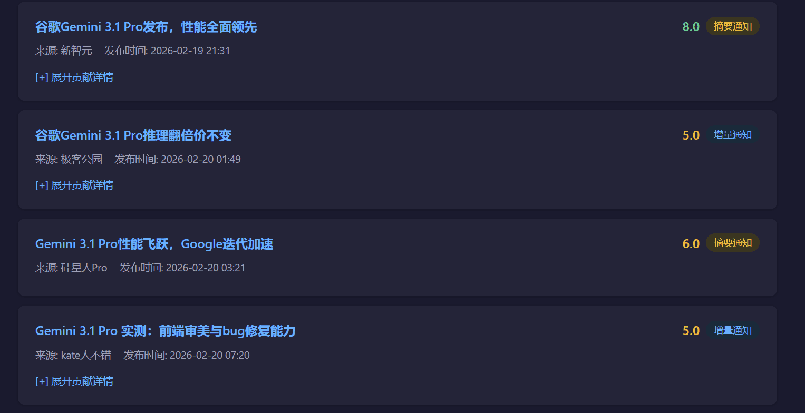

For collection, the system connects to several kinds of RSS sources:

- RSSHub subscribes to updates from Bilibili, Xiaoyuzhou, and niche platforms
- YouTube officially supports XML subscriptions by Channel ID (the format is `https://www.youtube.com/feeds/videos.xml?channel_id=xxx`), which needs no third-party service and is stable and reliable. For YouTube videos, the system first tries to extract the platform's subtitles. If there are none, it goes through a download-then-local-transcription flow.
- WeChat to RSS converts WeChat official accounts into RSS for reading
- General podcasts natively support the RSS protocol, so the audio can be downloaded directly
- Newsletters are converted to RSS with the Kill the Newsletter service

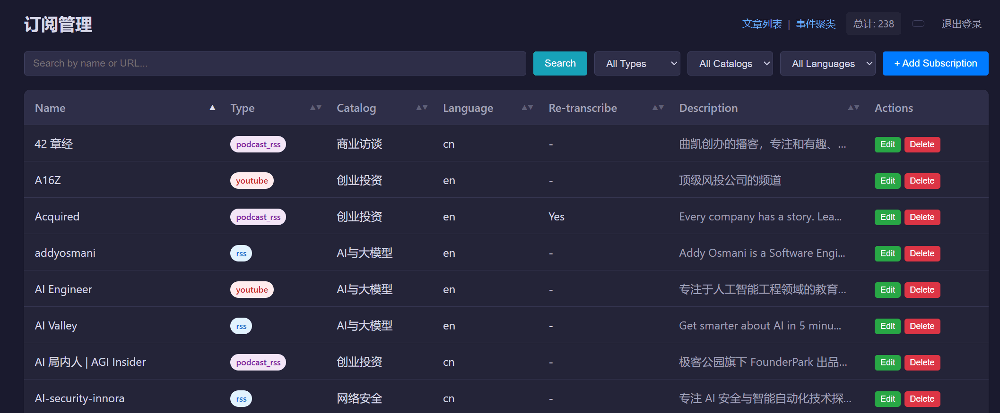

All filtered content is stored locally in Obsidian as Markdown, and pushed by bots into different WeCom (WeChat Work) or Feishu group chats for easy reading and later sharing. The system also has a companion web version where I can view content, summaries, and abstracts, and quickly push valuable information into Memo for unified storage.

One more observation: after processing this many articles, I feel even more strongly how much content sources matter. For some sources, seven or eight out of ten items are valuable. For others, it might be only one or two. Prefer paid sources. For free ones, pick those with firsthand information whenever possible. Conversations and interviews in particular hide more breadcrumbs.

#### On Choosing a Channel for Consuming Content

Here's a brief comparison of the different ways of consuming content:

- Obsidian: Well suited to reading and processing on a computer, but the mobile client experience is mediocre.
- WeCom and Feishu: Both natively solve offline data storage and multi-device sync. But objectively, Feishu's reading experience beats WeCom's by a whole tier.
  - WeCom has simple features and can't sync reading progress across devices. The Android bot also has styling bugs that went unfixed for months after I reported them. The reading experience on tablets is mediocre too. Apart from conveniently sharing content to WeChat, it's useless.
  - Feishu does reasonably well on reading experience alone, but integrating it with my current system is awkward. I send content using the Feishu Card 2.0 format, and when I forward that content to a Feishu bot for post-processing, the bot can't read it. Still, I'd recommend Feishu first as the place to send content.
- Web: I may need to post-process pushed content, for example saving it to Memo. But because of IM platforms' API limits, many things can only be done on my own web pages. The web version mainly makes it easy to copy text into third-party LLM tools for further questions, and also to view clustered topic articles merged together.

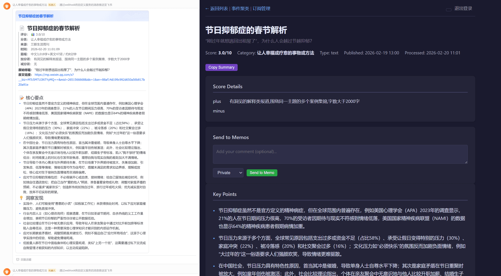


### rss2im: Filtering Short Social Media Posts

The processing flow above is designed for longer articles and doesn't suit short posts on social media. But the idea carries over: I can reuse the same scoring and filtering logic on short social media posts, currently mainly Twitter. Updates are subscribed via RSSHub, filtered, and pushed to IM. It can also work together with the Video Transcript API: subscribe to certain creators' updates and automatically submit transcription requests.

### Video Transcript API: Transcribing and Summarizing Audio and Video

> ⭐ Open source: https://github.com/zj1123581321/VideoTranscriptAPI

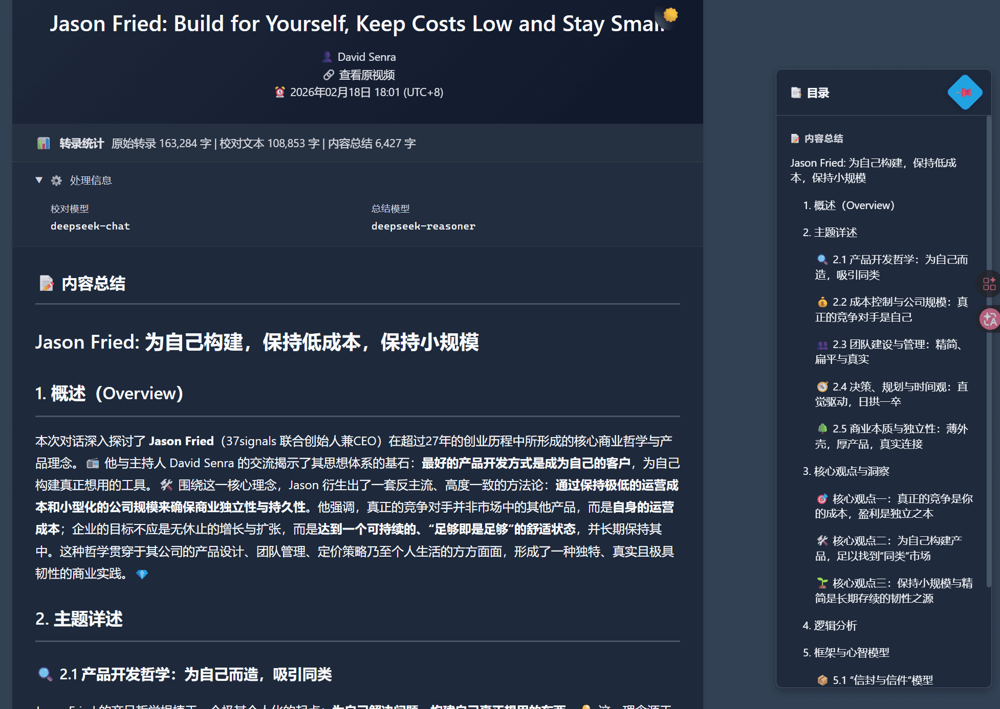

I started writing this tool in April 2025 and have been iterating on it ever since. I use it very frequently.

The original idea was actually simple. I looked at my own content consumption habits and found that I prefer interviews, livestream clips, and case-study talks. In this kind of content, what one or two people say is what matters, and the visuals matter much less.

My first approach was to play all audio and video at 2x or even 3x by default, but that still didn't meet my needs. It was too slow. Also, a lot of my content consumption happens on my phone, where browser plugins aren't that convenient.

I'd also been following ASR tools. But mature commercial ones, because of copyright and compliance concerns, usually make you download the audio and upload it to their servers for post-processing. The whole process is too cumbersome, and on a phone you can't really do it at all.

Later I used CapsWriter, an open-source voice input tool, and found that its architecture can transcribe any audio or video file with no length limit, runs on CPU alone, and is fast with acceptable accuracy. A natural idea followed: automate the whole flow so that I only provide a URL, and the system downloads, transcribes, and pushes the result to an IM platform for me.

Yes, at first there was no LLM at all. It just pushed the raw transcript. The later features all evolved out of actual use:

- Local audio/video transcription tools have limited accuracy and poor readability → introduce an LLM to proofread, using auxiliary information such as title and description
- WeCom bot notifications limit text length, so pushing the full text of a very long interview reads badly → don't push the original text; call an LLM to summarize it and push only the summary, with the original viewable on the web, where a table of contents can also be configured to improve reading
- The CapsWriter transcription engine can't distinguish speakers, and some interviews read better with speakers labeled → there was no mature solution on the market, so I built funasr_spk_server for local speaker-diarized audio transcription
- I wanted to ask follow-up questions based on the raw transcript, but didn't want to maintain a whole system for it, and wanted to make the most of existing LLM memberships → add a parameter to the URL to export the raw transcript directly, so the URL can be pasted into other tools for quick questions
- ...and plenty more; see the Git history for details

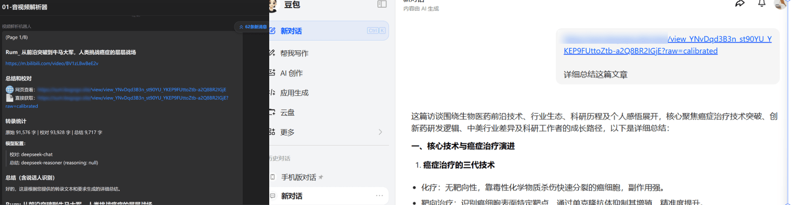

---

Features implemented so far:

**Supported platforms**: YouTube, Bilibili, Xiaoyuzhou, Douyin, Xiaohongshu. Each platform is downloaded differently:

- YouTube goes through my own YouTube Download API (introduced later)
- Bilibili uses BBDown
- Douyin and Xiaohongshu go through third-party APIs like TikHub
- Xiaoyuzhou uses a web crawler

**Dual-engine transcription**: CapsWriter and FunASR.

- CapsWriter doesn't distinguish speakers but is fast, and runs on a consumer-grade CPU (paraformer-zh model)
- FunASR can distinguish speakers, but is much slower without GPU acceleration

**LLM processing** uses a three-layer architecture of coordinator, processor, and core components. The proofreading step fixes homophone errors and normalizes punctuation, and text longer than 5,000 characters is automatically split into segments and processed concurrently (about 2,000 characters each). The summary is generated from the proofread text and supports both single-speaker and multi-speaker modes. If multiple speakers are detected, the system also infers their identities automatically and maps `spk_0` to real names.

The caching system uses a two-layer architecture of SQLite plus the file system, avoiding repeated processing and cutting costs.

The LLM summary supports any OpenAI-compatible API, and proofreading and summarizing can use different models to reduce cost. A custom Webhook address can be set for sending to any chosen group chat. There's a web interface for sharing links and for pasting into other LLMs' web apps for follow-up questions.

Because it's API-based, it can be combined with all kinds of automation software: Quicker on Windows, Shortcuts on iOS and Mac, and Tasker or FV Floating Ball on Android. It can also be combined with other projects I've built.

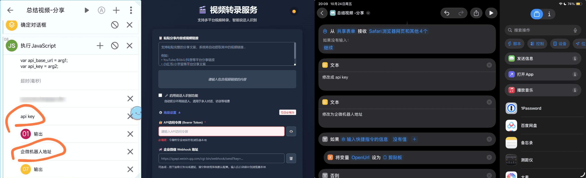

PS: As the big companies push their own AI tools, getting transcripts of short videos has become much easier. Send WeChat Channels videos to Yuanbao, Xiaohongshu to Diandian, YouTube to Gemini, and on Douyin Selected just tap the AI button in the top right.

---

## The Memo Ecosystem: From Notepad to Universal Bookmark Collection

[Memo](https://github.com/usememos/memos) was originally for jotting down fragments of information, and gradually turned into a global bookmark collection. I built two extra tools to extend it.

### im2memo: Making Input Easier

As you can see, I integrate both the AI Information Processor and the Video Transcript API with IM platforms for pushing information. That's become my default habit for new projects, and many tools hook into IM. But I didn't want my saved items scattered across different IM platforms, and switching apps is a hassle. So I connected the IM platforms to Memo.

Three platforms are supported for now: Feishu, WeCom, and Telegram. On all three, I can message the bot directly to create a Memo, with support for text, images, rich text, and voice.

One small design I find very handy: after forwarding content, send `// your comment` right away, and the comment is automatically merged into the same note, with no need to go edit it in Memo separately. On Feishu, directly replying to a message (which carries a `parent_id`) is also treated as a comment automatically, so you don't even need to type `//`. The system has a 10-second aggregator timeout, and all comments sent within that window are merged together.

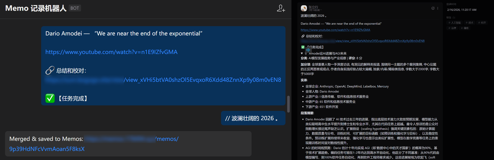

### memo auto: An AI Post-Processing Platform

Saving a note is only the first step. The real value is in organizing, linking, and reviewing afterward. This tool has two parts.

**The first part automatically enriches new notes.** Triggered by a Memos Webhook, a series of workflows runs automatically once a new note comes in:

- Extract URLs in the note, fetch the body content, call the AI Information Processor's summary API to generate an abstract, and write it back into the note
- For Xiaohongshu notes, call an API to pull the related text and images back into Memo
- Run OCR and Doubao image understanding on the images in the note
- Call an LLM to tag the note automatically based on all the above, with a tag registry maintained by the system to keep the tag taxonomy consistent
- Then switch between several "perspectives" and have the AI comment on the note. Some do fact-checking, some do divergent association, and some ask follow-up questions from the opposing side. Multiple perspectives are called in parallel, letting the AI get fairly deeply involved in maintaining all my notes

This part follows my own content consumption habits entirely. If those habits shift later, I'll introduce new workflows and add them to the current post-processing flow.

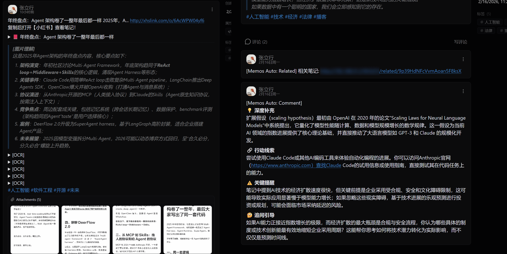

**The second part is related-note discovery.** All notes get Embeddings (text-embedding-3-small) and cosine similarity is computed. A web page shows all the notes related to a given note, and then runs deep insight analysis over those related notes. The idea is borrowed from Flomo.

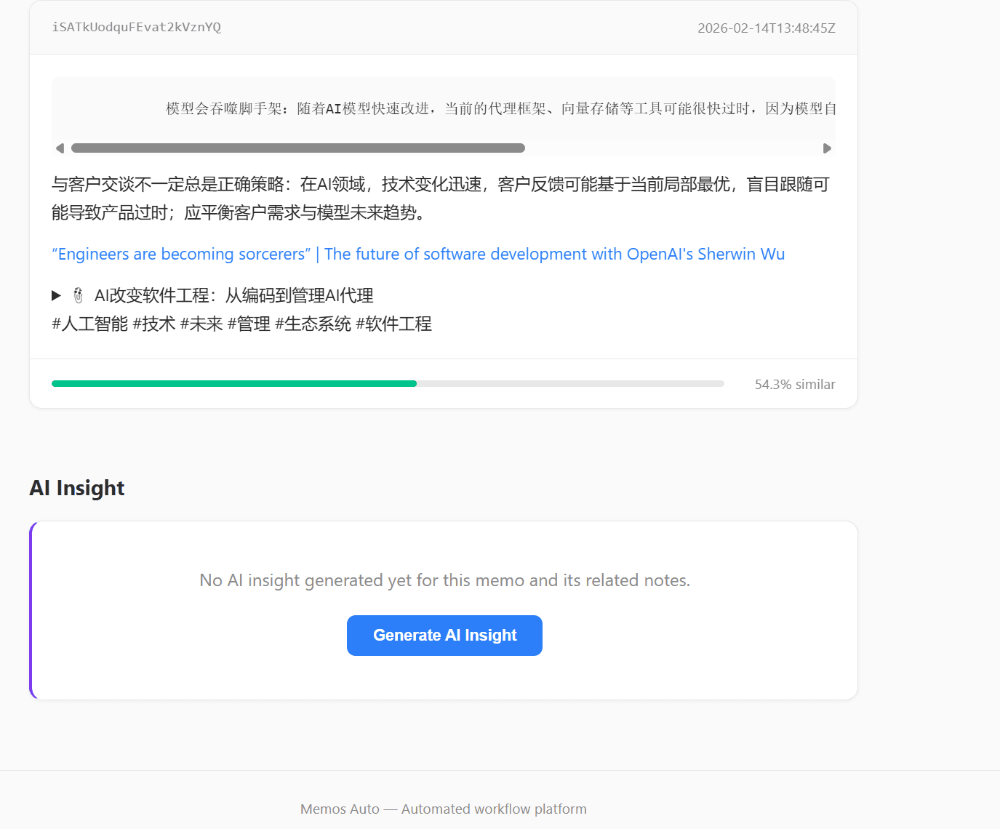

There's also a daily review feature that picks historical notes by some strategy and pushes them on a schedule through WeCom, helping me revisit my past thoughts.

---

## Review and Analysis

### Every Day Analysis: Daily Retrospective

I want to know what I actually do and what I look at in front of my computer every day.

This tool combines ManicTime Server's Timeline data for analysis. The process works like this:

Step one: fetch each device's application activity and document activity from ManicTime Server. The system supports fetching from multiple devices in parallel. PC devices return full application, document, and screenshot data, while phone devices return only app usage, classified by rules without calling an LLM.

Step two: process screenshots. After downloading, deduplicate first. Using the pHash algorithm to compare adjacent screenshots, anything above 90% similarity is skipped, keeping only the screenshots taken at application switches. The deduplicated screenshots go through OCR.

Step three: merge time windows. Activity data is merged into 15-30 minute windows, grouped by application. Windows from multiple devices are merged intelligently at 5-minute intervals, keeping the overlapping parts.

Step four: first LLM summary. It generates an activity description for each time window.

Step five: second LLM summary, the daily summary. It merges all the window descriptions into 3-7 main items.

Then it's combined with the content consumption records synced by Online Video Sync (watch history from YouTube, Bilibili, and Xiaoyuzhou) to understand "what I watched today". There's also LLM analysis of video consumption: content categories, viewing habits, and relevance to work.

Finally, in Obsidian I run a Skill and, using a voice input tool, talk through what I did and thought today, and do a weekly retrospective each week. On my phone I can also complete this flow by connecting through HAPI to Claude Code on my dev machine. The daily review results are synced into my notes through the Obsidian REST API, and a summary in Markdown table format is pushed through WeCom.

The caching strategy for the whole flow is also fine-grained: API data and OCR results for past dates are cached permanently, and LLM summaries can be refreshed separately with `--force-refresh`. Data for the current day bypasses the cache. The whole service runs in Docker, with cron running it automatically at 00:05 every day.

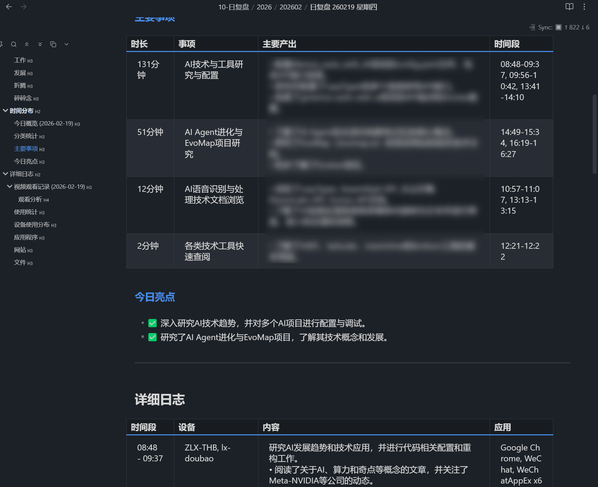

### WeChat Group Summaries

Based on Chatlog Server, this fetches the content of specific group chats through an API. Images are converted to text, article links get summary extraction, and voice is transcribed to text. After all that is processed, an LLM summarizes it, generating local Markdown files and Feishu Bitable records for easy browsing.

However, Chatlog Server was sued by Tencent and its repository taken down, so it's no longer maintained, and newer WeChat versions can't be supported. Still, as AI coding agents get more capable, local reverse engineering will become easier too. Perhaps I'll maintain a solution of my own later.

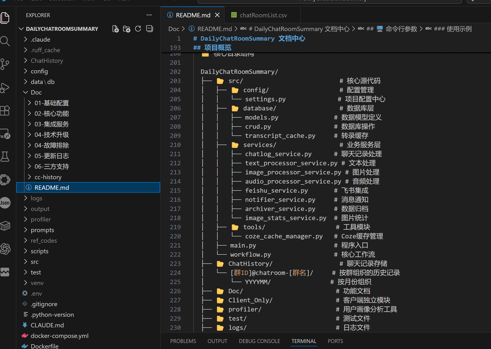

---

## Auxiliary Tools

The next two tools are relatively independent. They don't process information directly, but supply data to the systems above.

### Online Video Sync: Syncing Audio and Video Consumption Records

> ⭐ Open source: https://github.com/zj1123581321/online-video-history-server (enhanced fork)

Every day it automatically syncs my YouTube, Bilibili, and Xiaoyuzhou audio and video consumption records to a server. It does no processing at all. It just dutifully pulls the data down and stores it, so Every Day Analysis can use it during the daily review.

I built this by modifying an open-source Bilibili history sync project.

YouTube history sync can't be done with Cookies alone and requires an external Chrome CDP. It also can't get the exact playback time of each video, so it uses the time of the scheduled query as the playback time. That's good enough for my own purposes.

Xiaoyuzhou history sync has a higher barrier. It requires capturing packets on a phone, and Android needs Root (I haven't tried iOS). Worse, Xiaoyuzhou's API responses contain no field related to playback date at all, so I can only use the time the script runs as the listening time for the podcast.

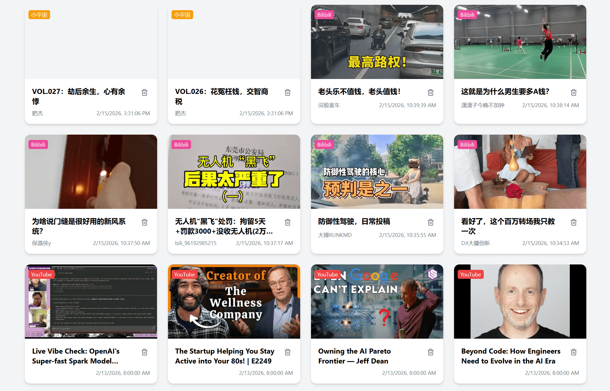

### Obsidian Clip API: Web Clipping

> ⭐ Open source: https://github.com/zj1123581321/obsidian-clip-api-couchdb

Given a URL, the system automatically fetches the body content, downloads the images in it and uploads them to my own image host, then calls the AI Information Processor's summary API to summarize it, and finally stores everything in Obsidian. It's effectively an automated web clipper.

It needs a machine running Obsidian 24 hours a day, with the Local REST API plugin installed to expose an API.

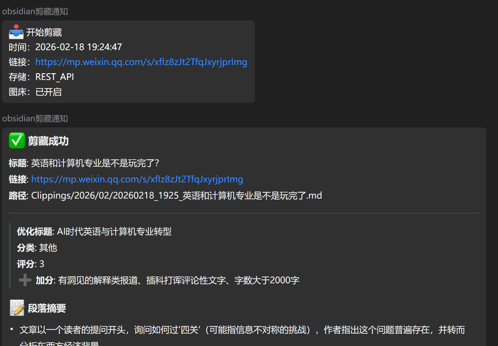

---

## Base Component Layer

This layer consists of relatively independent services that the systems above call repeatedly. Their value is that they can be freely combined. For example, putting ASR, OCR, and image understanding together gives you a multimodal understanding tool for local video (I built one myself to analyze local videos and produce structured text records). They fall into four categories by function.

### Image Processing

**MacOcrAPI** ([open source](https://github.com/zj1123581321/MacOcrAPI)): An API service wrapping the Mac system's native OCR capability. Call volume is high, and running it locally has no extra cost. It's connected to an LLM, and you can choose whether to call the LLM to format the output as Markdown. From my own experience, formatting matters if the text is for humans to read. But if it's for an LLM to read, having coordinate information and the raw text is enough for it to infer the rest more or less.

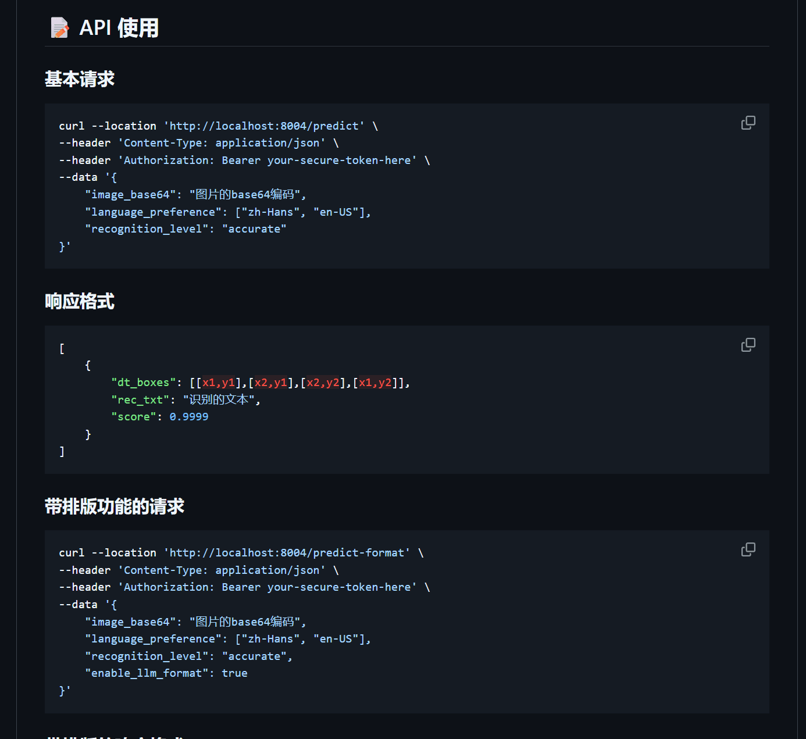

**Image understanding**: An API combining the Doubao lite model (cloud-based, cheap and good enough) with a local Florence-2 model. Florence is mainly used for image captioning, supports several caption modes (brief, detailed, more detailed), and has a SQLite cache (180-day expiry by default). At high call volumes it saves a lot of cost compared with cloud multimodal models.

A bit more on this: although many on-device VL models can now run on a local Mac, their processing time and concurrency just can't be integrated into my existing workflow. So I chose an ancient image understanding model (Florence-2). Its capability is weaker and it only outputs English, but its speed and concurrency are barely usable.

### Audio and Video Processing

Two local ASR engines complement each other, both running on a Mac Studio:

**FunASR_spk_server** ([open source](https://github.com/zj1123581321/funasr_spk_server)): Can distinguish speakers, suited to interviews and conversational content. It's very slow without GPU acceleration, with an RTF (transcription time / original audio duration) of about 1/3 depending on CPU clock speed. With MPS acceleration (a Mac advantage), the RTF is about 1/10.

In my own testing, normal transcription uses about 10G of Mac unified memory. So with only 16G of RAM, running a single thread is probably the right call. On my 64G Mac I run three threads day to day, with a queue mechanism added, which basically covers my daily workflow.

The accuracy of speaker distinction isn't that high, because real audio may have several people talking at once. Accuracy is usually higher for conversations with clear back-and-forth and clean turn-taking.

A bit more on this: after using it for so long, speaker-diarized transcripts do help the LLM's summarizing and proofreading, but only to a limited degree, because the LLM can infer from context who said what, with the occasional small error that doesn't affect the whole. Speaker distinction mostly improves our own reading experience, making the text more comfortable to read.

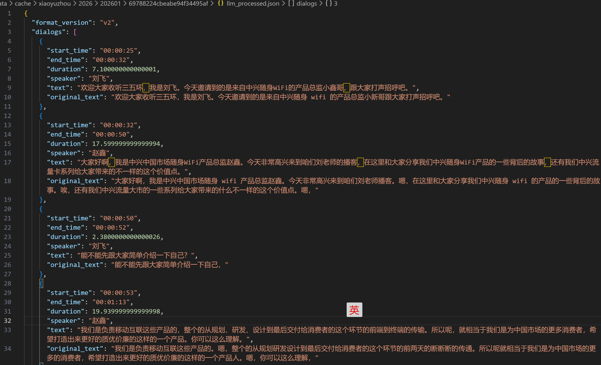

**CapsWriter** ([open-source project](https://github.com/HaujetZhao/CapsWriter-Offline)): Doesn't distinguish speakers, runs on CPU alone, with an RTF of about 1/20, so it's faster. Suited to single-speaker content.

Although the author's recent update introduced the FunASR-Nano model, I still recommend going back to the old paraformer-zh model for long-audio transcription. The new model is more accurate, but may be very slow on CPU, and may have unknown bugs that cause the flow to break off midway.

More importantly, local audio and video transcription has an accuracy ceiling. And now that we have LLM APIs, we can use more contextual information to raise transcription accuracy cheaply through an LLM. For local audio and video transcription, I think the approach is to have a base model produce a roughly right result and then call AI to proofread it, which gives very high readability.

If you need Cantonese, Korean, or Japanese, you can switch to the SenseVoice model, at the cost of lower accuracy for Chinese and English.

If you demand the highest possible local transcription accuracy, I'd still recommend [using the Whisper large model](https://sspai.com/post/83644).

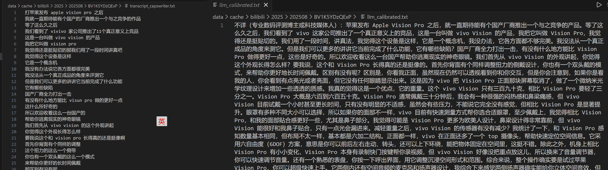

### Content Acquisition

**[CDP Chrome](https://chromedevtools.github.io/devtools-protocol/)**: A Chrome instance with Remote Control enabled, deployed on the Mac Studio. It doesn't use headless mode, in order to imitate real human operation as closely as possible. It stores account login information, making web browsing and data scraping easier. For sites with strict risk control, this is the safest approach. It's currently used mainly for batch downloading YouTube videos and scraping Twitter posts, and also lets OpenClaw operate web pages.

**YouTube Download API** ([open source](https://github.com/zj1123581321/youtube_download_api)): A dedicated download service built on top of CDP Chrome.

I download dozens of YouTube videos every day, and have for quite a while. My earlier approaches based on third-party parsing APIs or yt-dlp got flagged by Google's risk control, and every download URL returned a 403 error. So I built a download service that imitates a real user.

The implementation is a three-level fallback. It tries CDP first (the real browser with a logged-in account's cookies, fingerprint, and random human browsing behavior, which lowers the 403 risk), then falls back to yt-dlp (free and powerful), and finally to the TikHub API (stable and unaffected by rate limiting, at about 0.002 USD per call). TLS fingerprint emulation and a PO Token mechanism are added to get past risk control. There are also smart circuit breakers: independent breakers at the downloader level and the IP level, with passive probing and tiered tripping, to avoid being banned outright.

Audio downloads support M4A/WebM at 128kbps. Subtitle extraction outputs JSON, choosing by the priority zh-Hans > zh-Hant > zh > en. A file-level cache lets the resources of the same video be shared across tasks. Expired files are cleaned up automatically after 60 days. It also supports manual upload: when some video really can't be downloaded, I can download it manually with IDM and upload the audio or video, and the system packages and processes it automatically.

It supports the video download needs of both upper-layer systems, the AI Information Processor and the Video Transcript API.

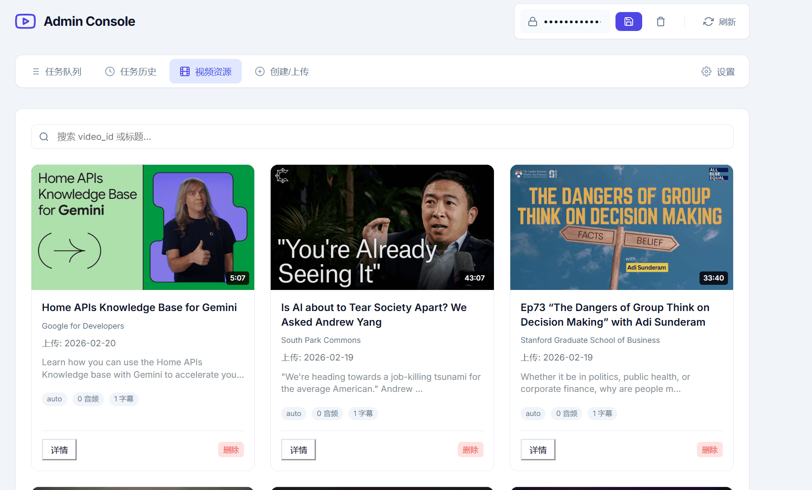

### Text Processing (LLM)

**[OneAPI](https://github.com/songquanpeng/one-api)**: Unifies API calls to all LLMs under OpenAI's request format, making it easy to switch models directly in each application. Every place mentioned above that calls an LLM (scoring, summarizing, proofreading, commenting, insight) is routed through OneAPI.

---

## Base Software Layer

### Obsidian

Everything is Local First. All content ultimately settles as local Markdown, which is easy for LLMs to process, and various Skills can be run inside it for post-processing. In my system, Obsidian is both the final resting place of information and the workbench for daily and weekly reviews.

### Voice Input

On the computer: [LazyTyper](https://lazytyper.com/) (Volcano Engine, the same voice input API as Doubao) plus CapsWriter (which I've modified myself with some AI post-processing, though I'm gradually switching over to LazyTyper), with a DJI Mic Mini for audio capture (connecting the receiver is recommended to reduce latency).

On the phone: the Doubao input method. Right now, apart from its high voice recognition accuracy, Doubao's input method is honestly quite basic. Still, its voice accuracy is much higher than WeChat's input method, especially for very long audio. The WeChat input method feels like it uses something LLM-like, and often produces repetitive, meaningless content.

The draft of this article was itself written through voice input.

### Networking: Tailscale + Cloudflare Tunnel

Networking has two parts, and both products are free, so I haven't had to pay anything extra.

#### Tailscale

I recommend enabling Tailscale's [Subnet](https://tailscale.com/docs/features/subnet-routers) feature. That way, for services on the internal network, even across remote locations you can access the original IP directly, without having to record Tailscale device IPs separately.

Tailscale recently added the [peer relays](https://tailscale.com/blog/peer-relays-ga) feature, so you can set up a server to speed up cross-location networking.

#### Cloudflare Tunnel

A godsend for tunneling into the local network. It handles HTTPS and some security issues automatically, has no usage limits, and offers enough bandwidth for API and text workloads.

That said, when it comes to networking, **don't expose anything to the public internet if you can avoid it**. Tools written by AI in particular have far too many vulnerabilities. For any service you do want to expose publicly, I suggest having AI run a deep security check.

### [HAPI](https://github.com/tiann/hapi)

Connect to the Coding Agents on your dev machine, such as Claude Code and Codex, from anywhere. It makes it easy to develop on your phone wherever you are, so even fragments of spare time can move a project forward.

It's far more convenient than tools like Happy, and the web version is naturally cross-platform. What made this Spring Festival holiday so different was that in the gaps between visiting relatives and friends, I could connect remotely to my development environment to fix bugs and add features, which was great.

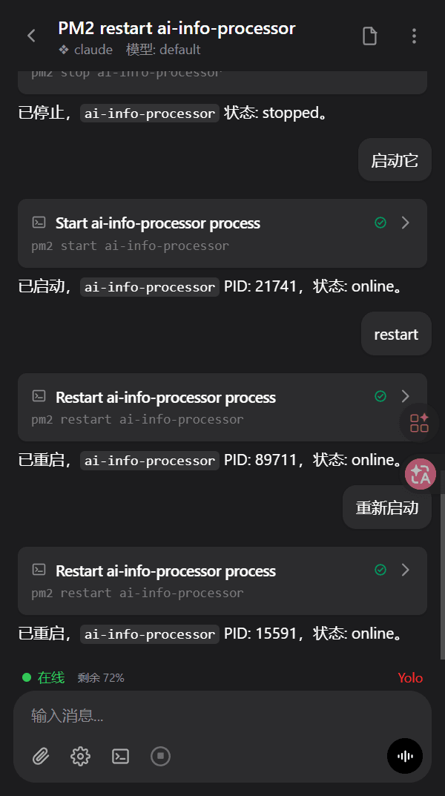

### [ManicTime](https://www.manictime.com/)

On Windows and Mac it records what you do on the computer, uploading to the Server as a Timeline plus periodic screenshots. On phones, Android usage data can be uploaded directly. It's the core data source for Every Day Analysis.

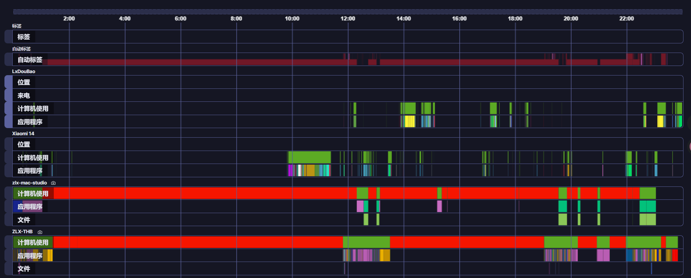

### [Ferdium](https://ferdium.org/)

It lets you pin many web pages as always-open apps. You can think of it as a Chrome browser that can only open specific pages, and it's ideal for people with several AI account memberships who want to switch between them to ask questions. The ones I use most are Doubao, ChatGPT, Gemini, Claude, Todoist, Memo, and NotebookLM.

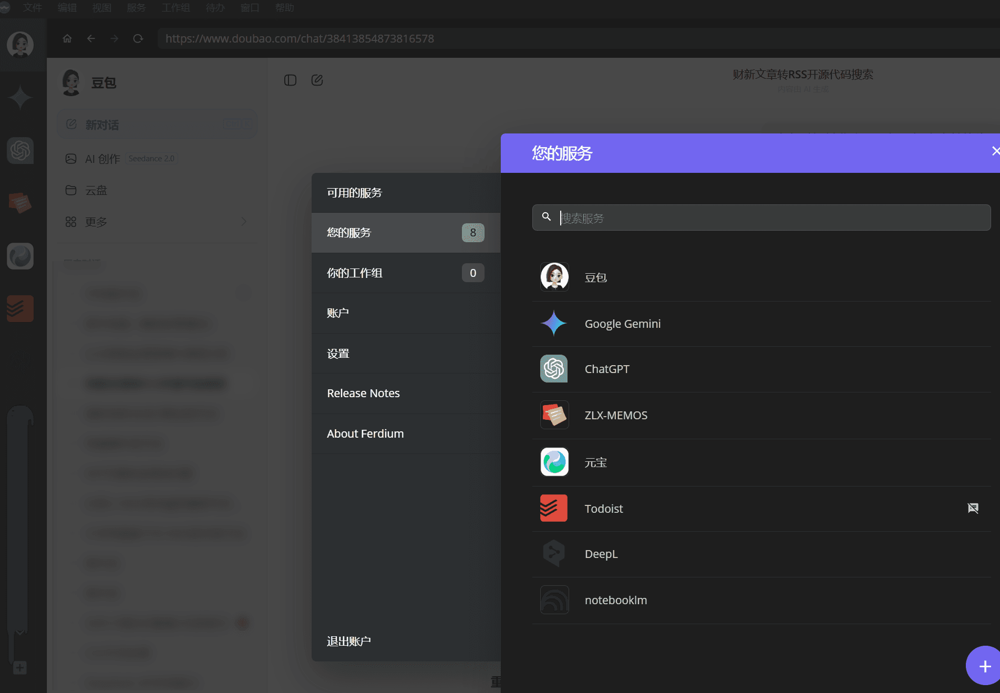

### NotebookLM

A great tool for topic-based learning. All the local Markdown files produced above can be uploaded into it for unified processing, for deep topic learning and knowledge organization.

My most common use is to collect all of one person's historical articles and statements, organize them into Markdown or PDF, and upload them to NotebookLM. That gives you a digital twin of them, and you can ask questions of someone you respect at any time. For content sources, there are tools or APIs to bulk-export from WeChat official accounts, Weibo, and X, and at worst you can have AI drive a browser to scrape the history.

I'd also recommend [notebooklm-py](https://github.com/teng-lin/notebooklm-py), an unofficial NotebookLM API that can automate the flow above and combine it with your own tools.

---

## Base Hardware Layer

### Mac Studio M1 Max 64G+1T

The US version cost under 8,000 RMB, basically half the official price. Its large unified memory can run many services, and it has MPS acceleration. Nearly all the compute-intensive base components run on it: MacOCR, Florence image understanding, the FunASR and CapsWriter transcription engines, and the CDP Chrome instance. It runs 24 hours a day with very low power consumption.

### 32G NAS

It handles services that run long-term, with modest compute needs but heavy memory use. It complements the Mac Studio: the Mac Studio provides compute, and the NAS keeps things always on. (If you maintain your own hardware, remember to buy a UPS to prevent a power cut from blowing things up.)

### DJI Mic Mini

Used with voice input on the computer. The experience of voice input depends heavily on audio capture quality, and a good microphone noticeably reduces recognition errors. It also lets me whisper in the office without it being too embarrassing.

---

## A Few Thoughts

### In an Age When Words Become Code, Voicing an Idea Is Like Open-Sourcing the Code

For small and mid-sized tools, voicing an idea is basically the same as open-sourcing the code. So for basic components that everyone can share, I just open-source them, so people don't waste time rebuilding them. But for highly personal workflow software, I only share the ideas. You can throw this article at an AI and, together with your own needs, work out an architecture that suits you.

That's the original purpose of this article. You don't need to use the same tools as I do, but you can use similar ideas and let AI help you grow your own set.

### AI First

When you have a question, ask AI first. When you have a need, bring it to AI first. **I only want to answer questions that AI can't, in this article and everywhere else.**

### Insight into Needs and Taste Matter Most

This is an age where insight into needs and taste matter most. And only you know your own needs best. So in principle, you can grow software that's uniquely yours.

The technical barrier has dropped dramatically in the AI era. You used to need to write code to turn an idea into a tool. Now you only need to describe your needs clearly and AI can build it. The real barrier becomes whether you know clearly what you (the target customer) actually need, and your taste for what counts as "easy to use".

### Skills for Fast Validation, Engineering for Stability

For short-term experiments, or when there's a lot of semantic judgment in the middle of a process, use a Skill first to get the flow working quickly. But if you want stability and high concurrency, I recommend engineering the whole flow. That keeps output stable and also cuts Token consumption substantially, without eating into your precious Coding Plan quota.

Many of my own tools evolved this way: first validate the idea with a Skill, and once it works, have AI write it into a proper service.

### Context not Control

This phrase matters even more in the AI era. Sufficiently clear Context, like the capability of the model, has a very significant effect on output quality.

If you want AI to be deeply involved in your life, then digitize everything that can be digitized as fully as possible. Daily work activity, health data, and environmental data can all be fed to it. That's why I built tools like the daily review, ManicTime activity recording, and video consumption sync. At bottom, they're all about giving AI fuller Context.

### The Time Saved by Top Models Matters Far More Than the Money Saved on Tokens

Unless you have special requirements, such as in finance or security, tinkering with local LLMs doesn't mean much for most people.

Two reasons. First, top models have capabilities no other model can match. Working with a top model, the time you save is far more important than the few bucks saved on Tokens. Weaker models can make directional mistakes, and the back-and-forth ends up costing more time.

Second, objectively, the interaction data between most ordinary individuals and an LLM has little commercial value. Of course, don't upload sensitive information like keys.

### Use APIs as Much as Possible

Two points. First, when building a project, prefer calling external APIs for fairly complex problems, such as the risk control of various platforms. That's much less hassle than handling it yourself, and you can swap in a backup option at any time.

Second, the services you host yourself should also expose as many APIs internally as possible, so they're easy to integrate into other projects. My own tools can call each other (the AI Information Processor calls the YouTube Download API to download videos, and memo auto calls the AI Information Processor's summary API to enrich URLs), largely because every service exposes an API.

There's an extra benefit too: when every service exposes an API, you can wrap them into Skills and hand them to an AI agent like the Lobster (OpenClaw). It then gains the ability to handle all kinds of content formats and can go surf the web on your behalf. That's an important reason I suggest providing services as APIs whenever possible.

### Heavy AI Filtering Also Needs to Feed Back into the Recommendation Algorithm

After bringing in AI tools to process content for me, there's a side effect: I consume a lot of valuable content through transcripts and summaries, so from the platform server's point of view, the completion rate and engagement on that content look poor. Over time, the recommendation algorithm concludes you aren't interested in that kind of content, and recommendation quality actually declines. So I also need to deliberately do some things now and then, such as liking, watching all the way through, and commenting, to tell the system I approve of this content, and to help creators spread a bit further.

If the content source has a web version, it's relatively simple: let Chrome CDP imitate human operation to consume the content. But if there's only a phone client, it comes down to your own discipline.

### LLMs Swallow Everything

A clear trend is that LLMs swallow everything. I've canceled many software subscriptions.

Specifically, I unsubscribed from Flomo, because with my own Memo plus im2memo plus memo auto ecosystem, the features fit my needs and positioning better than Flomo's.

I unsubscribed from Inoreader and Readwise, because the AI Information Processor already covers RSS reading and content filtering, and adds things a generic RSS reader can't do, like scoring-based filtering and event clustering and deduplication.

I unsubscribed from some paid audio and video summarization tools, because the Video Transcript API can fully replace them, and even when I occasionally want a nicer UI, I can just use Tingwu's free quota.

But while saving these subscription fees, my non-Coding API calls now average seven or eight million Tokens a day. So in cost terms it's gone up rather than down, though from an ROI perspective it's still worth it.

A few more points about Token consumption:

- I've collected some LLM pitfalls and cost-reduction engineering lessons in [this document](https://github.com/zj1123581321/VideoTranscriptAPI/blob/main/docs/development/llm/engineering_guide.md).
- Most LLM billing is per million Tokens, so the number looks startling. But converting it to money with a million as the base, burning 1 million Tokens a day on DeepSeek costs only two or three yuan.
- Token consumption by Coding Agents and by APIs in engineering projects differs by orders of magnitude. Developing a new project or running a complex Skill, a Coding Agent can easily burn tens of millions or hundreds of millions of Tokens, and that's when context management is done fairly well. So I suggest abstracting shared methods into tool API calls to cut costs.
- Objectively, in the future each person's Token consumption will, to some extent, reflect their leverage. Conversation can't consume many Tokens. Only when more tools and agents run 24 hours a day does a person's Token consumption go up. Token consumption is ultimately an intermediate metric. A person's own problems are finite, and only when you start solving problems for more people does Token consumption truly pull ahead.

---

## Final Words:

At this point in 2026, with AI and robotics advancing, the future has arrived—just unevenly distributed.

Much of the underlying operating logic and value definitions of human society are being thoroughly reconstructed, with an intensity far beyond the last industrial revolution.

I wrote this quickly to share these ideas while they still have some value.

I have much more to say, but there are so many threads that I don't know where to start. So let me end with Faye Wong's song from this year's Spring Festival Gala.

```
A century is a long river, and this is only one moment we are living through together.
We have been here since a time far beyond our memory.
```

---

> The draft of this article was done by me through voice input, with the framework design and proofreading done in collaboration with Claude Code. Cover image: generated by Nano Banana Pro.
