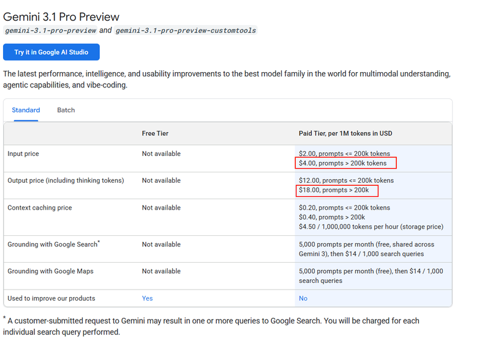
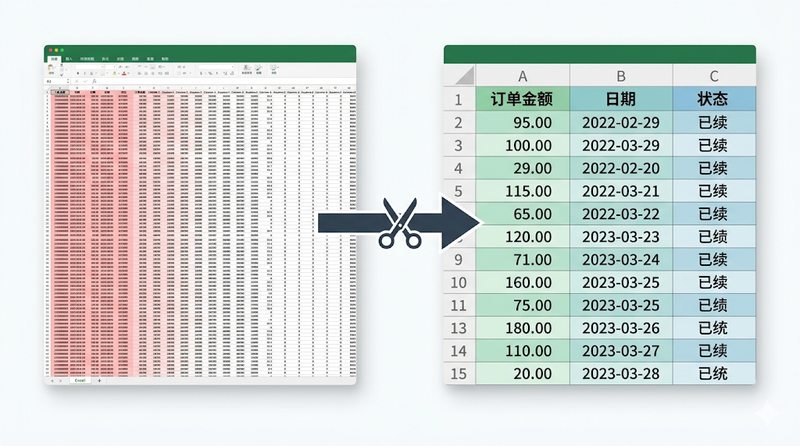
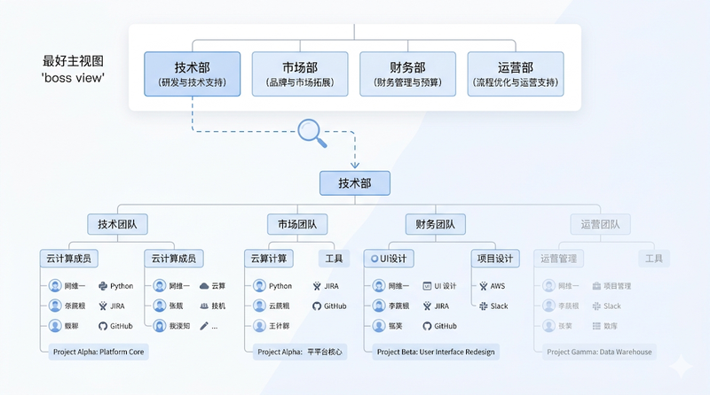
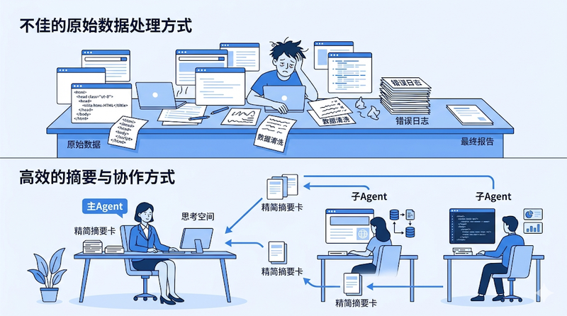
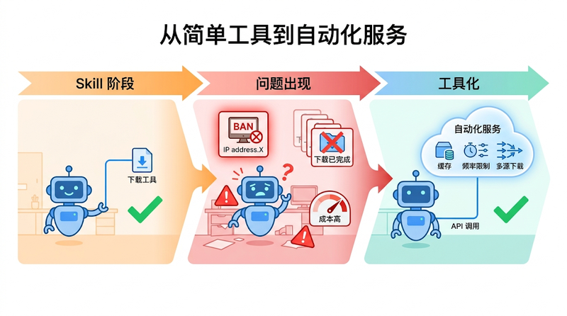
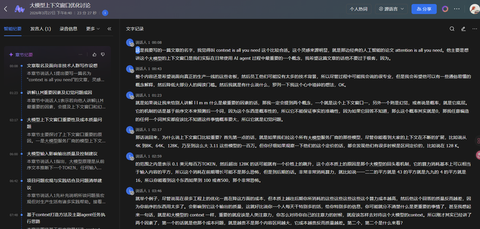
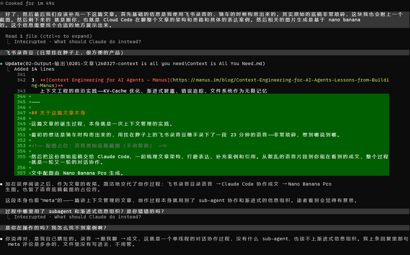

*Translated from the [Chinese original](/posts/context-is-all-you-need/).*

> **Description:** The AI starts acting dumb mid-conversation, a Skill's success rate swings up and down, you copy someone else's setup and can't reproduce their results—these problems often share one root cause. Understanding the context window is the first lesson in using any AI tool well.

> Treat your AI's context the way you treat your most precious attention.

---

## Preface: You've Probably Run Into These Problems

- After twenty-odd turns with the AI, it starts contradicting itself, and even forgets what you said five minutes ago
- You have an Agent run the same workflow: sometimes it passes on the first try, other times it fails for no obvious reason
- You throw a big chunk of data at the AI for analysis, and it answers off-topic, or the analysis is complete nonsense
- The same Skill gives completely different results on a different model; the same model succeeds this time and fails the next
- A Skill that used to work fine starts failing after you install more Skills
- You copied someone's Agent configuration and project setup in full, yet the actual results are miles away from the demo
- The AI assistant of Meta's director of safety **deleted all of their emails**—because the conversation was so long that the safety constraints were lost when the context was compressed

If you've had similar experiences (or worry something similar could happen to you), this article may help you find the root cause.

These problems look wildly different, but they often point to the same cause—the **Context Window**. Simply put, it is the AI's "working memory": the total amount of information it can "see" at the same time when answering you. This space is limited, and far more fragile than you might think.

Understanding the context window is the key to understanding every AI tool today. Whether you're using ChatGPT or Claude, or building your own Agent automation workflows, this concept is the unavoidable first lesson.

---

## Harness Engineering: Why I'm Not Chasing the Latest Trend

The hottest direction in the industry right now is **Harness Engineering**—its goal is to let AI systems correct course and iterate on their own, minimizing human intervention throughout. It includes multiple pillars such as context engineering, architectural constraints, and automated entropy reduction, and it is indeed a very promising direction.

But frankly, even the very best teams are still in the exploration stage. OpenAI claims that in some internal systems, 90% of the code is written by Agents with no human involvement, but that is still a long way from something ordinary people can directly reuse in their daily work.

And if you take Harness Engineering apart down to its foundations, you'll find that its **first pillar is context engineering**—feeding the right information to the AI in the right way. So rather than chase a top-level framework that is still evolving, it's better to thoroughly understand the lowest layer first. Once the foundation is solid, understanding the superstructure later gets easier.

This article focuses on exactly that foundation.

---

## A Metaphor Throughout the Article: Your Workbench

To make what follows easier to understand, let's first establish a metaphor—**think of the AI's context window as a workbench**.

- A workbench has limited surface area (the context window has an upper limit)
- The more stuff piled on the bench, the harder it is to find the key materials (noise degrades output quality)
- The bigger the bench, the higher the rent—and it doesn't grow linearly (the cost problem)
- The smart approach is to sort and file materials into drawers, and take them out only when needed (progressive disclosure)
- Dirty, tiring work can be handled by an assistant at another bench, who just hands you the result (Sub-agent isolation)
- Manual work repeated every day should be turned into a machine that runs automatically (turning workflows into tools)

Every methodology that follows can be understood by coming back to this workbench.

---

## Why Does Context Matter So Much?

### 1. Quality: Every Piece of Information You Stuff In Affects the AI's Judgment

A large model works by predicting the next output based on all the preceding text. This means **every piece of input—useful or not—influences the direction of the output**.

This also explains a common puzzle: the same Skill can give completely different results when driven by a different model; even the same model on the same task may succeed this time and fail the next. That's because large models are fundamentally probabilistic—they aren't "executing instructions," they're "predicting the most likely next step." Any subtle change in the context (a different conversation history, a different loading order, even a different timestamp) can tip the probabilities in a different direction. **This isn't a bug; it's how the thing works.** What you can do is make the signals in the context clear enough that the "correct next step" becomes the overwhelmingly most probable one.

This isn't a theoretical worry; there's real data behind it.

**A positive example:** While optimizing their Slack integration tools, Anthropic found that the concise version of a response used only **1/3 of the tokens** of the detailed version, yet the Agent completed tasks just as well. Cutting two-thirds of the information did not reduce quality—because the information that was cut was noise to begin with.

> *"Tools should return only high signal information."*
> —— [Writing effective tools for agents, Anthropic](https://www.anthropic.com/engineering/writing-tools-for-agents)

**A negative example:** GEO poisoning—"black-hat SEO" aimed at AI search. This year's 315 Gala (China's annual consumer-rights TV program) already exposed the problem: many large models now call search engines to get up-to-date information when answering, and some people exploit this by flooding search results with junk content—keyword stuffing, fake reviews, mass-generated low-quality pages—to push their own products to the top of the rankings. When the AI pulls this junk into its context during search, it gets misled and earnestly recommends this low-quality content to users.

**This is essentially "poisoning" the AI's context.** The quality of the information in the context directly determines the quality of the output. Garbage in, garbage out.

Back to the workbench metaphor: every extra scrap of waste paper on the bench makes it more likely you grab the wrong material.

### 2. An Amplifier of Hallucination: The More Noise, the More the AI "Makes Things Up"

If you've used an AI coding assistant (such as Claude Code), you may have a feel for this: early in a conversation the AI performs very well, with clear thinking and accurate execution. But when context usage reaches seventy or eighty percent, the error rate clearly rises later on—it starts generating function names that don't exist, and mixing up logic from different files.

The model hasn't gotten dumber. The context has simply accumulated too much information—useful, useless, and outdated all mixed together—and the model finds it harder and harder to tell what matters most right now. So it is more likely to "find" nonexistent connections in the noise, and to earnestly fabricate content that looks plausible but is completely wrong.

An extreme case: when Meta's director of safety was using an AI assistant to handle email, the assistant **deleted all of their emails**. The reason wasn't that the model "went crazy." During a long conversation, the context window filled up, and when the system compressed the conversation history, it lost the critical safety-boundary instructions—constraints like "don't delete emails" and "confirm before acting" were discarded as unimportant information during compression. With its "brakes" gone, the AI naturally caused a disaster.

This case points to a serious issue: **context affects not only answer quality but also the safety boundaries of AI behavior directly.** When there isn't enough room in the context, the first things to be sacrificed are often not the task itself but the rules and restrictions you thought were "already set."

**Keeping the context clean is itself one of the most effective ways to reduce hallucination and hold the safety boundaries.**

Back to the workbench metaphor: when the bench is piled high with materials from every project, you're more likely to mistake Project A's data for Project B's—and you might even clear away a "must never be thrown out" document as waste paper.

### 3. Cost: Double the Content, Possibly Quadruple the Bill

Beyond quality and safety, context management directly affects your wallet.

When a large model processes information, it has to "cross-check" each piece of current content against everything that came before. So as the input grows, the computation doesn't grow linearly but approaches quadratic growth:

| Input size | Computation (approx.) |
|--------|---------------|
| 1 | 1 |
| 2 | 4 |
| 3 | 9 |
| 10 | 100 |
| 100 | 10,000 |

The growth looks modest at first, but it becomes frightening later on. This is also why model pricing often has "tiers"—for example, one price up to 200K tokens, and a jump in price beyond that.

Although engineering optimizations keep driving down this cost, the underlying math hasn't changed. **Every extra piece of content you put into the context costs more than you think.**

In other words, trimming the context doesn't just make the AI answer better and more safely—it also saves real money. That's three wins in one.

Back to the workbench metaphor: double the bench area, and the rent doesn't double—it multiplies several times over.

---

## Practical Methodology: How to Manage Your "Workbench"

The above covered the "why"; now for the "how."

The five levels below run from simple to advanced. Anyone can start using Levels 0-2 today; Levels 3-4 may require some technical background or team support.

### Level 0: Keep the Conversation Clean—Learn to "Switch Benches"

The simplest optimization: zero cost, immediate results.

**One task, one conversation.** Don't have the AI draft a plan, then modify code, then translate, then analyze data all in the same conversation. Every new task direction deserves a fresh, clean conversation.

If the new task needs some background from the earlier conversation, don't hand over the entire history. Instead, **summarize the key conclusions in a few sentences** and bring them into the new session.

The principle sounds simple, but many people's habit is to keep chatting in a single conversation forever. If you work alone at your desk all day, your efficiency drops noticeably by four or five in the afternoon—the AI's context works the same way.

### Level 1: Filter Noise—Don't Pile Junk on the Workbench

Context space is precious, and every piece of content put in should deserve its place there.

**Case 1: Filter first, then feed**

You ask the AI to analyze this month's orders, and the system exports an Excel file—50 columns, 3,000 rows. But all the AI really needs may be just 3 columns: "order amount, date, status."

If you throw all 50 columns at it, you not only waste precious context space but may also let irrelevant fields lead its analysis astray—for example, it might spend a lot of space analyzing a field like "tracking number" that means nothing to you.

**Filter first, then feed—that is the simplest optimization.** The principle applies in every scenario: before showing data to the AI, ask yourself one question—"How much of this information does it actually need?"

**Case 2: Trimming API responses**

If you're building an Agent automation workflow, the data your endpoints return often far exceeds what the AI actually needs. For example, an order query endpoint returns 3,000 lines of JSON, 90% of which is repeated array structure and low-level identifiers the AI doesn't need at all.

The right approach is to give the AI a **concise description of the data structure**—which fields exist, what each field means, and what the structure looks like—rather than stuffing in all the raw data. This way, the 90% of useless repeated information can be compressed away entirely, and the AI's understanding of the data actually becomes more accurate.

**Case 3: Filtering command output**

If you use an AI coding assistant, compile logs and test output easily run to hundreds of lines, while what the AI really needs may be just "line 47 threw a TypeError." Tools like [RTK](https://github.com/rtk-ai/rtk) can filter out 80-90% of useless log information and pass only the key errors to the AI—the amount of information is cut to a tenth, and the AI actually handles it better.

**The core idea is just one: more information isn't better; higher signal density is.**

### Level 2: Progressive Disclosure—File Materials in Drawers, Take Them Out When Needed

This is a **very important shift in thinking** in context management.

Let's start with a metaphor. As a company's boss, you only need to know that "the tech department can fix system problems, and the marketing department can handle promotion." You don't need to carry in your head the skill list of everyone in the tech department or the execution details of every campaign in marketing—when you need something, you just go ask the relevant department.

Managing information for an AI works the same way. **You don't need to stuff the detailed descriptions of all capabilities into the context up front; you only need to let it know "this capability exists and can do this kind of thing." When it decides it needs a capability, load the specific usage details then.**

In AI tool design, this idea is called **Progressive Disclosure**. The Skill mechanism is a product of this idea—the system only tells the AI "you have a capability called 'image compression'" (one sentence), and only when the AI decides it needs to compress an image does it load that Skill's full instructions.

The benefit is huge: information that would otherwise fill the entire context is compressed into a few lines of index. And the AI can "open the drawer" for the details whenever it needs them.

Both Manus and Anthropic's Agent SDK make heavy use of this approach:

> *"The file system offers unlimited size, persistence, and is directly operable by agents."*
> —— [Context Engineering for AI Agents, Manus](https://manus.im/blog/Context-Engineering-for-AI-Agents-Lessons-from-Building-Manus)

> *"The folder and file structure of an agent becomes a form of context engineering."*
> —— [Building agents with Claude Agent SDK, Anthropic](https://claude.com/blog/building-agents-with-the-claude-agent-sdk)

It boils down to one sentence: **store the details in the file system, and the AI only needs the ability to "find them."** Only the table of contents and index sit on the desktop; all the detailed materials are in the drawers.

#### Lessons from the Field: Skill Pollution Is Real

Progressive disclosure solves the "volume of information" problem, but there is another easily overlooked one—**Skills polluting one another**.

You may have run into this: a Skill that was working perfectly suddenly starts failing after you install a few new Skills. That's not because the new Skills have bugs; when an Agent has too many similar tools in front of it at once, it can make the wrong call at the "which tool to pick" step. It's like having three similar-looking keys on your desk—the odds of grabbing the wrong one naturally go up.

A few practical suggestions:

- **Install Skills per project, not globally.** Have each project load only the Skills it needs, so unrelated Skills don't crowd the space for tool selection
- **Don't let Skills with similar functions coexist in the same space.** If two Skills do roughly the same thing, either pick one or merge them into one
- **Make Skill descriptions sufficiently distinct.** The Agent decides which one to call based on the Skill descriptions; if descriptions are vague or too similar, the error rate shoots up

This is also one reason behind "copied someone's Agent configuration, yet the results are miles off" (note: only one reason). What you copied is the tools and settings, but the factors that affect the final result go well beyond those—the model you use differs, the project's background information differs, the conversation history at runtime differs, and which other Skills you've installed differs. Skill pollution is just one variable, but it's the easiest to overlook and the easiest to fix yourself.

### Level 3: Sub-agent Isolation—Let an Assistant Work at Another Bench

When a task involves multiple stages—say, scraping data, then cleaning it, then analyzing it—if you let the main Agent do everything in one line, all the intermediate data piles up in the same context. By the final analysis stage, its "workbench" is already covered with raw scraped HTML, intermediate cleaning results, assorted error logs…and there's hardly any space left for the actual analysis.

A better approach is to **bring in a Sub-agent**—hand the dirty, tiring work to an "assistant" at another bench, and have only the final result handed back.

For example: you need to do a competitor research report.

- **The bad approach:** Have the main Agent open 5 web pages in turn → scrape all the content → clean the data → write the summary. By the time it writes the summary, the context is already stuffed with the raw content of 5 web pages.
- **The good approach:** Have a Sub-agent do the "scrape + clean" work; after it finishes in its own independent context, it sends back only a 500-word structured summary to the main Agent. The main Agent's workbench always holds only clean, high-density decision information.

> *"Subagents enable parallelization and context isolation—multiple agents handle separate tasks and return only relevant findings, preventing context overflow."*
> —— [Building agents with Claude Agent SDK, Anthropic](https://claude.com/blog/building-agents-with-the-claude-agent-sdk)

Going further: Sub-agents can use lower-cost models for the grunt work, while the main Agent uses the strongest model for judgment and decisions. This both saves the main Agent's context space and controls cost.

### Level 4: Turn High-Frequency Workflows into Tools—Turn Manual Work into Machines

When a capability goes from "used occasionally" to "used every day," relying purely on the AI to execute it is no longer enough—it's time to solidify it into a stable tool or service.

There are two paths to turning something into a tool:

**Path 1: Plug into existing tools.** This is the option to consider first. There are already plenty of mature tools on the market that can be connected to an Agent via API—automation platforms like n8n, data scraping tools like Octoparse and LocoySpider, and all kinds of third-party API services. These tools have been polished over a long time, and in stability, anti-bot evasion, data processing and so on they are often far more mature than what you'd build from scratch. The arrival of AI Agents doesn't mean the death of these tools—quite the opposite: they are a natural fit as "capability extensions" for Agents, helping them handle the dirty, tiring, and high-barrier work.

**Path 2: Build your own tools/services.** Only when existing tools can't meet your specific needs, or you need deeper customization and control, should you consider writing code yourself. This path costs more, but offers more flexibility.

Which path to choose depends on your actual needs, your team's technical ability, and your long-term maintenance capacity. **Don't build it yourself if you can use something off the shelf.**

**Four trigger signals—if any one appears, consider turning it into a tool:**

| Signal | Typical scenario |
|------|---------|
| **High concurrency triggers anti-bot controls** | Large volumes of requests get you banned by the platform |
| **High stability requirements** | "Works sometimes, not other times" is unacceptable |
| **Repeated labor across the team** | Multiple people repeatedly handle the same thing, and the cost can't come down |
| **Cross-tool reuse** | The same component is called repeatedly by multiple Skills or Agents |

#### A Real Evolution Story

Take my own industry, cross-border e-commerce, as an example. Market research and customer feedback analysis are among our core daily work, and we need to process large amounts of audio and video content from various platforms—YouTube product reviews, TikTok unboxing videos, competitors' promotional materials, and so on.

**Early stage (the Skill stage):** Just have the Agent call local tools like yt-dlp to download videos and extract subtitles. Handling one at a time was fine—videos downloaded and subtitles came out.

**The problem appears:** After a few days, YouTube banned the IP outright. The reason was simple—sustained high-frequency requests were classified as bot behavior. Worse, multiple downstream workflows would issue duplicate requests for the same video, and no data caching had been done at all, so the same content was downloaded again and again, wasting resources and speeding up the anti-bot trigger.

**The tooling stage:** We had no choice but to wrap the entire download process into a standalone service. In this service, we used engineering methods to solve all the problems that couldn't be handled at the Skill level:
- Data caching: download the same video only once, and return the cache for subsequent requests
- Anti-bot evasion: pass in the latest cookies, simulate real user behavior, and control request frequency
- Multi-source backup: connect multiple download methods and providers, and switch automatically when one path fails
- Unified interface: wrap it as an API so the Agent only needs to pass a URL and the server side handles the rest

In the end, the team gradually built up several infrastructure-level internal services:

1. **Multi-platform audio/video parsing API** — input a video link, output a direct audio link, handling the differences among YouTube, TikTok and other platforms uniformly
2. **Audio/video transcription + video understanding service** — a standalone server where all results are cached, so the same video is never processed twice
3. **Multi-source data scraping tools** — Reddit, Amazon, Xiaohongshu, etc., solving the anti-scraping problem through engineering

All of these capabilities started at the Skill level—having the Agent call tools directly could work. But once usage frequency and stability requirements went up, they had to be upgraded into engineered services.

> *"Tools for agents differ fundamentally from traditional APIs... tools should consolidate multi-step operations."*
> —— [Writing effective tools for agents, Anthropic](https://www.anthropic.com/engineering/writing-tools-for-agents)

From a context-management perspective, the gains from turning things into tools are also huge: the Agent goes from "I need to handle all this logic of downloading, caching, rate control, and error retries myself" to "I call one API, pass one URL, and get the result." **The entire complex process is compressed into a single tool call**, consuming almost no context space.

A reality worth facing: **free, no-barrier scrapers yield essentially zero incremental information.** The truly valuable data sources—Twitter, Reddit, Xiaohongshu, Amazon—all have strong anti-scraping measures. That's why these capabilities sooner or later need to be engineered: not because we want to, but because we can't use them otherwise.

Of course, turning things into tools has a cost too. Maintaining a service requires ongoing investment; although AI-assisted development makes it much faster, maintenance really does become a problem once you have many tools. So the criterion is always: **it's worth the investment only if it's frequent enough and valuable enough.**

---

## Self-Check List

If you run into problems while using AI, you can check against this table to locate the cause quickly:

| Symptom | Possible cause | Corresponding solution |
|------|-----------|---------|
| The AI starts acting "dumb" and contradicting itself mid-conversation | The conversation is too long and the context is drowned in noise | Level 0: start a new conversation, bring in a summary |
| Skill / automated workflow success rate swings up and down | Irrelevant information has crept into the context | Level 1-2: filter noise + load on demand |
| The Agent often picks the wrong tool | Tool descriptions are unclear, or too many tools are loaded at once | Level 2: trim descriptions, progressive disclosure |
| Multiple people repeatedly handle the same task and the cost can't come down | No caching or shared infrastructure | Level 4: turn it into a tool + team sharing |
| Frequently banned by platform anti-bot controls | High concurrency with no protection, no disguise or rate control | Level 4: engineered handling |
| The AI's answers are "watery" or obviously fabricated | Too much noise in the input | Level 1: filter out irrelevant information |

---

## How I Work Myself

Having said all this, let me share my real workflow when I start a new project or a new tool.

Frankly, a very large share of my time goes into "preparing the context"—rather than starting a conversation with the AI right away.

Specifically:
- First use Deep Research to survey the existing solutions and tools on the market, to see if there's anything I can use directly
- Find the relevant documentation and API specs, and organize them into local Markdown files
- If the documentation contains a lot of irrelevant content, delete it manually—keep only the parts the AI really needs
- When an API response is too verbose, I trim it first and re-describe the data structure in a semantic way
- Much of this preparation is itself done with the help of AI, but the key point is: **all of this is finished before the main conversation is opened**

By the time I actually discuss plans and write code with the AI, it faces a **high-density, clean, and sufficient context environment**. The result: often the plan passes on the first try, with no back-and-forth rework.

This process is really a combined application of all the methodologies in this article—first filter noise (Level 1), organize information on demand (Level 2), let auxiliary AI finish the dirty work first (Level 3), and then hand the clean results to the main Agent to make decisions.

Sounds like a hassle? But compare it with the alternative—preparing nothing, jumping straight into chatting, and then correcting course, reworking, and restarting again and again in the conversation—and you'll find that **the time spent on context preparation up front pays back many times over in later execution.**

There's another principle I hold to: **the AI may make mistakes, but the same mistake is allowed only once.**

Every time I hit a problem—whether stepping into a pitfall or finding a better solution—it must be captured. Lessons from pitfalls are written into documents, and successful experience is solidified into workflows or Skills. That way, the next time a similar scenario comes up, the AI doesn't need to scout the path again; it just follows the path that has already been verified.

This is essentially also about saving context space. If you don't do this, every new conversation spends a lot of context having the AI "try, correct, try again," walking again the detours already walked. Once the experience is solidified, that exploration cost is permanently eliminated—future conversations can start from a shorter, straighter path.

One thing needs adding, though: **the strategy for managing context depends on what role you want the AI to play.**

When you need the AI to act like an employee, executing reliably according to an SOP—say, processing data in batches or generating reports by a fixed process—then all the methods above apply directly: prepare clear instructions, lean inputs, and solidified workflows in advance, aiming for determinism and consistency.

But when you need the AI to act like a consultant or a master helping you think through a plan, the approach should be reversed: **you should provide only the background and the requirements, and deliberately leave out your own preset solution.** Give the AI room to explore and think divergently on its own and to find the best engineering practice—this is often far better than limiting the direction beforehand. In that case, the "suggestions" you put in ahead of time may instead become a kind of noise, boxing the AI's thinking into the range of your existing understanding.

Both are context management, but one is "pave the road and let it walk," and the other is "clear the ground and let it find its own direction." The goals differ, so the strategies differ, but the underlying logic is the same—**make every piece of information in the context serve your current goal.**

---

## Conclusion

The core of this article is really just one idea:

**Treat your AI's context the way you treat your most precious attention.**

You wouldn't make yourself handle dozens of things at once, you wouldn't let your desk fill up with waste paper, and you wouldn't let yourself drown in irrelevant information when you have a major decision to make. The same should hold for AI.

Of course, all of the above rests on one premise: even the very best models today have context windows only on the order of a million tokens. If the context grows by another two orders of magnitude in the future, perhaps many of these limits will no longer exist. But until that day comes, managing context carefully remains the most direct and effective way to get more out of AI.

---

## Further Reading

Many of the ideas in this article benefited from the following pieces shared by frontline Agent engineering teams. These are experiences distilled by the very best teams while building real Agent products, and their information density far exceeds most secondhand interpretations. If you want to understand more deeply the capability boundaries of Agents and the directions for optimization, I strongly recommend reading the originals—even with AI translation, that's far better than reading retellings.

1. **[Writing effective tools for agents — Anthropic](https://www.anthropic.com/engineering/writing-tools-for-agents)**
   How to design tools for AI—how to write tool descriptions, how to trim responses, and the essential differences between Agent-native tools and traditional APIs

2. **[Building agents with the Claude Agent SDK — Anthropic](https://claude.com/blog/building-agents-with-the-claude-agent-sdk)**
   Agent architecture design—Sub-agent isolation, the file system as extended memory, verification and feedback loops

3. **[Context Engineering for AI Agents — Manus](https://manus.im/blog/Context-Engineering-for-AI-Agents-Lessons-from-Building-Manus)**
   Cutting-edge practice in context engineering—KV-Cache optimization, progressive disclosure, error tracking, the file system as unlimited memory

---

## About This Article Itself

The initial idea came to me while riding a bike. I used a Feishu voice recorder worn around my neck to casually record a 23-minute voice memo—very scattered, saying whatever came to mind.

<!-- 配图占位：语音原始底稿截图（手动替换） -->

Then I gave this raw draft to Claude Code, and together we sorted out the article's structure, polished the wording, and added cases and citations. From scattered voice fragments to the finished piece you see now, the whole process was round after round of conversational collaboration.

The illustrations in the article were generated by Nano Banana Pro.

