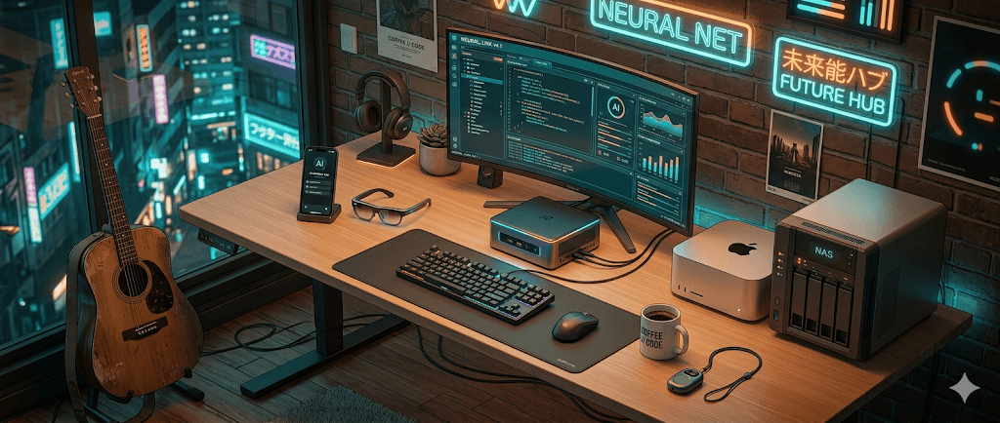
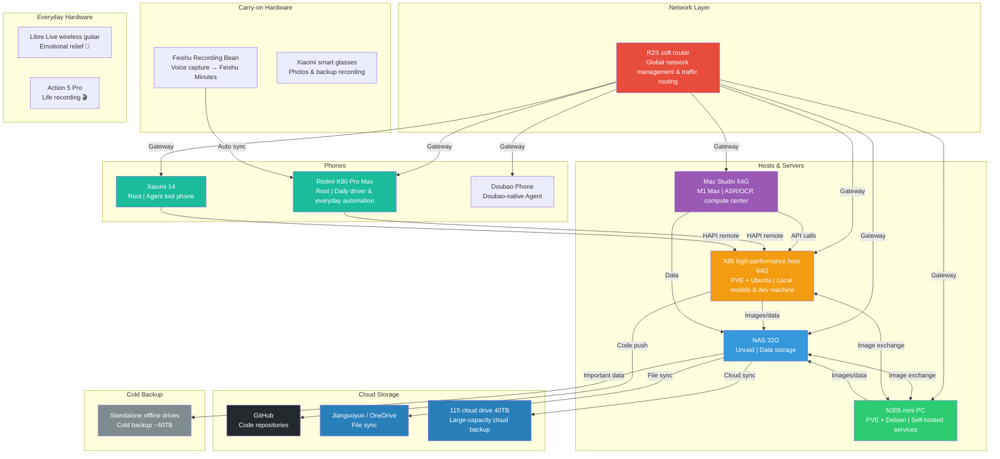
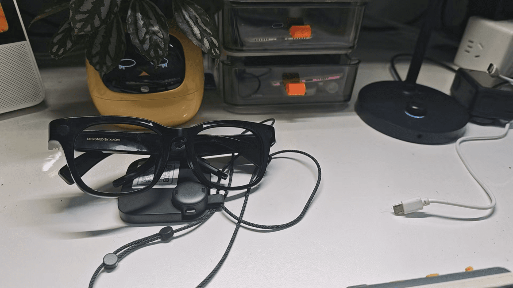
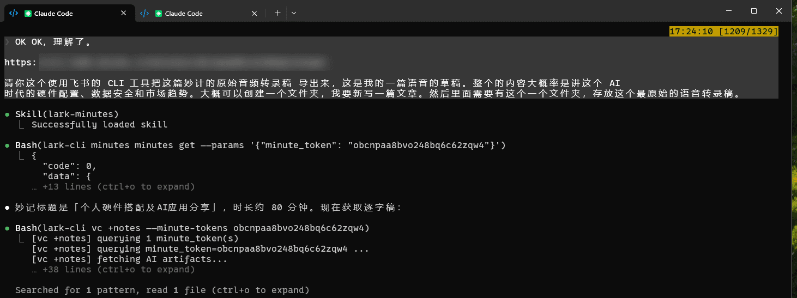
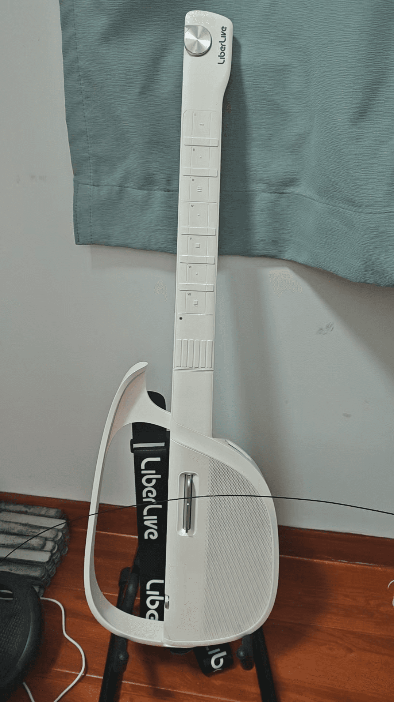
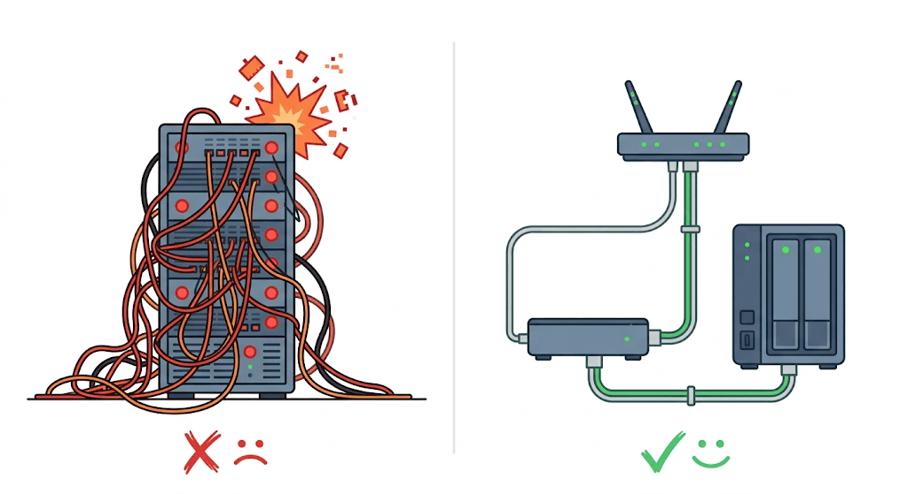
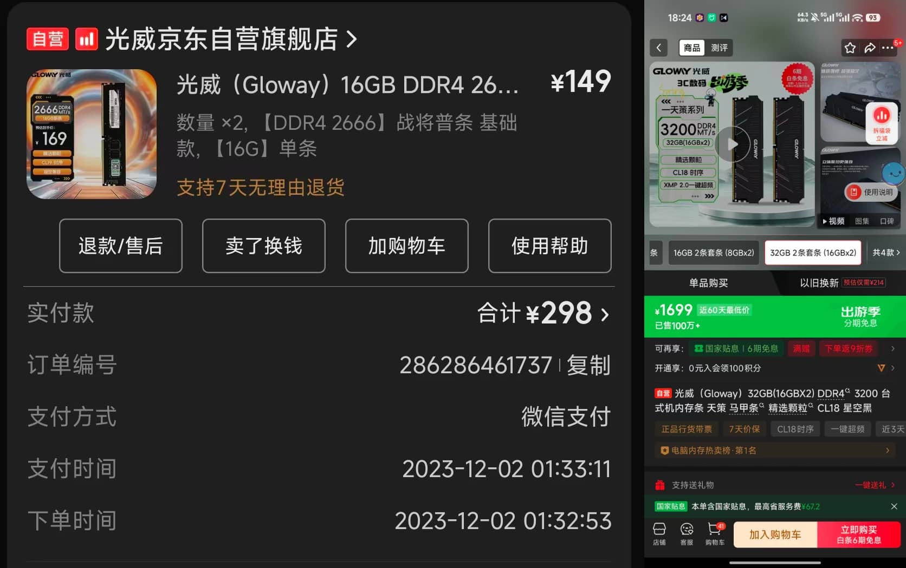
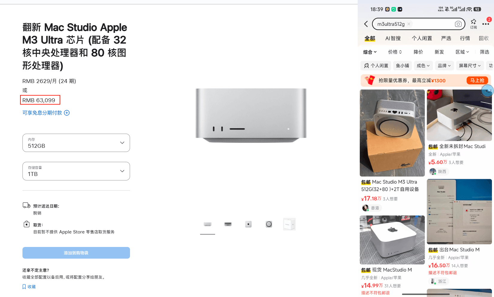

*Translated from the [Chinese original](/posts/260329-ai-hardware-data-security/).*

> This is the hardware installment of the "LLM Eats Everything" series. The previous post, [The Tools I Grew with AI](https://mp.weixin.qq.com/s/w8VnWJcUp5VkD5J-fYCUrg), covered how I built things at the software layer. This one covers the hardware foundation underneath: how I built it, why I built it this way, and my read on where the hardware market is heading.
>
> This post gets a bit geeky. I actually wanted to write it a long time ago and put it off for almost a month, and in that month hardware prices went up quite a bit more.

## 1. My Hardware Landscape

Let's start with an overall architecture diagram to show how the devices work together:

Now let's go through them one by one.

### 1.1 Hosts and Servers

#### NAS (32G, Unraid)

In my earlier posts, my NAS carried quite a few core services. But an abnormal Unraid shutdown after the Spring Festival took every service down, and it gave me a strong sense of urgency: I had to get service isolation and disaster recovery right.

The NAS's role is now very pure: **pure data storage**, plus some Docker services that don't touch core business data (Home Assistant, for example. If it dies, it dies, since most of my automation lives in Mijia).

> I'll cover the lessons from the All-in-One pitfalls in a dedicated section later.

#### N305 Mini PC (PVE + Debian Container)

I bought it during last year's national subsidy sale: N305 CPU + 16G + 512G. I got it just to tinker with, and then found I had no real use for it. As it happened, the hardware architecture upgrade gave it a job, and I integrated it into the newest setup.

The base layer is PVE, with a Debian 12 Linux container inside, dedicated to running Docker. All the automation tools that used to be on Unraid have now been migrated here.

A side note: I used to be a bit intimidated by Linux because it's pure command line. But since the AI era arrived, I actually find the command line more convenient, even more so than on Windows. And my use case is running services 24/7, where Linux is the natural fit.

**Debian vs Ubuntu, which to choose?** I had AI research it for me, and the conclusion was:
- **Long-term stability, dedicated to running containers**: use Debian (lighter and more stable)
- **Development and large language models**: use Ubuntu (a more mature CUDA ecosystem)

My core goal is keeping services running stably over the long term, so I chose Debian.

The reason I didn't install a distro directly on the physical machine, and went with PVE plus virtual machines instead, was **data safety**, mainly to make backups easy. PVE virtual machine images can be backed up as a whole, so if something breaks I can recover quickly.

#### Mac Studio (64G + 1T, M1 Max)

Its role hasn't changed. It's still the **compute center** on the local network, running both the ASR service and the OCR service.

I'll go into Mac's unique advantages in the AI era in the "Hardware Market Trends" chapter later.

#### X86 High-Performance Host

This machine has an interesting origin. While scrolling Xiaohongshu, I found that a video studio was going out of business and selling its high-performance editing workstation. The price was very good, so I bought it without hesitation.

**Specs and price:**

| Component | Spec |
|------|------|
| CPU | I5-13600KF |
| RAM | 64G DDR4 |
| GPU | RTX 3060 12G |
| Storage | 512G SSD + 4T HDD |
| **Used price** | **5,500 RMB** |
| New, same config | 8,000-9,000+ RMB |

> I'll come back to this price gap later. The core of it is that AI hit the video editing industry, studios laid people off, and the equipment flowed into the second-hand market. In a sense, it's dark humor.

The base layer is also PVE, and the machine is split into three uses:

**① Local model (Ubuntu + GPU passthrough)**

It runs a quantized Qwen3.5 4B model for local image understanding. I used to call the Doubao API for this job, but in practice the 4B model is entirely good enough for daily needs, and concurrency can reach 3 to 4. For local work that isn't time-sensitive, queuing is perfectly adequate.

With 12G of VRAM, I've also confirmed it can run a quantized Qwen3.5 9B, with acceptable quality. Native multimodality makes it a great fit for simple tasks done locally.

**② Dev machine (16G RAM)**

Apart from the app-side code, which I write locally, all my web-side scripts live on the dev machine. It's online 24/7, isolated with tmux, and I run multiple Claude Code processes in conversation at the same time. When I'm out, I connect remotely through HAPI and write code anywhere, and the experience is great.

Combined with Skills for automation, **I can basically go through the whole flow from idea to coding, push and deploy, and debugging using voice input alone.**

OpenClaw is also installed on it, and sometimes I have it direct Claude Code and Codex to write code for me.

**③ Shared OpenClaw instance**

I set aside a separate virtual machine to host a shared OpenClaw with no private data on it, which keeps it relatively safe.

Likewise, everything is backed up under the GFS (Grandfather-Father-Son) model. The PVE images on both sides are interchangeable, so the data can never be lost.

#### R2S Soft Router

Every device's gateway points to it, so traffic routing for different sites is managed globally in one place. Access to sites like Claude Code and OpenAI is completely seamless, and no device needs extra software.

> **This is the least conspicuous but most important piece of the whole architecture.** The network is the most basic dependency of every other device. I'll come back to it when I talk about the All-in-One pitfalls.

### 1.2 Phones

#### Doubao Phone

I bought it mainly because it feels like a meaningful keepsake: it shows what an Agent can do on a phone. Even though things have stalled now over conflicts of interest, I still admire the product.

That said, honestly, if you use it for Chinese apps, it's basically useless. Taobao and Xiaohongshu get forcibly logged out all the time, because the risk control is simple: they handle it uniformly by phone model. Apart from ByteDance apps, which run smoothly, everything else is a real hassle, and the Doubao assistant can't operate non-ByteDance apps either.

Using it with overseas apps is relatively smooth, though. YouTube and the like work fine, because the Doubao phone's influence hasn't reached that level. But it isn't problem-free either: it hasn't passed Google certification, so some apps, such as Reddit's native client, may not install.

#### Redmi K90 Pro Max (Rooted)

My daily driver. My own habit is that if an Android phone can't be rooted, I might as well buy an iPhone.

My last rooted phone was the Xiaomi 14, and I thought it would be the last rooted Xiaomi phone, since Xiaomi had explicitly banned bootloader unlocking. Then on March 8 a Xiaomi vulnerability went public, and you could unlock the phone and get root directly through it. I hurriedly bought a new phone and migrated my data over.

I now use the retired Xiaomi 14 specifically for sensitive operations. It holds no personal sensitive information and is purely a tool phone.

**Why is a rooted phone worth having in the AI era? Four reasons:**

**① The barrier drops to zero**

In the past, tinkering with phones meant following online tutorials step by step. Now my process for rooting the Redmi K90 was: download a script online → have Claude Code do a security review first → run it in one click. For hiding the root environment and installing plugins, I just state what I want, and Claude Code looks up approaches, executes them, and verifies. The whole process is both safe and convenient.

In the past, many plugins depended on open-source authors to maintain them, and as rooting became more niche, many were abandoned. But now with Claude Code I can customize any plugin without understanding much of the low-level stuff myself.

**② Reverse-engineering an app's database**

I bought that Libre Live wireless guitar. It has too few scores, and creating scores on the phone, tapping around back and forth, is a pain. So I had Claude Code use root access to reverse-engineer the underlying app's database. We went back and forth, and it really worked.

Writing one score used to take more than ten minutes of back-and-forth debugging. Now I skip the UI and write the finished score directly into the underlying database, then build an AI score generator on top, and the whole flow works end to end. **This experience was completely impossible in the era of human labor.**

**③ Cost-effectiveness of getting data from phones**

I mentioned in an earlier post that a scraping tool with no barrier to entry will most likely bring zero incremental information. In the AI era, data is the core moat, and vendors who have data take their data sources very seriously.

Reverse-engineering the web side is an order of magnitude easier than the phone side, so large numbers of people build reverse-engineering tools for the web, and web-side risk control keeps escalating. Xiaohongshu's web login, for example, is valid for only 12 to 24 hours, so you often have to rescan the QR code. That is essentially because web-side automation is too easy.

Switch your thinking: reverse-engineering and getting data on the app side through a rooted phone is actually very cost-effective. So-called code obfuscation is mostly just obfuscation aimed at humans. **To an AI, obfuscated code and unobfuscated code are not fundamentally different**, and an AI can even read binaries directly. Many countermeasures designed for humans mean nothing to AI.

A note of caution, though: **the above mainly applies to apps from non-major vendors.** Big companies' detection of root environments is actually quite comprehensive, the countermeasures are fiercer, and it's hard for ordinary people to pull off. This is more about offering a line of thinking, and I wouldn't recommend people without relevant experience try it directly.

> Here's an article about a fully automated reverse-engineering tool worth sharing. It can dig up many vulnerabilities even in the app of a famous Chinese payment giant, which would have been unthinkable in the era of human labor.
>
> https://innora.ai/zfb/

**④ Giving an Agent the lowest-level phone control**

The painful lesson of the Doubao phone shows that big companies are very sensitive to AI operating their apps. If you have root access, it's like giving your OpenClaw (the "little lobster") the lowest-level phone control. Having the lobster order takeout, say, is more gimmick than real value, but it does show a possibility.

#### iPad mini

Honestly, I use it less and less now. When I'm out, I basically use HAPI to connect back and chat with Claude Code, which I can do right on my phone. The phone's only problem is that the screen is too small. But on Android I don't need the annoying redirect that iOS forces every time I use the Doubao input method, so the experience is fine.

In essence, the iPad mini's role may be taken over by a foldable phone in the future. A foldable plus HAPI remote coding gives you a bigger screen and basically solves the last pain point.

### 1.3 Carry-on Smart Hardware

#### Feishu Recording Bean (899 RMB): Never Leave Home Without It

I now wear a Feishu Recording Bean around my neck, and my last few posts were written with it. I really like this form factor.

I weighed this choice carefully. Something like Plaud, which sticks to the back of the phone, doesn't suit me. For one thing, I'm not an iPhone user, so I have no need for magnets, and for another, I don't like bulky things. What I ultimately cared about most was **the ability to sync files automatically and seamlessly to Feishu Minutes.**

My current workflow looks like this:

1. When walking or cycling, I turn on the Recording Bean and capture scattered thoughts
2. After recording, a summary and a transcript are generated automatically
3. I read the summary, which helps me sort out my thinking
4. I export the transcript and drop it into Claude Code
5. We keep discussing the article's structure: what needs more elaboration, what should be cut, and what the target audience might not understand

This experience is better than a voice input method. For one thing, you don't have to stay in front of a computer, and you can speak as thoughts come. For another, a voice input method has limited context understanding in a single pass, while Feishu Minutes proofreads the audio transcription against the overall content, so it's more accurate.

**Especially now that Feishu has gone fully CLI**, I can fetch Minutes directly from the command line and keep chatting with Claude Code, with the whole process automated. Earlier products simply couldn't substitute for this experience.

The hardware is 899 RMB and includes six months of membership (smart summary quota and voice transcription hours). Renewal is 69 RMB a month, not expensive. But that's not what I really care about, because locally I have full automation for turning audio and video into text and calling large models to summarize. **What I lack in this era is the ability to build hardware**: I can't make a device this small that automatically syncs finished recordings to a server. That's the Feishu Recording Bean's core selling point for me.

It's tiny and hangs around the neck like a necklace. I never leave home without it.

#### Xiaomi Smart Glasses (1,500+ RMB, 800-900 RMB second-hand)

I carry quite a few recording devices now. The Xiaomi smart glasses can also serve as backup recording, but everything has to go through the app, with no API, so I actually use them less. Most of the time it's just snapping the occasional photo or listening to music, which makes them more of a toy.

A new price of over 1,000 is a bit steep, but not long ago I saw on Keji Jianlou (a bargain-hunting channel) a batch of official returns being sold second-hand, with a seven-day no-questions-asked return, for only 800 to 900. That price is fine for buying one to play with.

**I've actually been waiting for Doubao's smart glasses.** I previously saw Fan Bing share that he uses the Doubao earbuds and the full-platform capability of Doubao's web version to write a script on his computer that monitors the commands synced from the earbuds to Doubao, which makes the whole thing automatic. He gives a command to the earbuds, the script on the computer detects it, and then it runs the follow-up automated workflow.

That's basically a Jarvis-style experience: issue commands through earbuds or glasses, and control the computer to run post-processing automation workflows.

But my problem now is that I'm **running out of body parts**. I have the Recording Bean, the glasses, and AirPods, and there's really no room to carry a separate pair of earbuds. So I'm looking forward to Doubao's smart glasses, which would be perfect.

#### Capturing Passing Thoughts: Still Unsolved

In the AI era, voice input is basically a must. At work I capture audio with a DJI microphone and pair it with the Doubao desktop input method, and the experience is very good.

But I also want to record random murmurs at any moment. None of the solutions I've tried so far is ideal:

- **Open the phone's IM and send to a bot**: too many steps, not elegant
- **Feishu Recording Bean**: not suited to this kind of fragmented scenario
- **Smart watch**: I think this is the best form, even better than the phone. But after surveying the options:
  - iOS has the most complete framework and the flow basically works, but **battery life is too poor**, and I don't want to charge it every day
  - Xiaomi's watch has official documentation stating it has recording capability, but it is **completely closed to Xiaomi's own products**. I emailed them and was told it was "in planning," and then heard nothing more.
  - I don't use Huawei or OPPO products and ecosystems, and their documentation isn't as clear as iOS
- **Smart glasses**: Rokid seems relatively open, but I still want to wait for Doubao...

So for now I've shelved this. If there's a good solution, it could connect to my Memo system and flow through naturally and automatically.

### 1.4 Hardware for Recording Life

#### Libre Live Wireless Guitar: This Year's Most Recommended Hardware (Maybe)

This is a smart guitar, and a foolproof one. You just follow the keys on the score on your phone screen and press whichever light is on. There's almost no barrier to getting started.

In the AI era, a large part of every day is spent chatting with AI. AI is patient, knowledgeable, and offers emotional support. Aside from not having a physical body, it can be hard for humans to compete. But after chatting for a long time you start to feel a bit lonely, because a physical body and the real touch of an embrace are still different.

**When emotions come and there's nobody around, picking up a guitar and playing a bit is a pretty good way to soothe yourself.** There's zero barrier, and I love it. I've even bought them to give to friends.

Of course, it isn't without problems. Popular songs have scores, but niche songs often aren't in the official library, and the quality of scores uploaded by other users varies. So you have to transcribe by ear yourself. Transcribing is hard enough, and then you have to enter notes one by one into the app's UI, so the whole process is pretty frustrating. That's also why, as I mentioned earlier, I wanted to reverse-engineer its app database and build an AI score generator.

There are also competitors on the market that advertise "import songs from NetEase Cloud Music/QQ Music and generate a score in one click." The idea is indeed good. But from what I've learned about the algorithms, AI-generated scores still have limitations in string and fret accuracy, so judge the actual results for yourself.

I chose Libre Live mostly because it pioneered this category and **has a large enough installed base in the market**. These products combine software and hardware, so you can't look only at the hardware itself: if the manufacturer goes under, the hardware may turn into junk. So market installed base and the vendor's ability to survive are also factors to consider when buying. As for other brands, use your own judgment.

#### Action 5 Pro: Last Year's Most Recommended Hardware

The core in one sentence: **that state of mind never comes back.**

It has captured a great many states of mind of mine that are hard to reproduce. Whenever I go to a concert or a gathering, I bring the Action 5 Pro and film it. Even though I won't rewatch or edit these recordings anytime soon, having them is still having them, and at the least I've left a doorway into the future.

Honestly, I even regret buying it so late.

Last year there was a major upheaval in my life. My whole attitude toward life took a big turn, and my experiences and outward appearance afterward changed enormously. The me of a year ago and the me of a year later might look like two different people. There were many very hard moments along the way. Time smooths over a lot of things, but objectively it was a painful time.

At a higher level, though, I don't reject that experience. In a way, it makes my whole life experience more complete.

I'm very grateful that I recorded some of those hard times. When I look back on those days now, most of the time only scattered fragments remain, and I can never get back to the state of mind I was in then. I just toss these recordings into cloud storage and don't post them anywhere, but recording this kind of experience is really good.

> **Record more, share more.** Whether voice, text, or video, these are core assets in the AI era. Although storage costs a lot, **relative to the value of these records, the cost of storage is zero.**

---

## 2. Data Safety: More Important Than Code

I wrote in [an earlier post](https://mp.weixin.qq.com/s/az3gUGA24mXs1ptYdayFjQ): **Context is the most important thing in the AI era.** You should accumulate as much rich context about yourself as possible.

So my approach to choosing software now is to see whether it has an API and a CLI, so it's easy to talk to an Agent or export data for later automated processing. If a piece of software is particularly closed, I no longer choose it.

I maintain a lot of automation tools locally, and **I can accept them being down briefly, but I can't accept data loss**, because once it's lost, it's truly lost.

### The 3-2-1 Backup Principle

Hard drive prices are high right now, but objectively, **relative to the value of the data, the cost of a hard drive is almost zero.**

In my practice, the overall data flow is: **produced locally → aggregated on the NAS → synced to the cloud → cold backup for important data**.

| Data type | Local (produced) | NAS (aggregated) | Cloud (synced) | Cold backup (important data) |
|---------|------------|------------|------------|----------------|
| PVE virtual machines | Images packaged automatically every day | Images synced to NAS | 115 cloud drive | Standalone offline drives |
| Code repositories | Local Git | — | GitHub | — |
| Files | Local | NAS storage | Jianguoyun / OneDrive | — |
| Video / large files | Local | NAS storage | 115 cloud drive | Large-capacity drive cold backup |

A few key points:

- **Standalone offline drives**: they keep the data from being contaminated. At a company I once got hit by ransomware and lost more than a year of accumulated data, a lesson I won't forget.
- **Images exchanged between the two PVE hosts**: this ensures the data can never be lost.
- **All paid memberships stay renewed**: GitHub, Jianguoyun, OneDrive. Take your data seriously.

### Recommending the 115 Cloud Drive

115 has an 8-year 40TB plan for 800 RMB, which works out to about 100 RMB a year. That's very good value.

Every year people online say it's about to run off with the money, but I did some research ([reference analysis](https://sum.lexgogo.site/view/view_EN_wsTpJON90cKbKD4yZsAUoNYLw8AiU6D9-TGN1OLw)) and think its business logic holds up:

- **Pay-first model**: the high barrier of a 500 RMB annual fee filters out freeloaders and leaves only real paying users, so cash flow is stable and it doesn't depend on ads or monetizing data
- **Deduplication lowers real costs**: most users' actual usage is far below 40TB, and popular files are stored once and shared among many users, so actual storage costs are far below the nominal capacity
- **Cutting the sharing feature on its own initiative**: it reduces copyright risk and bandwidth costs, and although it sacrifices virality, it greatly lowers operating risk
- **Bound up in heavy assets**: its headquarters moved to Meizhou, and it invested hundreds of millions in the "World Hakka Merchants Center" commercial real estate. These physical assets act as ballast, making running away far costlier than continuing to operate
- **17 years of continuous operation**: it lived through the industry shakeout of the 2016 "cloud drive war," when competitors such as 360 Cloud Drive and Kuaipan shut down one after another, and 115 survived to today

So I'm relatively comfortable with its business sustainability.

> **But that doesn't mean I vouch for it.** I don't vouch for any of these cloud services. I'm only offering a possibility. The final decision is entirely yours, so don't blame me.

My current storage scale is roughly: NAS about 20T + cold backup about 40T + cloud about 40T + GitHub + Jianguoyun + OneDrive.

---

## 3. Lessons Learned: From All-in-One to Splitting Services

My Unraid used to run in All-in-One mode, with networking, compute, and storage all on one machine. In the early days it really was convenient: one machine solved everything, and the All-in-One setup ran for quite a long time.

But that abnormal Unraid shutdown after the Spring Festival took all the services down. It made me realize: **you must isolate services.**

The principles after the split:

- **The network (soft router) must be independent.** The network is the most fundamental dependency of every other device, and if it goes down, everything goes down
- Compute and storage can be split or merged as needed
- The virtual machine images on each PVE node can be exchanged for mutual backup

All-in-One isn't unworkable. Every approach has its risks, so take what you need. But **I don't recommend it in the long run.** At the very least, separate the network from the other devices. That's the bottom line.

---

## 4. Hardware Market Trends: Better to Buy Early Than Late

This is the chapter I most want to talk about, especially for readers at companies and small-to-medium teams.

### 4.1 The Logic of Price Increases: AI Has Eaten All the Capacity

When I saw that X86 host at 5,500 RMB, I thought it was a great deal. But honestly, a year or two ago that price wouldn't have been cheap. It only looks especially good now because RAM, hard drive, and even CPU prices are all rising.

How extreme is it?

- **32G memory modules**: two used to cost 300 RMB together, and now it's 1,700 RMB, a fivefold increase
- **Hard drives**: prices doubled
- **Cheap and good domestic model subscription plans**: raising prices and limiting sales one after another

This round of price increases is entirely driven by AI.

AI has grabbed all the semiconductor capacity. It needs memory (HBM), storage, GPUs, and CPUs. Many manufacturers have cut their consumer memory production lines to supply HBM at full capacity, because the big AI companies are willing to spend and the margins are high. The result is that all consumer products get more expensive.

### 4.2 Basically Irreversible

There's a view online that this might last only two or three years and prices will surely fall back, for example when the AI bubble bursts.

**My judgment is that it's basically irreversible.**

The chain of logic:
1. You've seen what AI Agents can do and the extreme demands companies place on them
2. Token consumption will grow by orders of magnitude, a hundredfold
3. The current physical-world hardware base simply can't meet AI's booming demand
4. The speed at which the physical world adds memory, storage, and compute cards can't keep up with real business demand

Essentially this is a supply and demand problem: can semiconductor manufacturers add production lines as fast as Agents demand semiconductors? If there's spare capacity, consumer products can of course still wait for their price drop. But if demand in the bit world grows a hundredfold, a thousandfold, I think the physical world's capacity expansion can't keep up.

Some may say algorithms are improving. For example, a few days ago Google released a new algorithm that can sharply reduce the KV Cache memory footprint while large language models run, and the news even crashed some memory-related stocks. Doesn't it look like demand will fall?

But there's a classic **Jevons Paradox** here: **technological progress lowers unit cost, which instead causes demand to surge, and total consumption ends up rising rather than falling.** Improvements in steam engine efficiency didn't reduce coal consumption. They multiplied coal usage several times over. The same goes for AI: KV Cache compression means the same hardware can run longer contexts and more concurrency, and companies will certainly fill the freed space with more Agent tasks rather than buy less memory.

**So my judgment is: don't expect consumer hardware to get cheaper in the short term.**

Prices may look high now, but next year they may be higher. Agents aren't widely adopted yet, and as they spread further, that terrifying growth in compute demand will be hard to make up for.

And the day hardware actually gets cheaper? That most likely means most people no longer need local high-performance hardware, or have simply lost their jobs. Another piece of dark humor.

### 4.3 The Dark Humor of the Second-Hand Market

The first-hand market's capacity has been sucked away by AI, but interestingly, **the second-hand market actually has opportunities.**

The faster AI enters companies, the more unemployment it causes, and the more old studio machines sit idle. My 5,500 RMB X86 host came about exactly this way: progress in AI imaging hit video editing studios, causing layoffs, and their computers flowed out.

I discussed this topic with Gemini earlier, and it gave a very insightful analysis:

> The burst of second-hand supply is a "**one-time release of assets during industrial transition**" and is temporary. Once traditional small and medium enterprises finish clearing out, high-quality supply in the second-hand market will quickly dry up.
>
> The second-hand market will polarize into a "**dumbbell shape**": the high end stays extremely strong, and the low end loses value.
>
> — [The New Landscape of the Hardware Market Under AI Impact | Gemini Conversation](https://gemini.google.com/share/48bdf8fcabb4)

I basically agree with this polarization trend, but with two additions:

**On the high end**, prices for GPUs with 16G+ VRAM and hosts with 64G+ RAM hold firm, and that's right, because they convert directly into frontline productivity. And it isn't only AI geeks and indie developers snapping them up. **For small and medium teams, this kind of second-hand high-performance host is equally worth it.** After all, the budget you save can buy more machines for Agents to work on.

**On the low end**, "electronic junk" is going too far. The market is tiered: first-hand prices are rising across the board, so people who used to buy 12G cards step down to 8G when their budget falls short, those on 8G step down further, and demand sinks level by level. So low-end second-hand prices have actually been rising lately too. It's just that what you buy has little real value and can't run any decent local model.

So: **don't miss a bargain when you come across one, but don't be too optimistic either.**

### 4.4 Mac's Cost-Effectiveness in the AI Era

I used to think Mac memory was expensive, but things have changed: **Mac's cost-effectiveness in the AI era is very high.**

The core reason is Mac's **Unified Memory Architecture (UMA)**.

An analogy: on a traditional computer, the CPU and GPU each have their own "warehouse," and data has to be hauled back and forth between the two warehouses. Mac's unified memory is one big warehouse that anyone can take from directly. When running large models there's no hauling around, so efficiency is much higher.

This isn't just a theoretical advantage. I recommend a technical article for a deeper look at the principles behind it:

> [From KV Cache to AI Memory Systems](https://blog.xieydd.top/from-kv-cache-to-ai-memory-system/): this article explains why the bottleneck of AI inference is no longer compute (FLOPS), but **memory bandwidth and capacity**. Mac's UMA architecture removes the boundary between CPU memory and GPU VRAM at the physical level, a huge advantage in memory-constrained scenarios.

**Unified memory was already a big advantage in the large language model era, and in the Agent era the advantage will only grow.**

The price trend says even more:

| Device | Previous price | Current price |
|------|---------|---------|
| US-version Mac Studio 64G M1 Max | 8,000 RMB | 10,000 RMB |
| 512G M3 Ultra Mac Studio | A bit over 60,000 RMB (with national subsidy) | Pulled by Apple; second-hand prices hyped to **150,000 RMB** |

For running large models, I recommend the **[OMLX framework](https://github.com/jundot/omlx)**. It's relatively new, its underlying support for Apple Silicon is well done, and its performance scheduling is more efficient. And as more people realize Mac's advantages in the Agent era, more people will build adaptations for its ecosystem, so the experience can only get better.

> Of course, this isn't investment advice. I'm just saying that if you have the need, Mac is worth considering first.

### 4.5 Local Large Models Are a Must for Enterprises

For individuals, unless you have security or financial requirements, fiddling with local models doesn't mean much. Even though I've deployed Qwen3.5 locally, I only use it for image understanding. I would never hand Coding or deep thinking to a local model. **Once you've experienced the depth of thought that top models bring, you can't go back.**

But for enterprises, **local large language models are a must.**

The logic is simple: if you don't use AI, you can't use AI's leverage to raise efficiency. But if you do use AI, you don't want your company's data and processed experience to be used for training and turned into skills that everyone publicly knows a year or two later. It would be like burning yourself to make the AI stronger, until your skills are no longer scarce.

So core data can't leave the network, and local large language models are the natural choice.

**My strategy is: [top models set the direction, local models cut costs in execution](https://mp.weixin.qq.com/s/Set_2-M-QP2xSAhyl1MonQ).**

- Use a top model like Opus 4.6 to optimize workflows and set direction
- But make sure every internally run Skill and Agent call is based on a local model
- Core data is not opened to top models

But frankly, there's a **prisoner's dilemma** here that I haven't fully figured out.

The structure of this contradiction is as follows: if you don't use top models, it's hard to get the best results and you fall behind your competitors in efficiency. But if you do use them, your data may be used for training, and the experience and workflows you worked hard to build are no longer your moat. And your competitors face exactly the same dilemma.

In essence this is the enterprise version of the **dark knowledge paradox** I mentioned in ["A Few Idle Remarks"](https://mp.weixin.qq.com/s/Rjxlr-O2kbH2vtHOWJ2G9A): without AI you lose leverage, and with AI you distill yourself away.

And this gap is **structural and permanent**. No matter how much local models improve, they're limited by the physical constraint of hardware parameter counts. At most you can deploy a model of a few hundred B, which won't necessarily match a top model running on a multi-card cloud cluster. More importantly, cloud models are improving while local models improve, and with unequal resources they improve faster. So don't expect to "wait until local models are good enough." That day won't come.

**There's no perfect solution to this contradiction.** The approach I can think of is to layer by **data sensitivity**:

- **Core secrets** (customer data, finances, know-how that forms a core competitive barrier) → local models only. If the results are a bit worse, so be it. Safety is the bottom line
- **Procedural knowledge** (coding standards, general engineering practices) → top models are fine, because this stuff isn't your moat anyway and the industry will level it out sooner or later
- **Processing of public information** (market research, document writing) → use whatever you like

**The point isn't "whether to use top models," but "which data absolutely cannot leave the network." Once you've drawn that line clearly, everything else is an engineering problem.**

One more point that's easy to overlook: **a Skill is itself a core asset.** When you orchestrate a company's workflow into a Skill, the Skill's prompt already contains a lot of procedural experience. Even if the data never leaves the network, if the Skill's definition files are poorly managed, it can leak just the same. So access control over Skills is in some sense even more important than the data itself.

In the end, the real moat may no longer be in "knowledge" but in **execution speed and iteration density**. Knowledge gets leveled out sooner or later anyway, but whoever gets things working with Agents first and engineers their workflows into production first will reap the dividend within the window.

> I judge that enterprise-grade hardware prices doubling within the next two years is still entirely possible. **If you have this need, better to buy early than late.**

### 4.6 No More High-Performance Laptops

At the current pace of Coding Agent development, I most likely won't buy a high-performance laptop again. All that budget will move to **high-performance hosts**, whether Mac or X86.

In an extreme case, you could even do without an IDE. When going out, a foldable phone plus a voice input method plus a network connection might be all the work environment you need.

The only need for a laptop on the road is a bigger screen that's easier on the eyes, but that's from a programming standpoint. Design and development are another matter, since image editing really can't be done without one.

**For programming at least, from now on I'll only buy portable, long-battery-life products like the MacBook Air.** That positioning better fits what programming needs in the AI era.

---

## 5. Outlook: Where Does AI Hardware Go Next?

So far I've covered "how to build it now." Finally, let's talk about "where it goes next."

AI is unbeatable in the bit world, but once it reaches the physical world, the bottlenecks become obvious. An Agent can help you write code, make decisions, and process information, but the inputs and outputs it relies on ultimately have to pass through physical-world hardware. What everyone is brainstorming to solve right now is essentially one problem: **how do we make the Agent's working environment better?**

I see a few directions:

### Lowering the Input Barrier

Right now the most natural way to interact with an Agent is still voice. Voice input methods, the Feishu Recording Bean, and the Doubao earbuds are all fundamentally solving the same problem.

Thinking about it in the extreme, there's a meme online of a keyboard with just three keys: one for voice input, one for delete, and one for "think again." That's roughly this trend. The bottleneck in programming used to be detailed debugging, but now the bottleneck is whether you can state your requirements and tests clearly. I think hardware innovation around this direction will keep exploding.

### The Agent's "Eyes": Hardware-Level Global Understanding

Today's Agents can operate a computer, but they lack a global understanding of the physical screen. They know which commands they ran, but not what's actually happening on the screen.

I've seen people working on related projects. The idea is to build a virtual screen for the Agent so it can read the information stream on the screen directly. That gives the Agent its own "eyes" to see what it has done and what state the interface is in, and then react with its own multimodal capability. Once this direction matures, Agent autonomy will go up a big step.

### Carry-on Agent Interaction Devices

The Doubao earbuds → computer script monitoring → automated workflow I mentioned earlier is really the early form of this direction. The core need is: **talk to your own Agent anytime, anywhere, and have it carry out post-processing tasks for you.** No need to take out your phone or sit at a computer. One sentence into your earbuds or glasses is enough.

I used to hope Doubao's smart glasses could deliver this experience, but honestly, thinking about it carefully, they can't, because they're essentially one-way. They can only send commands out from the glasses, with no way to send anything back. You can't have the Agent push results back to the glasses to confirm or show you something.

### The Barrier to Hardware Development Is Falling Too

For example, with Xiaozhi AI plus a Huaqiangbei dev board, you can directly build a model framework and an AI assistant at a cost of a few dozen RMB. The barrier is already very low. I used to mainly play with software, but now with AI I want to play with everything and try everything. **Every bottleneck is my own problem.**

But there's an awkward side too: **big companies have the ability to do hardware well (battery life, performance, craftsmanship) but aren't open enough, while individual developers and small teams have ideas and needs, but the hardware they build can't compete with the big companies on battery life and performance.** This contradiction is currently unsolved.

All I can say is that I hope some startup team has both hardware capability and a willingness to build an open ecosystem. The trend is very clear: **AI is penetrating from the bit world into the physical world, and hardware is the next battlefield.** Whoever gets this loop working first will reap a wave of dividends.

---

## Final Words

If after reading this post you want to know what hardware you should buy, **my advice is to throw this post at an AI, describe your needs, and let the AI help you decide.** But don't let the AI judge prices, because AI has no real-time market price data. Check prices yourself.

Or using Qwen seems fine too, since it's connected to Taobao.

---

> **Disclaimer**
>
> Everything in this post represents only my personal views and experience, and does not constitute any investment advice or purchase recommendation. Hardware prices fluctuate for many reasons, so please go by actual market conditions and judge for yourself.
>
> The products, brands, and services mentioned in the post are all shared from my own real use, with no commercial cooperation or interest relationship of any kind.
>
> I have no intention of debating anyone. Everyone's needs, budget, and technical background are different, and what suits me may not suit you. Think what you like.

---

> The draft of this post was conceived by voice-to-text with the Feishu Recording Bean, the article structure and content were worked out in conversation with Claude Code + Opus 4.6, and the illustrations were generated by Nano Banana AI.
