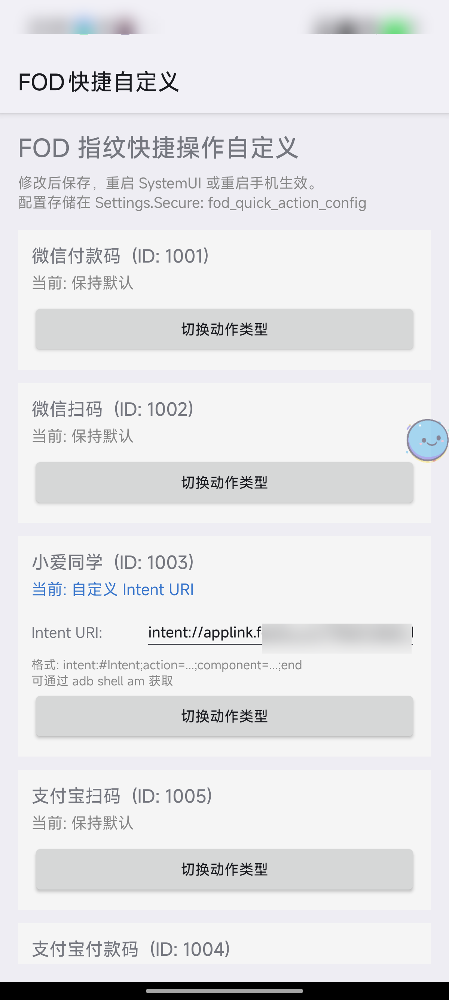
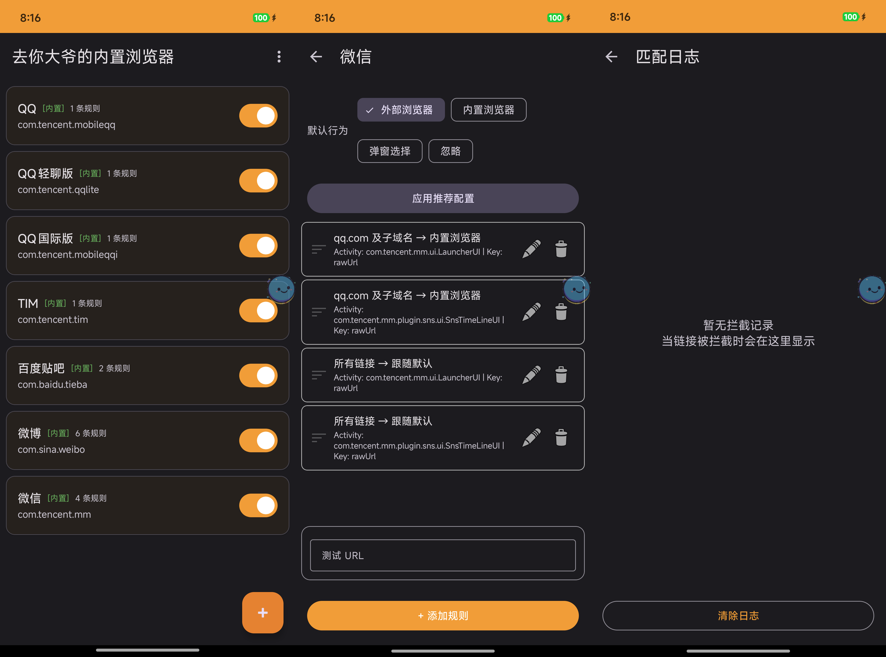
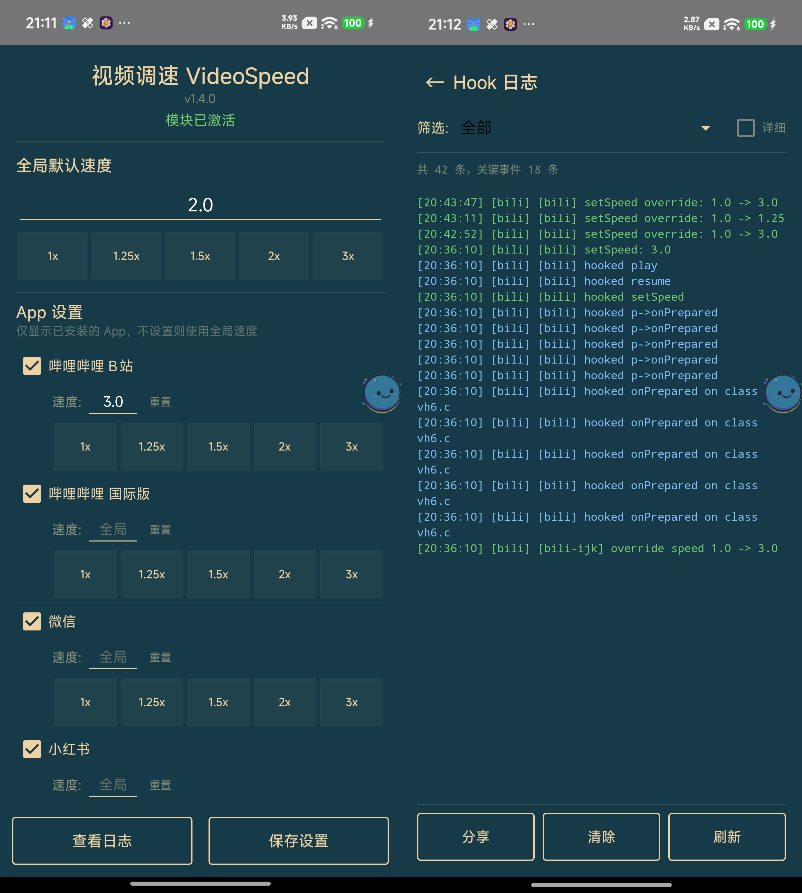
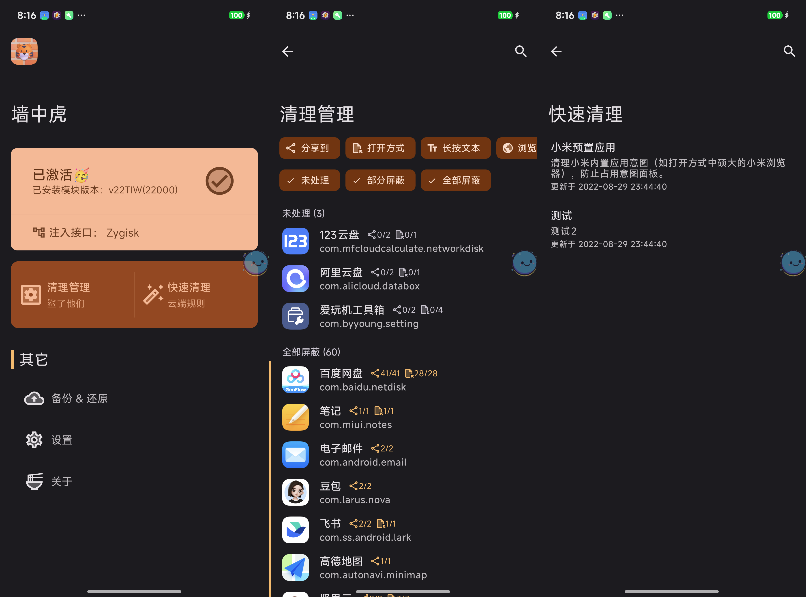
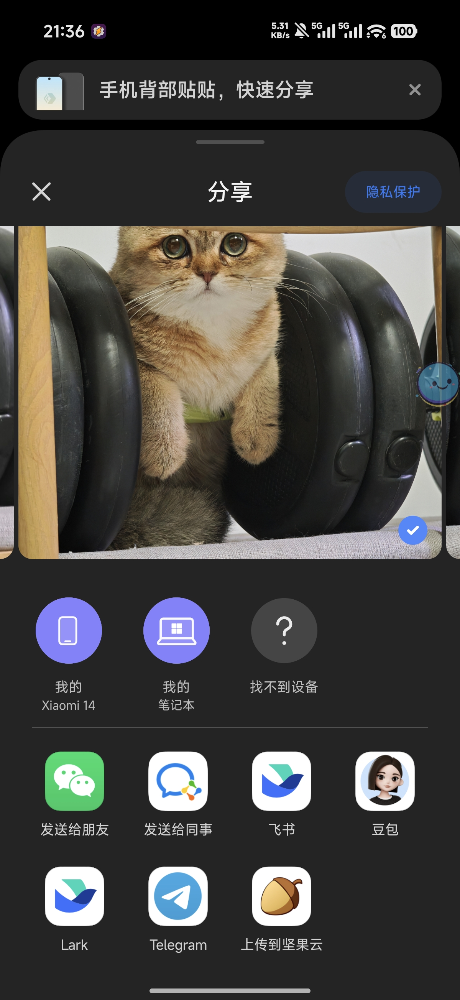

*Translated from the [Chinese original](/posts/260406-root-modules-and-hardware-freedom/).*

<!-- Cover image prompt for Nano Banana Pro:
A smartphone floating in mid-air with its back panel opened like a door, revealing glowing circuit boards and neural network patterns inside. A small robotic arm (representing AI) reaches into the phone, rewiring and customizing the circuits. Around the phone, holographic UI panels and code snippets float in the air. The scene has a cyberpunk aesthetic with warm orange and cool blue lighting contrast. Isometric perspective, clean minimal background with subtle grid lines. Digital illustration style, high detail.
-->

In the previous post, [*The Agent's Home: A Hardware Foundation for Individuals in the AI Era*](/en/posts/260329-ai-hardware-data-security/), I mentioned one idea: **in the AI era, it's worth owning a rooted phone.** I gave four reasons at the time, but didn't expand on them.

This post is that expansion.

I'll walk through 5 Root modules I've actually been using lately to show what an ordinary person can do when they have the lowest-level access to their hardware, combined with an AI coding tool like Claude Code. The point isn't these specific plugins — they're just vehicles. What I want to show is a possibility: **as long as you can define the problem clearly and spell out how to test it, anyone can be a developer.**

This post gets a bit geeky. If concepts like Root and Xposed are completely foreign to you, I'd suggest reading only the "what problem it solves" part of each module to get a feel for the idea — no need to actually tinker with any of it.

> **For those unfamiliar:** What is Root? Simply put, when you buy a phone, the manufacturer only gives you "tenant" permissions — you can use it, but you can't change it. Root means getting "landlord" permissions, so you can modify any behavior of the system. And [LSPosed](https://github.com/LSPosed/LSPosed) is the most commonly used tool framework after Root. It can change an APP's behavior without modifying the APP itself — for example, making links in WeChat open in an external browser, or making video APPs play at 3x speed by default. The "plugins" and "modules" mentioned below are all small tools built on this framework.

---

## 1. Building a Plugin from Scratch: Lock Screen Straight to a Feishu Bot

### The Problem

In an earlier post, [*The Tools I Grew with AI*](/en/posts/260220-ai-时代的自用软件工具分享-正文稿/), I shared my [Memo](https://github.com/usememos/memos) note-taking system — through Feishu/WeCom/Telegram bots, I can send ideas to a bot anytime, anywhere, which are automatically saved into Memo and trigger AI post-processing.

This setup works very well, but one step has never been smooth enough: **how fast I can capture a fleeting thought.**

When an idea pops up, I need to: unlock the phone → open Feishu → find the bot → start typing. Three steps, each with friction. I'd been looking for a faster way and had looked into various wearable hardware, but never found anything suitable.

### The Idea

Since the hardware route was a dead end, I'd look at the phone itself.

I know many APPs support the [URL Scheme](https://en.wikipedia.org/wiki/URL_scheme) protocol — for example, tapping a specific link can jump straight to Xiaohongshu's search page or WeChat's scan page. Feishu has a similar capability: you can share a bot's chat window as a URL.

That means that as long as I can trigger this URL from anywhere, I can jump straight into the Feishu bot's conversation window in one step.

What about the lock screen? I use a Xiaomi phone, where swiping up while unlocking with the fingerprint sensor can quickly launch WeChat's scanner, Alipay's payment code, the Xiao Ai assistant, and so on. If I could replace one of those slots with "open the Feishu bot" — a swipe on the lock screen fingerprint sensor, straight to the chat box.

### The Implementation

With the idea in hand, the next step was to verify it. In the past, you'd have to read the project's code, learn the Xposed framework's API, and debug step by step. Now with Claude Code, I connect the phone to my computer via ADB, enable Root access, and let Claude Code explore the relevant Xiaomi SystemUI code, while I help with some basic debugging — for example, telling it "this Hook point is wrong, try another one."

The whole process was very smooth. I basically never had to dig through complicated documentation; I just pointed out the direction at key moments. In the end the plugin worked: **swipe up on the fingerprint sensor while unlocking, and you land directly in the Feishu bot's chat window.**

<!-- TODO: Insert the FodQuickAction demo video -->

> Open source: [FodQuickAction](https://github.com/zj1123581321/FodQuickAction) — supports customizing the 5 fingerprint quick-action slots on Xiaomi HyperOS, and can point to any APP, deep link, or Tasker task.

This is the first Xposed plugin I built from scratch. It worked not because I understand low-level Android development, but because I could define the problem clearly: "When I swipe up on the lock screen fingerprint sensor, trigger a URL Scheme." Claude Code took care of the rest.

---

## 2. Reviving Abandoned Open-Source Projects

The one above started from zero. But more often, my needs aren't that unique — someone has already built it, and the project just stopped being updated.

The Root tinkering scene has a very real predicament: **fewer and fewer people use it, yet the development cost isn't low.** Many Xposed module authors built them out of passion, but Android ships a major version every year, the porting workload is significant, the user base is shrinking, and the return on investment keeps dropping. As a result, many genuinely useful modules have slowly stalled at some Android version.

These authors deserve our thanks. They solved real pain points; the maintenance cost was simply too high.

And this is exactly what Claude Code is best at: **fork it, tell it which version to adapt to and what to fix, and the upgrade can be done within a few days.** The four projects below all follow this pattern.

### 2.1 ExLink — Intercepting WeChat's Built-in Browser

**What problem it solves:** WeChat has a maddening design — every link opens in WeChat's built-in browser. Someone shares a Xiaohongshu note, a Bilibili video, or a Zhihu answer in a WeChat group, and when you tap it you can only view it in WeChat's browser, which is a terrible experience. Want to jump to the corresponding APP? You have to tap the menu at the top right, choose "Open in browser," and only then does the system ask which APP to open it with. That's two extra steps every time.

ExLink solves exactly this: **it intercepts WeChat's link-opening behavior and, based on rules you preset, automatically opens the link in an external browser or the corresponding APP.** You can configure rules by domain — for example, all bilibili.com links jump straight to the Bilibili APP, and all xiaohongshu.com links jump straight to Xiaohongshu. You can also set a default behavior: apart from specified domains that stay inside WeChat, everything else jumps to the external browser.

**The original project had been abandoned for 6 years.** The original author, [xloger](https://github.com/xloger), last updated it in 2020. After I forked it, Claude Code finished 20 commits in 6 days: migrating from Java to Kotlin, upgrading to AndroidX and Material 3, adapting to Android 16, and rewriting the rule editor and match log — basically a complete refactor.

> Open source: [ExLink](https://github.com/zj1123581321/ExLink)

### 2.2 VideoSpeed — Global Video Playback Speed

**What problem it solves:** Most people watch videos at faster speeds. The problem is that although most APPs support speed control, **no APP supports setting a default speed** — you have to adjust it manually every time you open a video, and many APPs only go up to 2x at most. If you're like me and used to watching at 3x, adjusting it every single time is really annoying.

VideoSpeed solves exactly this: **it sets a default playback speed for 13+ APPs, taking effect automatically when you open a video.** Bilibili, WeChat Channels, Douyin, Xiaohongshu, Twitter/X, Instagram, Telegram, Weibo — all supported. Each APP can be configured separately — for example, Bilibili defaults to 3x and Douyin to 2x. Set it once, and you never notice it again.

**The original project had been abandoned for a few months, and its Hooks were breaking against newer APP versions.** After I forked it, Claude Code finished 8 commits in 2 days: fixing the speed failure on the latest Bilibili version, adding per-APP speed settings, speed preset buttons, and a log viewer, and modernizing the entire UI.

> Open source: [VideoSpeed](https://github.com/zj1123581321/io.github.MarsGao.speed)

### 2.3 ClipboardWhitelist — Restoring Background Clipboard Access

**What problem it solves:** Starting with Android 10, the system forbids APPs from reading the clipboard in the background. The intent was to protect privacy, but for automation tools that depend on the clipboard it's catastrophic. For example, I'm a heavy [Tasker](https://tasker.joaoapps.com/) user, and a lot of my automations are triggered by "watching for clipboard changes" — copy a link and it automatically calls [the tool I shared earlier](/en/posts/260220-ai-时代的自用软件工具分享-正文稿/) to summarize audio/video, or clips it to Obsidian in one tap. After Android 10, all of these broke.

ClipboardWhitelist's approach is simple: **you specify which APPs may access the clipboard in the background, while all others remain restricted by the system.** It doesn't give up privacy entirely, yet lets your automation tools work normally.

**The original project is maintained by [fei-ke](https://github.com/fei-ke), but hadn't been adapted to Android 16 yet.** After I forked it, Claude Code finished the adaptation in 1 day, and also changed the Hook approach from the fragile `findAndHookMethod` to the more robust `hookAllMethods`, cutting the core code from about 120 lines to 40.

> Open source: [ClipboardWhitelist](https://github.com/zj1123581321/ClipboardWhitelist)

### 2.4 TigerInTheWall — Share Menu Cleanup

**What problem it solves:** Android's share menu is a disaster zone — almost every APP stuffs its own entry into it. The result is that when you want to share an image or a link, the share sheet is packed with dozens of options, and finding the one you want takes forever.

TigerInTheWall lets you **manage in bulk which APPs appear in the share menu and the "Open with" list** — turn off the share options you'll never use in one tap and restore a clean share sheet. It filters by intercepting the system's Intents, and also offers a quick-cleanup feature so you can adjust things at any time.

Here's what the share menu looks like after cleanup — only the few options you'll actually use remain:

The original project was likewise abandoned for years and didn't support newer Android versions. After the upgrade it supports Android 16, with a new feature for bulk-disabling permissions.

> Open source: [TigerInTheWall](https://github.com/zj1123581321/TigerInTheWall)

---

## 3. The Same Goes for Computers

A phone needs Root to get low-level access, but a computer has it natively.

Here's one example: WeChat desktop's local database. There used to be a project called chatlog that could decrypt WeChat's local chat history database and export past conversations for AI analysis. It later broke because of WeChat updates, but people in the open-source community keep relaying the baton to find [new approaches](https://github.com/ylytdeng/wechat-decrypt), and it works again on the latest WeChat 4.0.

With Root access built in natively on computers, there's only more you can do.

---

## Final Thoughts

All the projects mentioned above are open source. But honestly, I built these things mainly to make my own life smoother, and open-sourcing them was just incidental. If you run into problems, you're welcome to file an Issue, but I most likely won't have time to deal with it.

**What I'd recommend instead: try solving it yourself with Claude Code.** This may be a new mode of collaboration for this era — not just raising a problem and waiting for someone else to fix it, but filling in the whole solution yourself in one go.

Back to the original idea: **as long as you have the lowest-level access to your hardware, you can customize any product feature you want, on demand.** That possibility is worth more than any specific piece of code.

Of course, Root isn't without cost. It brings low-level security risks — your phone's defenses against malware will weaken. My approach: all core data is backed up in the cloud, and the rooted phone has no banking apps and stores no sensitive information. If you're willing to tinker, welcome; if not, that's perfectly fine too — at least now you know this possibility exists.

---

> The draft of this post was conceived through voice-to-text with the Feishu Recording Bean, and the article's structure and content were organized in conversation with Claude Code + Opus 4.6. The illustrations were generated by Nano Banana AI.
