*Translated from the [Chinese original](/posts/260505-kazakhstan-trip/).*

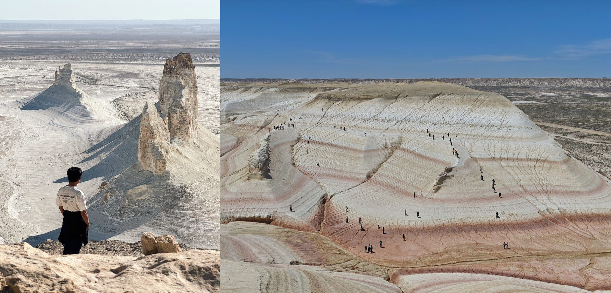

---

## 1. How It Started

A couple I know were going to Kazakhstan and asked what my plans were for the May Day holiday. I happened to have none, so I happily said yes and dragged my college roommate along. The whole trip ran from April 25 to May 4. I took 4 days of annual leave, so it came to about eight or nine days.

Honestly, these days when I travel I care more about natural scenery. I'm not that interested in the cultural side, and I can't really read it anyway. I also try to avoid peak season. Kazakhstan's terrain and landscapes are not much different from Xinjiang's, but at least there are fewer people, and it isn't expensive either.

Anyway, someone else was booking the flights and hotels and making the itinerary, so all I had to do was pay and follow along. I signed up the second the trip was announced.

But there was still plenty of day-to-day stuff to sort out (transport, exchange rates, currency), and that was left to me.

---

## 2. Using AI to Plan an Off-the-Beaten-Path Independent Trip

The early planning was done largely with the help of AI. The process was fairly simple: I pooled Deep Research reports from several different platforms, had Claude Code help me compare what the reports agreed on and where they conflicted, then wrote the result into a Feishu document through the Feishu CLI and shared it with everyone going.

I used Deep Research from four sources: **Doubao, Diandian, Qianwen, and Gemini**.

Looking at the final result, I think two sources would actually have been enough:

- **Diandian** (backed by Xiaohongshu): timely and very China-oriented. It had already helped me avoid some pitfalls, such as poor exchange rates at the airport and the advice to exchange money at a bank. It also noted that Google Maps is not as useful locally as 2GIS. That is its one-of-a-kind advantage.
- **Gemini** (backed by Google): its sources are more international and more rigorous. Things like rules on carrying medication, for example, were nowhere to be found in the other channels. A global view does help when preparing.

Of course, many of the warnings in them may never come up in practice. They're more about being prepared and knowing what to expect. Since the report was already generated, I figured I might as well share it with anyone who needs it.

> 📎 **Full pre-departure preparation document**: [Feishu Wiki link](https://zlx-1688.feishu.cn/wiki/XBEbw7z08iFWdwksozNcKFxJnMe) (includes the checklist, connectivity options, currency exchange guide, payment methods, transport, and an Aktau special section)

---

## 3. The Pitfall List

We went to Almaty and Aktau. These two places can't represent all of Kazakhstan, so I can only speak to my own impressions: it very much feels like it's stuck in the last century, in the Soviet era. The natural scenery is fairly untouched and commercialization is not so developed. You get to see more primitive things, but the supporting facilities are less convenient. Toilets are an eternal topic, and I'll come back to them again and again.

Here are the traps I actually fell into along the way.

### 3.1 SIM Cards: The IMEI Binding Trap

Even though I'd done quite a lot of research beforehand, I still ran into problems in practice.

Our plan was to buy two roaming SIMs in China and two local SIMs on the ground, so we'd have backups for each other, and we really did need each to cover for the other. Here is how it turned out in practice:

| | Roaming SIM (Taobao) | Local SIM |
|---|---|---|
| Price | 80 RMB for 20 GB / 10 days | 80 RMB / unlimited data, throttled after the cap |
| Signal in the city | Decent | Good |
| Suburbs / countryside | Often no signal, and when there is one you can only send text; images load with difficulty | Clearly stronger, images load smoothly |
| Wilderness (Aktau) | Slightly better signal | About the same |

Overall I'd recommend buying the local SIM. On both Android and iOS, the local SIM loads images smoothly even in the countryside.

But the local SIM has a trap: **it gets linked to your passport plus your phone's IMEI.** If you change devices or give the SIM to someone else, you may in theory need to re-register or unbind it, which in practice is a huge hassle. If you want to share data with someone temporarily, the easiest way is still to turn on a hotspot.

### 3.2 Payment: Alipay > WeChat > Credit Card > Cash

We didn't spend much overall, so I didn't bother to work out exchange-rate savings and looked mostly at convenience.

**Alipay has the widest coverage.** You scan a code through Kaspi and pay directly, and it feels seamless. Some places in some cities support WeChat Pay, but it reaches fewer merchants than Alipay.

Credit cards were a disaster zone. From personal experience: **my China Construction Bank VISA dual-currency card is useless in Kazakhstan.** Linking it to Yandex Go failed, and paying in person failed too. That was true even though I had turned on every overseas-transaction switch before leaving and had notified customer service in advance. The reason is unknown.

A Hong Kong credit card, on the other hand, worked fairly smoothly.

The funny thing is that when I left the country I had only notified CCB and hadn't notified the Hong Kong card, so I was on edge the whole time. Luckily I linked the Hong Kong card to Yandex Go at the airport in China just before leaving, so it was a close call but no harm done.

Later, when I had to pay for overweight baggage on FlyArystan, the same problem came back: the CCB card couldn't pay, and the Hong Kong card didn't have enough balance, so I had to log into another account on the spot and transfer money to fix it. Across the whole trip, the CCB card didn't succeed even once. A lesson learned in blood and tears.

**Cash**: carry large denominations, but also have some 100-tenge change. In many places a toilet costs 100 tenge, and they don't support online payment. In some wild areas, villages, or places with unstable signal, online payment may not work, and cash is the last backstop.

**Withdrawing cash**: prefer a UnionPay debit card, and avoid withdrawing cash with a VISA credit card (you lose on the exchange rate and pay another layer of fees). ATMs that carry the UnionPay logo and are connected to the UnionPay network can usually dispense tenge directly.

### 3.3 Transport: Seven or Eight Hours a Day Racing Across the Wilderness

Local transport is not well developed, and many roads are dirt tracks. Whether you take a chartered car for a small group of three or four or a big-group bus, chances are you'll be on the wilderness roads, sometimes for seven or eight hours a day round trip. That raises a few problems to solve:

1. **Anti-diarrhea medicine**: to avoid an upset stomach (think about what it's like to go to the toilet out in the wilderness)
2. **Pillow and eye mask**: for catching up on sleep on the bus
3. **Seat cushion**: to ease the torment on your butt and lower back; bring extras if you can

For taxis I only used **Yandex Go**, and it was fine.

### 3.4 Climate: UV + Temperature Swings + Wind

The temperature swings are large and the UV is extremely strong. Prepare both chemical and physical sun protection, but bring more of the physical kind: hats and sun-protective clothing.

⚠️ **Don't bring a sun hat with no strap** (the kind with no cord to tie it on). It's fine in the city, but the wind in mountain passes and canyons is fierce and often just blows it away. That one was a lesson.

**Sunglasses are a must.** The glare is harsher than I expected, and it takes a while to adjust when your vision flips back and forth between bright and dark.

### 3.5 Phone: Overseas Verification Codes + Gemma 4 Offline Translation

Before departure, confirm that your phone number has **international roaming enabled** (the big three carriers don't necessarily enable it by default, so you need to apply in advance through their app or customer service). Once enabled, receiving SMS is free. If it isn't enabled, you can't receive Chinese verification codes abroad. Many apps detect that your IP is overseas and you haven't logged in for a long time, then force a logout, and logging back in is only possible with a verification code.

I especially recommend **Google's open-source Gemma 4 model** (E2B / E4B parameter sizes), which can run locally on your phone:

- Once quantized, both iPhone and flagship Android phones can run it quickly
- It supports multimodal input: text, images, and audio all work
- With no network, asking questions, translating images, and translating speech all work fine. **It's perfect for dead-signal wilderness.**
- It's basically an offline, dumber version of Doubao, good for killing boredom and for emergencies

How to get it: search for **"Edge Gallery"** on Google Play or the App Store. Note that you need to download both the app and the model inside it (I recommend E2B, which is small and fast).

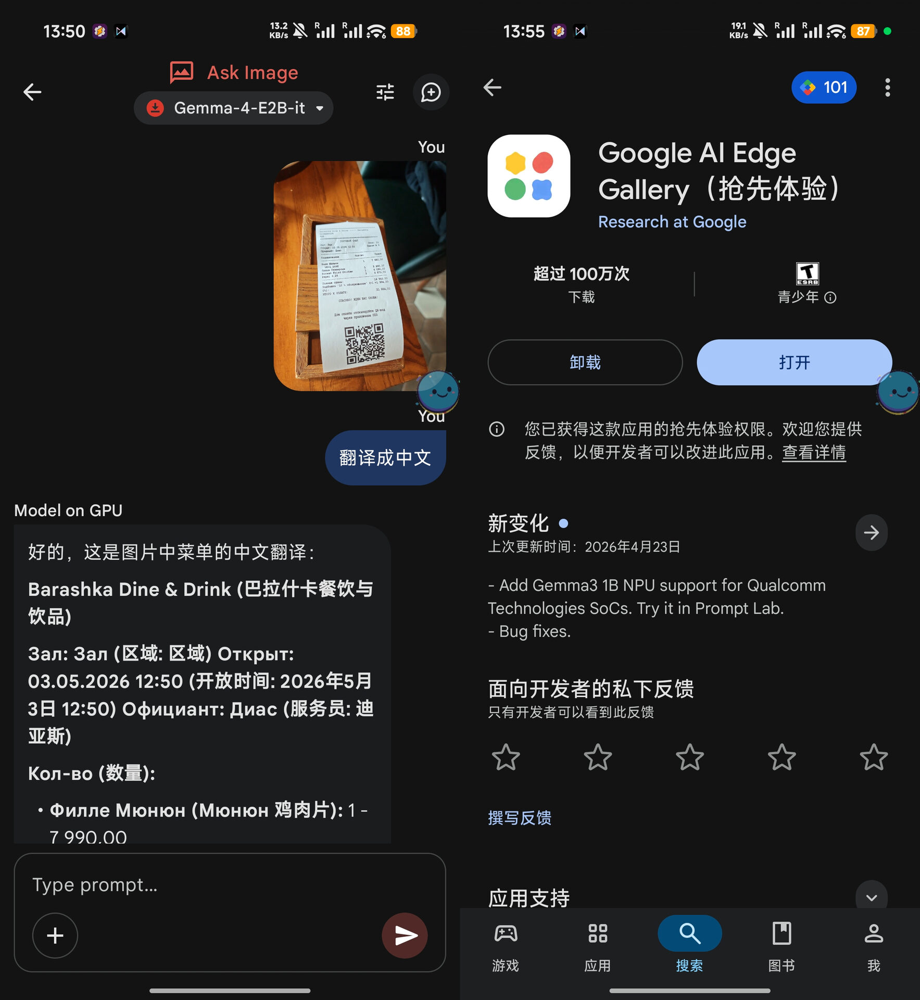

### 3.6 Food: A Survival Guide for Chinese Stomachs

The most awkward part of the whole trip was that the best food was always at Chinese restaurants. Purely local food is either meat or flour and grain products, and a Chinese stomach just can't take several days of that in a row. We had two Northeastern Chinese meals in Almaty, and that feeling of warmth at seeing a "Harbin" sign in a foreign land is something those who know, know.

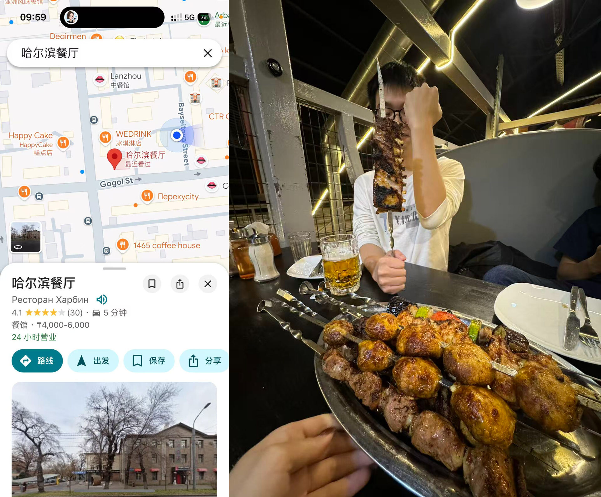

An interesting find: at a Chinese restaurant in Aktau, the menu wasn't the Chinese translated into Russian, but **Chinese dish names transliterated using Russian approximations of the sounds**. Google Translate had no hope with it. You have to ask an intelligent model like Gemini to work out what the dishes actually are.

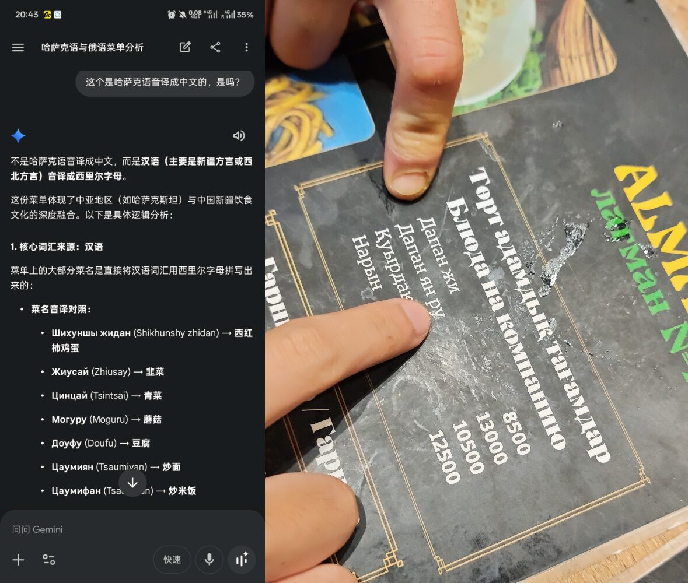

Buying water was a repeated pitfall too. Sparkling water seems to be the mainstream here, and the bottles look exactly like ordinary water. I bought the wrong one the first time, switched brands and got it wrong again. The same brand in a different package is a different thing inside. It took two or three mistakes to figure out the pattern, and in the end I still had to take a photo and ask AI.

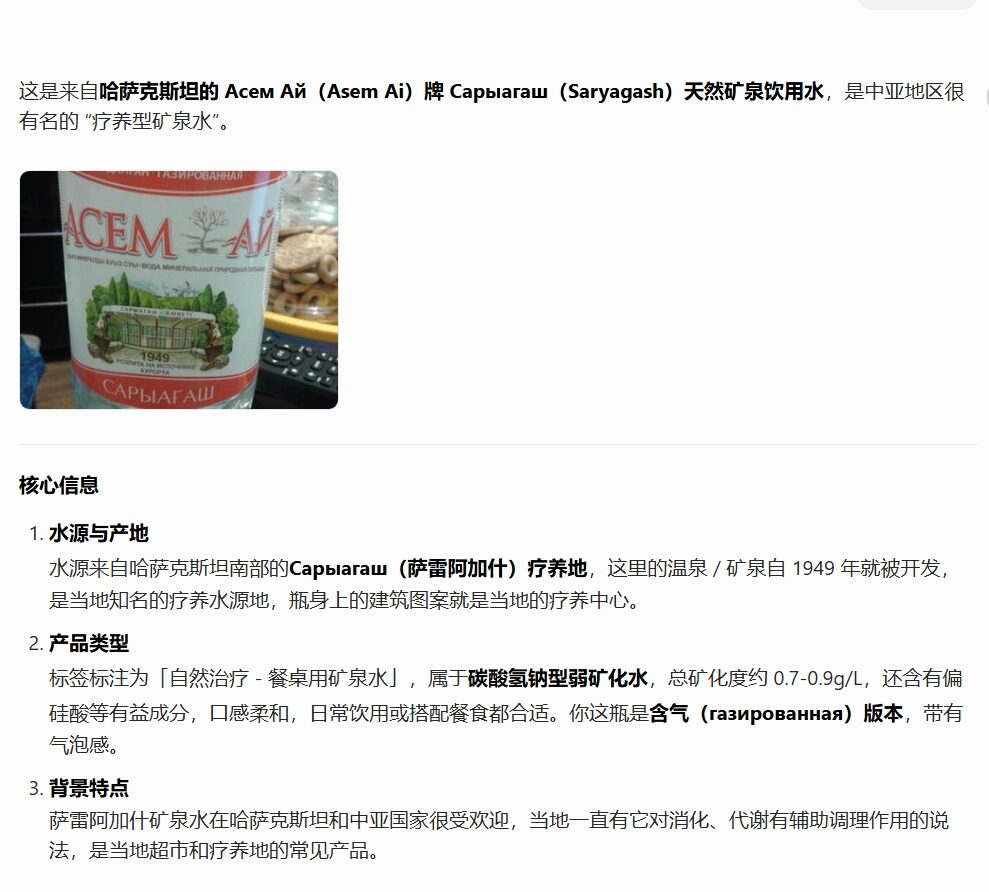

### 3.7 Gear: A Few Tips for Long Trips

- **Decathlon's swimming sports towel** is far better than a disposable bath towel. Disposable bath towels take up too much suitcase space, while the sports towel absorbs well and dries fast, which suits long trips with frequent changes of lodging.
  
- **Bring playing cards from China.** Many local supermarkets and shops don't sell ordinary playing cards; only specific card shops do.

---

## 4. Almaty Day 1: Sunset Coaster in the Soviet Era

We arrived in Almaty at noon. By the time check-in was done it was already afternoon, and in the evening we went to the amusement park at the top of the mountain.

The whole park gave me a feeling of traveling through time: loudspeakers tied to utility poles, rusty iron frames, simple but unpretentious joy. Most of the rides are scaled-down versions of what you find in Chinese parks, maybe the same ones you played on more than ten years ago. More broadly, the whole city gave me this feeling too: stuck in the Soviet era, with history and modernity blending together.

But the sunset coaster is worth riding. We happened to catch the time when the sun was going down. Sliding down the mountain and watching the sun drop behind the distant ridgeline gave me a very different feeling.

I've been into Chen Jingfei recently, so I naturally thought of **"Sunset Elsewhere"**:

> People come and people go, the fragrance of roses in rose-colored air, and quietly you become the past.

That evening the melody kept playing in my head on its own. Time really does pass quickly, and we each ended up falling for a sunset elsewhere.

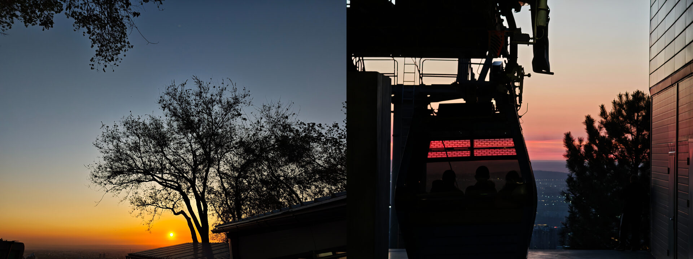

For dinner we had local barbecue. Nothing special, just lots of meat in big portions. The skewers were as long as a forearm, and you can find similar ones in China. But it's not so good that I'd rave about it. Once it cooled it got especially greasy, and the only thing that cut the grease was onion. In terms of taste it's not as good as those barbecue places in China that use distinctive marinades, and other than being cheap there's not much else to say. I suggest ordering a few at a time rather than too many, or the last few skewers are purely a fight against grease.

In the evening we went to a supermarket for water and fell into the sparkling-water trap I mentioned earlier.

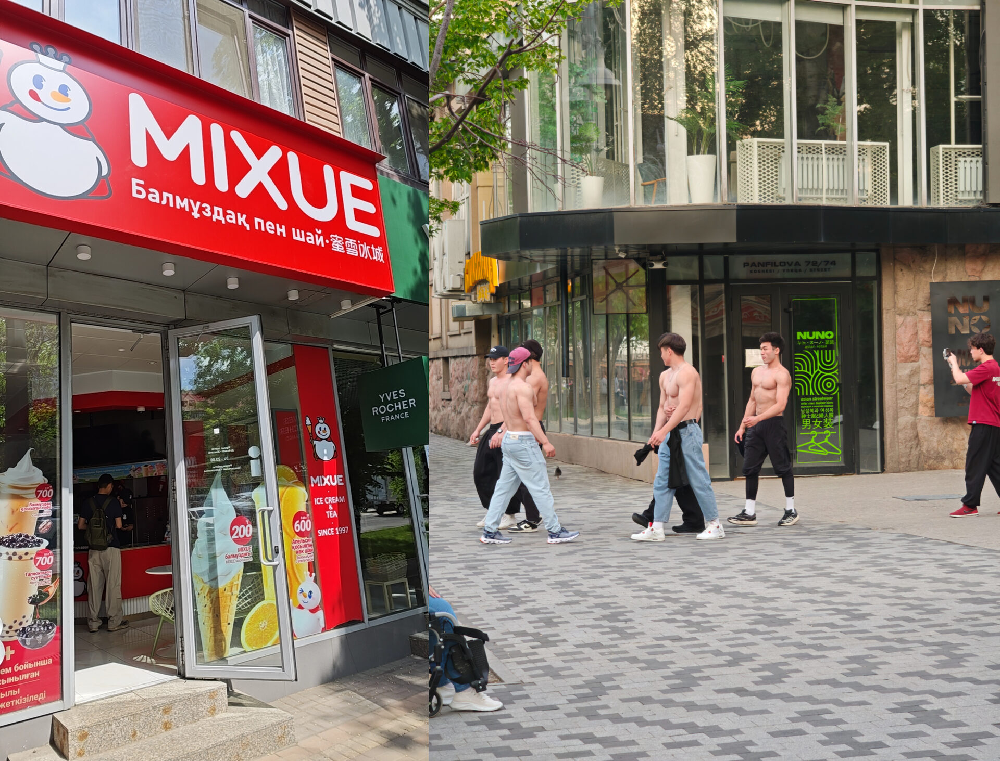

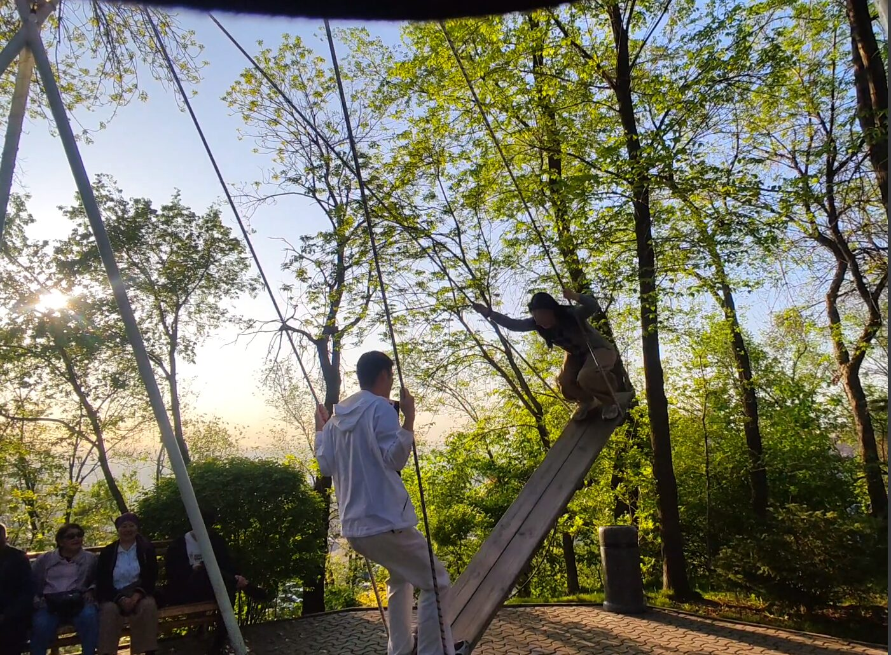

---

## 5. Almaty Day 2: Snow Mountains, a Drone, and a Bowl of Lanzhou Beef Noodles

### Cable Car Under Maintenance

The original plan was to take the cable car up the snow mountain. Of all the bad luck, it was under maintenance and only reopened on May 1, so we were a few days early. The public bus runs only once, at 9 a.m., and it was already gone by the time we got there, so we had to take a taxi halfway up the mountain.

There was also an environmental rule: gasoline vehicles can't go to the summit, only electric ones, at 5,000 tenge per car. Yandex Go couldn't get a car here, so I flagged down a car on the roadside with a "green car" mark on its body to get up the mountain. But once I got up there I found they were using diesel generators for power on the mountain. I don't know what exactly is eco-friendly about that.

### The Drone Blown Away by Canyon Wind

Then came the funniest thing of the whole trip.

I'd brought my DJI Flip drone and wanted to take off from halfway up the mountain for a panoramic shot, at an altitude of around 100 meters. Everything was normal at first, but then a sustained crosswind blew the drone straight into the canyon, and I couldn't find it. I got no footage at all and also lost a 128 GB memory card.

Only after reading up on it afterward did I learn that although the Flip is rated for Level 5 wind resistance, it is a lightweight model with fully enclosed propeller guards. In the sustained crosswinds and turbulence of a mountain-pass canyon, its flight margin is not generous, and a side wind can easily push it away. Once bitten, twice shy.

**Follow-up decision: I did not take DJI Care's 50% replacement offer.**

I thought it over, and two reasons made me choose not to replace it for now. First, the drone flying environment in China is terrible right now. UOM often doesn't approve flights, the checks on carrying them on transport are getting stricter, and the overall flying experience is very poor, with nine out of ten places you want to fly off-limits. I need to wait and see how policy develops. Second, the Flip's wind resistance really isn't enough for outdoor hiking scenarios. If I need this again, I'll go straight to the newly released Lito X1, which has better wind resistance. Besides, a used Flip body alone costs only seven or eight hundred, so there's no need to spend the 50% replacement money on something that can't fly.

I'd crashed a drone once before, back then it was a repair, so I have a bit of experience. This time I wasn't that panicked when it happened, and it didn't affect my mood much. I didn't dwell on the loss. It's just that the rest of the trip was missing a perspective, and I couldn't capture the grand aerial views of those landscapes, which is a real pity.

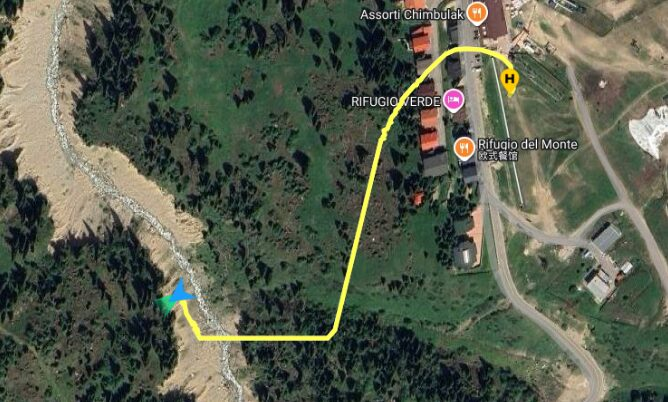

### Horse Meat, Lanzhou Beef Noodles, Craft Beer

On the mountain I also tried a horse meat snack place. The texture was strange, with a flavor I can't quite describe, and I just couldn't get used to it. My friends, on the other hand, discovered a Lanzhou beef noodle shop: after traveling far and wide, you still come home to your Chinese palate.

In the evening we went to a local bar for craft beer. My friend said craft beer here is very cheap: a large glass is only 30 RMB, where the same volume would be 50 in China. What surprised me was how ordinary the atmosphere was. You could even see dads and moms bringing kids of three or five years old, without the sense of distance that bars in China have.

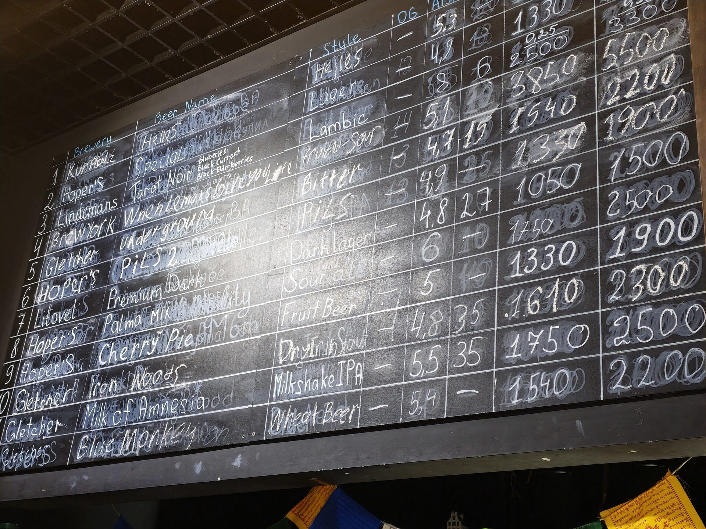

---

## 6. Almaty Day 3: The Failure Lessons of the Aqueduct Hike

My friends and I hike a lot, so on day three we picked the Almaty Aqueduct route. It was a spur-of-the-moment decision: no hiking shoes, no trekking poles, nothing prepared when we went.

It started with a sustained climb along the big pipe, which was very tiring. The weather didn't cooperate either: heavy fog and lots of moisture, the whole route shrouded in thick mist with very low visibility. At the top the lake was entirely frozen, and there was no distant view to speak of.

I had GPT generate an "expected image" and compared it with the real thing, and the difference was big. The AI drew me a blue lake with no fog, while reality gave me a gray blur where I couldn't see anything.

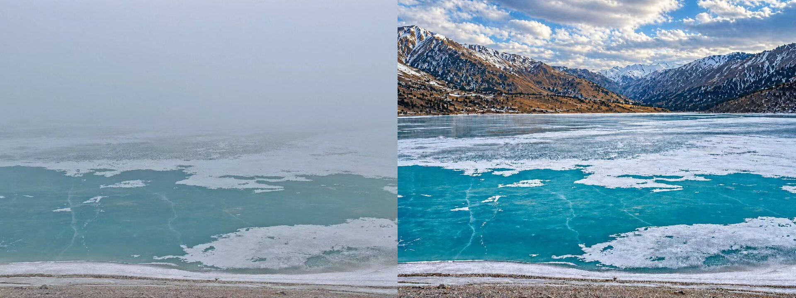

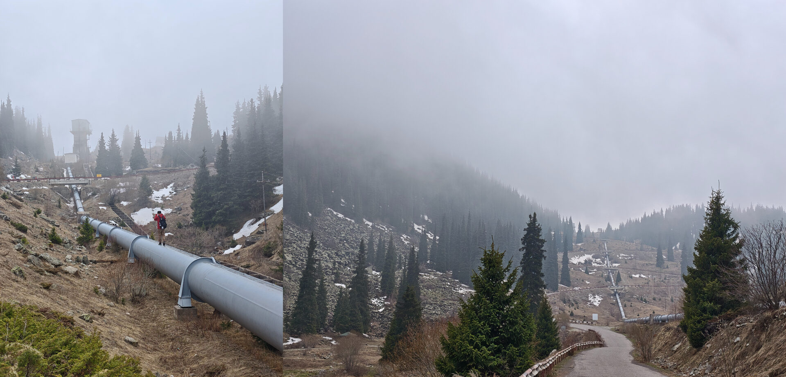

This route is only an experience. Purely in terms of scenery, many routes in China are better. The pipe itself is a distinctive feature, but the natural scenery doesn't stand out. If you're planning to go, **choosing the right weather** matters more than anything. Next is to relax and adjust your expectations. If you find it tiring, renting a car for that opening stretch straight to the summit is also a fine option, and there's no need to force yourself. When tiredness can be solved with money, sometimes you shouldn't just push through it.

---

## 7. Almaty Day 4: The Museum, Then Off to the Countryside

In the morning we went to the local art museum, which had an exhibition of works by the country's artists, with oil paintings, sculptures, and video material. Some paintings were quite interesting and I could roughly pick up on some of the emotion, but without the local cultural and historical background I really couldn't understand them more deeply.

This is where I have to mention **Doubao**. Most of the time I'd just take a photo and ask it a question, or even video call it so it could look at the exhibits and explain them. Its answers were convincing, like a cultural advisor available anytime, anywhere. Of course I don't have strong feelings about cultural things, so I just treated it as broadening my horizons.

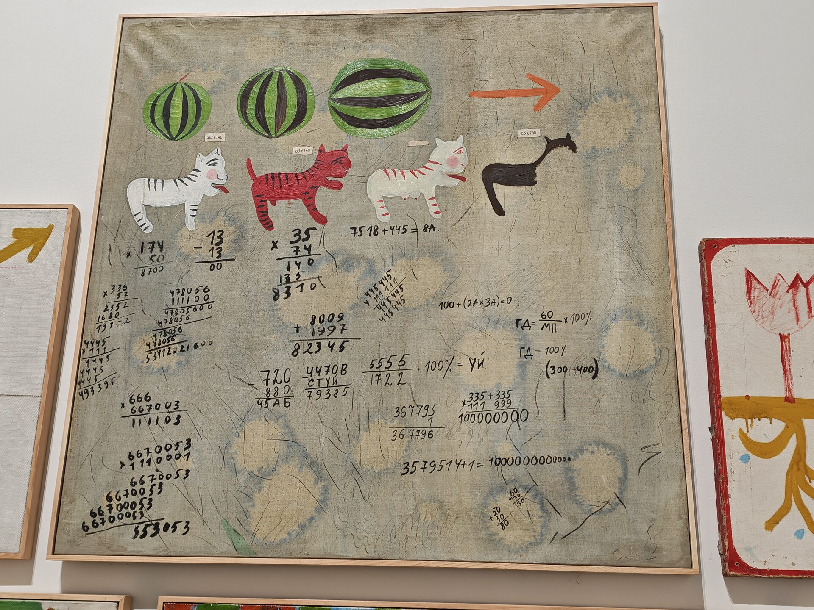

In the evening we joined a tour group and headed to a meeting point in a village in the countryside outside Almaty. The moment I stepped off the vehicle, it felt like I'd arrived at my grandmother's village: the familiar smell of livestock dung, a remote hamlet, a starry sky of unusual clarity. You can't ask for fully equipped facilities, but it was relatively clean. The only problem was that the curtains didn't block any light, so you'd be woken by direct sunlight in the morning. But since we had an early start the next day, it worked as a natural alarm clock.

The signal was very poor, so I went to sleep quickly.

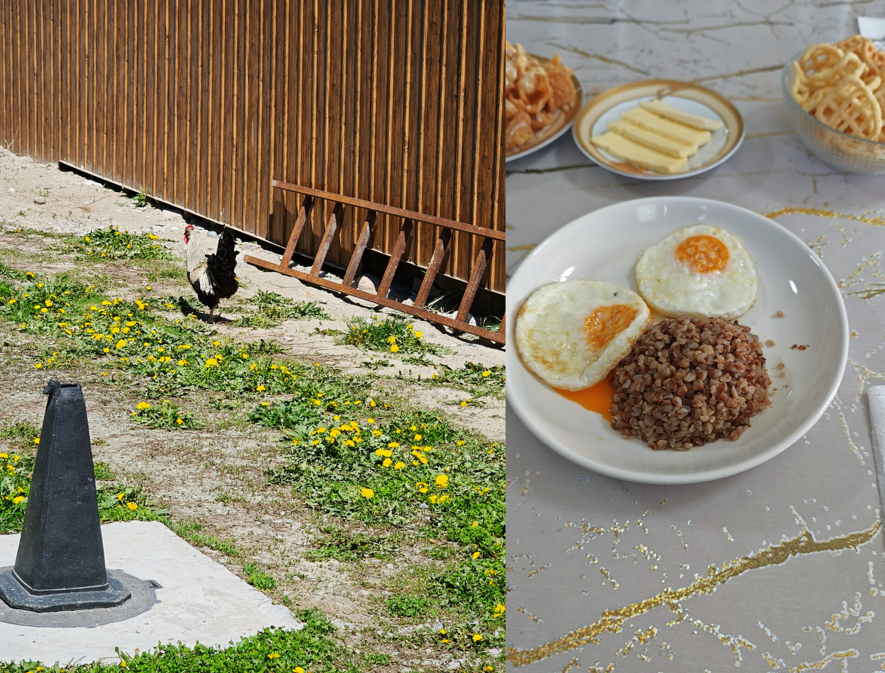

---

## 8. Two Lakes and a Canyon: Bonfire, a Filipino Couple, and Chen Jingfei's "North Sea"

"Two Lakes and a Canyon" is the most classic natural route around Almaty: Kolsai Lake (easy hiking + boating on the lake + photo spots on the slopes), Kaindy Lake (the sunken forest), and Charyn Canyon (often marketed as Kazakhstan's Grand Canyon, with hiking inside the canyon).

On the bus to the two lakes and the canyon, the guide enthusiastically played "Gangnam Style." The last time I heard this song was in middle school, and what came to mind was watching a girl I liked dance to it at KTV. More than ten years later the song is still the same song, but all the listeners have changed.

The locals are indeed heavily influenced by Korean culture, and when they see an Asian face many of them first ask whether you're Korean.

The lake scenery lived up to expectations. Purely on scenery it doesn't beat Jiuzhaigou, but there aren't as many people here, and it's quiet. I also tried horseback riding up the mountain: 40 minutes for 100 RMB, much cheaper than in China.

### On AI-Composited Photos: No Need to Waste Time on Photography

Locally there is an eagle (or maybe a vulture?) tied up so you can pay to take a photo with it. In the past I'd definitely have paid, but now I don't think it's necessary.

You take a rough shot of the background, or someone else's photo as a reference, and just have GPT Image 2 composite it for you. It comes out seamless, and you can't tell at all. The same logic applies to photographing a boyfriend or girlfriend: take a background and a rough shot of the person and blend them, which is more than enough for a social-feed-level use. There's no need to spend lots of time chasing the perfect shot, and the line between photo retouching and AI-composited images is no longer very clear.

**My own feeling is: seeing it with your eyes is enough.** I'm not that into taking photos, but I am into shooting video. It's more three-dimensional, with sound, motion, and ambient noise, and it lets you truly recall the feeling of that moment later. A heavily retouched photo can't do that.

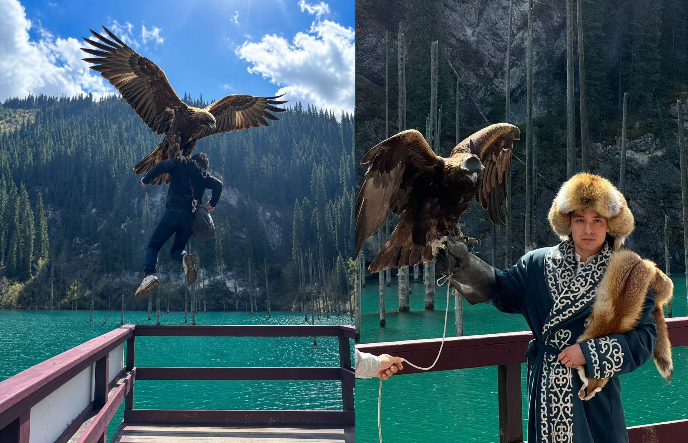

### Bonfire Party

In the evening there was a bonfire party. I hadn't expected that in such a small place, the tour groups could gather people from so many countries: China, Korea, India, the Philippines, Russia, the US, Canada, and Scotland. And the bonfire party was very raw, not like the heavily commercialized bonfires in China. Everyone had had a bit to drink and was relaxed, chatting on and off around the fire, and the experience was quite good.

I met a Filipino couple on their honeymoon, their first time abroad. I talked with them for more than an hour. They spoke fluent English, and mine is relatively mediocre; I could understand most of it, I just didn't quite know how to put my thoughts into words. We got by with gestures too. We talked about the usual things: how each of us met our partner and what this trip's itinerary was. We even swapped banknotes, and I found that Philippine banknotes have a transparent window, which was quite interesting.

At the villagers' house where we stayed, we could hear popular Douyin songs from China, which was surreal. They were collecting currency from different countries too, so I left a Chinese banknote for him.

### The Boat, Then the Canyon

There were boats on another lake, and the commercialization was done fairly well. On the boat I played Chen Jingfei's **"North Sea."**

The last lakeside-trail trip like this was in Xinjiang in September 2024. Although only a bit over a year has passed, many of the details of those memories have blurred, and only fragments remain to outline how it was. It's just that now that person is gone, and my state of mind is very different.

> At this moment, are you living the life you long for?

It's a question, and it's also a blessing. I hope all my friends can live the life they long for.

The food in the suburbs was very plain. We ate together with local families. Some of it was okay, and some was plain oats with no seasoning, with the vegetables being just carrots and pickled cabbage. If you also have a Chinese stomach, I suggest bringing some food from China that complies with customs quarantine rules.

The second day was the canyon. The scenery was desolate, and often there was no signal. That kind of desolate scene easily gives rise to a feeling of sorrow, and my mood wasn't really in it, so I mostly just followed the road.

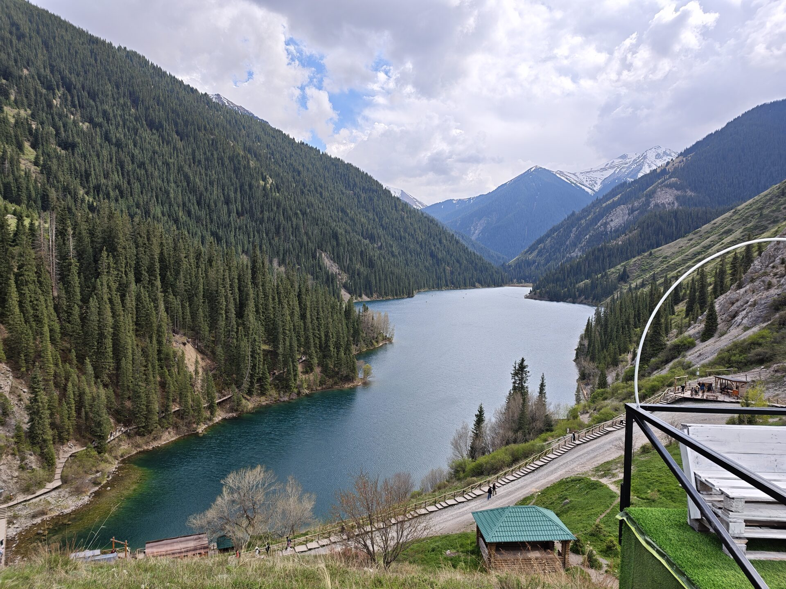

---

## 9. Aktau: Seabed Ruins and Caspian Mist

Only when I looked at the map did I realize Aktau is already close to the Caspian Sea, and fairly close to Europe. It may be the closest I'll ever get to Iran in my life.

### Arrival

May 1 is Kazakhstan's Day of Unity. In the morning in Almaty we watched the holiday performances, a multi-ethnic countryside stage show that was quite lively. In the afternoon we flew to Aktau.

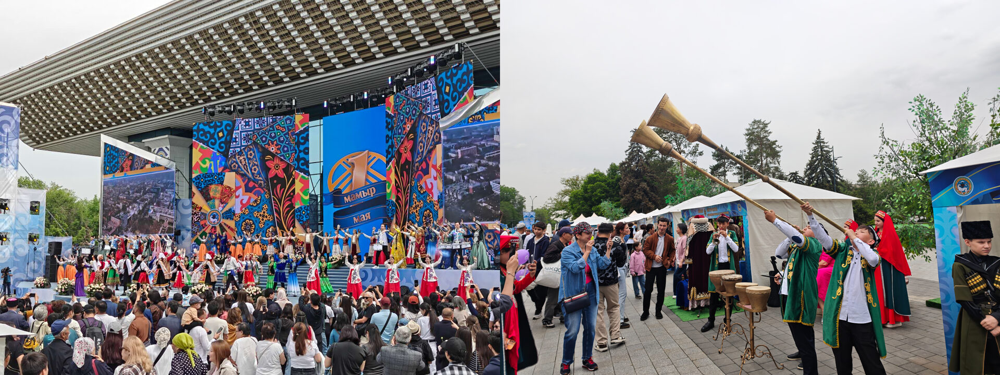

The hotel in Aktau had a strong smell of formaldehyde, but overall it looked decent enough, and I didn't ask for more. In the evening we went for Chinese food, at the same restaurant I mentioned earlier that transliterates Chinese dish names in Russian.

### Mangystau Seabed Ruins

The next day we joined a tour, the "3 Locations in one day" day trip, departing at 08:45 and ending at 21:30, about 13 hours, at 17,000 tenge per person (about 243 RMB). The main sights were Bozzhyra Valley (the Mars-like landscape) and Kyzylkup (the Tiramisu canyon). Apparently geological formation pushed the ancient seabed up to the surface, so you can see all kinds of geological features and sedimentary rock.

But this trip was a real ordeal: 4 hours out and 4 hours back on the bus, over very bumpy roads that kept throwing you into the air, so be sure to fasten your seat belt. On the way back, the road was muddy and the bus **got stuck**, so everybody was forced to get off and push to free it from the mud pit.

Of the fifteen or sixteen people on the bus, apart from the guide, the driver, and two local passengers, everyone else was Chinese, since it was already the May Day holiday back home. The guide even ran an icebreaker on the bus, which produced a wonderful scene: lots of Chinese people introducing themselves to each other in English on the wilderness of Kazakhstan. For a moment I couldn't tell whether we were the foreigners or they were.

### Red and White Landscape + Tiramisu

The first stop was a red-and-white striped landscape, and it was magnificent. This is where I really regretted having no drone, because terrain on this scale simply can't be captured from the ground.

A fairly interesting interlude was not being able to find a toilet. The surroundings were an endless plain with nowhere to hide, so in the end I had to climb to an untouched hilltop and relieve myself into the wind. I even recorded it, so it's a unique memory.

Next was the place called "Tiramisu": a few block-shaped hills suddenly rising out of a barren plain, surrounded by landforms shaped by wind erosion and sedimentation. It really is great for photos, with a desolate feeling of looking for the end of the world, so you could see a long line of people queuing to take pictures. It was a place with more drones than birds.

Some of the wind-eroded formations nearby were hollowed out at the bottom and had faint cracks on top, so I didn't dare linger on them long. The guide also said there are no public toilets here and you need to find a "hidden place" yourself, which left everyone speechless :)

### Caspian Coffee Shop

The next day was a free day in Aktau, and I spent an afternoon at a coffee shop by the Caspian Sea. It was very foggy that day and the view wasn't clear, but sitting there watching three large cargo ships drifting in the mist in the distance suddenly made the Caspian feel concrete to me.

Given the current situation in the Middle East, I couldn't help wondering where those ships were headed. Seeing on the map for the first time how close I was to Iran was a rather strange experience.

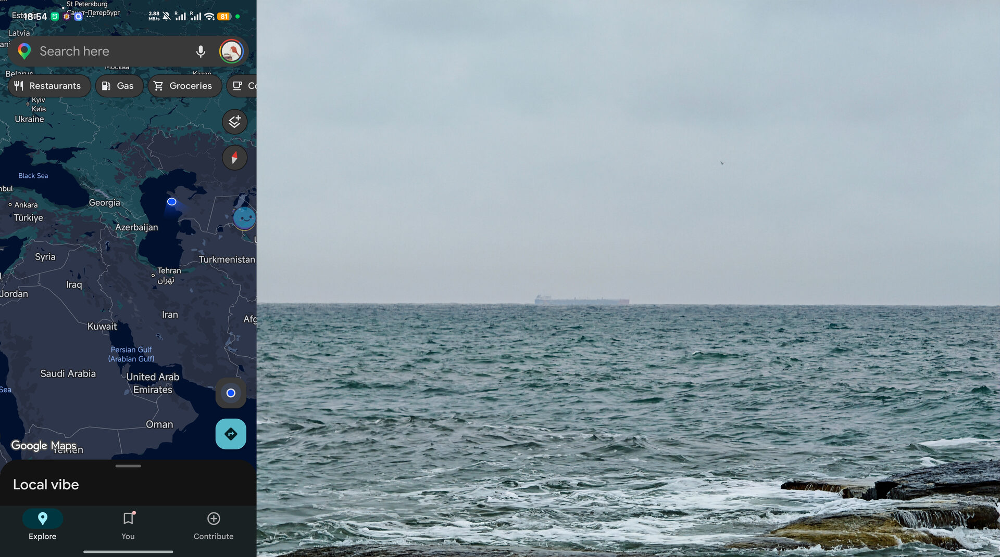

In the evening we went to another local barbecue place. No surprises, as expected.

### Return

We flew from Aktau back to Almaty for a connection, then waited for the evening flight back to Guangzhou. When paying for overweight baggage on FlyArystan, the credit card problem I mentioned earlier repeated itself: the CCB VISA couldn't pay, the Hong Kong card didn't have enough balance, and I had to log into another account and transfer money as an emergency rescue. The time difference between the two places is 3 hours, so we took off at 9 p.m. local time and it was already past 5 a.m. when we landed in China. After a night on a plane, I got home, took a shower, and fell straight into bed, waking at two in the afternoon.

I figured I hadn't eaten many vegetables these past few days, so I bought a hotpot and a jin of baby napa cabbage to make up for it. That evening I started writing this travelogue.

---

## 10. Food for Thought on the Road

Whether on a plane or a bus, the time on the road is long. You either read, watch shows, or listen to podcasts. Either way you have to fill those seven or eight hours of bouncing across the wilderness.

### Books

- **Ma Qinwang's *The Second Emperor of Qin Must Die***: wild imagination combined with serious historical research. A very interesting novel that reads fast, and the experience was good.
- ***Nexus*** (by Harari; a reread): looking at this book again against the current pace of large language model development, on one hand I marvel at the insight that reaches across time, and on the other more questions arise. What will it look like when agents are deeply involved in every aspect of human society? Back when AI was still primitive, algorithms could already influence elections. What about now? There's no choice but to look forward. No one can unilaterally withdraw from a game-theoretic environment. Would you be willing to hand your fate over to someone else? Along the way I also came across an article about the permanent ["useless class"](https://archive.is/20260503132651/https://www.nytimes.com/2026/04/30/opinion/ai-labor-work-force-silicon-valley.html) theory. Putting the two together, they're getting closer and closer to reality, which made me sigh even more.
- **The original novel of *Ordinary Songs*** (《凡人歌》): recommended by the podcast "Fei Hua Lian Pian." The network was bad then and I couldn't watch the show, so I went looking for the original novel to read. I could understand the characters and empathize with them, but I don't necessarily approve of them.

  > On the five-hour bus ride toward the suburbs of Kazakhstan, I listened to the 2024 episode of Fei Hua Lian Pian that recommended the TV series *Ordinary Songs*.
  >
  > The roaming signal came and went, so watching full videos was out of the question. I could only go find the original novel and see whether I could finish it in this stretch of time.
  >
  > The novel isn't long and reads smoothly, and I could empathize with its twists and turns.
  >
  > The three male characters in the novel left me shaking my head in exasperation as I read; each was hateful in his own way.
  >
  > Na Wei's earlier job loss and stumbles were all fine. They just make you feel he's foolish. But his wife goes out to sell braised meat and he does nothing to help, just sinks into gloom. That is only infuriating, and, damn, so embarrassing.
  >
  > Na Jun seems clear-headed, but he is always fixated on wanting to change others. Plain crazy. "I wanted it when I came, I strove for it, I got it." This smooth experience reinforces itself and takes him further and further down the path of execution. Understanding how the world works is the real learning.
  >
  > Shen Lei just goes against the grain. That attitude toward life doesn't matter if he lives alone, and has no effect on the world. But if you want to take part in the dating and marriage market, you can't expect others to be content with poverty and happy with the Way as you are. It's plainly not a fit, so why force it?
  >
  > So I do think Xie Meilan leaving him was a very good choice, only it should have come sooner. This has nothing to do with loyalty; it's simply plain market behavior, and everyone has the right to pursue a better life for themselves.
  >
  > Shen Lin, a remarkable woman, who could pick things up and in the end could put them down. Under the soft body runs a steel-like energy that keeps the whole family going. Lao Na was punching above his weight to marry her.
  >
  > Li Xiaoyue is good. Whether clear-headed or ignorant, she enjoyed her happiness, has no regrets, and is very clear on the big life choices.
  >
  > Xie Meilan, I hope she gets to live the life she wants.
  >
  > ---
  >
  > As for this novel, the TV series should have aired around August 2024. ChatGPT appeared around early December 2022. And right now it's 2026, after four years of AI sprinting ahead.
  >
  > So if we really were to push their lives further forward,
  >
  > the ones whose days would be thriving should be the cousins' renovation crew and Shen Lin's braised meat shop.
  >
  > They are the real producers, solving concrete, practical needs for society one by one.
  >
  > As for the other friends, I can only wish them luck.
- ***Gödel, Escher, Bach* (GEB)**: I had read an article about the protocols and text-first design philosophy that people came up with in the early days of limited computing resources, which unexpectedly collides with the needs of today's large language models. So I picked up this 1979 odd book. I got through seven or eight chapters and couldn't continue, and after that I just chatted with Gemini about the emergence of consciousness: the underlying mechanism may not need to be that complex, but the upper layers can achieve the emergence of consciousness. Looking at today's AI development, it's a bit magical.
  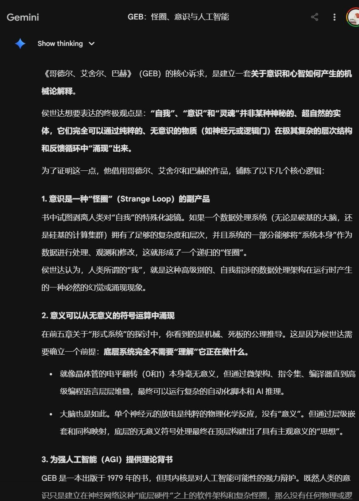
- ***The Art of Unix Programming***: the Unix philosophy has always been valuable, but with the spread of LLMs and agents it has become especially prominent and important. There's really no need to remember the specifics, since the large model certainly knows them better than you; you only need to know the direction. It's strange how a design philosophy from the era of scarce hardware fits the needs of the large model era.

The attitude I've already talked about in a previous article, [from anxiety to acceptance](https://mp.weixin.qq.com/s/Rjxlr-O2kbH2vtHOWJ2G9A), still holds: experience as much as you can right now. No one can change this direction anymore.

### TV

**The first half of *Friends* Season 1**: recommended by "Fei Hua Lian Pian." I wanted to train my ear. The plot is also okay, and it will probably become something I watch while eating.

### Podcasts

**Fei Hua Lian Pian** is probably my podcast of the year. It offers the very rare perspective of a married couple in conversation, and the way they get along so well is enviable. Another thing is that the guy is from Dalian, Liaoning, just like me, which gives me a natural sense of affinity. I have it on whether or not there's anything going on, and I've listened to over 130 episodes. Recommended.

---

## 11. An Unexpected Discovery

For some reason, my sleep quality during this trip was exceptionally good. My wristband data shows that my usual sleep score averages around 70, but during this vacation trip it actually averaged 80, and one day even hit 95, a high score I hadn't seen in many years.

The cause is unknown. Maybe all the hard walking each day wore me out, maybe I was away from my usual sources of anxiety, or maybe it was simply the good country air. Anyway, I'm noting it down.

---

## 12. Epilogue: Has the Golden Age of Outbound Travel Passed?

After I got back, I was scrolling Xiaohongshu and saw that there were air-raid sirens when planes landed at Dubai airport. Fuel conditions, the world economy, all kinds of uncontrollable factors... it stirs up some feelings.

**The best era of outbound travel may already be over.** More than ten years ago it was cheap and smooth, and there were no unpredictable risks like war. And now? I'm reminded of that classic line: although things are already much worse than they were 10 years ago, this might still turn out to be the best year of the next 10.

A great upheaval unseen in a thousand years: take it one step at a time, and experience as much as you can.

When I travel abroad now, I pay special attention to the local **geopolitical risk**: war safety, the economy, public security, strikes, whether fuel supply is adequate. These are things I never had to consider before, and now they've become mandatory.

Whether from the standpoint of holiday travel experience or AI development, **I should return to a flexible-work state as early as possible**, and sooner is better than later. This time, because of some temporary work needs, I handled things remotely through [HAPI and Cloudflare](https://mp.weixin.qq.com/s/w8VnWJcUp5VkD5J-fYCUrg), and the whole experience was fairly smooth, which further confirmed my judgment: when traveling, a big screen, a good network connection, and a voice input method are enough, and the compute-heavy work can run on high-performance servers.

If you can work anywhere, then you can live anywhere.

---

I hope everyone gets to live the life they want. Dream more, experience more.

That's all.
