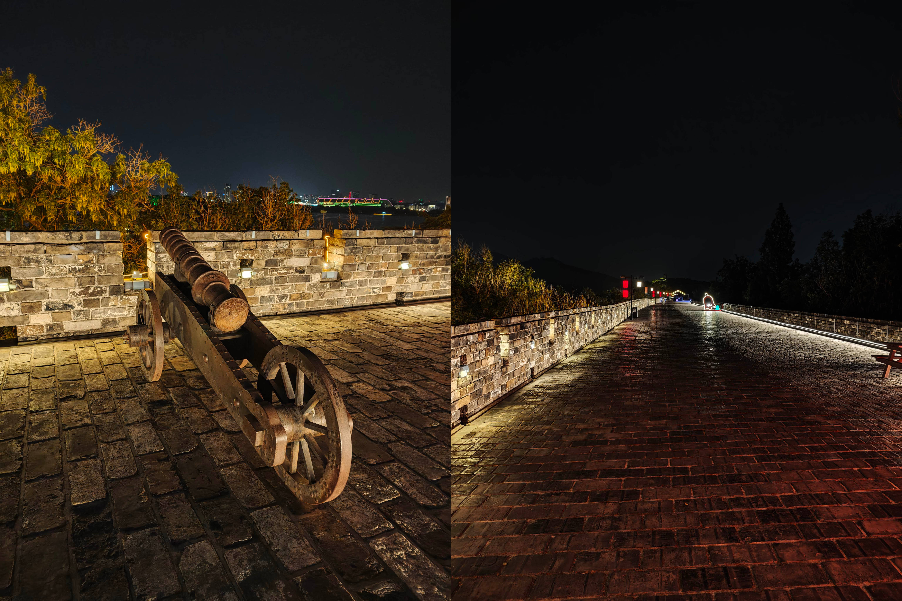
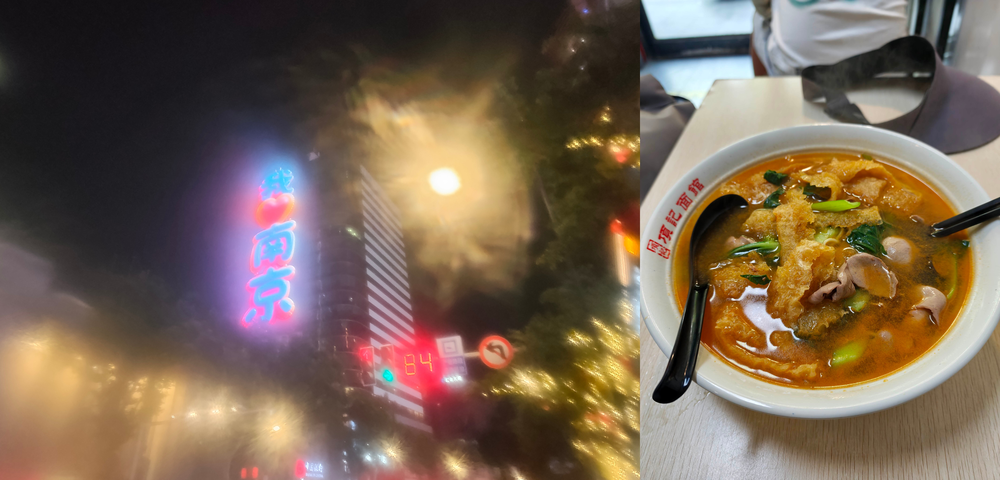
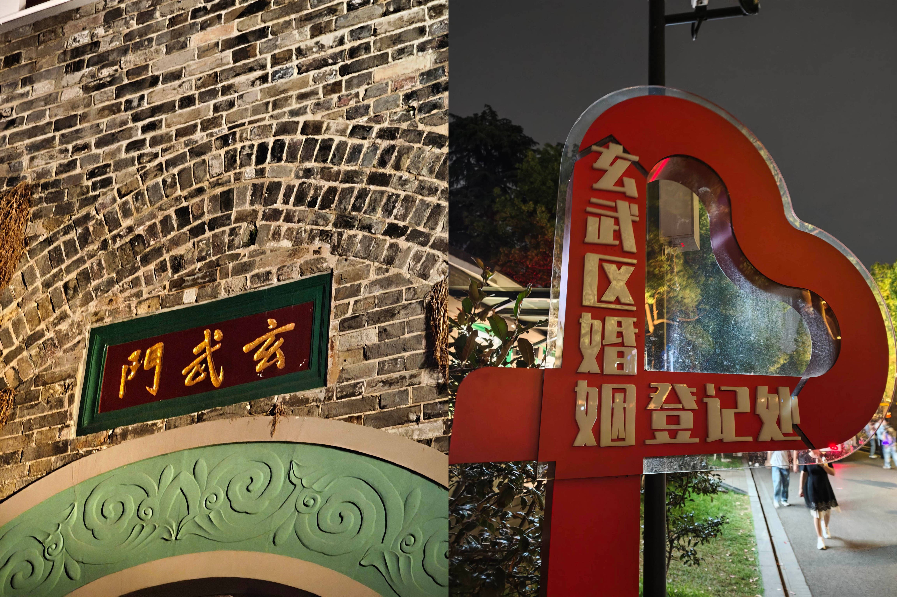
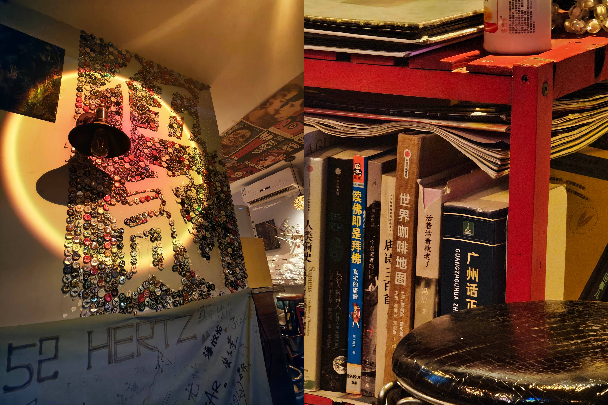
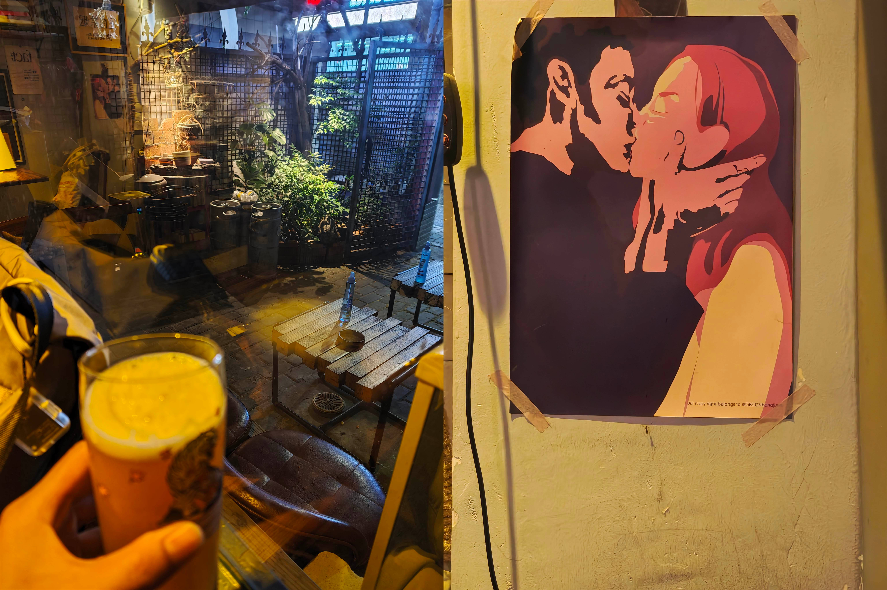
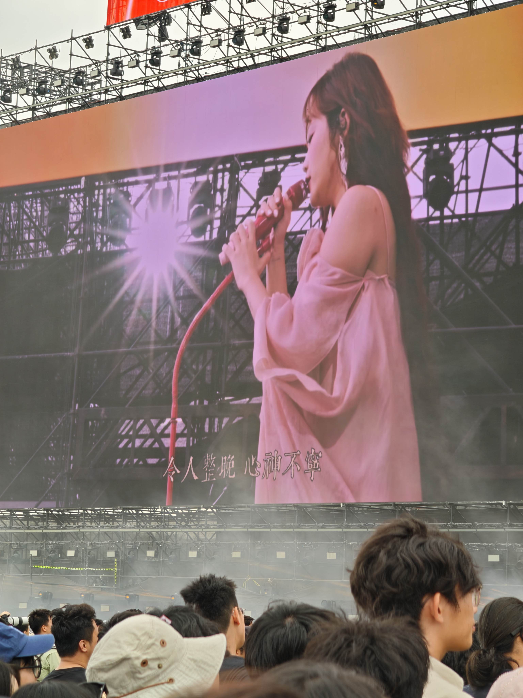
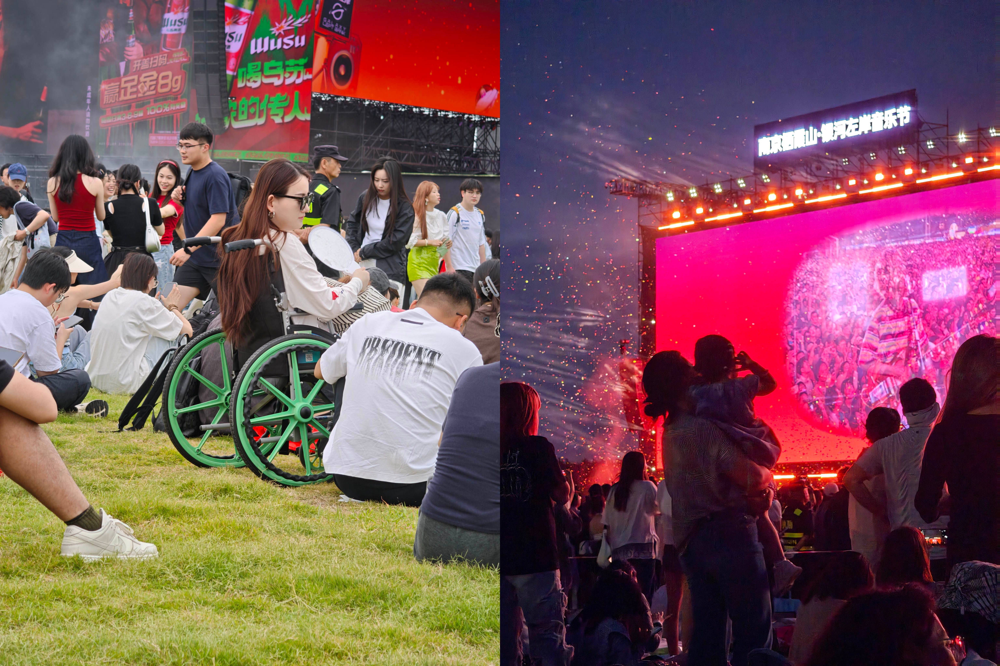
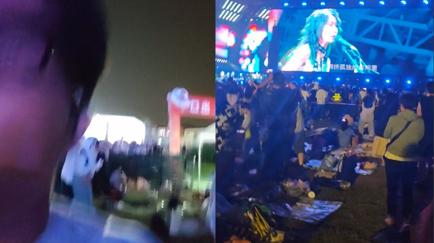
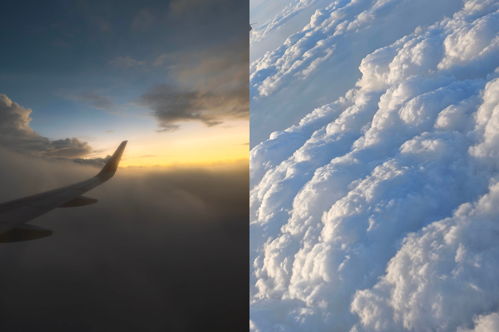
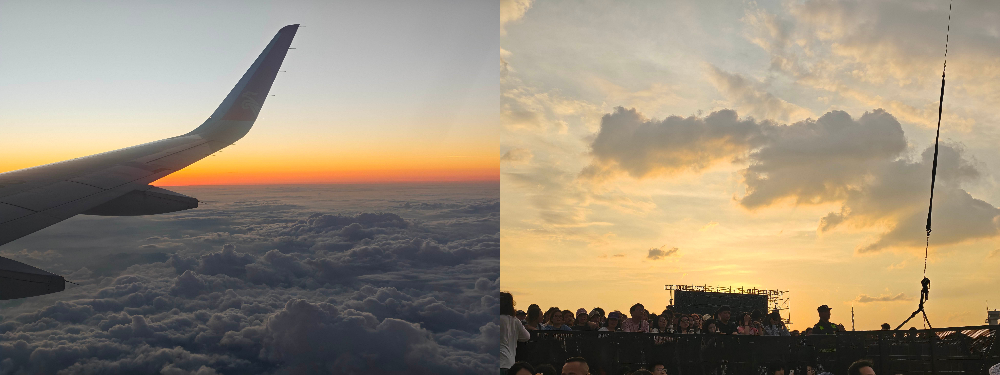

*Translated from the [Chinese original](/posts/260613-nanjing-music-festival/).*

---

I wanted to write a travelogue but was too lazy to do it properly, so I first rambled through everything I wanted to say into Feishu's Recording Bean, then slowly sorted it out.

## 1. How It Started

It started simply: a friend said there was a music festival in Nanjing, and **Chen Jingfei** happened to be on the lineup, so they asked me to come along. I said yes instantly.

I thought it was my first time in Nanjing, then realized later that it was actually my second. My friend ran into an unexpected problem at the last minute and couldn't make it, so the whole trip became a solo trip.

## 2. Departure: The New T3, Pretty but Not Very Useful

My flight was a little after nine, so I dragged myself up at 5:30 and took the intercity rail to the new Terminal 3 at Guangzhou airport.

The facilities really are nice, but it's beautiful in a way that isn't very practical. Dragging a suitcase across that stretch of carpet was so tiring I wanted to curse. The little details like charging spots, though, are much better than in the old terminal.

## 3. Landing: Pi Du Noodles, and a Venue Way Out in the Countryside

After landing in Nanjing, I went to Xinjiekou first and had a bowl of pi du noodles (noodles in soup with fried pork skin). It was a local place my friend had found from a Doubao guide, and the taste was decent.

After eating I rushed out to the suburbs, to the Qixia Mountain music festival venue. Good grief, this place is truly the countryside. It's 20 kilometers from the airport to the city, and another 20 from the city to the venue, so that's 40 kilometers one way just on the road. By the time I'd checked in I was completely wiped out, and I collapsed into bed and slept until six in the afternoon.

When I woke up I thought: it's my second time in Nanjing, so I should get out and see more. Why not go into the city, eat something, find a sight to walk off the meal, and mumble to myself for a while.

## 4. A Night at Xuanwu Lake: Crab Roe Noodles, a Bike Ride, and the Couples by the Water

After searching around, I decided to eat near Xuanwu Lake first. I'd wanted xiaolongbao with duck blood vermicelli soup, but that shop doesn't open at night, so I found another place near the subway station through Dianping: crab roe noodles and xiaolongbao.

One bowl of crab roe noodles with crab roe cost 88 yuan. Honestly, I felt nothing for that flavor (maybe it was the cooking), and I ate with little enthusiasm, relying on a pile of side dishes to cut the richness.

After eating I headed to Xuanwu Lake. Taxis were hard to get, and it was only 4.7 kilometers, so I simply hopped on a shared bike. It was past eight by then. Nanjing's roads are quite well suited to cycling. Halfway there I saw a little girl sitting astride the back seat of an electric scooter, leaning against what was probably her dad. It was lovely, but by the time I wanted to snap a photo I'd already ridden far past.

I'd assumed Xuanwu Lake at night would have few people and be good for a solo stroll, but when I reached the entrance I realized I was completely wrong. It was packed, with all kinds of performances inside, commercialized to the max.

Just as I entered Xuanwu Gate, a pair of tourists next to me asked: what does this Xuanwu Gate have to do with the Xuanwu Gate Incident of the Tang dynasty? It stopped me for a second, and I found it funny too.

> The two gates sharing a name is essentially a reflection of the "tradition of naming by direction" in ancient China:
> Xuanwu, as the cultural symbol of the god of the north, ran through the construction of ancient Chinese capitals, and the northern gates of palace cities and capitals were often named "Xuanwu."
> The Tang dynasty's Xuanwu Gate was named directly for its position as the main northern gate of the palace city. Nanjing's Xuanwu Gate was named indirectly, after Xuanwu Lake (the lake got its name because it lay north of the Six Dynasties capital, fitting the feng shui pattern of the Xuanwu in the north). Both ultimately trace back to the same traditional cultural logic.

I walked three or four kilometers around the lake, though not the whole circuit. I usually listen to podcasts, but since I'd be watching the show the next day, I put Chen Jingfei's playlist on loop and hummed along.

There's no railing along the lake, and I could see couples here and there, sitting in pairs under the trees or at the water's edge. Nobody was scrolling on a phone; they just chatted back and forth in low voices. The evening breeze on my face was lovely.

> The heart's secrets in youth are the most endearing.

As I walked, I caught sight of a Chayan Yuese (a Changsha tea chain) by the lake. I'd only seen one in Changsha the week before last, and now I'd run into one in Nanjing too. Suddenly a thought popped into my head: wasn't "Chayan Yuese" adapted from some idiom? But I'd heard the name so many times that I couldn't for the life of me recall the original idiom. I asked the Xiaoai voice assistant, but it probably didn't pick up my voice and gave no answer. In the end it was Doubao that told me: oh, right, **he yan yue se** (和颜悦色, "kind and cheerful in manner").

Even that phrase looks unfamiliar now. I haven't said it in so long that my head was full of nothing but Chayan Yuese, Chayan Yuese.

## 5. A Night Walk on the City Wall: Quiet Amid the Bustle, and Things You Only Think About Alone

I walked until I reached an exit and suddenly noticed a ticket gate for the city wall next to it. I figured surely the wall was open to climb? I asked a staff member, who said it closes at ten and it was now nine. The ticket was 30 yuan. I hesitated for a moment, then thought: I'm here anyway, so let's go up and have a look.

The ticket turned out to be worth it. There were very few people up there, maybe because it was close to closing, and it had a real feeling of **finding quiet amid the bustle**. As I climbed the steps, the noise behind me receded bit by bit and slowly faded away. Looking ahead, you might be the only person on the whole path. A perfect place to mumble to yourself.

So on the city wall I turned on the recorder and, facing the night, slowly talked through some thoughts.

> The carved railings and jade steps should still be there; only the rosy faces have changed.

I'd always thought I had never been to Nanjing, until one day I suddenly remembered I had probably come in my sophomore year. That memory is so faint that I can't recall anything specific, just some blurry fragments: there seemed to be a bookstore on a downward slope, where I bought a little bear charm and hung it on my shoulder bag; later I stopped carrying the bag, and the charm broke. So many things just scatter quietly like this. Maybe that's why my impression of Nanjing has always been so thin.

Coming back now, I'm much more at ease. After going through all these things, I know more clearly what kind of person I am, what kind of relationship I want, and what I'm really chasing. And I have no obsession at all with places I must check in at or photos I must get. It's more about wanting to experience more and record more.

The night breeze was very comfortable, cool and light on my face, and I casually played Chen Jingfei's "Evening Breeze."

> Evening breeze, how many beautiful dreams you bring, how much hidden pain you blow away.

Walking alone, my thoughts always drift far, and I can't help asking myself: what will the future actually look like?

By the lake there was something of the feeling of "Moonlight over the Lotus Pond." Some people chatted under trees, others sang by the water; the friends strolling ahead of me were joking around, their talk mixed with cheerful laughter.

It reminded me of a Li Dan livestream I watched earlier, where a bookish listener wrote in to describe the feeling of their stirring youth, roughly the experience of one glance making your heart race. Li Dan said he was especially envious. Honestly, I felt the same way watching it.

But as the years go by and experience piles up, I now look at everything through a layer of quiet rationality, and it's hard to get "carried away" anymore. When I see a pretty girl, all I have left is "Mm, pretty," and then what? What I want more now is **someone I can talk to and be compatible with in bed**.

Not long ago, by happy chance, I got to know Teacher Gu and Teacher Zhu, and I finished their [annual romantic history series](https://mp.weixin.qq.com/s/veL_r5t37VQ2mbxtq4r1Gg). I couldn't help marveling. It was the loveliest discovery of my day, a rare specimen of human sincerity and a slice of beautiful love. It made others green with envy.

But on the other hand, the pace of the times is too fast, so fast that AI has already stepped deep into human emotional life.

When you reach for AI first to talk about everything, you can't help feeling that people are somehow not so "reasonable." A couple of days ago I was listening to the podcast *Laogong Bu Zai, Liao Dian Zhende* (roughly, "Husbands Not Here, Let's Talk Real"), where four hosts living in the US, from different cultural backgrounds, talked about AI, and one conflict was quite interesting.

> Hillary shared a real conflict with her partner Lao Gao. After an argument, Lao Gao demanded a "gentle wife," and Hillary replied: "Then go talk to AI, talk to ChatGPT, have ChatGPT soothe you." Lao Gao got even angrier and fired back: "I'm a person with warmth... I fucking don't want to talk to AI, what I want is a gentle wife!"

A soul-searching question: does cheating with AI count as cheating? Friends who are interested can search the tag "#人机恋" (human-AI romance), which is a completely new world.

On one hand, I think **desire and obstinacy** may be the biggest difference between people and AI, a difference in initiative and agency. On the other hand, these rough edges are bound to chafe against each other in day-to-day life. It's a bit like algorithms and short videos: it understands you too well, but with the bar set this high, is that really a good thing?

Some time ago I read an article saying that marriage is not a good solution to love. I agree. But then what? The evolution of institutions will always be slower than the change in ideas, and standing right at this juncture, you feel the jolt of the tangled chaos more keenly. If human society still exists a hundred years from now, what kind of social thought will prevail then?

## 6. A Small Bar Under the City Wall

Around ten, I went down into the subway, and just as the doors were about to close I glanced at the navigation app: the last train was at 23:49. Well, I had plenty of time, and there was no point going back so early, so I figured I'd have a drink at a nearby bar and experience a bit of Nanjing's flavor.

It was one of those little shops inside a residential compound, tiny, with well-kept plants and a very sly orange cat that kept trying to slip out the door.

The shop had lots of little touches, and I took a few photos: words spelled out in bottle caps, a Cantonese learning guide on the bookshelf, and a painting of a couple kissing passionately. The owner was very nice, and the whole place had the feel of "a folk singer who's done wandering and has settled down to open a little bar."

After one drink it was nearly eleven, so I went back to the hotel, washed up, went to bed, and got my things ready for the next day's music festival.

## 7. The Festival's Main Day: Chen Jingfei, Reading on the Grass, and New Pants Blowing Up the Place

This was my first time at a music festival. Looking at the lineup for the 13th, the one I most wanted to see was of course Chen Jingfei. Chen Li and New Pants were scheduled for the evening, and I wanted to take the chance to hear them live too. They have a few songs everyone knows that I like: "Zou Ma," "Xiao Ban," and "Do You Wanna Dance?" Besides, now that I was in Nanjing and had nowhere else to go out in that mountain village, I might as well stay until the end.

Chen Jingfei was on around 13:30, so I left the hotel a little after eleven, ate a big lunch, and headed to the venue.

I was pretty lucky that day. It was cloudy, not as scorching as the next day, and the occasional bit of sun was bearable. During Chen Jingfei's set that afternoon I squeezed to the very front and stood there, excited for more than half an hour. I didn't know most of the later singers, so I simply lay down on my picnic mat and read.

By evening the temperature dropped, and with the night breeze and only a short-sleeved shirt on me, it really was a bit cold. I admit there were a few moments when I seriously considered wrapping the picnic mat around myself to stay warm. But the girls all around me were in short sleeves and shorts, and doing that would have made me stick out like a sore thumb.

Then New Pants opened with "Do You Wanna Dance?" Good grief. It catapulted me straight into jumping around, I was totally lit up, and man, was it energetic. The crowd clearly got hyped up too.

I quite like these two photos; they make a striking contrast. An adult comes to a music festival even in a wheelchair, while a child covers their ears tight, finding it only noisy.

At this point I have to add something: at this kind of live event, rather than only shooting the singer, you're much better off turning on the front and rear cameras together to record yourself in the moment and the stage at once, like a flat panoramic camera. Or put it this way: **you in that moment are more worth capturing than the singer on stage**.

Years later, if all you have are photos and videos of the singer without your own reaction in that moment, you'll probably feel regret.

As for singers, there will always be someone who films them more professionally and more clearly, so they aren't scarce. But for you, nobody will film you except yourself, and that is the truly rare memory. So now I always turn on both the front and rear cameras, recording my thoughts of the moment exactly as they were. Watching that video of me jumping along now, I can still feel that **joy so intense everything goes blurry**.

After New Pants played two or three songs, I didn't know the later songs and was also afraid of the crowd jam at the end, so I left early. The official exit routes were badly done and a bit chaotic, but luckily I slipped away fast and got out without much delay.

There was one more odd thing: for some reason, at security the mineral water bottle caps had to be unscrewed before they'd let you in. How strange. Were they trying to force me to buy the official water? It made me feel uneasy all over, and I had to hold the bottle in my mouth while reading. If I'd known, I'd have smuggled a bottle cap in.

Right below the hotel was a snack street, so I ordered a Hunan dish to take upstairs and picked up a bottle of beer at the supermarket. And that was how the day ended.

## 8. The Return: Xiao Yang Shengjian's Old Connection, and Cloud Cotton Candy

The next day I checked out at noon. I'd meant to find food at the mall downstairs, but there were long lines everywhere, so in the end I picked Xiao Yang Shengjian (pan-fried buns) with a bowl of duck blood vermicelli soup.

Speaking of Xiao Yang Shengjian, I only just remembered that the first time I ever ate these was probably in Nanjing.

Back then I thought it was amazing and couldn't forget it. Later, on a trip home from Guangzhou when I had to sort out a phone SIM card along the way, I even squeezed in a stretch of my layover to go eat it again. But the second time wasn't as stunning as the first. Or rather, once I'd had the Nanjing Xiao Yang Shengjian, eating it in Shanghai just tasted like what I expected. Six or seven years have flashed by, and time really does flow past in a hurry.

At the airport I glanced at Guangzhou's weather. Sure enough, it was the "dragon boat water" season (the heavy rains around Dragon Boat Festival), so it was time to say sorry to everyone again. The 4:10 flight was dragged out until 6:10 before it finally took off. Luckily it wasn't cancelled or diverted, so it went fairly smoothly.

The view from the window was quite nice. When we took off, I looked down and saw huge swaths of cloud, lit by the sun like big patches of smeared cotton candy.

Nearing Guangzhou, as the plane descended, in the few seconds before it went into the clouds I just managed to catch a shot: white clouds, the setting sun, and blue sky, all the colors mixed together, beautiful beyond words.

On landing at T3, it didn't taxi for as long as people online had said, but I didn't expect departures and arrivals at the new airport to share the same passage, which made me do a double take..

I'd planned to take the intercity rail home, but arrived at the station just as one train left, so I had to take a bus and then transfer to the subway, which was a bit of a hassle.

When I got home and pushed the door open, I nearly lost my breath. Our cat Huhu had knocked over the trash can, and garbage was scattered all over the floor. When Huhu saw me come back, she trotted over meowing. Sigh, I really didn't know what to say. Luckily there was nothing liquid. I cleaned up and sprayed the trash can again with some citrus spray.

I'd meant to turn on the computer and finish the whole travelogue in one go, but there was just too much, so I decided to record it first, and the photos will have to be added slowly. That's about it, a small note on Nanjing.

## 9. Epilogue: The Book on the Road

Oh right, one more thing I should add: on this trip I actually spent most of my time reading.

Recently I've been collecting material on Lee Kuan Yew. I'd started by throwing it into NotebookLM and asking questions, but after using it for a while it didn't feel satisfying enough. It was hard to build up a framework-level understanding, and details got lost badly, and I really do enjoy reading his material. So on the road I carried **Lee Kuan Yew's memoirs, *From Third World to First: 1965–2000*** (the second of Singapore's two volumes), which covers the many designs from Singapore's early years and his judgments about all of Southeast Asia and the situations of countries around the world. Compared with *Lee Kuan Yew on the World* and *Lee Kuan Yew on China and the World*, the information is far more comprehensive.

Following his perspective and looking back at documentaries and history I've seen before gives them an extra layer of corroboration, which is quite interesting. For example, the Sino-Vietnamese War only became somewhat understandable to me once I saw it against the Southeast Asian situation of the time. Or take the trial of a former president during South Korea's change of government, where the public came to doubt and lose hope in all authority, and from a societal standpoint it's hard to say whether that was good or bad.

He was an extremely pragmatic man. In a way, I think he and Deng were the same type: practical, not bound by ideology, clear about where reality was really stuck. When the two met, Lee made an exception, having a smoke-free hotel ventilated so Deng could have a place to smoke, while Deng, considering Lee's allergy to tobacco, refrained from smoking for a day. There was a kind of mutual appreciation in it.

Few people can, from the position of head of state, tell the story of going from zero to one in their own words. That's quite different from asking questions and getting answers from NotebookLM; it has a smooth, coherent flow, and reading it was truly satisfying. After finishing the whole book, my understanding of both Lee Kuan Yew himself and Singapore as a whole went one level deeper.

At this juncture of "changes unseen in a thousand years," I do feel rather lost. Sometimes I truly wish I could seek this wise old man's advice once more. After listening to him, would my heart feel a bit steadier?

---

Six chapters of a floating life, notes of leisure and pleasure.

That's all.
