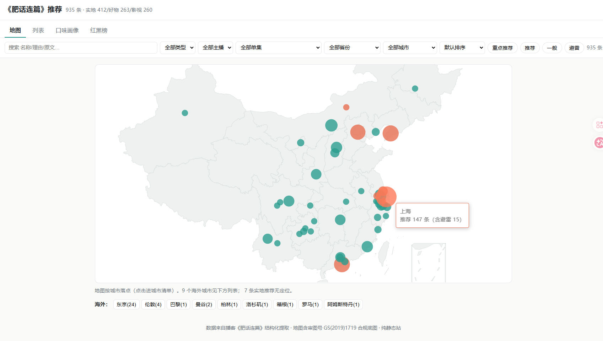

*Translated from the [Chinese original](/posts/260617-podcast-insights/).*

A couple of days ago in Nanjing, I finally finished all 234 episodes of the podcast *Feihua Lianpian* (肥话连篇), start to finish.

The show drops recommendations from time to time: a restaurant in some city, a series the hosts are bingeing, a little gadget they like. While listening I think "worth trying", make a mental note to check it out later, and then... nothing happens. Later, when I actually want to find that one restaurant again, all I can do is rummage through my fuzzy memory, and I basically never find it. Xiaoyuzhou (the podcast app) currently has no ability to search the text inside the audio.

**That's the awkward thing about listening to podcasts: the information just flows past, so it's hard to stop and organize it in the moment, and afterwards there's no way to retrieve it.**

But this time I happened to have half the pieces already, so I let the solution take shape from there. The end result is a map:

👉 **[Feihua Lianpian Recommendation Map](https://feihua.lexgogo.site/web/)**

Here's how it was built.

## Starting Point: I Already Had Half the Toolset

I had previously built [VideoTranscriptAPI](https://github.com/zj1123581321/VideoTranscriptAPI), an audio/video transcription service that can turn audio from Xiaoyuzhou, YouTube, and Bilibili into transcripts that are **speaker-diarized and proofread by an LLM**. It was originally built for my [information-processing system](https://mp.weixin.qq.com/s/w8VnWJcUp5VkD5J-fYCUrg), and when it came to processing a podcast, it was naturally the first thing I thought of.

So this wasn't starting from zero. It was "I happen to have half a set of building blocks on hand". What remained was getting Claude Code to fill in the missing half in the background.

## What I Did: Transcribe → Extract → Map

The whole thing breaks down into three steps, and it ran on and off in the background for two days.

**Step one: turn sound into text.** First I had to grab the links to every episode of *Feihua Lianpian*, and that step has its own hurdle: the Xiaoyuzhou web page only shows the latest 10 episodes by default, so getting the full history of all 234 episodes isn't realistic that way. Fortunately I had already explored this before. When I built [an online audio/video consumption history tracker](https://github.com/zj1123581321/online-video-history-server), I worked out how to scrape Xiaoyuzhou's historical episode list, so this time I just reused that.

With all the links in hand, I wrote a script to submit them in one go to my VideoTranscriptAPI server. The 234 episodes of audio queued up and ran for about a day, and the DeepSeek proofreading cost came to nearly 20 RMB. When it finished, I had 234 speaker-diarized, proofread transcripts.

(There was a small side episode in the middle: the ASR kept getting the hosts' names wrong, so I needed a dedicated step to normalize names, otherwise everything downstream would be a mess. This is exactly the kind of chore that's perfect to toss to an AI.)

**Step two: turn text into structured data.** Transcripts alone aren't useful. I had to pull out "what got recommended": whether it's food, a film or series, or a product, what fields each type should have, and all of it had to be normalized into a unified structure.

For this step I didn't write a traditional script. Instead I used Claude Code's newest **Workflow** feature, running the same extraction logic across all 234 transcripts. The model was the cheaper Sonnet, with concurrency around 8, and the whole thing finished in thirty to forty minutes. Compared with writing the script myself, it's more flexible, because it can handle the various little problems that crop up along the way as it runs.

I was extra picky about one thing here: every recommendation must be **traceable back to its source in the original text**. That confirms the model didn't make it up, and later I can also jump back to the podcast's actual words to hear the surrounding context. When you're processing this much content, "trustworthy" matters more than "pretty".

**Step three: turn data into a map.** I didn't get down to the exact latitude and longitude of each restaurant; it stays at the city level, clustering recommendations onto the map by city. So how do you find a specific restaurant? I took a shortcut: the web version of Amap (Gaode Maps) supports embedding the search term directly in the URL (similar to Google's URL search), so clicking a restaurant's name jumps to a search in Amap, and the job of precise positioning gets handed off to Amap. The whole visualization lives in a separate project, deployed on Cloudflare. (Incidentally, I deliberately used a compliant version of the base map, one that carries an official map approval number. If you don't take this kind of detail seriously, it will cause trouble one day.)

## The Result

It's the image at the top: the [Feihua Lianpian Recommendation Map](https://feihua.lexgogo.site/web/).

You can browse the restaurants recommended on the show by city, or switch to a list to flip through the films, series, and products, each with a category and the reason it was recommended. No more fretting over "I think they mentioned a place once".

All the code is here if you're interested: [podcast-insights](https://github.com/zj1123581321/podcast-insights).

## A Few Reflections

If I had to sum it up, it comes down to a few points:

First, **engineering**. At its core, this setup is about snapping together a few ready-made components: transcription, extraction, and mapping, each handling one segment, and put together it just works. Scaling up to batch processing isn't hard either, and the output is predictable, unlike a Skill, which still depends on the underlying model being capable enough.

Second, **Workflow is genuinely good in this kind of scenario**. For running the same processing across hundreds of pieces of content, this kind of large-scale job, a workflow is far more flexible than writing a script.

Third, that feeling of "say it and it happens": whatever comes to mind, I can build almost immediately, and it's still just so satisfying.

---
That's all.
