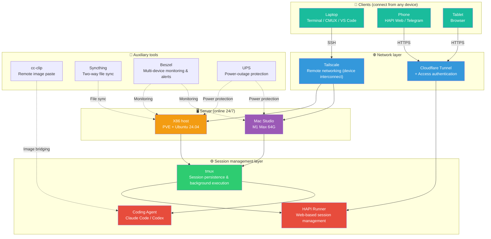
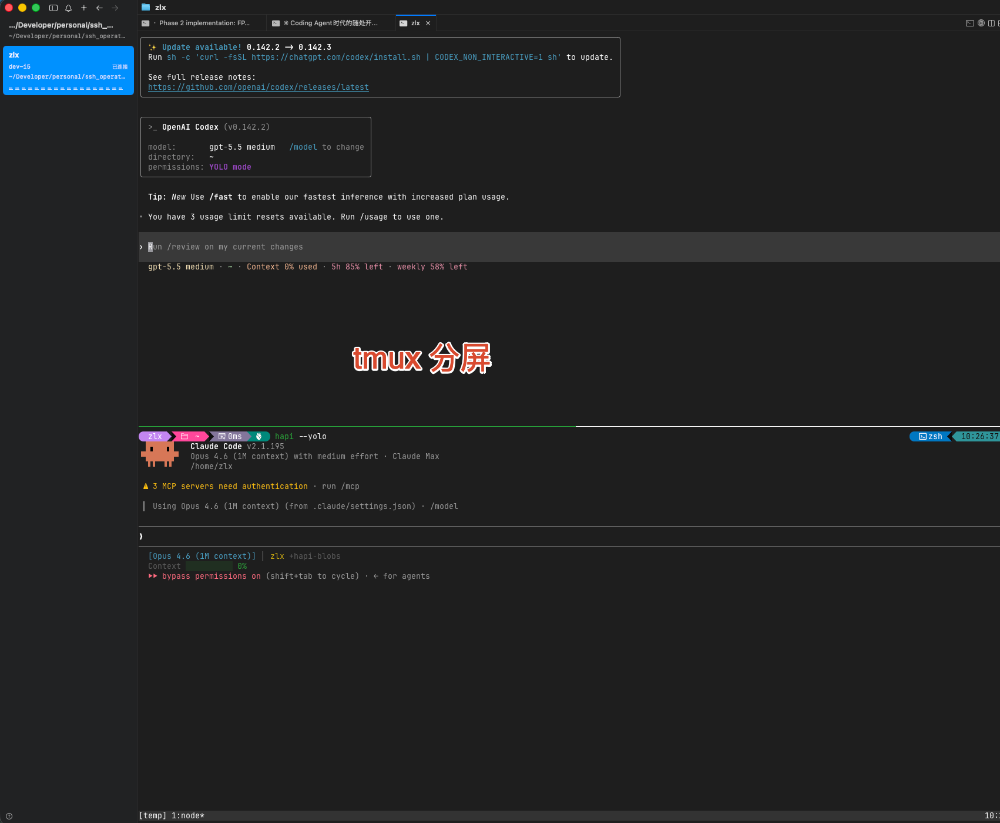
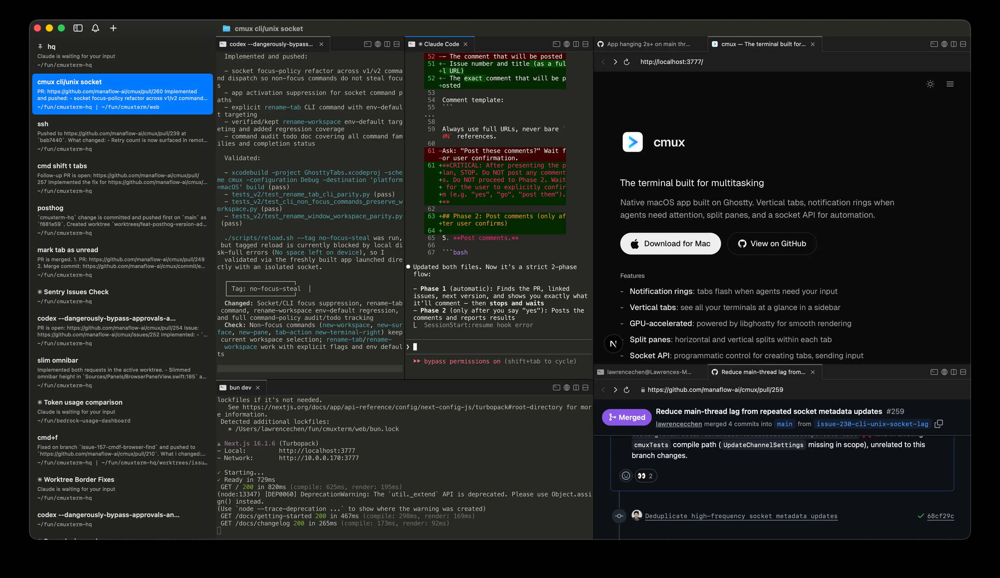
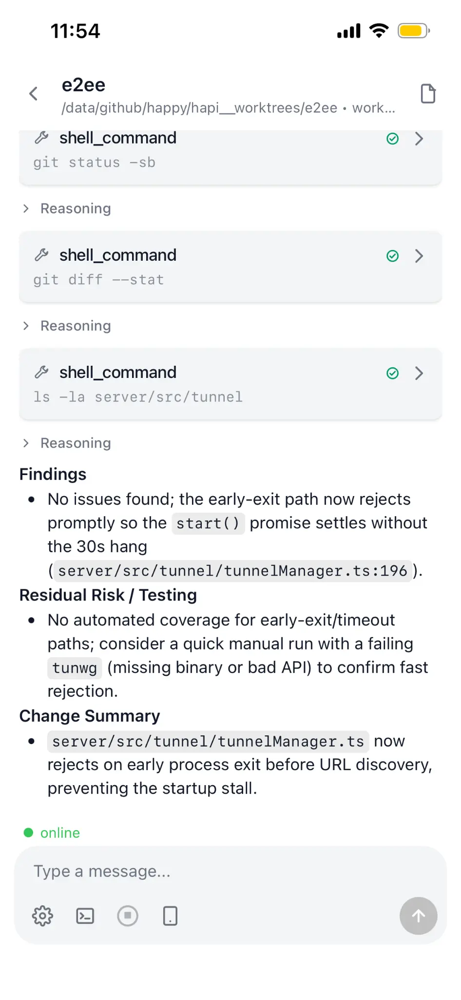
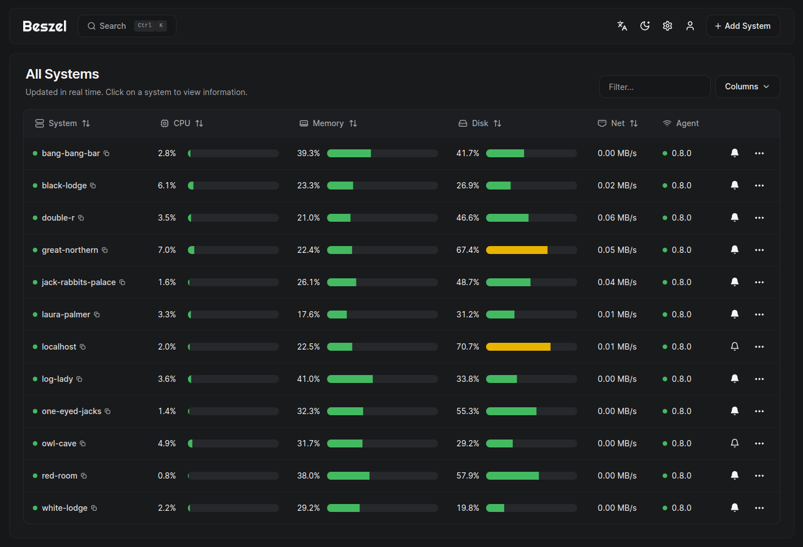

*Translated from the [Chinese original](/posts/260628-agent-era-dev-anywhere/).*

> This post is the development-environment installment of the "LLM Eats Everything" series. For how to build the hardware foundation, see the previous post, [The Agent's Home: The Individual's Hardware Foundation in the AI Era](../260329-ai-hardware-data-security/); for how to build the software layer, see [The Tools I Grew With AI](https://mp.weixin.qq.com/s/w8VnWJcUp5VkD5J-fYCUrg). This one is about what comes next: once the hardware and software are in place, how do you keep your Agent online 24 hours a day, while you connect anytime, anywhere, from any device?
>
> Same as always — **as a human, all you need to understand is the architecture and logic of this article. For all the specific software installation and environment configuration, just hand this article to Claude Code or Codex and let it execute.**

## 1. A Shift in Mindset

In the [hardware post](../260329-ai-hardware-data-security/) I mentioned that, at the current pace of Coding Agent development, I most likely won't buy a high-performance laptop again. All of my budget will move to a high-performance host machine. The only thing I need from a laptop when I'm out is a bigger screen that's comfortable to look at — a portable, long-battery-life machine like the MacBook Air fits the needs of programming in the AI era much better.

A while ago I heard that Apple's supply chain costs were going to rise, so I ordered a MacBook Air M5 32G + 1T that very night: a like-new, in-warranty used unit for 10,300 RMB, while the same configuration lists at 15,000. A few days after it arrived, Apple did indeed raise prices across the board. I suppose I got to enjoy a little payoff from cashing in on my own awareness.

Why an Air instead of a Pro? Because in this era, **a laptop is just a screen plus a keyboard**. All the compute, all the code repositories, and all the running Coding Agent processes live on a remote server. The device in your hand only needs to do one thing — connect.

The core idea comes down to one sentence:

> **A 24/7 server runs the Coding Agent, and every other device is a thin client that connects remotely.**

This is the underlying logic of the entire article. Everything below unfolds around this idea.

## 2. Architecture Overview

Here's a global topology diagram first, to give you the overall picture. Each layer will be expanded one by one afterward.



The whole architecture has four layers: **server → session management → network → client**, plus a set of auxiliary tools. Let's go through them from the inside out.

---

## 3. The Server: The 24/7 Home Base for Your Agent

### Choosing an OS: Why Not Windows

I recommend **Linux** or **Mac** as the server for a Coding Agent, and I don't recommend Windows.

The reason is simple: in the training data of large language models, a huge amount of code, commands, and environment configuration is based on the Unix family (Linux and Mac both belong to it). If you ask an Agent to set up environments and run commands on Windows, it will repeatedly stumble over things unrelated to your actual work — path formats, permission models, and package management all differ from Unix. You end up spending a lot of time going back and forth correcting things that have nothing to do with the business at hand, which is pointless.

Besides, the AI era has actually made the command line more convenient than a graphical interface — Agents are naturally good at handling command-line instructions rather than clicking a mouse. If you used to be intimidated by the command line, you can now let that go, because you don't need to type commands yourself; just let the Agent type them.

### The Mac Route

When using a Mac as a server, there's one core principle: **prioritize memory**.

A single Claude Code process easily takes 800–900 MB of memory, so if you want to run multiple Agents in parallel for speed, memory is the hard bottleneck.

CPU matters much less. The baseline CPU performance of Mac M-series chips is already very high, and unless you're doing especially heavy compilation or rendering, you'll hardly feel the difference between M1 and M5 in daily use. Besides, most of the time the Agent works in the background; even if a task takes two or three extra minutes because of a CPU difference, it doesn't matter to you.

Storage doesn't need much agonizing either. Mac storage is expensive, but you only need a 256G or 512G internal drive for the system and commonly used tools; code repositories and large files can be handled with an external drive of a few TB.

So I recommend buying a used **M1 Max Mac Studio** — compared with the current M4/M5 models, the same budget gets you more memory, which is the most practical thing. There's no need to pay a premium for a newer chip. As for Mac mini versus Mac Studio, it honestly doesn't matter much; what counts is the amount of memory.

> For the unique advantages of the Mac's unified memory architecture in the AI era, and for hardware market price trends, see the [hardware post](../260329-ai-hardware-data-security/).

### The Linux Route

Recommended setup: **PVE as the base layer + Ubuntu 24.04 LTS, headless (no desktop)**.

A few concepts are involved here, so let me explain briefly:

- **PVE (Proxmox VE)**: a virtual machine management platform. You install it on a physical machine, then create and manage virtual machines inside it. You can think of it this way — through PVE, one physical computer can simulate several independent "virtual computers" that don't affect one another.
- **Ubuntu**: one of the most popular Linux operating systems, with an active community, plenty of tutorials, and the most complete development-tool ecosystem.
- **Debian**: another Linux operating system, lighter and more stable than Ubuntu, but with slower package updates.
- **LTS (Long-Term Support)**: means the vendor will keep providing security updates for several years, which suits scenarios like servers that need to run stably for a long time.

Why not install Ubuntu directly on the physical machine, instead of installing PVE first and then a virtual machine? The core reason is **data safety**. PVE can package an entire virtual machine into an image file for backup. Something went wrong? Just restore the image, and all the environment, configuration, and data come back. That's far more convenient than repairing a system on bare metal.

Why Ubuntu rather than Debian? For development and running Coding Agents, Ubuntu's tool ecosystem is more complete. If you're only running some long-lived small services, Debian is a better fit.

The Linux route does have a somewhat higher barrier — you need at least a basic idea of SSH (explained in the next section). But it has a wider range of applicability — essentially **any computer that can run Windows can run Linux**, so you don't need to buy new equipment.

And to repeat: **you don't need to study tutorials yourself.** You only need to know "what I want to do," and let Claude Code connect over SSH and take care of the specific operations. Most of the time you're just typing a password or clicking confirm.

### Server Software: The Coding Agent

The most essential thing to install on the server is the Coding Agent itself — the AI that writes code for you.

What I mainly use right now:

- **[Claude Code](https://docs.anthropic.com/en/docs/claude-code)**: Anthropic's official CLI tool, my main driver
- **[Codex](https://github.com/openai/codex)**: OpenAI's CLI Agent
- **[OpenCode](https://opencode.ai/)**: an open-source option, as the lowest-level backup
- **[Hermes](https://github.com/NousResearch/hermes-agent)**: Nous Research's autonomous AI Agent, which I mainly use to connect to WeChat for communication and to run scheduled Agent tasks

None of these is complicated to install; just let the Agent look up the official docs and install it itself.

---

## 4. SSH and tmux: The Cornerstones of Remote Control

### What Is SSH?

If you've never touched a server, SSH may be the first unfamiliar word you run into.

Have you used remote desktop? Things like Windows Remote Desktop, macOS Screen Sharing, or tools like TeamViewer — on your own computer you can see another computer's screen, and the mouse and keyboard operate that remote computer.

**SSH does the same thing as remote desktop — it remotely controls another computer.** The difference is just that remote desktop transmits the picture, while SSH transmits text. After you connect to a server over SSH, what you see is a pure-text interface (like the black window hackers type commands into in movies); you type instructions into it, and the server executes them and displays the results as text. This black window has a technical name: **Terminal** — it will come up repeatedly later, and all you need to know is that it's "that window for interacting with a computer through text."

Why not use remote desktop? Because text is much lighter than a picture — SSH stays smooth even on a very poor network, when remote desktop may already have turned into a slideshow. And Coding Agents themselves work in a pure-text interface, so SSH is a perfect fit.

In this architecture, SSH is the most basic way to connect — on your own laptop you SSH into the remote server, launch Claude Code or Codex there, and you can start collaborating with the Agent. The whole process is encrypted, so even if someone intercepts it, they can't read it.

**Passwordless SSH login** is a recommended configuration. By default every SSH connection asks for a password; once passwordless login is set up, a single command connects you. Just let the Agent set it up for you — it's a matter of a few commands.

### tmux: Keeping Your Agent Always Online

tmux is **the single most critical piece of server-side software** in this architecture.

#### What Is tmux?

In plain words: tmux is a **"virtual desktop that keeps running in the background and never drops."**

Normally, you SSH into the server and start a Claude Code process to chat about code. If your network drops, your laptop lid closes, or your phone locks its screen — the SSH connection breaks, the Claude Code process dies with it, and all the context from the earlier conversation is gone.

With tmux, your Claude Code process runs inside tmux's "virtual desktop." SSH dropped? No problem — tmux is still running in the background, and Claude Code keeps carrying out its task. When your network comes back, you SSH in again, run `tmux attach`, and the earlier interface returns exactly as it was — the Agent may well have finished writing the code for you.

This is why it matters so much: **tmux guarantees that a Coding Agent can run 24/7 without interruption, completely unaffected by your network or device state.**

tmux can also open multiple "windows" within a single SSH connection, each running a different Agent task. You can switch between them like tabs, which is very handy.



#### Pitfalls I Hit With tmux

tmux itself isn't hard to install or use, but there are a few configuration pitfalls specific to Coding Agent scenarios that will hurt the experience if you don't handle them in advance:

**① Title passthrough**

While running, Claude Code and Codex display their current status through the terminal title (the line of text at the top of your window/tab) — while running, the small dot in the title keeps moving or blinking.

But many default tmux configurations don't pass this title change through to your outer terminal tab. The result is that you have to click into each one to see what state each Agent is in, which is painful when you have several open at once.

Once title passthrough is configured, you can tell at a glance from the tabs which Agent is still running and which has stopped.

**② Bell notifications**

When Claude Code finishes a task or needs your input, it sends a bell signal (the "ding" of a terminal). tmux may not respond to this signal by default, so you can sit there waiting without knowing the Agent has actually already finished. Once configured, the tmux status bar highlights, and the outer terminal also triggers a system notification.

**③ Special key passthrough**

Tools like Codex use key combinations such as Shift+Enter. tmux may not forward these keys by default, so pressing them does nothing.

**④ Escape delay**

By default tmux has a half-second delay after pressing Esc, which is annoying in scenarios with frequent interaction; just set it to 0.

I've already stepped on all of these pitfalls. My tmux configuration reference is in the appendix at the end of the article — have the Agent read it and load the configuration onto the server directly.

---

## 5. File Interaction: Comfortably Viewing Code and Transferring Files

With the server and Agent in place, the next question is: the code and files are all on the remote server, so how do you conveniently view and manage them?

### VS Code + Remote SSH: A Local-Like Development Experience

[VS Code](https://code.visualstudio.com/) (Visual Studio Code) is a free code editor from Microsoft; think of it as the programmer's "Word" — writing code, reading code, and managing project files all happen inside it. It's currently the most popular code editor in the world, with extremely rich tutorials and plugins.

VS Code has a plugin called Remote SSH (a plugin is an extension package that adds features to software). Once installed, you can **browse and edit files on the remote server directly from your local VS Code interface** — it looks exactly like working with local files, but the files actually live on the remote server.

When the network is decent, you can browse the remote server's directory structure, view code, and copy file paths to give instructions to the Agent, and the experience is very smooth.

But it suits text and code — relatively small files. Large files like PDFs and Excel sheets of hundreds of megabytes will be very laggy to open over the network.

### Syncthing: Two-Way Sync for Large Files

For the relatively large files in a repository — Excel files of tens of megabytes, design drafts, datasets — I recommend using [Syncthing](https://syncthing.net/) for two-way sync.

Syncthing is an open-source file synchronization tool. You can think of it as building an "automatic transfer channel" between your local computer and the remote server: when you edit an Excel file locally and save it, it automatically syncs the change to the server; when the Agent on the server generates a new file, it automatically syncs to your local machine too.

Compared with the laggy experience of forcing a large file open in VS Code Remote SSH, Syncthing lets you open and edit it locally with native applications like Excel or WPS, which is a much better experience.

### SMB Sharing: The Fallback for Ad-Hoc File Transfers

Sometimes you just want to push a file to the server or pull one down temporarily, and it's outside the range you've set up in Syncthing.

**SMB** is a file-sharing protocol — you may have used a "shared folder" at work, where in "My Computer" or Finder you can see folders your colleagues have shared and drag files straight into them. SMB is the technology behind that. You can share a folder on the remote server, then open it from your laptop or phone and copy and paste files just like on a USB drive.

Just have the Agent set up an SMB share on the server; the configuration isn't complicated.

### cc-clip: Pasting Screenshots Remotely

This is an open-source tool that I help maintain (I contributed the Windows client), and it solves a very specific pain point: **you see a problem on a front-end page locally and want to screenshot it and send it to the remote Claude Code for analysis — what do you do?**

Your screenshot is in the local clipboard, but Claude Code runs on the remote server — you simply can't paste across.

[cc-clip](https://github.com/ShunmeiCho/cc-clip) was built to solve this. It runs a small service locally and, through SSH's port-forwarding mechanism (you don't need to understand this detail), "bridges" your local clipboard to the remote server. The effect: you take a screenshot locally, then paste directly into the remote Claude Code terminal, and the image goes through — **completely seamless**.

The experience on macOS is excellent; Windows support is experimental.

---

## 6. Clients: Connect From Any Device

Once the server side is all set, the next question is which device and which tool you use to connect.

There isn't **that much to be particular about** here — the client is largely whatever you find comfortable. But there are some differences in experience across devices that are worth mentioning.

### On a Computer: Terminal Tools

The simplest option, of course, is VS Code's built-in terminal, which can also be opened multiple times. But when you want to run Agents on several different projects in parallel, VS Code's multi-window management gets a bit tiring.

I recommend a dedicated terminal tool (that "black window" from earlier). A dedicated terminal can open many tabs at once, each connected to one tmux session, clear at a glance. Often you don't even need to open VS Code, because you already know what the topic is and can just chat with the Agent right in the terminal.

**Windows:** Windows Terminal is enough, and it's made by Microsoft.

**Mac:** I recommend [CMUX](https://github.com/manaflow-ai/cmux). It's built on the Ghostty rendering engine (GPU-accelerated) and optimized specifically for AI Coding Agent workflows:

- **Notification system**: when an Agent needs your attention (say it's waiting for input or has finished a task), the pane shows a blue halo, the tab highlights, and there's a system-level notification — you don't have to keep staring at the screen
- **Sidebar**: shows the current git branch, PR status, working directory, and other information
- **Built-in browser**: you can view the dev server's page right in the terminal without switching windows



Of course there are many terminal tools on Mac — iTerm2, Ghostty, and Warp all work. CMUX's advantage is its deep integration with AI Agent workflows. Note that **CMUX is macOS only**.

### On a Phone: HAPI (Highly Recommended)

Phones do have SSH clients that can connect back to the server, but honestly — the screen is so small and the keyboard so hard to press that reading Claude Code's output and typing commands on it is a very poor experience.

There's also a more important reason: **risk-control safety**. In the [risk-control post](../claude-code-risk-model-philosophy/) I analyzed in detail that the sensor information a phone app can obtain (GPS location, cell tower information, system time zone, and so on) goes far beyond what you can disguise at the network level. For services with risk-control policies, installing a native client on your phone is effectively handing over your physical location voluntarily. So on my phone I only use the PWA web versions of Claude and ChatGPT (a PWA "installs" a web page onto your phone's home screen; once opened it looks like a native app, but it's still a browser running underneath and doesn't access the phone's sensor information), and **all interaction with Coding Agents goes through HAPI** — the phone is just a display terminal and exposes none of the phone's sensor information.

I recommend [HAPI](https://github.com/tiann/hapi) more.

#### What Does HAPI Do?

In plain words: **HAPI turns Claude Code's command-line interface into a web page, so you can operate it from your phone's browser.**

But it's far more than "terminal to web page." HAPI consists of three parts:

1. **CLI**: wraps the process of Agents such as Claude Code on the server and syncs session state out in real time
2. **Hub**: a central service that stores session data and presents it to you through a web page
3. **Runner**: a background daemon — with it, you can start a brand-new Agent session directly from the phone's web page, without first having to SSH in, open tmux, and type commands

#### Why Is It Better Than SSH on a Phone?

1. **Rendering optimization**: HAPI's web page automatically adjusts width and font size to the phone screen, so the reading experience is completely different from squinting at tmux
2. **One-tap approval**: when the Agent needs you to confirm an operation, you just tap once instead of typing on a tiny keyboard
3. **Seamless switching**: you're chatting with an Agent on your computer and suddenly have to head out — open the HAPI web page on your phone and take over that session to keep working. When you get home, switch back to the computer, with **no context lost at all**
4. **PWA support**: as mentioned earlier, a PWA lets you install a web page on your home screen to use like an app. HAPI supports this too, so you don't have to open the browser and type the address every time
5. **Telegram integration**: after an Agent task finishes, it can push a notification to your Telegram
6. **Multi-Agent management**: Claude Code, Codex, and OpenCode can all be managed from a single entry point



When I'm out, I basically just use HAPI to connect back and chat with Claude Code. With a voice input method on the phone, the experience is actually decent. In the future, foldable phones plus HAPI, with bigger screens, will basically solve the last pain point.

---

## 7. Network: The Guarantee of Anytime, Anywhere

With the server and clients in place, one link is still missing in between — **the network**.

Normally, your server sits in the local network at home (a local network is the network covered by your home WiFi), and you can only reach it when connected to the same WiFi. But the whole point of all this is "anytime, anywhere" — you can't stay home forever.

Buy a public IP (so the outside world can reach your home server directly)? That's both expensive and insecure — it's like leaving your front door wide open to the street.

So two network solutions need to work together.

### Tailscale: Pulling All Your Devices Into One Secure Virtual WiFi

In plain words, what [Tailscale](https://tailscale.com/) does is: **no matter which physical network your devices are on — home WiFi, the office network, a café's WiFi, your phone's 4G — it can pull them all into the same virtual local network.**

You can think of it as Tailscale building an "invisible private WiFi" for all your devices. Only you can see and access this virtual network; everyone else has no idea it exists.

Once installed, whether you're on a high-speed train or traveling abroad, you can SSH straight into your home server using the internal address Tailscale assigns, just as if you were sitting at home.

**And it's free for personal use.**

#### NAT and Peer Relay

A concept called **NAT** comes up here. Simply put, NAT is a way your home router works — it lets the devices in your home share a single public IP to get online. The side effect is that devices outside can't proactively find devices inside your home.

Tailscale tries to let two devices communicate directly (called "hole punching"). But if both sides have strict NATs and hole punching fails, Tailscale relays the data through its globally distributed relay servers (called DERP). It works, but adds some latency.

[Peer Relay](https://tailscale.com/docs/features/peer-relay) is an advanced feature: **you can designate a device on your own network that has a public IP as a relay node**. Compared with going through Tailscale's overseas public relay stations, relaying through your own public-IP server gives lower latency and faster speeds.

The actual steps are simple: both Alibaba Cloud and Tencent Cloud offer lightweight servers for 99 RMB a year, with roughly 3 Mbps of bandwidth — the amount of data moved back and forth when writing code is tiny, so this bandwidth is plenty. You just install the Tailscale client on that server and enable the Peer Relay feature, and Tailscale will automatically relay through it when the network is bad, guaranteeing basic connection quality. Achieving a similar effect used to require building a complicated relay service yourself; now one setting does it, and I highly recommend it.

> Analogy: DERP ≈ "relaying through Tailscale's public courier station, which is overseas and rather far away"; Peer Relay ≈ "buying your own courier relay station in China, much closer."

### Cloudflare Tunnel + Access: The Solution for Reaching HAPI From a Phone

Tailscale solves the problem of "interconnecting devices." If you've also installed Tailscale on your phone, you can simply open HAPI in the browser using the internal IP Tailscale assigns, and that works perfectly fine.

But there's a snag on phones: Tailscale runs as a VPN, and a phone can run only one VPN app at a time. If you're using other network tools at the same time, they'll conflict. That's when you need a fallback that doesn't depend on a VPN — [Cloudflare Tunnel](https://developers.cloudflare.com/cloudflare-one/connections/connect-networks/).

**What Cloudflare Tunnel does is securely expose a service on your server to the public internet, bound to your own domain.** All you need is a domain (the cheapest cost just over ten RMB a year), and then anyone in the world can reach the service you specify through that domain.

An analogy: originally only family could get into your home. Cloudflare Tunnel is like building an encrypted dedicated passage between your home and the public internet — others can only get in by going through this passage via the domain you've set up. People outside the passage can see nothing.

In our scenario, you expose the HAPI Hub through Cloudflare Tunnel, and your phone's browser can operate HAPI just by visiting your domain, with no need to turn on the Tailscale VPN.

#### Access: One More Lock

Although HAPI has its own login authentication, if you want extra safety you can layer [Cloudflare Access](https://developers.cloudflare.com/cloudflare-one/policies/access/) on top.

Access works like this: **before a user can touch your web page, it requires them to verify their identity** — it supports email one-time codes, Google login, and so on. Only your own email can pass verification. Everyone else can't even see what the page looks like.

HAPI authentication plus Cloudflare Access — two layers stacked together, and even exposed to the public internet there are no security worries.

Incidentally: Tailscale, Cloudflare Tunnel, and Cloudflare Access are **all free**. It's hard to imagine services at this level costing nothing — I use them heavily, and truly haven't paid much.

---

## 8. Security and Stability

Finishing the architecture isn't the end. For a system that's online 24/7, you need to make sure it **runs stably** and your data **isn't lost**.

### Data Backup

Take data safety seriously. Back up multiple times, on multiple machines, even offsite. **The value of data far exceeds the cost of storage.**

For the specific backup strategy (the 3-2-1 rule, PVE image interchange, the 115 cloud drive, and so on), I wrote about it in detail in the [hardware post](../260329-ai-hardware-data-security/), so I won't repeat it here.

### UPS: A 300-RMB Power-Outage Insurance

A UPS (uninterruptible power supply) is a front-end power source that keeps your server from shutting down instantly when power suddenly cuts out, giving you ample time to shut down safely and avoid data corruption.

Don't underestimate this thing — a sudden power loss can corrupt data being written and leave PVE virtual machines in an abnormal state, and fixing that costs far more than buying a UPS. It's three or four hundred RMB on JD.com, and well worth it.

### Beszel: Multi-Device Monitoring and Alerts

Once you have many devices and virtual machines, you need to know whether they're all running normally.

[Beszel](https://beszel.dev/) is an open-source, free, lightweight server monitoring tool. You install a tiny Agent (only a few MB) on each device, then install a Hub on one machine as the dashboard — one web page shows the CPU, memory, disk, temperature, and network status of all your devices.

Most importantly, it can set up alerts: memory nearly full, CPU maxed out, a machine gone offline — it sends you a notification, and then you have Claude Code SSH in to investigate.



Compared with heavyweight solutions like Grafana + Prometheus that require configuring a pile of components, Beszel's advantage is being **minimalist** — a single program to deploy, done in five minutes.

---

## 9. Four Benefits of This System

### ① Your Local Device Stops Mattering

All the important code and repositories are on the remote server. Your local laptop can lose power, shut down, or go offline at any time without affecting the Agent's operation.

It even works the other way around — spotty signal on a high-speed train? No problem. When there's signal, sync progress back and send a few commands to have the Agent continue; when there's no signal, it's running in the server's background anyway. **You can actually use these fragments of time to keep the Agent working in the background.**

### ② Very Low Device Migration Cost

When I switched from a Windows laptop to the MacBook Air this time, there was almost nothing local to migrate — the important repositories are on GitHub and the dev machine, and all other materials are in cloud storage. With passwordless SSH set up, a new device can start working right away.

### ③ High Data Safety

Mac has Time Machine, and PVE can snapshot an entire virtual machine and back it up offsite. If something goes wrong you can restore at any time. Compared with the traditional model of piling everything onto a single laptop, the safety is much higher.

### ④ Better Value for Money

The more consumer electronics chase portability and integration, the more you pay a premium for "small size." But in the Coding Agent era, all we need is a screen to check the results; the client doesn't need much compute.

Put the whole compute budget into the server — a Mac Studio has no screen, keyboard, or mouse, with good cooling and strong performance, so the same compute costs less. A Linux host even more so. **Thin client + strong server turns out to be the most economical option.**

---

## Final Words


Built on this system, my Coding Agent is online 24 hours a day. Whether I'm at home, at the office, on a high-speed train, or traveling abroad over the May Day holiday, as long as the network reaches, I can get in touch with my Agent anytime, anywhere. Laptop, phone, tablet — any device works.

I've run this system across multiple cities and many network environments, and it has never given me trouble.

Once more: **as a human, all you need to understand is the architecture of the whole method.** For all the execution-layer work, send this article to your Claude Code or Codex, let it read through it, then tell it what you want to build, and it will do it for you.

One practical tip to add: services like Tailscale and Cloudflare mentioned above all support creating API Keys. As long as you give the Coding Agent SSH access and the relevant API Keys, it can do a lot of the configuration in one go, without you clicking back and forth across various admin consoles. **But once the configuration is done, be sure to revoke or rotate these API Keys promptly** to avoid key leaks. A special reminder: if you're not using the official API but a third-party relay service, never put any sensitive key information in the conversation — your conversation content may be visible to the relay provider.

---

## Appendix: Reference Material and Pitfall Notes for Agents

> The following content is aimed at Coding Agents (Claude Code / Codex, etc.). If you're a human reader, you can skip this part — send the link to the whole article to your Agent, and it will come read this section itself.

### Server Environment Setup

| Component | Reference docs | Pitfalls |
|------|---------|--------|
| PVE | [Proxmox VE Installation](https://pve.proxmox.com/wiki/Installation) | After installation the enterprise apt repository (requires a subscription) is enabled by default; you must switch to the `pve-no-subscription` repository, otherwise `apt update` will error |
| Ubuntu 24.04 LTS | [Ubuntu Server Guide](https://ubuntu.com/server/docs/installation) | Choose the headless version (Server); allocate 16G+ of memory to the virtual machine |
| tmux | Configuration below | Requires tmux 3.2+; lower versions don't support `extended-keys` and `allow-passthrough`. Check the version with `tmux -V` |

#### tmux Configuration Reference (write to `~/.tmux.conf`)

```bash
# ======== 基础体验 ========
set -g default-terminal "tmux-256color"
set -as terminal-features ",*:RGB"
set -g mouse on                # 支持鼠标操作
set -g history-limit 50000     # 回滚缓冲区
set -g escape-time 0           # 消除 ESC 延迟
set -g focus-events on

# ======== 窗口/面板编号从 1 开始 ========
set -g base-index 1
setw -g pane-base-index 1
set -g renumber-windows on

# ======== 分屏时保持当前目录 ========
bind '"' split-window -v -c "#{pane_current_path}"
bind '%' split-window -h -c "#{pane_current_path}"
bind 'c' new-window -c "#{pane_current_path}"

# ======== 状态栏 ========
set -g status-right-length 60
set -g status-left-length 20

# ======== vi 复制模式 ========
setw -g mode-keys vi
bind -T copy-mode-vi v send -X begin-selection
bind -T copy-mode-vi y send -X copy-selection-and-cancel

# ======== 快速重载配置 ========
bind r source-file ~/.tmux.conf \; display "Config reloaded"

# ======== 终端标题透传 ========
# 让 Claude Code / Codex 的标题变化同步到外层终端标签页
set -g set-titles on
set -g set-titles-string "#{pane_title}"
setw -g allow-rename on
set -g allow-passthrough on

# ======== 任务通知：bell 信号 ========
# Claude Code 完成任务时，tmux 状态栏高亮 + 透传到外层终端
set -g monitor-bell on
set -g bell-action any
set -g visual-bell both
set -g window-status-bell-style "fg=red,bold"

# ======== 特殊按键透传 ========
# 让 Shift+Enter 等组合键正确传递给 Codex 等工具
set -g extended-keys on
set -as terminal-features 'xterm*:extkeys'
```

### Network Configuration

| Component | Reference docs | Pitfalls |
|------|---------|--------|
| Tailscale | [Download](https://tailscale.com/download) | Runs as a VPN on phones, conflicting with other VPN/proxy apps. This can be mitigated by having a specific device forward traffic through an Exit Node, but the barrier is higher |
| Tailscale Peer Relay | [Peer Relay Docs](https://tailscale.com/docs/features/peer-relay) | Requires Tailscale >= 1.86; configuration command `tailscale set --relay-server-port=40000`; verify with `tailscale status \| grep peer-relay` |
| Cloudflare Tunnel | [Get Started](https://developers.cloudflare.com/cloudflare-one/connections/connect-networks/get-started/) | Prerequisite: the domain's NS must point to Cloudflare; `cloudflared` is best configured as a systemd service that starts automatically (`sudo cloudflared service install`); in config.yml, write the url as `http://localhost:<HAPI Hub port>` |
| Cloudflare Access | [Access Policies](https://developers.cloudflare.com/cloudflare-one/policies/access/) | Configure in the Zero Trust Dashboard; the Telegram Mini App requires HTTPS, which the Tunnel provides out of the box |

### Clients and Tools

| Tool | Reference docs | Pitfalls |
|------|---------|--------|
| VS Code Remote SSH | [Official docs](https://code.visualstudio.com/docs/remote/ssh) | First set up the Host in `~/.ssh/config` with passwordless login |
| Syncthing | [Getting Started](https://docs.syncthing.net/intro/getting-started.html) | You must configure `.stignore` to exclude directories like `node_modules` and `.git`; when first syncing a large repository, pause Agent writes to avoid conflicts |
| cc-clip | [GitHub](https://github.com/ShunmeiCho/cc-clip) | After installing, `cc-clip setup <SSH Host name>` deploys everything automatically; the remote needs `xclip` or `wl-paste`; if something goes wrong, diagnose with `cc-clip doctor --host <host>`; uses user-level token authentication, not suitable for shared servers |
| CMUX | [GitHub](https://github.com/manaflow-ai/cmux) | `brew tap manaflow-ai/cmux && brew install --cask cmux`; macOS only |
| HAPI | [Installation docs](https://github.com/tiann/hapi/blob/main/docs/guide/installation.md) | For global npm installation, use the official registry (domestic mirrors in China may lack platform packages); for remote mode use `hapi hub --relay` + `hapi runner start`; Telegram integration requires setting `TELEGRAM_BOT_TOKEN` and `HAPI_PUBLIC_URL` (must be HTTPS) |
| Beszel | [Getting Started](https://beszel.dev/guide/getting-started) | The Agent and Hub communicate over SSH; the first time you add one you need to configure an SSH Key |

---

> The first draft of this article was conceived from voice-to-text via Feishu's Recording Bean, and the article's architecture design and content organization were completed through conversation with Claude Code + Opus 4.6. Images come from official websites + gpt image 2.
