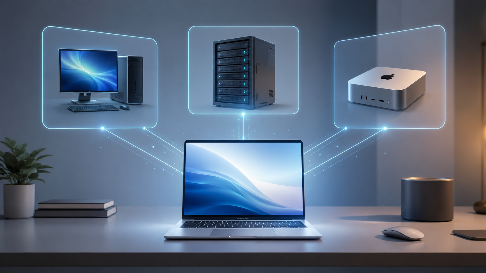
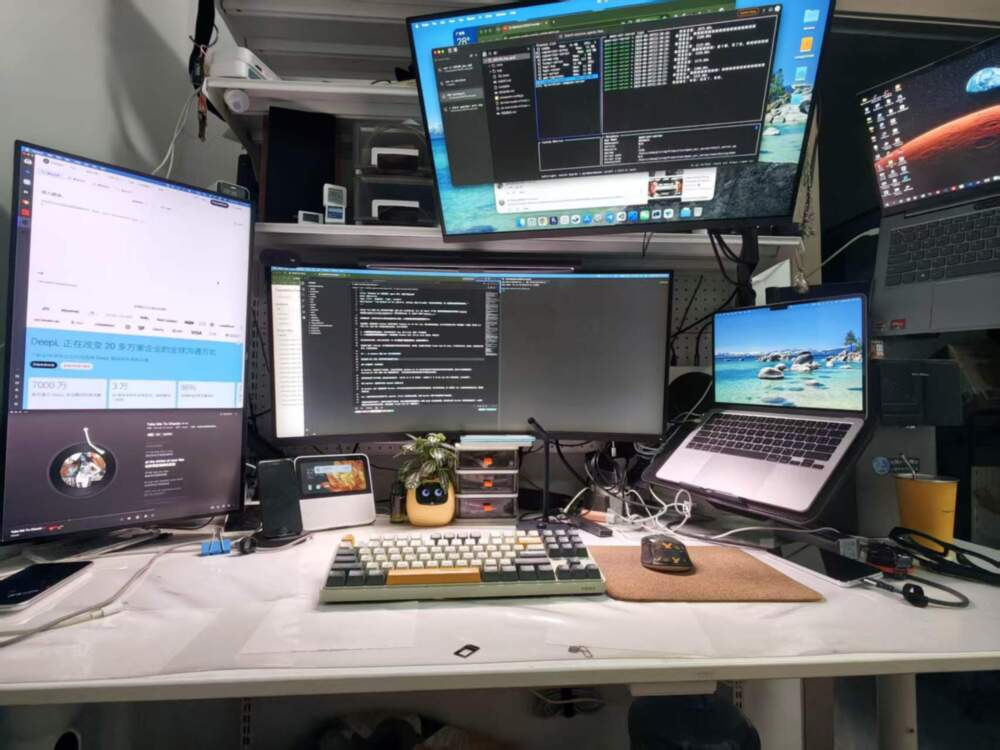
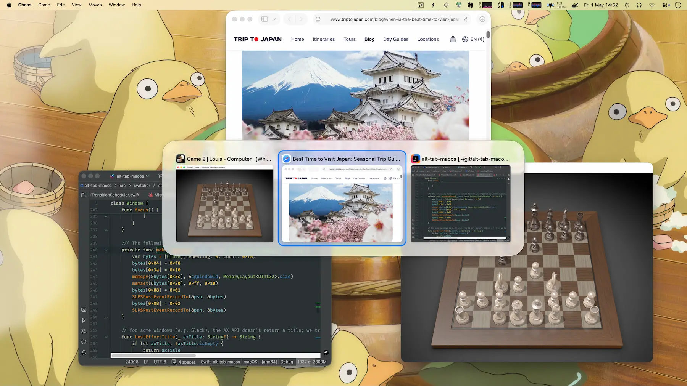
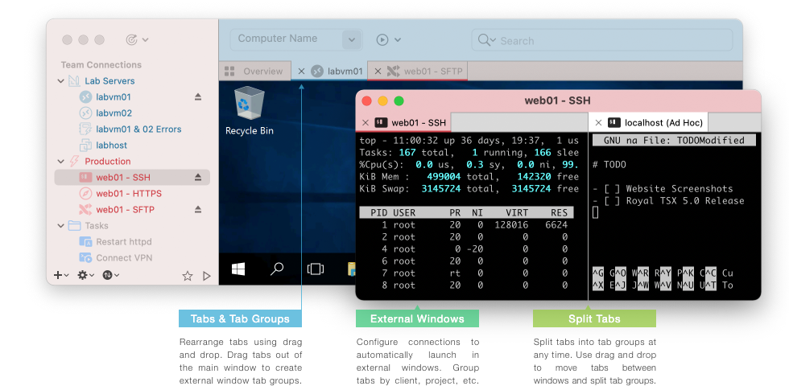
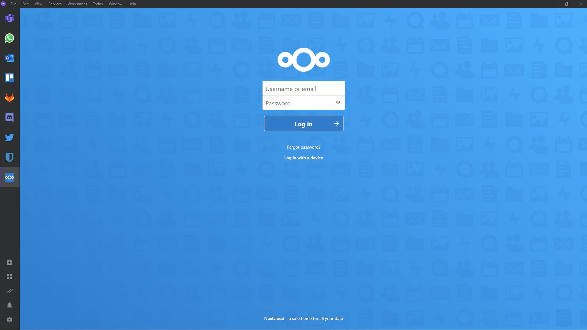
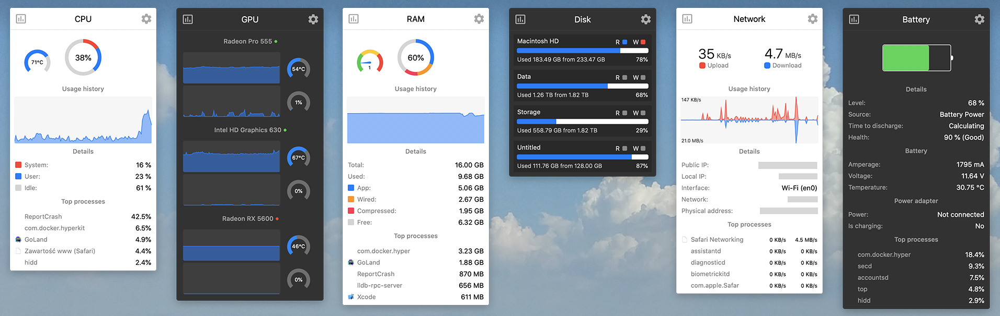

*Translated from the [Chinese original](/posts/260630-agent-era-mba-setup/).*

This post is the client-side installment of the "LLM Eats Everything" series. For how to build the 24/7 remote base camp, see the previous post, [Agents Never Clock Out: A Development System for Any Place, Any Time, Any Device](/en/posts/260628-agent-era-dev-anywhere/); for how to choose the hardware foundation, see [The Agent's Home](/posts/...).

The question here is: when all your main development work runs on remote servers, **what should you actually install on the laptop in your hands?**

First, some background. I recently switched from a Windows laptop to a MacBook Air M5 with 32GB. In the previous post I mentioned that in this era a laptop is just a screen plus a keyboard, which is why I bought an Air rather than a Pro. This MBA doesn't carry any long-running development work. It does only two things:

1. **Temporary local odds and ends**: filing a bug against some local software, tweaking a small tool, managing a few cloud services
2. **Serving as the remote control for every machine in the cloud**: connecting to the Windows host over remote desktop, SSHing into Linux VMs, managing files

So this software list is essentially answering one question: **how do you configure a laptop that works as a "remote control" so it feels good to use?**



The principle is the same as always: as a human, all you need to know is whether you have similar pain points. If you do, hand this post to Claude Code or Codex and let it find solutions and install the software for you. My choices are only a reference, not the standard answer.

## 1. Switching from Windows to Mac: Two Old Worries

Before deciding to switch to a Mac, two things made me hesitate for a long time.

### External monitors: from three down to two

On Windows I had three external monitors, which gave me a very roomy workspace. The MacBook Air M5 natively supports at most two external displays with the lid open. Going beyond that requires a DisplayLink solution (which sends video over USB), but its image quality and stability aren't as good as native support.

In the end I accepted the limitation. I now run two external monitors: a Xiaomi 34-inch 2K ultrawide and a regular 27-inch 2K monitor. Together with the MBA's own screen, that's three displays, which is enough.

### Quicker: the Windows automation tool I once couldn't live without

On Windows I was a heavy Quicker user. It makes all kinds of automation and quick launching very convenient, and its design is very intuitive. At one point I felt that without something similar on Mac, I'd have a hard time switching.

There really is no exact equivalent on Mac. RayCast and uTools all fall a bit short; none has that "what you see is what you get" intuitive feel Quicker has.

But I switched anyway. Not because I found a replacement, but because **the need itself was disappearing**. As Agents grew more capable, I noticed I was using Quicker less and less. Things that used to require an automation script are now done by just telling Claude Code in a sentence.

It's a bit like instant noodles versus food delivery: it's not that instant noodles got worse, it's that delivery got so convenient that it solved the same problem from a different direction.

## 2. Multiple Monitors: Making 2K External Screens Usable on a Mac



This is the section I think carries the most new information. Multi-monitor setups are nearly zero-configuration on Windows, but on a Mac there are quite a few pitfalls.

### BetterDisplay: a lifeline for 2K screens

This is the **most critical** piece of software in the whole multi-monitor experience.

The problem lies in macOS's display scaling strategy. Mac's Retina logic was designed for resolutions of 4K and above: a 4K screen uses 2x scaling, giving a layout equivalent to 1080p while keeping 4K sharpness, and it looks great.

But 2K screens are awkward. At 2x scaling, 2K (2560x1440) gives an effective resolution of only 720p, so too little content fits; at 1x scaling, the text is too small to read. macOS natively offers no good middle ground for 2K screens.

BetterDisplay's solution is to force-enable HDPI mode on the 2K screen, creating a virtual high resolution and then scaling it down to the 2K screen. The effect is as if macOS thinks a higher-resolution display is connected: it renders at the higher resolution and then scales it down to the 2K screen.

That said, this approach **only works for standard-ratio 2K screens**. On my 27-inch 2K screen, HDPI is barely usable. But the 34-inch ultrawide (3440x1440) doesn't work at all — its resolution isn't high to begin with, so enabling HDPI cuts the display area in half again, making the text absurdly large and the screen completely unusable. So on the ultrawide I use the native resolution without HDPI. To truly solve this for an ultrawide, you'd need a 5K resolution (5120x2160).

To be honest: **even with HDPI on, a 27-inch 2K screen is only barely usable**. The gap compared with the MBA's built-in screen is still obvious — text edges aren't as sharp, and the colors are a notch worse. But it's much better than not enabling it, so at least it's not painful to look at.

If your budget allows, buying a 4K monitor is the most thorough fix. But if you're like me and already have 2K screens you don't want to replace, BetterDisplay is a must-install.

### eqMac: making the volume keys control the external monitor's speakers again

This is a small but annoying problem.

My external monitors connect over HDMI, with audio going through the HDMI digital channel to the monitor's built-in speakers. But once macOS detects HDMI digital audio output, the volume keys on the keyboard simply grey out and do nothing when pressed. You have to drag the volume slider in System Settings by hand, or turn the physical knob on the speakers.

eqMac takes over the system's audio output so the keyboard volume keys can control the external speakers' volume again. It's also an equalizer, but I use it purely for this one feature.

### The window management trio

| Tool | What it solves |
|---|---|
| **Stay** | Every time you plug or unplug an external monitor, all your window positions get scrambled. Stay remembers window positions per display configuration and puts everything back automatically when you plug in |
| **AltTab** | The native macOS Cmd+Tab is too bare-bones: it shows only app icons, not window contents, and windows from all screens are mixed together. AltTab fixes two problems: first, it gives a **live preview** of what each window is doing as you switch, so you don't have to guess; second, you can set it to **switch only among windows on the current screen**, so windows on other screens don't get in the way when working across multiple monitors |
| **Rectangle** | Quick keyboard window snapping. For Windows users, snapping windows with Win+arrow keys is muscle memory; Rectangle brings that experience to Mac |



I think these three are essential for any Mac multi-monitor user, so I won't go into more detail.

## 3. External Keyboard: Windows Mode Plus Remapping Is Actually Better

The core tool in this section is **Karabiner-Elements**.

### The problem: Mac mode on third-party keyboards is a trap

Many third-party keyboards claim to support Mac mode, with compatible key layouts. In practice, the compatibility is often half-baked.

I use a MIIIW keyboard. Its Mac mode disguises itself as an Apple keyboard (the system shows an Apple device ID), so macOS treats it according to "built-in keyboard" logic. The result is that F1-F12 don't send real F-key signals but function codes like brightness and volume. Want to use F1-F12 shortcuts? No way. And this can't be changed in System Settings or in Karabiner, because the system believes it is an Apple keyboard.

The fix, ironically, is to **flip the physical switch at the top of the keyboard to Windows mode**. In Windows mode, F1-F12 send real F-key signals and everything works normally.

But in Windows mode, the physical positions of the Cmd and Option keys are reversed compared with Mac habits. That's where Karabiner-Elements comes in.

### My Karabiner configuration

**Basic remaps (for the external keyboard):**

- **Swap Cmd and Option**: In Windows mode, the Alt position on the keyboard maps to Option and the Win key position maps to Command. But Mac users are used to Command being next to the space bar (that is, Command should sit where the Win key is physically). Swapping them restores the Mac feel.
- **Map CapsLock to Fn**: This is a must in the voice-input era. Doubao Input Method triggers voice input by long-pressing the Fn key, but external keyboards either have no Fn key or have one the Mac doesn't recognize. CapsLock is the most convenient and least useful key on the keyboard, so I turn it into Fn — hold CapsLock with my left hand and voice input starts.

**Global rules:**

- **Disable Cmd+Shift+Q**: macOS has a "Log Out" shortcut, Cmd+Shift+Q, which is only one Shift away from "Quit app" (Cmd+Q). Although the system shows a confirmation dialog, it's easy to click confirm too fast and close every app. And Option+Shift+Cmd+Q is even harsher — it skips the confirmation and logs you out immediately. My Karabiner configuration disables this whole group of shortcuts to rule out accidental triggers entirely.
- **Left Ctrl+Left Cmd + I/J/K/L mapped to arrow keys**: A Vim-like arrow key scheme that lets you move the cursor without leaving the main key area.
- **Right Cmd+\` to switch the shared monitor in one keystroke**: I have a monitor shared between a Mac Studio and a Mac mini. This shortcut triggers a script that switches the monitor's input source between the two machines in one keystroke.

## 4. The Remote Console: One Mac Managing Every Machine in the Cloud

After switching to Mac, all my Windows applications run on a Windows host in the cloud, and I also have a pile of Linux VMs to manage. Remote management has become the core daily use of this MBA.

### Remote desktop: don't believe in one tool for everything

After trying a bunch of options, my conclusion is that **dividing the work by scenario gives a better experience than cramming everything into one piece of software**.

| Scenario | My choice | Why |
|---|---|---|
| **Connecting to the Windows host** | **Windows App** (official from Microsoft) | Free, with the best RDP protocol support; trackpad gestures, multiple monitors, and clipboard are all smoother than with third-party tools |
| **Mac to Mac** | **NoMachine** | The VNC protocol eats too much bandwidth and turns into a slideshow on mediocre networks. NoMachine uses the NX protocol, which uses far less bandwidth and feels much better |
| **Multiple Linux VMs** | **Royal TSX** | Supports RDP, VNC, SSH, and SFTP, so you can manage all your Linux devices as tabs in a single window |
| **Emergency use** | **ToDesk** | Convenient NAT traversal within China; used occasionally |

In theory Royal TSX can manage every device with one piece of software — it supports every protocol. If you just want to keep things simple, you could certainly use it for everything. But in practice, Microsoft's official client really does give a better experience for Windows, and Mac-to-Mac has to go through NoMachine because of bandwidth.

**In the end, Royal TSX has been reduced to a "Linux VM manager" for me**, dedicated to the VMs that need SSH and SFTP.



### Network prerequisite

Remote management depends on the machines being able to reach each other. I covered this in detail in the previous post; the core is that **Tailscale** pulls all devices into one virtual LAN. I won't repeat it here.

For a proxy tool I use **Clash Party** (the GUI client for mihomo), installed via brew cask.

## 5. Local Software: Temporary Jobs and Everyday Tools

### Coding Agents: only for temporary use, but you must have them

- **Claude Code**: my main Agent, installed standalone
- **Codex**: OpenAI's CLI Agent, a backup
- **OpenCode**: an open-source option, my last-resort fallback

Although this machine doesn't do long-term development, whenever I need to file a quick bug, tweak a script, or manage a remote server, I still need to run an Agent locally. The key point is that **they only handle temporary things** — run, finish, and leave.

The same goes for development runtimes — **fnm** (Node), **uv** (Python), **bun**, and **go** are all installed, isolated per project and installed on demand. But they aren't the focus of this machine.

### Ferdium: a single entry point for multiple AI services

If you subscribe to several AI services at once — ChatGPT, Claude, Gemini, Kimi, and so on — in a browser they're just a pile of tabs, and it's easy to lose track of which is which as you switch around.

Ferdium "pins" each web service as a separate app panel and lets you switch between them in the sidebar with one click. Essentially it's a multi-tab browser shell, but it's much easier to manage than a heap of tabs in Chrome.



### CotEditor: the Notepad++ of Mac

Sometimes you just want to open a file for a look and change a couple of lines, without launching something as heavy as VS Code. That's what CotEditor is for: lightweight, instant to open, with syntax highlighting that's good enough. It's similar to Notepad++ on Windows.

I've set CotEditor as the default app for `.env`, `.json`, and `.log` files: double-click to open, look, close.

## 6. The Little Toolbox: Each One Solves a Specific Problem

None of these tools is worth a post on its own, but each one solves a real pain point.

### Screenshots and screen recording

- **PixPin**: screenshots + pinning + OCR. It beats the built-in screenshot tool in two ways: first, the "pin" feature (after taking a screenshot you can pin it on screen so it stays put, handy when coding with a reference); second, OCR text recognition.
- **Cap**: a lightweight screen recorder. I use it when I need to record a walkthrough to send to someone.

### Video and media

- **Downie**: a video downloader. On Windows I used IDM to download from YouTube; it captures the video stream directly through a browser extension, with a very high success rate, far more stable than yt-dlp. There's no IDM on Mac, and Downie is the closest replacement I've found.
- **IINA**: the best video player on Mac, bar none.
- **HandBrake / ffmpeg**: video transcoding. Use HandBrake if you want a GUI, ffmpeg for the command line.

### Productivity boosters

- **Maccy**: clipboard history. Everything you've copied is kept and can be recalled any time. Lightweight, and it does just this one thing.
- **Stats**: system monitoring in the menu bar. CPU, memory, temperature, and network speed at a glance. You don't need to open a dedicated window; one glance at the menu bar tells you the machine's state.


- **Synergy**: one keyboard and mouse controlling multiple computers. I have both an MBA and a Mac Studio on my desk, and Synergy lets me move seamlessly between the two with a single keyboard and mouse, without reaching for another set.
- **Logi Options+ (slimmed-down version)**: the driver software for Logitech mice, used to configure mouse shortcuts and scroll wheel behavior. But the official version is very bloated — a pile of components resident in the background, and it uploads usage data. I recommend installing it with [logi-options-plus-mini](https://github.com/Qetesh/logi-options-plus-mini) from GitHub. It uses the official installer's command-line options to turn off, at install time, the components you don't need — analytics (data upload), Flow (cross-device collaboration, which duplicates Synergy), SSO login, and auto-update — keeping only the core device configuration features.
- **Thaw / LaunchManager**: manage macOS startup items and background services. Mac's LaunchAgent / LaunchDaemon system is very unintuitive for ordinary users; these two tools let you see all background services in a GUI and enable or disable them at any time.

### Input method

- **Doubao Input Method**: AI-assisted input. Combined with the CapsLock→Fn mapping in Karabiner above, long-pressing CapsLock starts voice input. In the Agent era, a lot of the time talking to Claude Code is faster by "speaking" than by "typing." I also suggest removing the built-in ABC input method so the computer keeps only Doubao, and using the Shift key to switch between Chinese and English. That way you never have to think about "which input method am I on right now," one less layer of mental overhead.

## 7. Final Thoughts

Looking back at this list, one theme runs through it: **the more capable the Agent, the fewer tools you need locally**.

Back on Windows, I needed Quicker for automation and a pile of productivity tools to organize my workflow. Now most things get done by telling the Agent in a sentence, and the tools that are truly irreplaceable locally are the ones that "have nothing to do with the Agent": how to make the monitors look good, how to make the keyboard feel right, how to make remote desktop smooth.

These are physical-layer problems, and the Agent can't help with them for now. But finding which software solves them — that, the Agent can help with.

So if you recognize a pain point of your own in this post, there's no need to remember what software I use. Describe your problem clearly, hand it to your Agent, and let it find a solution.

---

## Appendix: Software Installation List for Agents

The following is aimed at Coding Agents (Claude Code / Codex, etc.). If you're a human reader, feel free to skip it.

### One-shot install with Homebrew

```bash
# Formulae
brew install bat btop coreutils displayplacer duti eza fd ffmpeg findutils fnm fzf gawk gh git git-delta git-lfs gnu-sed gnupg go grep handbrake imagemagick jq neovim pandoc pnpm pngpaste shellcheck shfmt starship syncthing uv watch wget yarn yq zoxide zsh-autosuggestions zsh-syntax-highlighting

# Taps
brew tap oven-sh/bun && brew install oven-sh/bun/bun
brew tap rtk-ai/tap && brew install rtk-ai/tap/rtk
brew tap tiann/tap && brew install tiann/tap/hapi

# Casks
brew install --cask clash-party cmux codex ferdium handbrake-app iina iterm2 karabiner-elements launchmanager maccy neteasemusic nomachine nutstore obsidian openvpn-connect postman rectangle stay thaw visual-studio-code
```

### Non-Homebrew installs (download from the official site)

| Software | Install method | Notes |
|---|---|---|
| Claude Code | Official installer | `npm install -g @anthropic-ai/claude-code` or download from the official site |
| BetterDisplay | Official DMG | https://betterdisplay.pro |
| eqMac | Official DMG | https://eqmac.app |
| AltTab | Official DMG | https://alt-tab-macos.netlify.app |
| Stats | Official DMG | https://github.com/exelban/stats |
| Synergy | Official DMG | https://symless.com/synergy |
| PixPin | Official DMG | https://pixpin.cn |
| Cap | Official DMG | https://cap.so |
| Downie | Official DMG | https://software.charliemonroe.net/downie |
| CotEditor | Mac App Store or official site | https://coteditor.com |
| Typora | Official DMG | https://typora.io |
| Royal TSX | Official DMG | https://royalapps.com/ts/mac |
| ToDesk | Official DMG | https://todesk.com |
| Windows App | Mac App Store | Microsoft's official remote desktop client |
| Tailscale | Mac App Store or official site | The standalone version (not the App Store version) is recommended; more complete features |
| Doubao Input Method | Official installer | https://shurufa.doubao.com |
| Reqable | Official DMG | https://reqable.com (packet capture and debugging) |
| Bark | Mac App Store | Push notifications |

### Gotchas

| Tool | Gotcha |
|---|---|
| BetterDisplay | The free version is limited; Pro is a one-time purchase. GPU load rises after enabling HDPI on a 2K screen, especially noticeable on the ultrawide |
| eqMac | Requires installing a system extension (Audio Driver); the first install needs a reboot |
| Karabiner-Elements | Requires installing a virtual HID driver (system extension); on first run you must allow it manually in System Settings. The config file is at `~/.config/karabiner/karabiner.json` |
| Tailscale | On Mac, use the standalone version (macsys) rather than the App Store version. The standalone version supports more low-level networking features (such as exit node and subnet routing) |
| Stay | Requires Accessibility permission. After configuring, remember to enable "auto-restore" in Preferences |
| NoMachine | The installer is fairly large (~100MB) and registers a system-level LaunchDaemon. If you only use it as a client and not as a server, you can turn off NoMachine Server after installation |
| Synergy | Must be installed on both computers. When configuring, pay attention to which one is the Server (the one with the keyboard and mouse attached) and which is the Client |
| Doubao Input Method | Installs into the `/Library/Input Methods/` directory. To uninstall, simply delete `/Library/Input Methods/DoubaoIme.app` |

---

> The draft of this post was conceived through voice-to-text with Feishu's recording assistant, and the article structure and content were organized through a conversation with Claude Code + Opus 4.6. Images come from official websites + GPT Image 2.
