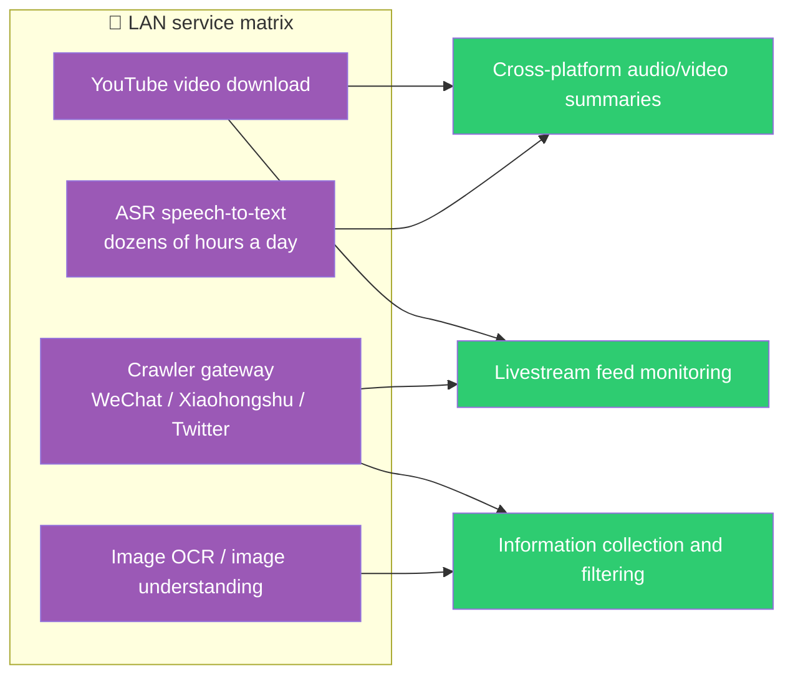
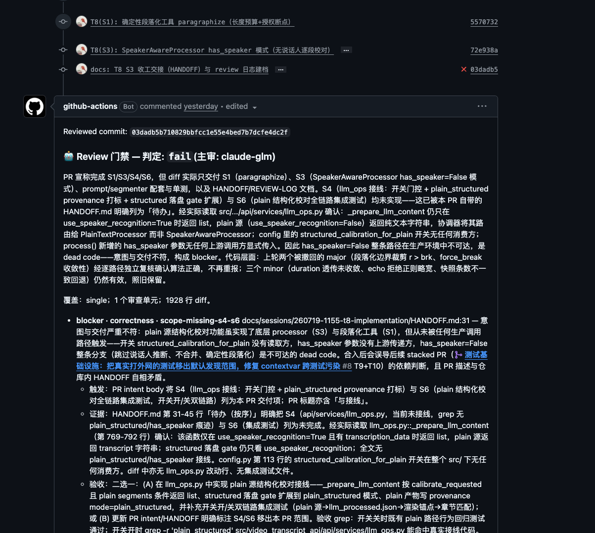
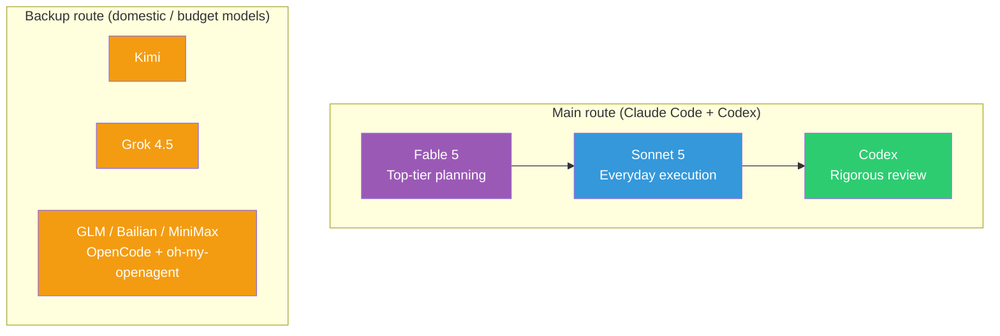
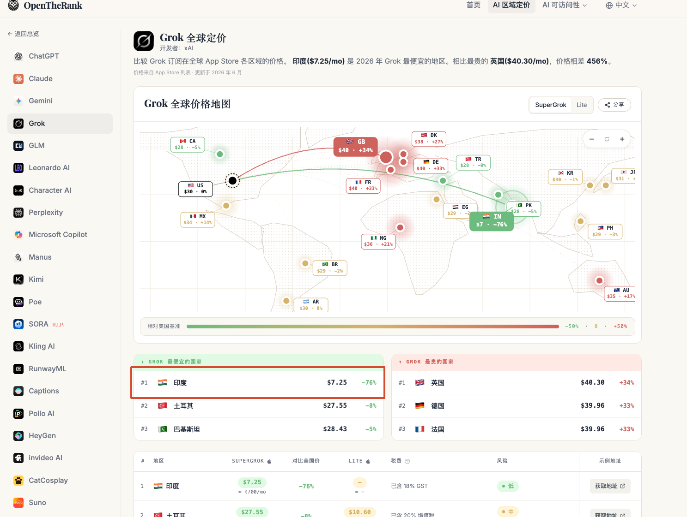

*Translated from the [Chinese original](/posts/260721-the-zelda-phase-of-life/).*

> This post is based on an 80-minute voice recording, and it covers a lot of ground: my current state of obsession, how I think about Token usage, the boundary between Skills and software, how human-agent collaboration is evolving, and every model I use. As with the rest of this series — **as a human, all you need to understand is the thinking and the architecture; for every concrete execution detail, just hand this article to your Claude Code or Codex and let it do the work.**

## Intro: The Night the Tokens Ran Out

It's been a while since my last update. The reason is simple: I've been hooked on squeezing every last drop out of Token subsidies.

Claude Code has hit its 7-day limit, Fable 5 (Claude's current top-tier model) has hit its limit, Codex has hit its 7-day limit, and Kimi Code is at 94%. Among the backup channels, GLM has 63% left, Grok has 32%, and DeepSeek and Bailian still have plenty of headroom — but my main drivers have all clocked out.

So I figured I might as well write something while I wait for the quotas to reset. I'd been meaning to write on this topic for a while, and the title I settled on is — **the Zelda chapter of my life**. This will be a bit of a grab bag, and a lot of it is about AI. Dear readers, let's see how it goes.

## 1. The Zelda Chapter of My Life

Zelda is a game on the Switch.

I don't really play games. The ones I've played were party games or two-player games, things to pass the time with friends. A solo game probably goes back to Crazyracing Kartrider in elementary school. But when I picked up *The Legend of Zelda: Breath of the Wild*, I got hooked instantly.

During that stretch, the only thing on my mind was the parts of Zelda's map I hadn't explored yet. I often played until two or three in the morning, and on weekends I basically spent the whole day in it. You don't feel tired, and meals and going out can all wait — **your head is full of nothing but Hyrule.**

The line Zelda players say most often is: I wish I had a brain that had never played Zelda. The game is finite, after all. Once you've explored most places and finished the side quests, it's hard to recapture the surprise and absorption of that first encounter. When *Tears of the Kingdom* came out I played it too, but it clearly didn't hook me like the first one — objectively, a lot of it was ground I'd already covered.

But lately, I feel like I've found that feeling again.

**Or rather, I may have entered the Zelda chapter of my life.**

My days are now packed with curiosity: I explore many different directions and solve many real problems. Once I get going, I often end up chatting with an Agent until one or two in the morning. I hold a simple belief: as long as something's data is online and large language models have seen related training data, then in principle you can try it with an Agent — my earlier [software post](/en/posts/260220-ai-时代的自用软件工具分享-正文稿/) and [hardware post](/en/posts/260329-ai-hardware-data-security/) both came out of experiments like this.

Objectively speaking, my entire July schedule was arranged around the expiry of my Fable 5 quota in Claude Code and the reset time of my Codex quota. Before July 10, my average daily Token consumption was only around 700 to 800 million; on July 10 a new quota cycle began, and to avoid wasting the reset I had to burn through my Fable 5 and Codex quotas in a concentrated push, so consumption shot up — for several days in a row the daily average was above 4 billion (all channels combined).

Note that **this 4 billion was the 20x plan's quota being maxed out, not me being unable to keep up.**

This is a Token usage monitoring dashboard I built myself. Over the past 30 days, total throughput (including cache) works out to an equivalent value of over $27,000 — note that this is only an equivalent estimate at API prices, not an actual bill; what I actually paid was two $200 subscriptions. By Coding Agent, Claude Code and Codex each account for half; by model, the biggest volume comes from gpt-5.6-sol (33%, the main model on the Codex route), Sonnet 5 (24%), Opus 4.8 (18.6%), and Fable 5 (5.6%).

It's easy to go from frugal to extravagant, and hard to go back. Pushing Token usage up is actually pretty easy, but once the Tokens drop, I feel like a useless person — my first instinct on so many things is "can I give this to an Agent?", and I can no longer remember how to do them by hand.

In [The Days of Running Ahead of the Bear](/en/posts/260315-ai-时代闲言几则-正文稿/) I wrote: "This process of building is far more fun than games, and far more addictive; it's very easy to slip into a flow state." Back then it was a feeling; now it's empirical evidence.

## 2. Reading the Subsidy Window: Harvest What You Can

Conclusion first: **while the Token subsidy window is open, accumulate as many production assets as possible that you can still reuse afterward — harvest everything you can.**

I started using Coding Agents around March 2025, switched from Cursor to Claude Code, and have upgraded plans alongside it ever since: my Claude Code + Codex combination went from 20+0, 100+0, 100+20, 200+20, 200+100, all the way up to 200+200 (the first number is the Claude Code subscription tier, the second is Codex). Now I'm planning to subscribe to a second Codex account.

Why so aggressive? It comes down to one judgment: **although the average Token cost of many models is falling, the cost of the genuinely high-intelligence Tokens is actually going up.**

Think of today's subscription plans as early-bird tickets, or limited-time flash-sale prices during a big e-commerce promotion — the price is unreal precisely because the platforms are still fighting for territory, trading low prices for users and training data rather than trying to make money off you. That's also why I don't think these cheap plans can last: neither Anthropic nor OpenAI has gone public yet, and what they want right now is user scale and behavioral data, not near-term profit. On a $200 monthly plan, I can easily burn through the equivalent of $10,000 in API quota; Codex is even more extreme, where $200 can get you $20,000–30,000 in equivalent consumption — thanks go to Tibo, the person in charge of Codex's quota reset mechanism, whose reset cadence is so well tuned that subscription utilization is absurdly high.

This kind of upside-down pricing obviously can't last long. At the end of my post on [Claude Code's design philosophy](/en/posts/claude-code-risk-model-philosophy/) I wrote "cherish it while it lasts" — that was a judgment; this is doubling down.

So the question becomes: **how do you spend the harvested Tokens so they don't go to waste?** That's the next section.

## 3. Turning Tokens into Code: Where Skills End and Software Begins

Let me set up a premise first: if high-intelligence Tokens in the future can only be bought at API prices, many of today's approaches won't be affordable. So now is the time to convert Tokens into a few things that stay reusable over the long term: cleaned, high-quality data, tool software, and Skills. What I've thought about most here is **where to draw the line between Skills and software**.

### The Nature and Limits of Skills

A Skill's results depend both on how well it's written and on the capability of the model itself; you need both, and if either falls short, output quality gets flaky.

Its upside is a low barrier to entry: it's all natural language, anyone can write one, and it's especially well suited to workflows that keep changing. Put simply, **you're borrowing the Agent's ability to handle uncertainty** — that's where a Skill is most valuable.

But that's also where the limit lies. You'll find that the same Skill run on a different model can easily lose instruction-following quality (though some of that can be pinned down with scripts). The more critical issue is attention. In [Context is All You Need](/en/posts/context-is-all-you-need/) I wrote: **an Agent's attention is its most precious resource, and it should be spent sparingly on resolving uncertainty.**

How to understand that? Think of an Agent's attention as a person's working energy — if you make it spend an hour dealing with a login CAPTCHA, it has an hour less for the real work. People are the same; nobody wants their workday swallowed by that kind of trivia.

Take an example. Say you have a browser-scraper Skill that can crawl all kinds of web pages; using it occasionally is of course fine. But once you use it frequently, you'll find the Agent spends a lot of its energy on chores unrelated to the main task: retrying a page's login over and over, fumbling with CAPTCHAs… After enough times, the attention wasted costs more than the time saved, and the Skill's return on investment naturally sinks. **Put plainly: the more frequently a scenario is used, the less it should be handled by an Agent on the spot, and the more it should become a program.**

### The Answer for High-Frequency Scenarios: Componentize and Engineer

So the better solution is: **once a scenario is used frequently enough, turn it into a program.**

In terms of efficiency and cost, it's like shifting gears when driving — once you've mastered a familiar route in a manual car, sooner or later you'll want an automatic, so the attention you save can go to road conditions that really need judgment. Or put it another way: if you cook the same dish every day, you're better off buying a bread maker, handing the deterministic steps to the machine, and keeping for yourself only the seasoning, the part that actually needs judgment. **Turning Tokens into code is, I think, the highest-leverage conversion available right now** — provided that code actually runs in production and keeps getting called. The marginal cost of code is nearly zero; most of the time it doesn't need Tokens at all, or needs several orders of magnitude fewer than the Agent approach.

Let me use my own example. For the same information-processing and filtering pipeline, I wrote it as a programmatic service — it still calls an LLM, but through a traditional single call rather than an Agent, and the model can be swapped for something cheap like DeepSeek. That way, a single project burning seven or eight million or even ten million Tokens a day works out to **under 10 RMB a day**. If the same job were done with an Agent, it might burn one or two hundred million Tokens — a subscription plan could carry that, but over the long run this approach isn't sustainable.

I've already accumulated a batch of these services on my LAN, for example: a YouTube downloader that handles IP-based restrictions, switches language and region settings, and downloads livestreams that are otherwise unavailable; a crawler gateway that, given a URL, fetches content from WeChat official accounts, Xiaohongshu, and Twitter without spending a single Token; an ASR speech-to-text service that batch-transcribes dozens of hours of audio and video every day; and an image OCR and image understanding service.

Once these are built, they can be consumed repeatedly by many downstream scenarios and recombined into new things — whether it's summarizing audio and video across platforms or monitoring livestream feeds on different platforms for me, it's all composed on top of the engineering foundation laid earlier. Each service usually has two or three downstream consumers, and some have four or five. This is the latest progress on the "validate quickly with Skills, pursue stability through engineering" idea from my post on [the tools I grew with AI](/en/posts/260220-ai-时代的自用软件工具分享-正文稿/).

### My Principles for Using Skills

For that reason, I don't have many Skills installed. The only one I use at high frequency year-round is the [gstack](https://github.com/garrytan/gstack) Skill pack open-sourced by YC CEO Garry Tan — I use its multi-perspective review Skill every single day. Others, even when installed, are mostly installed at the project level rather than globally. Or I simply study the principles behind a Skill and absorb them into my own engineered projects.

Here's another criterion to share: **whether a Skill keeps being iterated on is an important basis for deciding if it's worth it.** Most Skills shared by content creators, unless they're continuously updated, were probably written for viral reach and never really run in production. A good Skill must keep evolving — if even the author thinks "written, done, leave it," then it most likely hasn't been tested repeatedly in real scenarios, and its value is limited.

## 4. From Babysitting to Letting Go: A Self-Healing System

What I've covered so far is about "things" — how to turn Tokens into long-term assets. This chapter is about "people": as Agents can do more and more, where should the human stand?

### The Three Stages of Human-Agent Collaboration

I once read a practice write-up by a Silicon Valley AI engineer ([How Do AI Agents Truly Land in Production](https://mp.weixin.qq.com/s/cbEtEbDb-A1_YFyf00dj0A)) that divides AI usage into three stages, and I think the division is very accurate. Stage one is **Copilot**: the human leads, AI is just a tool, and every judgment and every execution needs a human nod. Stage two is **babysitting the Agent**: you can already throw more complex tasks out, which is progress in itself — but the problem is you can't walk away; when the Agent drifts you have to pull it back, when it gets stuck you have to push it, like looking after a baby, with the human tethered to the computer and no energy left for the decisions that actually matter. Stage three is **autonomous Agents**: a team works in the background on its own, you show up only at the most critical decision points, and the rest of the time you fully let go.

My own sense is that **I'm moving from stage two toward stage three**. One thing struck me deeply in this process: the more you interact with Agents, the more you notice that everyone runs into the same problem — **the human is the bottleneck in the whole loop**. You have to resolve your own sticking point first, so you can move your energy to more valuable things.

In a way it's a lot like starting a company: early on you do everything yourself and build the foundations; once you scale and can't cover everything, you have to hand things off and keep the business growing through process and division of roles — you gradually step back from front-line executor to department manager, then to CEO. Working with Agents follows the same path: Agents push people toward the two extremes — you're either the lowest-level executor or the top-level planner. The move from stage two to stage three is the process of humans continuously moving up to higher levels.

### The System I Built: Principles Only, No Details

Counting the services I maintain for myself and the ones I run for my team, I have roughly thirty or forty. Maintaining one or two is fine, but once there are many projects — old ones with bugs to fix, new features to add, new things I want to explore — a huge amount of time gets eaten by routine operations and bug fixing.

So the natural question is: **can the system dispatch an Agent to fix things itself when something breaks?** After it's fixed, it sends me a message, I confirm it's fine, and the problem gets resolved in production right away — and the whole time all I do is tap a button in Feishu.

The idea sounds simple, but when you actually build it, you find a pile of infrastructure to fill in: should the logs from all services go to one platform? How do you give the Agent enough context to locate problems in production? And how do you make sure the Agent doesn't introduce new problems when it fixes things?

I already have this system running, and it has actually gone through the whole flow end to end during a real production incident. The overall logic fits in one diagram:

```mermaid
graph LR
    SIG["Monitoring signals<br/>error monitoring / availability monitoring"]
    DISP["Dispatcher<br/>dedupe · rate-limit · classify"]
    AGENT["Agent diagnoses and fixes<br/>temporarily pulls code · reproduces the production version"]
    PR["Opens a PR automatically"]
    GATE["Unified CI gate<br/>tests · multi-Agent review · UI screen recording"]
    CARD["Feishu approval card"]
    DEPLOY["Merge + deploy to production"]

    SIG --> DISP
    DISP -->|Feishu prompt: investigate?| AGENT
    AGENT --> PR
    PR --> GATE
    GATE -->|all green| CARD
    CARD -->|I tap once| DEPLOY

    style SIG fill:#e74c3c,color:#fff
    style DISP fill:#f39c12,color:#fff
    style AGENT fill:#9b59b6,color:#fff
    style PR fill:#3498db,color:#fff
    style GATE fill:#2ecc71,color:#fff
    style CARD fill:#1abc9c,color:#fff
    style DEPLOY fill:#1abc9c,color:#fff
```

In the whole flow I do only two things: after an incident, reply "investigate" in Feishu; once the fix is ready, tap "merge" on the approval card. Everything in between — diagnosis, fixing, opening the PR, running tests, passing review — is done by the Agent itself.

By the way, PRs produced when I proactively assign work in daily life (writing new features, fixing bugs) go through this same CI gate, so they aren't drawn separately in the diagram.

The system comes down to three rules:

**First, no merging unless the gate is all green.** Tests must pass, the size of the change can't exceed a cap, and the Agent can't touch deployment infrastructure files — if any one condition isn't met, it's bounced back, no favors.

**Second, the one writing the code and the one picking at it can't be the same Agent.** Once a PR is opened, the unified gate triggers automatically: run tests, bring in an independent Agent for review (reviewer and author are kept separate, otherwise self-confirmation breeds hallucinations), and for projects with a frontend, it also runs end-to-end tests and records the screen to show me. All of this is carried by the Agents themselves, with none of my time taken.

**Third, the moment I'm summoned must be the moment when everything is ready and only my decision is missing.** When a PR has just been opened, Feishu only gets a progress card with no button; once the gate is all green, that same card grows a button. The whole stretch of running tests, review, and waiting for results never disturbs me.

Because this system is still iterating rapidly and is far from a stable form, I'll only cover the architectural principles here and not the implementation details — once it settles, it may get its own post like the one on [Agents That Never Clock Out](/en/posts/260628-agent-era-dev-anywhere/). On the supporting infrastructure, one note: a while ago I moved many of my personal GitHub repos under an organization, because an organization can natively reuse the same CI template system, and new repos automatically plug into the whole workflow without per-repo configuration.

### Once the System Is Running

After the system is built, you'll find that most of the time you're only making two kinds of decisions: **one is setting direction — what to do next; the other is approval — whether this can ship.** You no longer need to get involved in how it's executed.

My own development mode has become this: first chat with an Agent for an hour or two to thoroughly work through the system's goals, architecture, what should and shouldn't be done, and what engineering trade-offs to make; then hand it a long-running task and let it run on its own — from a few hours to dozens of hours. Along the way I hold three hard rules: test-driven development (TDD), small commits and PRs, and an independent Agent must review.

With this mode, I can now push roughly ten projects forward in parallel. That's also why my Token consumption looks a bit frightening — at peak hours, refreshing the dashboard every half hour shows two or three hundred million Tokens burned; and since Codex removed the 5-hour limit, burning through a 20x plan's entire weekly quota in a single day really does happen.

## 5. Token Philosophy and the Model Arsenal

### Three Basic Judgments

At this point, let me share three judgments about Tokens themselves.

**First, Tokens have become the fuel that sustains curiosity — they're my in-game currency in this game called reality.**

**Second, Tokens are cheaper than human energy, but an Agent's attention is scarce.** You have to believe "Tokens are cheaper than energy" first, or you'll be reluctant to spend them; at the same time, you have to put the Agent's attention where it counts. So my usage looks a bit contradictory: on one hand I care a lot about efficiency — I never turn on fast mode (it burns quota quickly, but output isn't proportional for the same task; better to spend it on parallelism and volume), and I install tools like [RTK](https://github.com/rtk-ai/rtk) and [Graphify](https://github.com/Graphify-Labs/graphify) to cut Token consumption per task, the former being a CLI proxy that reduces Token consumption of common dev commands by 60–90%, the latter turning a codebase into a queryable knowledge graph; on the other hand I'm not stingy at all — I deliberately bring in different Agents to cross-review project plans, precisely to find problems.

**Third, Token consumption may not be a good metric.** It's just that we can't yet find anything else objective to measure Token utilization and ROI, so we fall back on consumption. What we should really pursue is: can the same task be completed with fewer Tokens, and can the same Tokens unlock greater value.

### Tiered Calling: How I Divide Work Among Models

Based on these judgments, my overall calling strategy is tiered: **the top-tier model does planning and overall orchestration; balanced but cheaper models handle concrete execution; engineer-style Agents do multi-round review.**

A quick note on naming: Claude's models are split into tiers — Fable 5 is currently the top, followed by Opus 4.8 and Sonnet 5; gpt-5.6-sol is the main model on the Codex route. The names in the consumption chart from Section 1 should all line up with this section.

The thinking behind this division of labor comes down to one sentence: **assign different roles to models with different personalities, rather than expecting one model to do everything.**

**Fable 5 is my technical co-founder.** I only use it for top-level project planning, and I use it sparingly. What makes it most impressive is that it makes judgments from a business perspective — which things are worth investing in, which shouldn't be touched at this stage, how to choose the tech stack; it gives very solid advice on all of them. It's not a command machine that does whatever you say; it will actually stop you, and it can actually help you figure out which road to take. **Both a roadblock and a navigator.**

**Codex is the rigorous engineer, and also the king of value for money.** Thanks to Tibo's quota reset mechanism, it's the best-value tier of all the subscriptions, which is why I want to open a second account. When using Codex, keep its complexity in check — no engineering project in the world has zero bugs, but Codex is inherently extremely rigorous and wants to lock down risk at every point, so you need to tell it the project goals up front and warn against over-engineering, and when fixing problems, try to subtract before you add, otherwise solving one problem introduces a pile of new ones. It's really unbeatable at review; I've compared many models on engineering-perspective issues, and Codex is still the best experience so far, with plenty of volume to spare.

**Grok 4.5 is the workhorse of the execution layer.** Its capability is roughly near top tier, but its speed is outrageous — like it's got the runs. Through a subscription in the India region, the plan that normally costs $30 is only 30 RMB a month, with a quota of roughly 200–300 million Tokens a week, which is a great deal. When Claude Code and Codex are under heavy load, it's perfect to hand work off to it — fast and capable.

**Kimi 699 plan: great taste, CLI still maturing.** K3's frontend aesthetic really is the strongest among domestic models, and its overall capability is also very good, with about 700–800 million Tokens a week. What's frustrating is that the Kimi CLI experience is still a notch behind: long-running task context compression and support for some commands aren't as good as mature tools — though these should gradually improve. Purely on value, Kimi 699 certainly can't match Codex, but I still want to support the domestic effort, and I hope they keep it up.

**GLM 5.2 (199 plan):** I use it inside OpenCode, not the official client. It's decent overall, but without multimodality it always feels like something is missing; for now I mainly use it for code review.

**MiniMax M3 (199 plan):** Running ordinary tasks in Hermes (an Agent framework from Nous Research, which I mainly use to connect to WeChat conversations and scheduled tasks) is fine, but in Coding scenarios it's really weak — hallucination and instruction-following are both poor, so I can max out the quota on all my other plans while this one often can't find a use. Right now it's mostly used inside OpenCode for organizing and summarizing documents.

**DeepSeek:** Used via API by my programmatic services — that's the "under 10 RMB a day" scenario from Section 3; I use it less in Agents.

**Bailian Coding Plan (199):** Currently it only has qwen3.7-plus, no max or latest model. I use it in OpenCode, where it natively supports multimodality, and it's passable for simple tasks.

Most of these I put into OpenCode together with oh-my-openagent, assigning them to different tasks by role; overall it's still in catch-up mode.

### A Question Without an Answer Yet

On domestic models, I have a dilemma I haven't fully thought through: on one hand, I believe **models and the Harness (the software that hosts the model) should be tightly coupled**, and that combining the two is what lifts the experience to the next level — this is also Claude Code's design philosophy; on the other hand, domestic models have tight compute and are cost-sensitive, which makes you want to use the top domestic model only for top-level planning and hand concrete execution to cheaper models — under that approach, an open framework like OpenCode plus oh-my-openagent is actually a better fit, letting different models focus on different problems with more controllable costs. Which of these two paths is better, I don't have a clear comparative conclusion right now, so I'm telling you honestly.

## 6. Running Ahead of the Bear, Continued: The Age of Discovery

Everything above is my own little plot of land — specific usage and specific trade-offs. Zooming out to the whole industry, the same logic applies, and this is a sequel to [The Days of Running Ahead of the Bear](/en/posts/260315-ai-时代闲言几则-正文稿/).

### The Trend Holds, but the Process Is Long

Conclusion first: the big direction hasn't changed — **nobody can change the trend of Agents entering society's production environments.** But the process may be very long, and it's stuck mainly on two levels.

**First, Coding is an accidental and scarce scenario that other fields can hardly replicate.** Why have Agents progressed fastest at writing code? Because only Coding has both of two conditions at once: "open high-value data" and "a closed behavioral loop" — code you write can run, be tested, and be verified, forming a complete feedback loop. Most of the rest of the world has neither: the data may be very valuable but it lives in the heads of industry front-line people; there are too many influencing factors, and a decision can at most raise the probability of success without guaranteeing the outcome — so it's hard to close the loop. The physical world is even harder: all kinds of startups spend heavily to collect physical-world data, but neither in quality nor quantity can it compare with Coding, so progress is bound to be much slower. Put differently, **highly paid programmers plus an open-source community culture is itself an accidental, scarce combination**, and it's hard to find a second one like it in reality. This is also the "dark knowledge" problem I discussed in [The Days of Running Ahead of the Bear](/en/posts/260315-ai-时代闲言几则-正文稿/): the less an experience has been digitized, the harder it is for AI to reach.

**Second, technical hurdles are the smaller problem; the bigger one is the distribution of interests.** The first hurdle is stuck on data and scenarios; the second is stuck on people. A line from the British comedy *Yes, Minister* captures it perfectly: whatever a department was founded for, in the end it has only one purpose — to prove it needs to exist. That's what you actually face when pushing new technology into a company. So **bringing AI into an enterprise must be something the number-one leader personally steps into and signs off on.**

### But You Only Need to Be Relatively Ahead

Looking at it from another angle, though, **a high barrier is the same for everyone.** Agents landing slowly isn't slow for you alone; it's slow for the whole industry — and competition has never been against AI, it's against peers. Unless you hold a license or are tightly tied to the physical world, in online competition someone will always use a more advanced approach to push out the old rivals. And the barriers differ enormously from industry to industry, so **companies compete on relative lead, not absolute lead** — on AI skills we certainly can't match researchers at big Silicon Valley firms, but as long as your competitors use it at a fairly basic level and you're a step or two ahead, you reap a lot of benefits.

### What Is Most Valuable

What's most valuable in this era is certainly "knowing what to do" — setting direction. One level down, the valuable things are: **ideas, insight, best practices, and hard-won lessons — things that aren't in AI's training data.**

For anything online, as long as I can see it, it can most likely be reproduced. But what lies behind it is far more complex — industry know-how and hard-won experience are what's truly scarce. Two recent examples in the industry illustrate this especially well.

One is Cloudflare's [vinext](https://blog.cloudflare.com/vinext/): an internal Cloudflare project that reimplemented Next.js, which one engineer with AI finished in **one week**, at a Token cost of only $1,100. What made it possible was that Next.js's documentation is thorough and its test suite is comprehensive, so it could be carried over directly as the acceptance criteria.

The other is [pgrust](https://mp.weixin.qq.com/s/JaZiPYscoR349M0dbDuf3g) — a project rewriting PostgreSQL in Rust, with a more interesting story: the author first tried a **from-scratch rewrite, which failed**, and the whole codebase was archived; the path that actually survived was to first mechanically translate PostgreSQL's C source into Rust with tools, then have AI rewrite it module by module — and the end result passed PostgreSQL's original 46,066 regression tests.

These two examples point to the same conclusion: **whether AI can reproduce something depends on two things — whether there's a complete test suite to serve as the acceptance anchor, and whether the hard-won lessons the original system accumulated can be inherited.** vinext relied on the former, using Next.js's test suite directly as acceptance criteria; pgrust relied on the latter — mechanical translation preserved thirty years of accumulated code as-is, while a from-scratch rewrite threw all that accumulation away, which is exactly why it failed.

**In the end, tests are hard-won experience made concrete.**

This kind of hard-won experience is extremely valuable; it's one of the most important things for saving Tokens and raising ROI. **Anyone who is willing to genuinely share such experience with you is truly passing value to you.**

So, all in all, this is an Age of Discovery: risk and opportunity coexist, and the bigger the problem, the richer the reward for solving it. In every industry, gold may be lying all over the ground.

## Final Words

Zelda players want a brain that has never played Zelda because the game's content is finite — once you've explored it, it's gone.

But this time is different — **this new continent grows bigger every day**, and every morning you wake up there are new corners to explore. That is probably the happiest part of "the Zelda chapter of my life."

Of course, the subsidy window will close too: quotas will tighten, plans will scale back, and high-intelligence Tokens will sooner or later be billed at their true price. So while you can still harvest, harvest everything you can; and more importantly, turn the Tokens you harvest into **long-term reusable production assets** like code, services, and workflows — when the day comes that Tokens get expensive, what you've accumulated will be the real reward for finishing the game.

Happy exploring, everyone.

---

> This article's draft was conceived from a voice-to-text transcript captured with the Feishu Recording Bean; the article structure and content were organized in collaboration via Kimi CLI + K3, and the final polish was done entirely by Claude Code + Opus 4.6.
