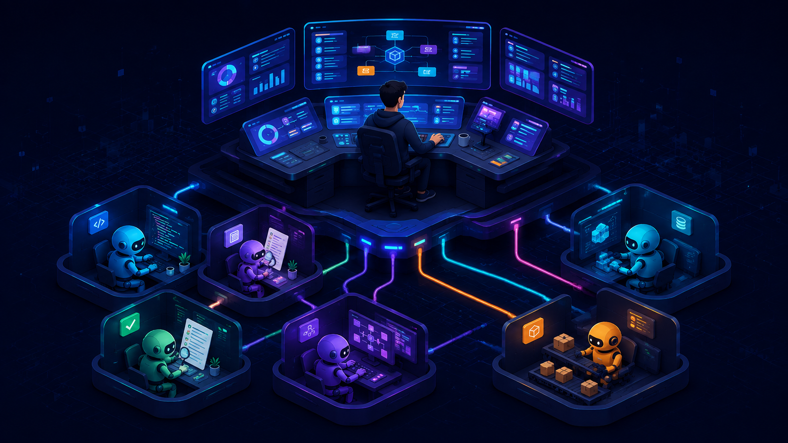
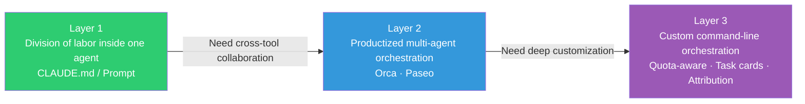
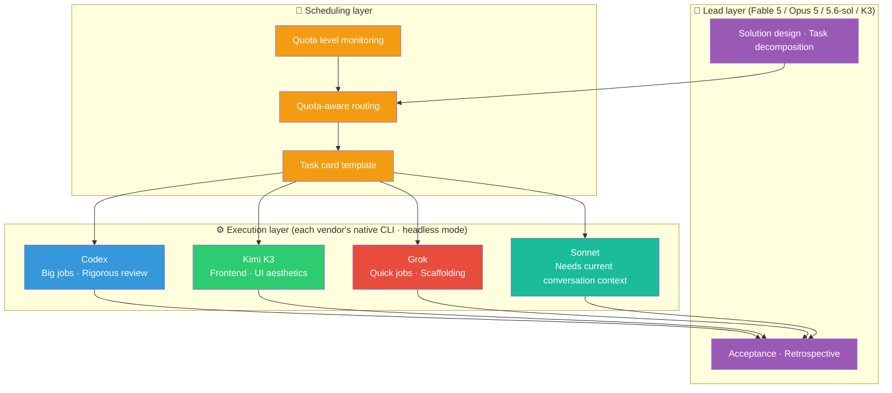
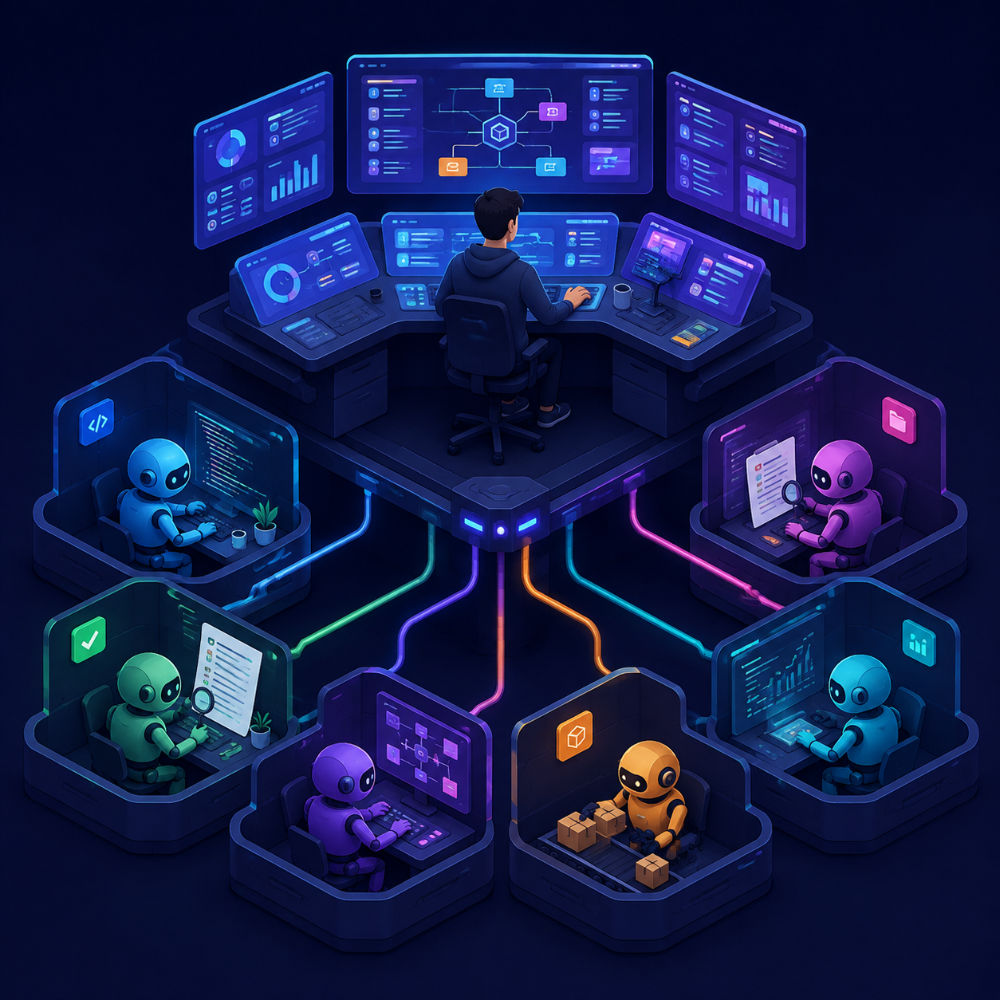
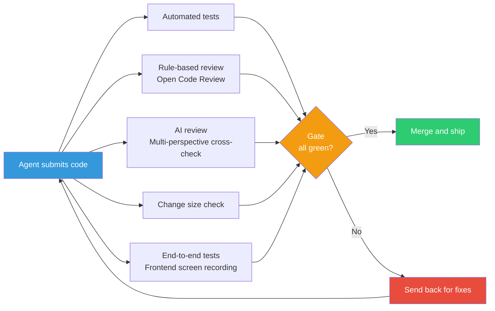
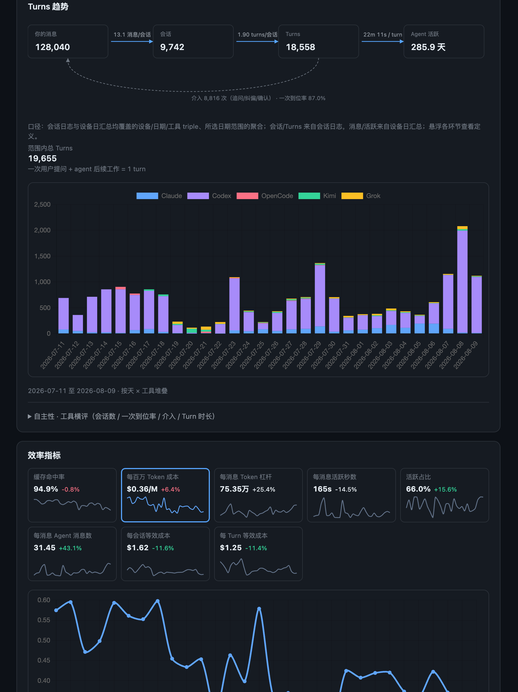

*Translated from the [Chinese original](/posts/260809-multi-agent-scheduling-architecture/).*



> This post started as an 80-minute voice talk. It continues the tradition of this series: **as a human, you only need to understand the ideas and the architectural logic; for all the concrete execution details, just hand the article to your Claude Code or Codex and let it do the work.**

## Opening: Why Talk About a Scheduling System

In [The Zelda Phase of Life](../260721-the-zelda-phase-of-life/), I used an architecture diagram and a short overview to touch on "multi-agent scheduling": a lead agent does the planning, an execution layer does the work, and gates do the checking. But that post focused on Token economics and the arsenal of models, and the scheduling system itself got only a passing mention.

This post is the full treatment.

Let me start with a one-line principle: **An agent's attention is extremely precious. You should spend it on resolving high-quality uncertainty, not on trivia.**

What does that mean? Think of an agent's attention as a person's working energy. If it spends an hour dealing with a login CAPTCHA, that's an hour less for the real work. In [Context is All You Need](../context-is-all-you-need/) I used a metaphor: attention is like your workbench. The bench is only so big, and once clutter piles up there's no room left for real work. That post was about keeping a single agent's "workbench" in good order; this one is about what to do when you have a whole crowd of agents at once (Claude Code, Codex, Kimi, Grok) and want to make good use of every one of their workbenches.

It's a close analogy to how a CEO allocates their energy. A CEO's energy is limited and should go only to decisions, high-value judgments about direction, and finding resources, not to the details of frontline execution. **The general doesn't chase the rabbit.**

## 1. How This System Grew

Many people hear "multi-agent scheduling" and assume it's a heavy architectural design, but it started out as a very plain idea.

Back then, Fable 5 (currently the top-tier model in the Claude family) was still in limited beta, and I didn't know whether I'd get to use it again. So I used it sparingly: Fable 5 handled only planning and design, and every concrete execution task was outsourced to Sonnet 5 (a cheap, well-balanced model). **Cost pressure forced out the original division of labor.**

The evolution went like this:

1. **Starting point**: Multiple coding agents each had their own config files, which were a pain to maintain, so I created a separate repository (think of it as one place where all of a project's files live) to manage them in one place.
2. **Step one**: Since the configs were centralized, could I try turning the other coding agents into an execution layer?
3. **Step two**: Once the execution layer could run automatically, I needed to know how much quota each subscription plan had left, so I wrote a monitoring dashboard.
4. **Step three**: With data in the dashboard, could I pick an executor automatically based on remaining quota? That became quota-aware scheduling.

None of these steps was designed in advance. Each one "grew" out of use. You'll find that once you build one component, it produces new uses you never expected:

- The **monitoring dashboard** started as a way to count usage per plan. Later I added Token consumption stats (by model, by project, by device), then monitoring of the dev machine's memory and workspace cleanliness, then the health of the CI test machines. In the end it became the "instrument panel" of the scheduling system, helping decide "who should get this task."

- The **scheduling system** started as a script that picked an executor. Later I added quota gates, task card templates, commit tracking, and retrospective reports, and it ended up as a complete multi-agent orchestration infrastructure.

**In the agent era, allow yourself to waste ideas. You can't know what a simple idea at the start will eventually turn into, or how useful a tool it will become.** It grows a little at a time in your collaboration with agents. If your curiosity is still alive, you'll find a great many interesting things to play with.

## 2. The Overall Architecture: Three Progressive Layers

This scheduling system has three layers. For most people, getting the first layer right is enough. If you want to manage several agents at once without much tinkering, the second layer has ready-made products. Only people with deep customization needs, like me, end up at the third.



### Layer 1: "Lead + Sub-agents" Inside a Single Agent

This is the daily reality for most people: you use only one coding agent (say, just Claude Code or just Codex) and split the work between a lead and executors inside it.

How? For example, Claude Code has a global config file called `CLAUDE.md`. You can write in it, "You are the lead. You only handle solution design and task decomposition, and you dispatch all concrete code changes to sub-agents," and the model will decide accordingly which things to do itself and which to send out. You can even give sub-agents roles: `implementer` (the executor, who writes code) and `reviewer` (read-only, who picks out problems). Codex works on similar logic, just constrained through prompts and config files.

The core technique at this layer is the one I covered in [Context is All You Need](../context-is-all-you-need/): keep the lead's attention on planning and decisions, and let sub-agents run the trivial execution on separate "workbenches" so the lead's bench doesn't fill up with clutter.

For most people, getting this layer right already brings a big efficiency gain. For the specifics of configuration, the appendix at the end has sanitized reference templates that you can hand straight to your agent to set things up.

### Layer 2: Productized Multi-Agent Orchestration (Where Most People Should Start)

If you subscribe to several coding agents at once (say Claude Code + Codex + Kimi) and want them to work together without building your own infrastructure, you can use ready-made products:

- **[Orca](https://github.com/stablyai/orca)** (a YC-backed project): focused on parallel agent orchestration. It manages multiple agents working at the same time on different copies of the code, with desktop, mobile, and server versions, and lets you run any coding agent with your own subscription accounts.
- **[Paseo](https://github.com/getpaseo/paseo)**: focused on lightweight orchestration. It also supports dispatching multiple agents from desktop and mobile, with a command line and a Docker deployment mode.


What these two tools share is that they also work by leveraging each vendor's native coding agent (like my Layer 3, they rest on the premise that "a model and its native tooling should be used together"), and they handle the most headache-inducing problem: how to let multiple agents work simultaneously without stepping on each other. They also come with graphical interfaces (GUIs), so the barrier to entry is much lower. If your need is "I have a few subscriptions and I want them all working for me at the same time," start at this layer and you don't need to go further.

My own orchestration system also learned a lot from these two open-source projects, for example how they detect task state changes in the execution layer and how they assign tasks. These are well worth studying.

### Layer 3: Custom Command-Line Orchestration (My Approach)

I went to Layer 3 not because the Layer 2 products are bad, but because I had more customization needs.

Let me start with the simplest pain point: **switching between different tools is tiring in itself.** When you have Claude Code, Codex, Kimi Code, and Grok Build all at once, the mental "gear shifting" of going back and forth eats a lot of energy.

Layers 2 and 3 share a premise: **a model and its native tooling should be used together.** I talked about this in [Claude Code's design philosophy](../claude-code-risk-model-philosophy/): to get the most out of a model, use the development tool it was designed to pair with, and ideally the model should be deeply coupled with the tool's feedback data during training. A recent interview with the Claude Code team backs this up: they deleted 80% of the system prompt, and the agent's capability didn't drop.

Incidentally, open frameworks like [OpenCode](https://github.com/opencode-ai/opencode) already have built-in multi-agent dispatch by category, automatically assigning different models by task type, out of the box. The problem is that it locks you into a single framework, so you can't enjoy the gains each vendor's native tooling makes as it evolves.

On top of that shared premise, I have a few extra customization needs:

**First, Anthropic explicitly forbids using a Claude Code subscription quota in other tools.** They've also been fairly wishy-washy about "headless mode" (I'll explain the concept below), possibly because they want to collect human corrective data on agent behavior. So day to day I don't run Claude in headless mode; I use other vendors' tools for automated execution.

**Second, I need automatic scheduling based on live quota levels.** I have a monitoring dashboard I wrote myself that tracks each plan's remaining quota in real time. The scheduling system reads that data and decides "who should get this task": when a plan's quota is nearly spent, dispatching to it pauses, and plans with plenty of headroom take on more work.

**Third, I need complete task tracking and retrospective ability.** Every task has a standardized task card template (goal, modification boundary, acceptance criteria), and every commit can be traced back to which executor and which model did it.

One more important point: **the whole orchestration system is built from a mix of "prompts + scripts," not software in the traditional sense.** Some rules live in prompts for the model to follow (such as role division and engineering conventions), while others are enforced by deterministic scripts (such as task assignment, creating and cleaning up copies of the code, and quota queries). Why separate them? Because space in the global prompt is extremely precious: stuff too much in and the model tends to lose key instructions over a long conversation. **If a script can guarantee something, don't rely on the prompt alone.** This design principle applies no matter which layer you use. The system currently runs on both Linux and Mac; Windows would be much more complicated.

So the Layer 3 design looks like this:



**The lead does only four things**: solution design, splitting task cards, accepting results, and periodic retrospectives. It doesn't write code (except for single-line tweaks).

The **scheduling layer** assigns task cards to the most suitable executor based on task type and each plan's remaining quota:

| Task type | Preferred executor | Reason |
|---|---|---|
| Big jobs: complex tasks touching multiple files | Codex | High quality, plenty of quota |
| Quick jobs / time pressure: project scaffolding, bulk renaming | Grok | Extremely fast, low cost |
| Frontend/UI: pages, components, visual styling | Kimi K3 | Strongest aesthetic sense among domestic models |
| Slow jobs with no deadline: adding tests, writing docs | Codex | Quality first |
| Needs tools specific to the current conversation | Sonnet sub-agent | Coupled to the current session's context |

The **execution layer** runs entirely in "headless mode." Let me explain the concept. When we normally use a coding agent, we open a chat window, say one thing, and it does one step. That's "conversation mode." "Headless mode" is a different way of working: you write up a task description, pass it to the agent through the command line, and it quietly finishes in the background and hands back the result, with no need for you to watch. It's like emailing an employee "get this done" instead of standing next to them and directing every step. I chose this mode because the scheduling system needs to dispatch dozens of tasks programmatically at the same time and collect results automatically, which a human sitting there in one conversation after another can't do.

While I'm at it, here's a tool combination for managing multiple agent sessions in a command-line environment: **[herdr](https://github.com/herdrdev/herdr) + [mosh](https://mosh.org/)**. herdr is a terminal multiplexer designed specifically for AI agents and can manage multiple agent windows at once; mosh solves the problem of resuming a remote connection after it drops. This combination has replaced the tmux + SSH setup I recommended in [Agents Never Clock Out](../260628-agent-era-dev-anywhere/). It's more stable and better suited to agent scenarios. If you're interested, you can also look at [this write-up of best practices for account upkeep and interaction](https://mp.weixin.qq.com/s/U0Ha_Zia3brKntMvPPeurA).

The concrete implementation details for this layer (task card template, routing config, sub-agent role definitions, and so on) are in the sanitized reference materials in the appendix. If you're interested, hand the appendix to your own agent and let it help you build a similar system.

### Parallel Development: One Lead, Many Pipelines

Managing with a single lead brings another big benefit: **parallel development gets much faster.**

What is parallel development? Say you have a project with three features to build at once: a login page, a payment API, and message push. Done serially, you finish one and start the next; done in parallel, all three start together and you go three times as fast. The difficulty with parallelism is that all three features change the same code, and without isolation they'll end up conflicting with each other.

The solution is called a **Worktree**. You can think of it as "photocopying" the project into several copies, with each agent working independently on its own copy without interfering with the others. When they're done, the lead merges each result back into the main line.

In my system, the lead manages these copies itself: which ones can start at the same time, which must wait for the previous one to finish, how to keep naming consistent, and how to clean up afterward. The lead arranges all of it automatically.



In actual operation, thirty or fifty agents are often running in the background at once, while the lead windows I have open in the foreground might be only seven or eight. Each lead manages five, six, even seven or eight tasks in parallel. Each task works on its own copy, and when they finish, the lead handles the merge conflicts.

If you don't have a lead managing this centrally and instead create these copies and development branches (think of them as "parallel versions" of the code) by hand, things get messier over time: lots of things go uncleaned and end up scattered everywhere. Letting the lead do it means it strictly enforces the rules you've set: consistent naming, automatic cleanup when done, and automatic conflict handling.

### How to Choose the Lead Model

The difficulty of every problem ultimately converts into one question: **can the lead that splits the task cards actually do the job?**

By "ability" here I don't mean raw model intelligence but the combined ability of "model + tools": can it plan things properly around your business goals? Can it use parallelism effectively to speed up development? Can it adjust promptly based on errors that come up along the way?

Right now Fable 5 is still in a class of its own as a lead. What makes it great isn't that it's smart, but its **sense of proportion**: it pushes back on you when it needs to and proposes better solutions. Without you deliberately steering it, it has the instinct to "think one dimension up": rather than treating the symptom and fixing the bug in front of it, it can propose a solution at a higher level so that this class of problem never happens again. That ability is very rare.

Because Fable 5's quota is limited, I also use Opus 5, GPT-5.6-sol xHigh, and Kimi K3 as leads. For fairly well-defined engineering tasks they're all good. But each has its temperament: GPT-5.6-sol is **too much like an engineer**, wanting everything done with extreme rigor and often over-designing, so you have to keep telling it in your instructions, "don't make this so complicated." K3 has limited compute, so it thinks deeply but runs slowly.

As for the execution layer, at the current pace of iteration at the model vendors, I think any of them is fine. My main execution layer has now moved to GPT-5.6-sol Luna xHigh mode, and on the Codex $200/month plan I get roughly 30 billion Tokens over 7 days, which is very ample. The frontier models of today would have far outclassed the best coding assistants of a year or two ago. They just lack global vision and a sense of the big picture, but if the task cards are split well, the execution layer is basically a solved problem. **So the difficulty all concentrates on the lead.**

## 3. Quality Assurance: Letting Agents Keep Themselves in Check

Every direction I care about, whether scheduling and orchestration, testing and evaluation, or autonomous operations, rests on the same logic: **human energy is limited, so outsource everything that can be outsourced, don't worry about Token consumption, and spend your own energy only at the two ends: setting direction at the start and doing acceptance at the end.**

Going even further: **just do approvals.**

But that comes with a precondition: you need an automated quality-control mechanism. Otherwise nobody reviews what the agents write, and sooner or later something goes badly wrong.

### Write Tests First, Then Code

In my system, long-running tasks (the kind where you issue one instruction and the agent may run on its own for hours) work well thanks to three hard rules:

1. **Write the tests first, then the implementation**: In a long-running task, an agent most easily drifts off course, gradually wandering from the original goal. Tests are its anchor. With the anchor in place, it can't drift far.
2. **Small commits**: Save after every small piece of functionality instead of saving everything in one go at the end. That way, if something goes wrong, you know exactly which step introduced it.
3. **Gates that keep finding problems**: Automated checks keep scrutinizing every commit and feed problems back to the agent, which fixes them and commits again, forming a self-correcting loop.

Together, these three rules usually give good results for an agent's autonomous execution in long-running tasks.

### The One Who Writes Code and the One Who Picks Faults Must Be Separate

I mentioned this in [The Zelda Phase of Life](../260721-the-zelda-phase-of-life/): **the agent that writes the code and the one that reviews it can't be the same.** Just as it's hard to spot errors in your own writing, an agent also "confirms itself" and thinks it did a pretty good job. Only an independent agent doing the review can truly find problems.

In practice I use two layers of review:

- **AI review**: After code is submitted, an independent agent is triggered automatically to review it. The reviewer is separate from the author, using a different model and a different context, which is like bringing in an outsider who has no idea how you wrote it to find faults. Having several reviewers with different perspectives cross-check greatly raises the chance of catching problems.

- **Rule-based review**: Here I want to strongly recommend [Open Code Review (OCR)](https://github.com/nicepkg/opencodereviewer), released by Alibaba. It doesn't use AI to "understand" the code; it scans mechanically against a fixed set of rules, like a quality-inspection line in a factory, checking one item at a time. The benefit is very low cost: even if you configure a very basic model (such as a cheap DeepSeek or MiniMax model), you can dig up a lot of problems at very low consumption. Of course it also produces many false positives (flagging things that are actually fine), but you can just hand what it digs up to an agent to judge. **It's a very good deal.** My OCR now burns about 100 to 200 million Tokens a day. Highly recommended.

### Control the Size of Each Change

The size of each commit needs to stay within what an agent can handle comfortably. Why? Because an agent's "workbench" (the context window) is limited: stuff too much in and its "intelligence" drops noticeably, and review quality drops with it.

My rule of thumb: **keep a single PR (one complete unit of code review) under 3,500 lines.** That's the hard cap in the gate system, leaving some headroom for auto-generated files. In day-to-day practice, most tasks end up at a few hundred lines once split. That way the reviewing agent works in its "sweet spot of intelligence."

### Show Me What the Frontend Looks Like: Record the Screen

For backend code, running the tests and getting the right results is enough. The frontend is different: you can't judge purely by running tests whether a page looks good or an interaction feels smooth.

My approach is to require the agent to actually launch the application, walk through the full flow from start to finish with a real account, and **attach a screen recording of the process to the commit**. At acceptance time I just watch the video and don't need to run it again myself.

### A Unified Automatic Gate

All of the checks above (tests, AI review, rule-based review, change-size control, frontend screen recordings) are integrated into one automatic gate. **If the gate isn't all green, it doesn't merge.**



This gate doesn't serve only the auto-repair scenario. Commits that come from work I dispatch myself go through exactly the same process. Rules are rules, and they don't get relaxed just because it's "one of our own."

## 4. Letting Agents Enter Production on Their Own

The self-repair system I described in [The Zelda Phase of Life](../260721-the-zelda-phase-of-life/) (a production problem → automatic diagnosis → agent fix → commit → pass the gate → Feishu approval → deploy) is the first form of agents entering production. Here are a few other scenarios, which all follow the same path in essence: **pick out the things you currently do repeatedly, and gradually let agents replace you, freeing up your energy.**

### Scheduled Batch Triage of Issues

While I was building the agent orchestration system, it produced fifty or sixty Issues a day in the early phase (think of them as tickets for problems to be handled). Once things stabilized it was still one or two a day. Handling them by hand took a lot of energy.

The approach: batch-process them in the early phase; later, turn it into a scheduled task. Every morning an agent automatically goes through the pending tickets and offers handling suggestions, and I just tap approve in Feishu.

### Periodic Architecture Scans and Security Audits

An agent's strength is that it has a strong sense of purpose, but that is also its weakness: it tends to solve the problem in front of it on its own terms. Unless you deliberately guide it, it won't proactively "go up a dimension" and ask whether an architectural adjustment could stop this class of problem from ever happening again.

So two things need to be done periodically:

1. **Architecture review**: Step outside the current task and have the agent scan the whole codebase to see whether there are architecture-level improvements.
2. **Security scanning**: For example OpenAI's **[Codex Security](https://github.com/openai/codex-security)** tool. It's very Token-hungry and takes a long time, so it's not suited to running every time, but it's suited to running once in a while. **A heads-up on a pitfall**: if your account hasn't passed Cyber verification, running a security scan with GPT's own models may get blocked by safety guardrails, so you spend the quota and get no conclusion. I recommend using a model without that restriction, such as DeepSeek V4 Flash, instead.

### Periodic Retrospectives

Every week I take the past development records and have the best model do a retrospective. The core evidence is the locally saved conversation logs and trajectory data (the next chapter covers in detail why to keep this data and how). I combine it with the official best practices from Claude Code and Codex to see where the current collaboration with agents still gets stuck and what can be improved.

The insights these retrospectives give you are far greater than you'd expect.

## 5. What Metrics to Monitor

Now that we've covered "how to build," let's talk about "how to measure."

First the caveat: there is currently no single perfect metric that directly reflects the quality of human-agent collaboration. These metrics are **not for comparing yourself against others**; they're more of an honest dashboard for yourself, an objective, indirect reflection of whether your collaboration with agents is smooth or full of friction.


### 1. Daily Token Consumption (Including Cache)

The most intuitive metric. Pushing Token consumption up without deliberately wasting it takes real skill and infrastructure; otherwise large amounts of Tokens get wasted on agents going off track, redoing work, and running in circles.

My current single-day peak is about 5 billion Tokens, with a daily average of 2 to 3 billion.

### 2. First-Pass Completion Rate

OpenAI uses a metric called [Codex agent turns](https://openai.com/index/how-agents-are-transforming-work/) to measure an agent's workload. In simple terms: you issue one instruction, and everything the agent does afterward adds up to one Turn.

From this you can derive the **first-pass completion rate**: after you start a task, the agent achieves all the goals with no intervention from you in between. Every time you step in to correct course, it means something wasn't aligned, either your description wasn't clear enough or the agent's own ability fell short.

### 3. Longest Execution Time for Long-Running Tasks

How long can an agent run on its own without trouble? This metric best shows how well a person and an agent are matched in ability. On one side it tests whether you can set goals and split task cards well; on the other it tests how well the agent and its tools handle long-running tasks.

The precondition for every metric is that **the goal must actually get done**. Chasing one number just to make it look good is meaningless.

### 4. Keep All Trajectory Data

When I talked about periodic retrospectives, I mentioned that their core evidence is the local conversation logs and trajectory data. **Without records you can't do a retrospective, and without retrospectives you can't improve.**

You already have records of the agent's work trajectories locally (log files of every conversation and operation), and they are excellent material for retrospectives. **The first thing to do: keep them long-term.** Claude Code only keeps 30 days of trajectory data by default; you can set it to keep them permanently and add scheduled backups.

This is task-path data unique to you, and it is extremely valuable. Put it this way: a large share of the revenue of relay services (third-party proxy platforms) comes from selling users' task trajectory data, because the model vendors bid outrageous prices for high-quality data on how models execute tasks. You have this data sitting on your own machine, so you have all the more reason to preserve it and put it to use.



### 5. Task Execution Cost per Million Tokens

This metric directly answers "are your Tokens well spent?" My current task execution cost per million Tokens has dropped from about $0.6 at the start to about $0.4, and could be optimized further to around $0.3.

Why care? Because the current upside-down pricing of the vendors' subscription plans can't last forever; I discussed this judgment in [the Zelda post](../260721-the-zelda-phase-of-life/) too. When the day comes that subsidies phase out and high-intelligence Tokens have to be bought at API prices, the routing experience you've accumulated today (knowing which tasks to send to which models, and which configuration is cheapest) will be real competitive strength.

### 6. Cache Hit Rate

When an agent repeatedly reads the same piece of code or documentation, if that content is still in the cache it doesn't need to be reprocessed, which saves a lot of Tokens. Cache hit rate is the proportion of content that hit the cache.

Under normal conditions, 95% or above is the baseline, and good tool configurations can reach 97% or 98%.

But this metric has a quirk: **the part you can actively control is fairly limited.** Cache lifetime and pricing are set by the platform. Different platforms have different cache windows (from a few minutes to a few hours), and a hit within the window costs far less than reprocessing. What you can mainly do is keep conversations continuous and avoid switching topics so often that the cache expires. So it's more of a **supporting metric**: you don't need to deliberately "optimize" it, but if you find it clearly below normal, there's a problem with how you're using things and it's worth investigating.

### 7. Every Commit Can Be Traced to "Who Did It"

Every code commit should be traceable to **which tool** did it (Claude Code, Codex, or Kimi), **which model** was used, **which configuration**, and **which conversation session** it's tied to.

That gives you a clear "report card":

```
Time + tool + model + config + conversation context → task outcome
```

With this, you can review which kinds of work each model-and-tool pairing suits and what usually causes failures. **Implementing it is actually simple.** Two layers of hooks do the job: one is a Git hook that automatically writes tracking fields into the commit message at commit time; the other is the coding agent's own hook mechanism (such as Claude Code's hooks), which automatically records metadata before and after each action the agent takes. Just tell your agent what you need and it will set up both layers for you. The total cost is just some local disk space, and the payoff is very high.

### 8. The Lead Scores the Execution Layer

In the scheduling system, the lead gives the execution layer a score as it accepts work: how did this model perform in this scenario?

This is a subjective metric, but as it accumulates over time you form a precise sense of each model's capability boundaries. That's much more economical than spending hundreds or even thousands of dollars on a formal evaluation. As individuals we can't run evaluations at that scale, but we can build up judgment cheaply through everyday work. That accumulation in turn helps you make better scheduling and allocation decisions for your agents.

## 6. Context Management: The Most Overlooked Core Battleground

Every vendor's tools keep improving, but one fundamental fact hasn't changed: **the core skill of every agent comes down to context management.**

The classic problem is called "context rot." As the conversation grows longer and the agent handles more and more information, it gradually drifts from the original task goal and loses important details, and you can feel its overall intelligence sliding downward.

This is really a lot like people. You've been busy at your desk all day, the desktop is piled with files and sticky notes, and by afternoon your efficiency and judgment are certainly worse than when you arrived in the morning. What to do? **Clear the desk and switch to a clean one.**

My personal favorite range is **the first 20% of the conversation window**, where the agent's thinking quality is usually at its best. Of course, in practice I can't be that disciplined every time, and sometimes I use up to sixty or seventy percent. As models and tools keep evolving, this ratio isn't a universal law. The key is to develop an intuition for when to summarize the key information from the current conversation into a document and then start a fresh conversation, so the agent is "back at full strength."

There's one more principle: **do every low-cost form of record-keeping.** Never mind whether it's useful right now. Have the agent, based on your business context, decide which logs to record and which context to keep so it can locate and analyze things later. In the digital world, the cost of recording is almost zero, while the payoff often shows up when you least expect it.

## 7. Industry References: I'm Not the Only One Doing This

### "Don't Build Loops, Build a Software Factory"

[Dexter Horthy](https://www.youtube.com/watch?v=xgkjtF89-44) (founder of the multi-agent orchestration tool Orca, with a YC background) put forward the concept of a "software factory," and he and I have a highly consistent observation:

The traditional development process is a loop: write code → review → merge → deploy → get feedback → write code again. Once agents take over the "write code" step, code gets written blazingly fast, but **the bottleneck quickly shifts to "reviewing code"**. No matter how fast the writing is, it's pointless if review can't keep up.

His solution is a lot like my approach: introduce automated review, cross-review across multiple models, and add safety nets in the automated pipeline. But he goes further and proposes a **four-stage model**: first figure out what product to build → then design the system architecture → then plan the code structure → finally implement one feature at a time as vertical slices. The core idea is to **move human intuition and architectural ability up front**, making the key decisions before the agent starts writing code rather than patching things up afterward.

He specifically warns about one risk: **if you never look at the code and look only at plans and task lists, within a few weeks the codebase will turn into "a pile of mush."** His team went through this firsthand: even the strongest model combination couldn't fix a codebase they had left unreviewed for a long time. This is the same logic as my system's insistence on "if the gate isn't all green, it doesn't merge": you can stop writing code yourself, but you can't give up all awareness of code quality.

Interestingly, multi-agent orchestration is already becoming productized. **[Orca](https://github.com/stablyai/orca)** focuses on parallel agent orchestration, with cross-device control across desktop, mobile, and server; **[Paseo](https://github.com/getpaseo/paseo)** focuses on lightweight orchestration and mobile management. That shows this direction is no longer just a personal hobby for geeks.

### Every Loop Succeeds, So Why Is the System Getting Worse?

[An in-depth article from the Castbox Guru team (doing AI-driven development on the [Trellis](https://docs.trytrellis.app/) framework)](https://mp.weixin.qq.com/s/CiV0mZwwB6ZT-CEHbpBq3Q) diagnoses a deep problem:

Every task the agent does succeeds and every test passes, yet over time the system as a whole becomes harder and harder to maintain. Why?

The answer: **tests only verify that "this time it was done right"; they don't verify that "the overall architecture of the system is still healthy."** One task succeeding, or ten, doesn't mean those successes combine into a long-term healthy system. Rules get duplicated in different places, state management gets muddled, docs and code drift apart, and while everything shows green on the surface, it's rotting underneath.

Their solution is called the "architecture decision baseline": a continuously updated architecture document that records what the current system looks like, what the target architecture looks like, where the gaps are, and why each design decision was made. Before each task begins, the agent must read this document, and after finishing, it must update it.

This points in the same direction as my practice of "periodically dispatching agents to scan the repository for architecture-level optimization": **don't let the agent be only an executor; let it also take on part of the responsibility for architectural governance, but only if you have a complete governance mechanism.**

### Vibe Coding a Big Project Will Collapse, Unless...

[Xu Wenhao's talk at AI Alchemy](https://mp.weixin.qq.com/s/kpeoDfe87-PY5yXpOm00fA) gave me a lot of inspiration on engineering practice:

> Pure vibe coding (letting AI write code by feel) on a big project will definitely collapse. The only way to avoid collapse is to build, and keep iterating on, your tooling and process system.

I already had some basic judgments before building my own system, such as that gates can't be skipped and writing and reviewing must be separate. But his team has gone deeper in implementation: dual code review, dozens of quality gates, automated tests plus screen recordings, periodic full-codebase architecture reviews, and automatic fixing of production errors. I learned many concrete engineering ideas from it, and the differences are mainly in scale (his is team-level, mine is individual) and in tool choices.

He said something particularly apt: **AI doesn't level engineers; it widens the gap between good engineers and bad ones.** The more you understand architecture, the more familiar you are with the codebase, and the more good ideas you have, the easier the system you build is to maintain, and the more smoothly agents run inside it.

## In Closing

Looking back at this system, the core really comes down to one sentence: **save attention, not Tokens.**

Objectively it did bring a big increase in Token quota (especially combined with the trend of falling model prices), but saving money was never the starting point. The starting point was this: when you're managing thirty or forty projects, if you don't have a system to take the burden of execution off you, you'll be drowned in trivial operations and problem fixing, with no energy left for the work that really matters: setting direction, doing architecture, and exploring new possibilities.

With that said, let me also talk about how I learn new things now, which is actually a by-product of this system.

When I see an interesting technical article or talk, here's what I do: **I look only at the architectural ideas and core thinking, and judge whether the thing is worth learning and which parts are worth learning.** If it seems valuable, I hand it straight to Fable 5 and have it look at what can be learned, absorbed, and reused given the scheduling system, testing system, and operations system I'm using now. I no longer read the specific technical details myself unless I'm especially interested.

The same logic applies in reverse to this very article: **as a reader, you only need to understand the architecture and the ideas. Hand all the technical details to your agent.**

This way I take in new things very quickly, and my overall ability grows very quickly too. In a sense, every day I'm a newer version of myself. On one hand, energy is the biggest bottleneck; on the other, there's an endless supply of new and interesting things worth exploring.

That's some of my recent thinking. It's just one person's view, it may not be right, and it may change over time. I hope it helps.

---

## Appendix: Reference Materials for Agents

> The following reference materials have been separated out from the main text and placed in the [references/ folder of the GitHub repository](https://github.com/zj1123581321/zj1123581321.github.io/tree/main/content/posts/260809-multi-agent-scheduling-architecture/references). Human readers don't need to study them closely. **Just hand the relevant link to your agent and tell it "use this as a reference to help me build a similar system."**

| File | Related section | Description |
|------|---------|------|
| [01-claude-code-sub-agent-setup.md](https://github.com/zj1123581321/zj1123581321.github.io/blob/main/content/posts/260809-multi-agent-scheduling-architecture/references/01-claude-code-sub-agent-setup.md) | Layer 1 | Claude Code implementer/reviewer sub-agent configuration |
| [02-codex-sub-agent-setup.md](https://github.com/zj1123581321/zj1123581321.github.io/blob/main/content/posts/260809-multi-agent-scheduling-architecture/references/02-codex-sub-agent-setup.md) | Layer 1 | Codex AGENTS.md lead orchestration + three roles: implementer/reviewer/explorer |
| [03-task-card-template.md](https://github.com/zj1123581321/zj1123581321.github.io/blob/main/content/posts/260809-multi-agent-scheduling-architecture/references/03-task-card-template.md) | Layer 3 | Task card template (goal / modification boundary / completion criteria) |
| [04-routing-profile.md](https://github.com/zj1123581321/zj1123581321.github.io/blob/main/content/posts/260809-multi-agent-scheduling-architecture/references/04-routing-profile.md) | Layer 3 | Quota-aware routing config (executor priority / quota-level gates) |
| [05-agents-template.md](https://github.com/zj1123581321/zj1123581321.github.io/blob/main/content/posts/260809-multi-agent-scheduling-architecture/references/05-agents-template.md) | Quality assurance | Repository-level AGENTS.md global guide template |
| [06-acceptance-scorecard.md](https://github.com/zj1123581321/zj1123581321.github.io/blob/main/content/posts/260809-multi-agent-scheduling-architecture/references/06-acceptance-scorecard.md) | Metrics | Acceptance scorecard (executor x task type → quality dimensions) |
| [07-gate-ci-overview.md](https://github.com/zj1123581321/zj1123581321.github.io/blob/main/content/posts/260809-multi-agent-scheduling-architecture/references/07-gate-ci-overview.md) | Quality assurance | Gate system overview (tier/chain/shadow, multi-agent review architecture) |

---

> The draft of this post was conceived from a voice-to-text transcript recorded with Feishu Luyin Dou, and the article structure and content were organized with Claude Code + Opus 4.6. The cover image was generated with GPT Image-2.
