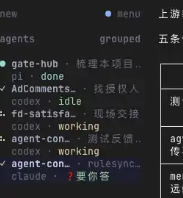
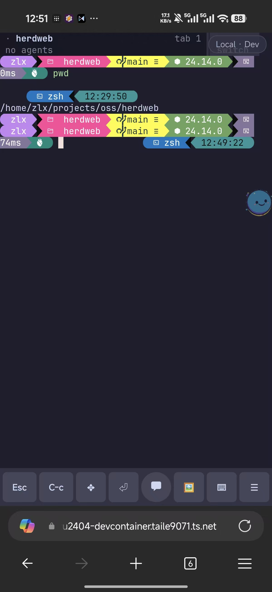

*Translated from the [Chinese original](/posts/260826-agent-era-mobile-dev-evolution/).*

> This post is the mobile-setup upgrade in the "Agents Never Clock Out" series. For how to build the base architecture, see [Agents Never Clock Out: A Development Setup for Anytime, Anywhere, Any Device](/en/posts/260628-agent-era-dev-anywhere/); for how to schedule multiple agents, see [A General on the March Doesn't Chase Rabbits](/en/posts/260809-multi-agent-scheduling-architecture/). This post is about what happened to the mobile development experience after the whole setup switched to Herdr.
>
> As always: **as a human, all you need to understand is the architecture and the reasoning behind the choices. Hand the actual installation and deployment to your agent.**

## Why I'm Writing This: The Emptiness After Losing the Connection

Today was a truly miserable day. In the afternoon, my four-year-old Codex account was suddenly banned, for no clear reason. No reverse engineering, no reverse proxy, just normal use. I had barely pulled myself together when I got home in the evening and found that my remote dev machine had disconnected.

Normally, once I'm home I pick up my phone and keep collaborating with my agents: reviewing the lead agent's plan, approving a few task cards, checking progress on the execution layer. With the connection gone, I suddenly felt incredibly empty. I finished my workout and had no idea what to do with myself.

So I figured I might as well write this post. I'd wanted to write it for a while but never got around to it. Recently my whole setup moved from tmux to Herdr, and the mobile side got a big upgrade along with it. HerdWeb was actually finished and has been in use for a while, so this gap is a good time to organize my thinking.

---

## 1. Two Cracks in the 1.0 Setup

In [Agents Never Clock Out](/en/posts/260628-agent-era-dev-anywhere/), the mobile setup I recommended was **HAPI + tmux**, with Tailscale or Cloudflare Tunnel for networking. After using it for a while, two problems became increasingly obvious.

### Crack One: tmux's Status Blind Spot

In the [multi-agent scheduling](/en/posts/260809-multi-agent-scheduling-architecture/) post, I mentioned that my current scheduling approach is for the **lead agent to dispatch task cards**: the lead agent handles planning and breaking down tasks, and the execution layer works autonomously in the background.

In this mode, tmux's title mechanism isn't enough. Two scenarios are especially painful:

- **The lead agent has finished, but the tmux title hasn't changed.** You don't know it's waiting for you, so the task just sits there without moving forward.
- **The tmux title has changed, but the background execution layer is still running.** You click in and find there's actually nothing for you to do. Your attention is wasted.

When I had five or six lead agents open at once, these two situations kept recurring. A huge amount of your energy goes into "figuring out who needs your attention" instead of paying attention to the work itself.

### Crack Two: Two Hard Flaws in HAPI

HAPI itself is well made, but two problems made me give it up in the end:

**First, an extra rendering layer.** HAPI re-renders the agent's terminal interface as a web page. In the process, some commands and interactions of native coding agents aren't fully supported. Whenever I switched from my computer to my phone, I could feel a distinct "translation layer" in between.

**Second, cross-session message takeover.** HAPI recently added a feature that lets different agent sessions talk to each other. It may have its uses, but the problem is that **it can't be turned off**. The result: while developing locally, in the middle of a conversation with one agent, the conversation would suddenly be "hijacked" by a message from another agent. The experience was terrible.

Together, these two cracks made it time to find a better solution.

---

## 2. Changing Generals: From tmux to Herdr

### What Herdr Is

If you read the previous post, you already know tmux is a "virtual desktop that never drops offline in the background": agents run inside tmux, and even if SSH disconnects, they keep executing in the background.

**[Herdr](https://herdr.dev/) does the same thing, but it's the next generation of tmux.** The name comes from "herd" plus an R, meaning "herding your terminal sessions". It's a popular recent open-source project designed specifically for managing multiple CLI clients.

In plain language, there are two core differences between it and tmux:

**① Mouse first.** tmux is operated entirely through keyboard shortcuts, and the learning curve is steep. In Herdr you can click panes directly, drag borders, and split screens from a right-click menu, the same way you use any other software. In the agent era this matters less (agents operate through commands themselves), but it's a plus when a human occasionally needs to operate things by hand.

**② A programmable badge API.** This is the real reason I switched. Herdr's pane badges, the little labels next to each window, **can be edited freely through scripts**.

### What the Badges Solve

Remember the tmux status blind spot I described above? After switching to Herdr, **that problem simply doesn't exist anymore.**

I wrote a monitoring script that detects the status of every lead agent and background task in real time, then updates the display through Herdr's badge API. The result: one glance at the badges tells me which lead agent is waiting for me, which execution layer is still running, and which task has finished.

**My energy can finally go into making decisions, instead of figuring out who needs me.**



In tmux, there was no convenient way to solve this. After switching to Herdr, the improvement was a qualitative leap.

### Herdr Has a Hidden Advantage

Herdr natively supports Web UI rendering. It doesn't care whether you reach it from a computer with a mouse and keyboard or through a web page. It has an adaptation for screens of different sizes.

This feature paved the way directly for the mobile setup that follows.

---

## 3. Choosing a Mobile Setup: Moshi or Web

With the foundation switched from tmux to Herdr, the mobile setup naturally had to change too.

### Moshi: Beautifully Made, but Not for Me

The first thing I noticed was a native phone app called **[Moshi](https://getmoshi.app/)**. A friend in a group chat recommended it, and I took a look. It really is beautifully made: designed specifically for remotely controlling agents, supporting tmux and Herdr, with a gorgeous UI, and even an Apple Watch companion and voice input.

But two problems made me pass on it:

**First, no built-in Tailscale support.** A phone can only run one VPN at a time. Moshi doesn't embed Tailscale, so you have to turn on the Tailscale VPN separately to connect back to your home server. The problem is that once Tailscale is on, other apps on the phone that need network tools can't be used at the same time. In daily use, this conflict is very annoying.

**Second, the price.** Licensing for three devices costs nearly 500 RMB a year, and I have a lot of devices.

### A Natural Thought

Since HAPI is essentially a web-based solution, and Herdr natively supports web rendering, could I **build the Herdr mobile experience directly on the web?**

The advantage of a web approach is that you just open it in the phone's browser. There's no native app to install, and no separate VPN to turn on (going through Cloudflare Tunnel over HTTPS is enough).

I searched GitHub, and someone had indeed already built the wheel: an open-source project called [remobi](https://github.com/connorads/remobi), which exposes Herdr, tmux, and Zellij sessions through a web page.

After trying it, I found that **Herdr had already solved the hardest part, Web UI rendering.** remobi only has to handle establishing the WebSocket connection and the front-end interaction, while the rendering itself is left to Herdr.

But the original project's experience on a phone was rough. So I forked it and did a fairly large refactor and upgrade, renaming it **[HerdWeb](https://github.com/zlxlabs/herdweb)**.

---

## 4. HerdWeb: Seven Mobile Optimizations

Every optimization revolves around one core tension: **phone screens are precious real estate.**

Every inch of display area counts. When you're reading agent output, you want as much information as possible; when you're operating, you want it as smooth as possible. All design decisions start from this constraint.



### ① Keyboard Control: Show When Needed, Hide When Not

On a phone you often need to scroll up and down to read agent output. The problem is that the agent's terminal has input focus, so the moment you touch the screen the soft keyboard pops up and instantly covers half of it.

HerdWeb has a global keyboard toggle. When it's disabled, you can scroll and browse freely without accidentally bringing up the keyboard; when you need to type, one tap enables it.

It sounds simple, but on a phone it's the key to a **qualitative improvement**: the amount of information the screen can show at once simply doubles.

### ② Voice Input: Typing Without Raising the Keyboard

Since the soft keyboard eats screen space, why not use it less. HerdWeb has built-in voice input, currently connected to Volcano Engine's speech recognition service (the same technology as the Doubao input method).

Plenty of people are already used to typing by voice on their phones with Doubao's input method, and it really is a good experience. But the catch is that you have to bring up the soft keyboard first to tap the voice button. As soon as the keyboard pops up, you've lost a big chunk of screen space again.

HerdWeb's built-in voice input skips that step: **you don't need to bring up the soft keyboard; just tap the voice button and speak.** Its recognition accuracy may not match the Doubao input method, but it lets you enter text without using any screen space, and on a phone that trade-off is worth it.

### ③ Key Layout: What Goes in the First-Level Menu

The action bar at the bottom of a phone has limited space, so you have to think carefully about which actions go in the first-level menu (visible at a glance, reachable with one tap) and which get folded into a second-level menu.

Based on how often I actually use them, I put eight items in the first-level menu:

> **ESC · Ctrl+C · Enter · Delete · Keyboard toggle · Image paste · Voice input · More menu**

These cover the vast majority of everyday interactions with a coding agent: ESC to cancel, Ctrl+C to interrupt, Enter to confirm, Delete to edit, plus the keyboard toggle, image paste, and voice input mentioned above. The less common actions go into "More", to be expanded when needed.

### ④ Image Paste: Restoring a Missing Capability

The original remobi project doesn't support image paste.

In the coding agent era, sending a screenshot to an agent for analysis is a very frequent operation. If a front-end page has a bug, one screenshot and the agent understands right away. Without image paste, you're basically missing a leg. HerdWeb fills that gap.

### ⑤ Notifications: Don't Miss Agent Messages

HerdWeb is a **PWA** (as I explained in the last post, a technology that "installs" a web page onto your phone's home screen so it looks like a native app when opened). A PWA comes with the ability to register for system notifications, so when an agent has a message, it gets pushed to your phone's notification bar.

It also supports external hooks, so you can forward notifications to third-party platforms like WeCom (Enterprise WeChat). Even if you don't have the HerdWeb page open, you won't miss important agent messages.

### ⑥ Multiple Devices, Multiple Servers

If you have several dev machines that all run Herdr (for example, I have both a Mac Studio and a Linux machine), HerdWeb can manage every session on every server from a single page. Switching is as easy as switching tabs, with no need to log in to different addresses back and forth.

### ⑦ Weak-Network Optimization: Borrowed from the Mosh Protocol

On a high-speed train, in a basement, anywhere with a bad signal, the network drops in and out. With an ordinary WebSocket connection, every drop forces a reconnect, and input in between may be lost or the screen may go out of sync with the server.

HerdWeb borrows heavily from the [Mosh protocol](https://mosh.org/) (a remote terminal protocol designed specifically for unstable networks) and mainly solves two problems:

- **Data consistency**: when the connection drops, the screen is marked "stale", and after reconnecting it automatically pulls the latest snapshot to refresh. This ensures you always see the server's real state, so you never end up thinking "I assumed the agent was still running, but it stopped long ago".
- **No lost input**: keys you press during a weak-network period are buffered and sent automatically after reconnecting, so you don't have to type them again.

These two points make a particularly noticeable difference on a high-speed train.

---

## 5. Authentication: What You Don't Build Matters Too

HerdWeb has no built-in authentication layer. This isn't laziness; it's a **deliberate design decision**.

It is essentially a personally deployed tool, and authentication should be handed to more professional, mature infrastructure, such as [Tailscale](/en/posts/260628-agent-era-dev-anywhere/#tailscale-pulling-all-your-devices-into-one-secure-virtual-wifi) or [Cloudflare Tunnel + Access](/en/posts/260628-agent-era-dev-anywhere/#cloudflare-tunnel--access-the-solution-for-reaching-hapi-from-a-phone), both introduced in the last post.

**But please remember: never expose HerdWeb directly to the public internet.** Whoever can reach this page can drive the terminals on your server, which is equivalent to handing them command-line access to your dev machine. Always put a Tailscale private network or Cloudflare Access authentication in front of it.

The good news is that the configuration here is exactly the same as in the 1.0 post. If you've already set up the network layer following the previous post, switching to HerdWeb only requires changing the port your Cloudflare Tunnel points to.

---

## 6. The 2.0 Architecture at a Glance

Putting the 1.0 and 2.0 changes side by side, the changes are confined to the session management layer:

```
1.0 体系                    2.0 体系
───────────────────────────────────────
tmux（后台会话管理）    →    Herdr（角标可编程 + Web 渲染）
HAPI（手机遥控器）      →    HerdWeb（语音输入 + 弱网优化 + 七项手机适配）
───────────────────────────────────────
服务端（Mac / Linux）        不变
网络层（Tailscale / CF）     不变
客户端设备                   不变
```

The server, the network layer, and the client devices: none of them need to change. This is the benefit of the layered architecture from the previous post: swap out the middle layer, and the layers above and below don't notice.

If you've already built the 1.0 setup, the upgrade to 2.0 takes very little work: install Herdr, deploy HerdWeb, and change the Tunnel port. Let your agent handle the whole migration, and it takes about a dozen minutes.

---

## 7. The End Result

With HerdWeb, the "anytime, anywhere, any device" experience described in "Agents Never Clock Out" is fully preserved, and the mobile operating experience has improved qualitatively:

- **Android and iOS**: install the PWA to your home screen and use it right away
- **Computer**: one URL in Chrome is all you need
- **Weak-network scenarios**: on a high-speed train or in a basement, input isn't lost and the screen recovers automatically
- **Voice-driven**: lying in bed, you can give your agent instructions just by talking to your phone

I currently use it every day for remote development from my phone, and I'm basically satisfied. As long as the remote dev machine is online, you can reach your agents from bed, on a high-speed train, or overseas, any time.

The code is fully open source. If anything is unclear, just pull down the [HerdWeb](https://github.com/zlxlabs/herdweb) repository and have your agent explain it to you.

---

## Appendix: Reference Material for Agents

> The following content is for coding agents. Human readers can skip it. Just send the link to this post to your agent, and it will read it on its own.

### Core Components

| Component | Docs | Description |
|------|------|------|
| Herdr | [Official docs](https://herdr.dev/docs/) | Terminal multiplexer, a replacement for tmux. Run `herdr` to start, or `herdr --session <name>` to create a named session. Supports the badge API and Web UI |
| HerdWeb | [GitHub](https://github.com/zlxlabs/herdweb) | Web remote control for Herdr, forked from [remobi](https://github.com/connorads/remobi). Requires Node.js ≥ 22 |
| Moshi | [Official docs](https://getmoshi.app/docs) | Native mobile terminal app (paid), supports the Mosh protocol, tmux, and Herdr. Not chosen in this post, but a possible alternative |

### Key Steps for Migrating from 1.0

| Step | Action | Notes |
|------|------|------|
| 1. Install Herdr | See the [official docs](https://herdr.dev/docs/) | Supports both macOS and Linux; confirm version ≥ 0.8 |
| 2. Deploy HerdWeb | `git clone https://github.com/zlxlabs/herdweb && cd herdweb && pnpm install` | Requires Node.js ≥ 22; start with `pnpm exec tsx cli.ts serve`, which listens on `127.0.0.1:7681` by default |
| 3. Configure networking | Give your Tailscale API Key and/or Cloudflare API Key to the agent and let it configure things | Pick either route or set up both; see the network comparison below |

### Network Options Compared

The voice input feature requires an HTTPS secure context, and both network routes satisfy that:

| Option | Advantages | Caveats |
|------|------|----------|
| **Tailscale** | Cross-location networking, secure by default: only your own devices can access it, and nothing is exposed to the public internet | The Tailscale app must be installed on the phone with the VPN kept on, which may conflict with other VPNs |
| **Cloudflare Tunnel + Access** | No extra software needed on the phone; just visit the domain in a browser | **You must configure an Access policy** for authentication (email verification, etc.). Otherwise you are exposing terminal access to the public internet, which is very dangerous |

I suggest giving the relevant API Key to your agent, telling it which route you want (or both), and letting it handle everything end to end. After the setup is done, remember to revoke or rotate the API Key.

### HerdWeb Feature Configuration

| Feature | Configuration notes |
|------|----------|
| Voice input | Requires an HTTPS secure context (Cloudflare Tunnel provides one); configure a Volcano Engine API Key |
| PWA notifications | Allow notification permission when first opening the page; supports Web Push |
| External hooks | A Webhook URL can be configured to forward notifications to platforms like WeCom |
| Multiple servers | Add multiple Herdr server addresses in the HerdWeb configuration |

### Weak-Network Optimization Mechanism (Based on the Mosh Protocol)

- When the connection drops, mark the screen state as stale and block replaying outdated data
- After reconnecting, pull the latest snapshot to refresh, ensuring data consistency
- Input buffering: keystrokes made during a weak-network period are not lost and are sent automatically after reconnecting

### Security Reminders

- HerdWeb has **no built-in authentication** and binds only to `127.0.0.1` by default
- It **must** be exposed through a Tailscale private network or Cloudflare Tunnel + Access
- **Never** open it directly to the public internet: anyone who can reach the page can drive your terminals
- The authentication setup is exactly the same as the network layer in [Agents Never Clock Out 1.0](/en/posts/260628-agent-era-dev-anywhere/)

---

> The first draft of this post was conceived through voice-to-text with Feishu's Luyin Dou (recording assistant), and the article structure and content were developed through a conversation with Claude Code + Opus 4.6.
