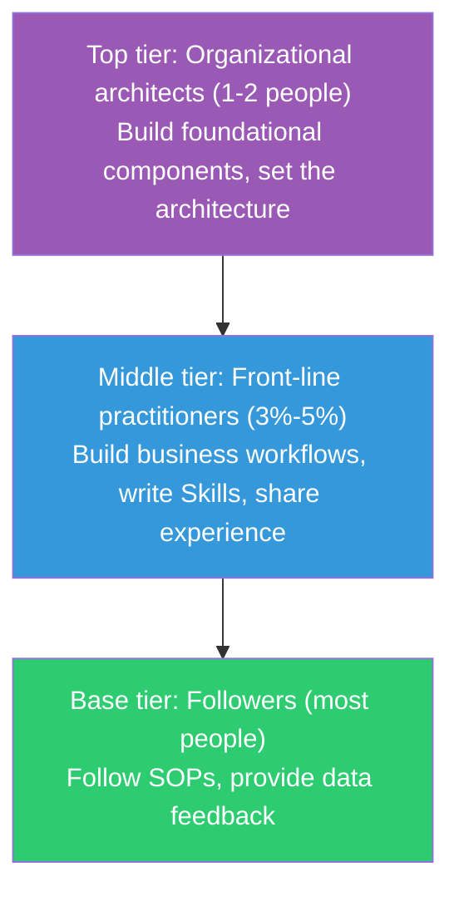
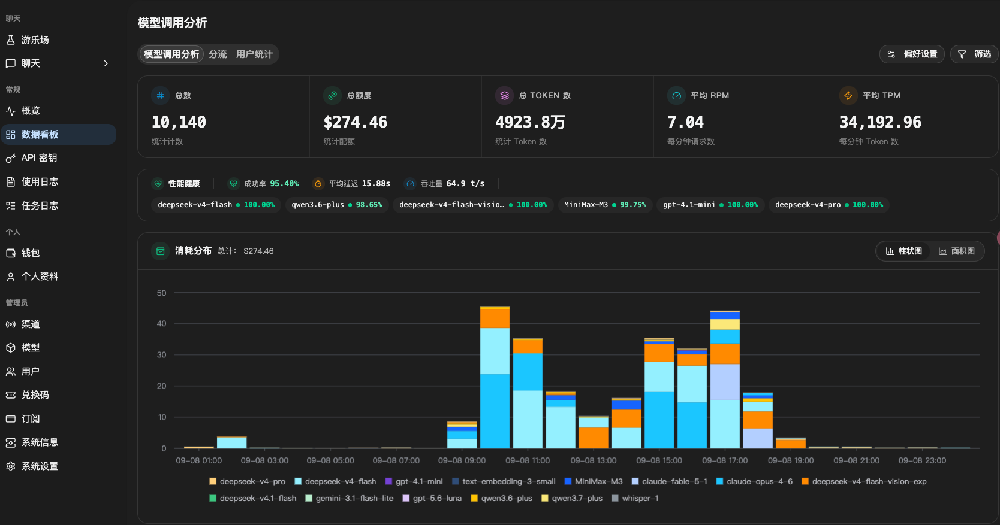
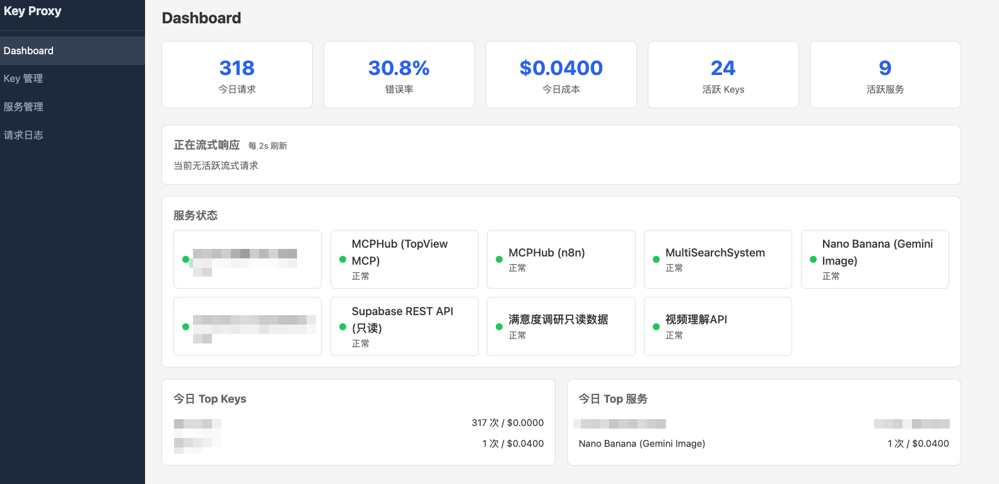
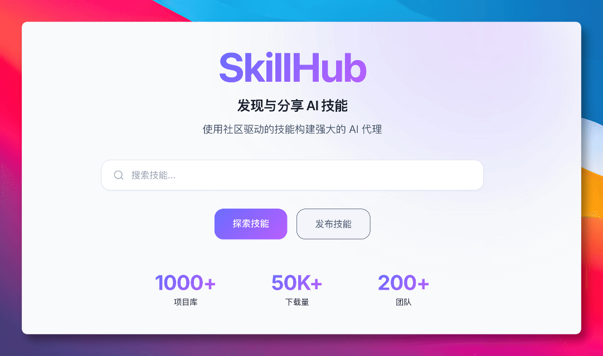
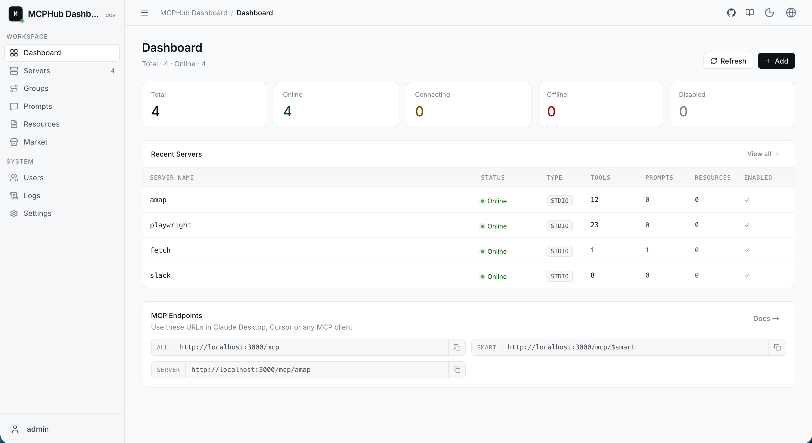
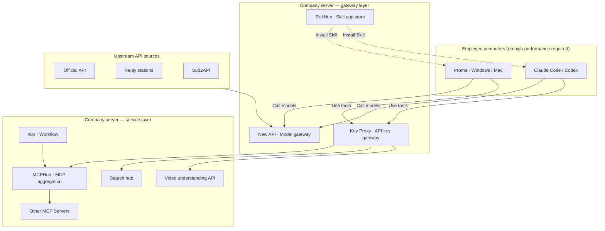
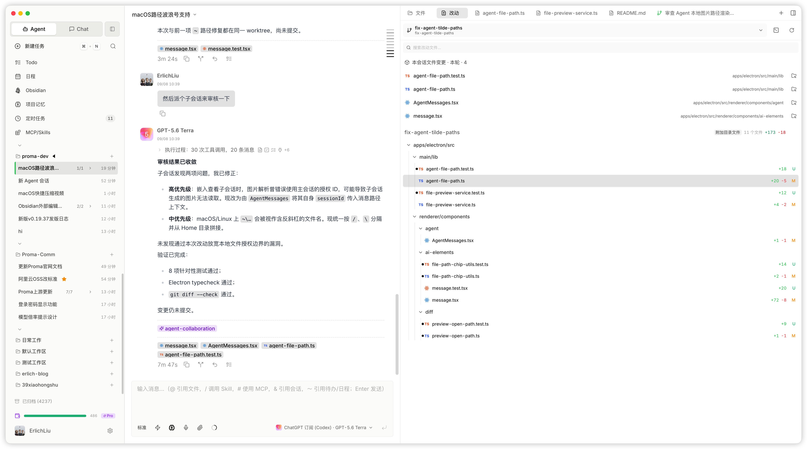

*Translated from the [Chinese original](/posts/260908-smb-agent-framework/).*

> The draft of this article was a 45-minute voice-recorded train of thought. Continuing the tradition of this series — **as a human, all you need to understand is the ideas and the framework; leave the execution details to your Agent.** The appendix at the end contains reference material for your Agent to read.
>
> Recommended background reading: [Context is All You Need](../context-is-all-you-need/) (the basics of context engineering), [Risk Control, Design Philosophy, and Model Selection](../260328-claude-code-risk-model-philosophy/) (model tiering strategy), and [A General Doesn't Chase Rabbits](../260809-multi-agent-scheduling-architecture/) (multi-Agent scheduling architecture). This article takes a different perspective — not "how I personally use Agents," but "how a traditional team gets Agents to land."

## Introduction: Why Talk About This

Over the past six months I've written quite a few articles about Agents, but all from a personal perspective: how I set up my environment, how I schedule work, how I remote-control things from my phone. This one switches to a different angle — the **organizational perspective**.

I'm currently on a business team at a cross-border e-commerce company, working to help the team use AI to improve efficiency and scale. From the traffic side to the supply chain side, it's a very traditional industry, and the team has every kind of role — people who run ad campaigns, operations, supply chain, and design. This isn't an AI company built from scratch, but an old organization that has been running for many years and wants to find new room for growth in the Agent era.

Almost everything below is first-hand practical experience.

Why add the qualifier "small and mid-sized teams"? Because for most small and mid-sized teams, compliance and legal requirements aren't that heavy, and everything internally is geared toward efficiency, so a lot of things are actually fairly rough-and-ready. That means that as you push forward, you can **accept some compliance cost in exchange for efficiency** — dealing with problems after they surface is an acceptable range. Large enterprises can't do this.

Before we start, let me state a judgment that I'm growing more and more sure of:

**Boosting an individual's efficiency 10x is easy; boosting an organization's efficiency by 20% is hard.**

Why? Because organizational efficiency isn't only a context problem — it involves permission approvals, infrastructure building, and the division of power. These organizational obstacles are the real tough nuts to crack. Context, on the other hand, is technically the easiest part to start on, but that doesn't mean it isn't important — quite the opposite, the quality of the context is decisive for the quality of the Agent's output (I covered this in detail in [Context is All You Need](../context-is-all-you-need/)). And collaboration itself is lossy: when information passes between people, it inevitably gets lost, distorted, and delayed.

So in the Agent era, **collaboration is actually a second-best solution**. The most efficient setup is one where the complete business context lives in one person's head, and that person handles it with the help of Agents. Every time you add another person, you should think one step further — **is this person truly indispensable? Or can an Agent replace this collaboration step?**

This isn't saying you shouldn't have a team. It's saying that the direction for organizational optimization in the Agent era isn't "get more people to collaborate better," but "have fewer people cover a larger scope with the help of Agents."

With that premise, let's talk about how to land Agents in a traditional team.

---

## 1. AI Native Is a Direction, Not a Goal

First, a definition. From my experience, an AI Native organization should satisfy three conditions:

1. All information in the organization is **readable** by Agents
2. Agents, just like humans, **participate** in the production decision-making process
3. The Agent's entire decision-making, execution, and results form a **verifiable closed-loop** chain

(Section 4 below will expand on how to get there step by step.)

I believe an AI Native organization can most likely only be built new from scratch. A brand-new organization building this framework from zero is relatively easy, with no historical baggage. But for an old organization that has been running for many years, becoming AI Native is, frankly, very hard — old processes, old systems, and an old staffing structure each put up resistance at every layer.

**But AI Native isn't the ultimate goal; it's a direction.** Organizations of every type can work along this direction and enjoy the dividends of the Agent era.

The ideal approach is to **spin off one line of business and build it from scratch**, with no historical baggage, designing everything around letting Agents enter the organization better. Which line of business should you pick? The criteria: a relatively closed data chain, a high degree of digitization, and the ability to see ROI quickly. The next best option is incremental transformation within the existing organization — while it's hard to reach the AI Native ideal, it can still deliver real, tangible improvement.

There's one more crucial point: **for businesses deeply tied to the physical world, build the digital infrastructure first.** In a truly AI Native organization, all the information for the main business is accessible online and the loop is closed. But on the front lines of commerce, a lot of things are tightly bound to the physical world — inventory is in the warehouse, samples are on the shelf, and the supplier's quote is in a WeChat voice message. If these things haven't been digitized, no matter how strong the Agent is, it has nowhere to start.

---

## 2. A Top-Leadership Project, Prioritizing a Bigger Pie

Landing Agents in an organization produces effects in two directions: **cutting costs and boosting efficiency**, and **growing the pie**.

Cost cutting and efficiency gains are relatively easy to quantify and achieve, so this is probably the entry point for the vast majority of bosses. But if you start from here, there's a natural problem — **it can create a conflict of interest with people inside the organization.** When you use an Agent to replace a certain step, someone used to be responsible for that step. This isn't something an outsider should push.

The other angle is **growing the pie** — using Agents to expand into new businesses and raise the output ceiling, and sharing the newly created gains. This meets much less resistance. Of course, some industries really don't have that much room for incremental growth and are forced to go the cost-cutting route.

Whichever path you take, one thing is certain: **landing Agents is a top-leadership project.**

Why? Because every step you save is, in essence, a redrawing of the boundaries of someone's turf. Without authorization from the top, and without someone who understands both the business and Agents to lead the push, it's basically very hard for the organization to truly enjoy the Agent dividend.

At the same time, **you shouldn't measure the results of landing Agents by a 100% AI usage rate.** Take cross-border e-commerce: people who are proficient in both supply chain and AI are extremely rare. And frankly, such talent is unlikely to stay in your organization anyway — unless you're willing to share the money.

So the right way isn't to push across the whole company, but to **push in tiers**.

---

## 3. A Three-Tier Staffing Structure

As I understand it, when a traditional team transforms for the Agent era, its people should be tiered like this:

### Top Tier: Organizational Architects (1-2 People)

At the top is a person who understands both Agents and the business very well and is responsible for building the team's foundational components: establishing the single source of business data, designing the permission governance mechanism, building the Skill-sharing platform, and constructing the feedback-and-iteration loop.

### Middle Tier: Front-Line Practitioners (3%-5%)

A small number of people in the organization who are willing to actively embrace change. In real business work, they use Agents to solve problems, improve efficiency, and produce results. These are the people who build the "branches" on the business side: concrete workflows, useful Skills, and experience interacting with Agents.

With Agent assistance, these people will also produce good business results. Most people are convinced by what they see: when a small group in the organization has truly mastered Agents and produced results, the others will naturally follow.

You need to use mechanisms to encourage and guide them to share.

### Base Tier: Followers (Most People)

Most people actually follow SOPs and follow Skills — those SOPs and Skills come from what the middle-tier practitioners have distilled. Base-tier employees don't need a deep understanding of Agents; they only need to operate according to the workflows that have been built, and provide data feedback along the way — giving the whole Agent system more behavioral data as input.

As for the small group who strongly resist AI, it's essentially a matter of calculating ROI. Some people really do have deep accumulated experience in the physical world, and their abilities remain strong without AI. In the end, this too comes down to the numbers. Collaborate with the best of them, and don't force it.

### Token Costs Follow the Tiers

This structure has another benefit: **controllable cost.** Only the top-tier architects and middle-tier practitioners need high-quality Tokens for thinking (using top-tier models to design solution frameworks and write reusable automation flows); most people are fine with a cheap execution model.

This is the strategy I described in [Risk Control, Design Philosophy, and Model Selection](../260328-claude-code-risk-model-philosophy/): **top-tier models set the approach, while domestic models handle the engineering to cut cost.** It applies equally at the organizational level.

> For organizational change in the AI era, I strongly recommend listening to this talk by Mango, co-founder of XMind: [Divide the Work, Divide the Circles, Divide the Money, Do AI](https://www.xiaoyuzhoufm.com/episode/6a8c42b42e27ea5b21fabac7) ([AI summary and proofread transcript](https://sum.zlxlabs.com/view/view__jJHBegbh00Puv8ZsVDPdYOQxfxJVEk8HRIpT8eIcPc)). It's first-hand construction experience from XMind's shift from a departmental structure to a "circle structure," and the core conclusion is: the goal of an AI-native organization is to minimize friction between people, and anything with friction should be automated wherever possible. How to divide the circles, the work, and the money — this episode explains it thoroughly.

---

## 4. Context: The Most Central in Value, the Easiest to Start on Technically

Everything so far has been about organizational obstacles — power, interests, staffing structure. Once those conditions are cleared, the next step is to get the context right technically.

There's a judgment I'm growing more and more sure of: **a top-tier model paired with garbage context performs worse than an ordinary model paired with top-tier context.** This was already covered in [Context is All You Need](../context-is-all-you-need/), so I won't repeat it here.

At the organizational level, building context has three layers, and each step up raises the value the Agent can deliver by a notch:

| Layer | Meaning | Example |
|------|------|------|
| **Readable** | The Agent can get the organization's business data conveniently and quickly | Sales data isn't scattered across individual Excel files but sits in a unified data source |
| **Writable** | The Agent can take part in business operations, not just look | The Agent can automatically update inventory status and send customer notifications |
| **Closed loop** | Execution results feed back and form iteration | The Agent's ad-placement decisions can see actual conversion data and self-correct |

These three layers progress like a staircase. Each layer up raises the depth of the Agent's participation in the business by a step, and the value gain comes in steps too.

But the premise of all this is that **the digital infrastructure must be built first.**

### A Single Source of Data: Feishu Bitable

The organization's business data can't be scattered across A's Excel, B's WeChat chat history, and C's head. If you haven't even built this basic digital foundation, don't expect Agents to bring any big improvement.

For small and mid-sized teams, my advice is: **use Feishu's Bitable as the single source of data for your business.**

Why Feishu Bitable?

- It's effectively a **small database**, but doesn't require much maintenance staffing from you — that's exactly the constraint small and mid-sized teams face; you're unlikely to maintain a complex database yourself
- Feishu offers comprehensive APIs and a **Feishu CLI** (essentially a toolbox for Agents to operate Feishu), making it easy for Agents to read and write the data in Bitable directly
- Combined with Feishu's built-in workflows, permission management, and multi-device sync, a typical business system can be up and running
- To be honest, DingTalk and WeCom spreadsheets are still quite far behind Feishu in capability. If you don't have heavy historical baggage, I'd suggest buying Feishu Bitable separately

Of course, Feishu Bitable has row limits, and past a certain stage you'll still need your own database. But in the early stage, it's more than enough.

### Legacy Systems: Find a Way to Plug Them In

In reality there's always some legacy system baggage. Some have APIs, some only have a web interface, and some only have Excel import and export.

Either way, you have to find a way to plug them into the overall infrastructure so Agents can reach them. There are many ways — connect directly where there's a programmatic interface, use automation tools to simulate human clicks where there's only a web interface, and set up automated data shuttling where there's only Excel import and export.

### Digital Mappings of the Physical World

Cross-border e-commerce has a lot of things tied to the physical world: inventory counts, physical products, supplier chat records, meeting recordings... All of these should be built into digital versions as mappings wherever possible — a unique product ID, inventory counts, transcripts of supplier communications, and so on.

It costs nothing more than some disk space. But in the long run, this data is the organization's biggest asset. Even if you can't process it now, as AI capabilities advance it can all be put to good use in the future.

The simplest first step: transcribe every meeting into text with a speech-to-text tool and save it. The cost is almost zero.

### The Core Mindset

Treat the Agent like a newly hired employee. To complete a task, what information is it still missing? Whatever it's missing, you supply.

A self-check: in your team's core business processes, what information does the Agent want to take part in but currently can't get? That's what you should digitize first.

---

## 5. Don't Chase Token Usage; Replace Individual Steps

After you've built the data source and the context, how do you measure the results of landing? There's a common misconception here: give everyone an Agent and a WorkBuddy account, then see whose Token usage is highest — **this metric is meaningless.**

What really matters is identifying individual steps in a business process for **replacement by an Agent**. A step that used to be done by a person is now done by an Agent, with better results, higher speed, and lower cost. Replacing one step at a time is the most practical and feasible approach.

The concrete model usage strategy follows the tiers too: top-tier models are used to design solutions, build frameworks, and write Skills; cheap models execute per the Skill, run operations, and collect feedback — so the execution results feed back to improve the next round of decisions, forming a closed loop.

In most cases, what the Agent does is simply **run a workflow**. A lot of things can be done with a Workflow, and having an Agent write that Workflow is perfectly fine too.

A small number of people build the business workflows, and everyone else has an SOP to follow; work that used to be done by hand may become clicking a few buttons and doing an approval. From the standpoint of organizational interests, this is relatively easy to push forward.

---

## 6. MCP: The Standard Protocol for Agents to Call Tools

Before talking about infrastructure, I need to explain a concept first: **MCP (Model Context Protocol)**.

You can think of MCP as the "USB standard" of the Agent world. If an Agent wants to query a database, send a message, search the web, or call some internal company service — none of these are things an Agent can do innately; it needs to "connect" to these tools through MCP.

Each MCP service needs to run a Server process, which consumes memory and compute. MCP services fall roughly into two categories:

- **External services**: for example GitHub, Google Search, and the official MCP interfaces provided by various SaaS platforms
- **Internal services**: deployed on the company's servers. These split into two kinds again — purely self-built systems (such as an inventory management interface the company developed itself), and tools deployed on top of the open-source community (for example n8n offers an MCP service through which Agents can trigger and manage workflows)

If every employee's computer runs its own pile of MCP Servers, it not only wastes resources but is also a nightmare to manage. That leads to the infrastructure design below.

---

## 7. Infrastructure: One Server Powers the Whole Team

What's the biggest difference between a team and an individual using Agents? **Things within a team can be reused.** What you've searched I don't need to search again, and the MCP service you've gotten working I don't need to configure again. So at the infrastructure level, on one hand **caching and sharing** should be at the core, and on the other hand you also need to consider **permission separation and log auditing** — who used what, how much was spent, whether anyone overstepped their permissions; in a team setting, all of this must be traceable.

There's a key architectural idea here: **server-client separation**.

All the heavy lifting runs on one company server, and employees' computers are just a lightweight entry point. This way:

- You don't need to equip everyone with a high-performance computer
- You don't need everyone to spin up a pile of MCP Servers locally
- All services are managed and updated uniformly

The tools recommended below, unless specifically noted, are all **open-source projects**, and can all run on an ordinary server with very low deployment cost.

### ① AI Relay Gateway: New API

> Scenario: the company has bought Claude and GPT APIs and wants all 10 employees to be able to use them, without handing the raw keys to everyone.

[New API](https://github.com/QuantumNous/new-api) is built for exactly this. It's a unified relay gateway for AI models. Upstream, it can connect to various official API channels, to relay-station channels you've purchased, and even to Tokens obtained from other channels through technical means — downstream, none of this is visible. Downstream, you can control which models each person can use and how much they can spend, and it can serve both people and the organization's internal software systems. It's easy to do the accounting and easy to control permissions. Many people use it, and its features keep getting iterated.

**Open source, free.**

### ② API Key Gateway: Key Proxy

> Scenario: operations wants to use GPT for image generation, design wants a third-party watermark-removal API, and product selection needs to call an interface on some data platform. Each service has its own key — you can't just hand the raw keys to everyone, right? But having everyone sign up on their own makes reimbursement and management a mess.

New API handles the biggest piece, relaying model Tokens, but it can't manage these long-tail API services. Also, most Skills are designed for a single person and a single Agent, and never considered a multi-person, multi-Agent usage pattern. What you need is a **general-purpose API key gateway** — one that turns the single key for each service the company has purchased into multiple keys for internal team use. Each employee needs just one key to open every door.

This needs logging, permission control, and spend control. I wrote my own called Key Proxy; it isn't open source, but the idea is general.

### ③ Skill Version Management: SkillHub

> Scenario: a colleague has written an especially useful Skill, such as "generate a competitor analysis report in one click," and wants to share it with the whole team. The current way is to throw a zip file into a group chat — two days later someone modifies it and throws in another, and a week later nobody knows which is the latest.

[SkillHub](https://github.com/iflytek/skillhub) is an open-source Agent skill registry platform from iFlytek. It solves versioned management of Skills within a team — upload, review, tiered permissions, one-click install — essentially an **internal Skill app store for the team**.

**Open source, free.**

### ④ MCP Service Aggregation: MCPHub

> Scenario: the Agent needs to call all kinds of MCP services — one for GitHub, one for searching competitor data, one for checking company inventory. If every employee's computer starts its own copy of these Servers, 10 people means 10 copies' worth of memory overhead, and configuration management is a nightmare.

[MCPHub](https://github.com/samanhappy/mcphub) is a self-hosted MCP gateway. Deploy all MCP services in one place on the server, aggregate them through MCPHub, and provide a single access point downstream. An employee's Agent client only needs to connect to this one MCPHub address to use all the MCP tools.

If you add a layer of Key Proxy on top, you can also achieve permission control — who can use which MCP services is clear at a glance.

**Open source, free.**

### ⑤ Search and Crawler Hub

> Scenario: three people on the operations team ask their Agents to search the same competitor's TikTok data at the same time. Without caching, that's triple the API call cost, and repeated requests from the same IP could trigger the platform's anti-abuse controls.

Different Agents' search capabilities vary widely, and search capability is itself an important component of building context. The organization should have a unified search and crawler hub:

- **Caching**: cache what has been searched, avoiding wasted cost from repeated calls
- **Aggregation**: external search (TikTok, Instagram, e-commerce platforms) and internal search (the enterprise knowledge base) through one unified interface
- **Async and concurrency**: when multiple Agents initiate search requests at once, the system has to hold up
- **Risk control**: handle crawler rate limits and IP management centrally, rather than letting each person's Agent operate without safeguards

I built this one myself as well, and it isn't open source, but any team with search needs should consider doing this.

### The Big Picture: A Whole Suite on One Server

The key point: **all the heavy lifting is on the server side, and the client is just an entry point.** Employees don't need high-performance computers and don't need to configure anything server-side themselves. This is very friendly to small and mid-sized teams — for the cost of one server, the whole team's Agent infrastructure can be up and running. If a technically capable person pushes this full-time, getting the open-source tools above from deployment to working takes roughly one to two weeks.

An aside: all the self-built systems mentioned above (Key Proxy, the search hub), plus the deployment and operations of these open-source services, are done by me alone. In the Agent era, these things really aren't hard — which is itself evidence for the earlier claim that "the top tier needs only 1-2 architects."

### One More Note: Network Security

Agents are very capable now, but strong capability also means greater security risk. If you can, I'd still suggest isolating the server-side network to some degree — to keep malicious attacks from getting directly into the organization through an Agent. This topic is too complex to cover in a few sentences, but you should at least have the awareness.

---

## 8. Clients: Configure as Needed

From what I've observed, only about 3%-5% of people in an organization have especially heavy Agent usage — basically the middle-tier practitioners mentioned earlier — and everyone else uses it very little. So there's no need to give everyone the most expensive account.

For **non-technical staff**, I especially recommend [Proma](https://github.com/proma-ai/Proma) — the **best open-source, free general-purpose Agent client** I've been able to find:

- **Not tied to any single big vendor's ecosystem**: it can connect to any OpenAI-compatible API, and used with New API and your own keys, the cost is very controllable
- **Very frequent updates**: an active community and fast feature iteration
- **Friendly to non-technical users**: a clear, intuitive UI and simple operation, with clients for both Windows and Mac

Connecting it directly to the New API we set up earlier makes it a great general-purpose Agent entry point for office scenarios.

**Technical staff** use Claude Code or Codex, which needs no further explanation.

If you don't want to self-host a backend at all, Tencent's [WorkBuddy](https://workbuddy.cn/) is a similarly positioned product — top up and use it, no need to set up your own New API. But Proma's advantage is that it can connect to a self-built New API backend, so cost and permissions are under your own control. If you have even a bit of technical ability, I still recommend building the infrastructure described above — the long-term cost advantage and management convenience are on a completely different order of magnitude.

---

## 9. From Workflow to Managed Agents: Three Steps Up

Using an Agent client personally is easy, but getting Agents to **run 24 hours a day at the enterprise level** is another matter. There's a clear progression path here:

| Level | Form | Characteristics | Representative tools |
|------|------|------|----------|
| Level 1 | Personal Agent client | Human in the loop, used on demand | Claude Code, Proma |
| Level 2 | Workflow + LLM automation | Deterministic flows + LLM nodes, running 24h on the company server | n8n |
| Level 3 | Managed Agent runtime | Autonomous Agents, long-running, scheduled, with full permission governance | Claude Managed Agents, TrueForge |

Level 1 is the day-to-day state described earlier. Let me focus on Levels 2 and 3.

### Workflow + LLM: The Main Battlefield for Most Enterprises

**The vast majority of internal enterprise scenarios can be solved with Workflow + LLM calls.** This may be a path that's seriously underrated right now.

The recommended tool is **[n8n](https://github.com/n8n-io/n8n)** — an open-source Workflow automation engine that you can simply deploy on the company server mentioned earlier, sharing a machine with the other services at no extra cost.

How n8n is used in the Agent era needs to shift: instead of people manually dragging and dropping to create workflows in the interface, **have Agents create and maintain Workflows through MCP and Skills**. At the same time, abstract the team's shared logic nodes into n8n Nodes and iterate on them over time, making it easy to freely assemble and combine them into workflows.

Having an LLM involved and an Agent stepping in during automation is already a very big step forward in itself.

### Managed Agent Runtime: An Advanced Topic

One level up is the truly autonomous Agent — one that can run for a long time (minutes to hours), run on a schedule (cron), and call all kinds of tools. Anthropic offers [Claude Managed Agents](https://platform.claude.com/docs/en/managed-agents/overview) as a managed platform of this kind, and the open-source community has projects with similar ideas, such as [TrueForge](https://github.com/truefoundry/trueforge).

But to be honest, this level already demands a lot from the enterprise — a sound permission policy, an MCP service system, and secure credential management are each non-trivial. Our own experience here isn't deep yet either, and **this is already a topic for another day.**

For most small and mid-sized teams, get the n8n layer solid first.

---

## Final Thoughts

Back to the judgment at the start: boosting an individual's efficiency 10x is easy, and boosting an organization's efficiency by 20% is hard.

But hard doesn't mean it can't be done. This article lays out a path a traditional team can take:

- **No need to chase AI Native** — just push forward incrementally along that direction
- **Build the digital infrastructure first** — Feishu Bitable solves most of the problem
- **Roll it out in tiers** — don't chase a full-staff usage rate; let results show why seeing is believing
- **Build the infrastructure with open-source tools** — one server can run it all, at very low cost
- **Workflow is the main battlefield** — 90% of enterprise scenarios can be solved with Workflow + LLM

It comes down to two things: **at the organizational level, clear the obstacles of permissions, infrastructure, and the distribution of benefits; at the technical level, give Agents ample context and build a closed loop.**

Only with a closed loop can an Agent inside the enterprise backtest and analyze against historical data and keep improving. That way your organization gets lasting incremental gains from Agents. Otherwise, as soon as any point in this chain is broken, the Agent can only be a one-off tool — used once, with no next time.

A closed loop creates lasting gains, and those gains are worth sustained investment. I think this idea matters more than any specific tool choice.

---

## Appendix: Reference Material for Agents

> The following content is aimed at Coding Agents (Claude Code / Codex, etc.). If you're a human reader, you can skip this part — send the link to this whole article to your Agent, and it will come read this section itself.

### Open-Source Tool List

| Tool | Purpose | URL |
|------|------|------|
| New API | Unified AI model relay gateway | https://github.com/QuantumNous/new-api |
| SkillHub | Agent skill registry platform, version management + permission control | https://github.com/iflytek/skillhub |
| MCPHub | MCP gateway, unified management and exposure of MCP services | https://github.com/samanhappy/mcphub |
| Proma | General-purpose Agent client, based on the PI Agent SDK | https://github.com/proma-ai/Proma |
| n8n | Workflow automation engine | https://github.com/n8n-io/n8n |
| TrueForge | Open-source Cloud Managed Agents platform | https://github.com/truefoundry/trueforge |

All of the above tools support Docker deployment and can be deployed on the same Linux server; Docker Compose is recommended for unified orchestration.

### Related Articles

- [Context is All You Need](/en/posts/context-is-all-you-need/): the basics of context engineering
- [Risk Control, Design Philosophy, and Model Selection](/en/posts/260328-claude-code-risk-model-philosophy/): model tiering strategy
- [A General Doesn't Chase Rabbits](/en/posts/260809-multi-agent-scheduling-architecture/): multi-Agent scheduling architecture
- [Agents Don't Clock Out](/en/posts/260628-agent-era-dev-anywhere/): setting up a remote development environment
- [Claude Managed Agents](https://platform.claude.com/docs/en/managed-agents/overview): Anthropic's official managed Agent platform

### Recommended Podcast

- [XMind Mango: Divide the Work, Divide the Circles, Divide the Money, Do AI](https://www.xiaoyuzhoufm.com/episode/6a8c42b42e27ea5b21fabac7): first-hand experience of an established software company's organizational shift from a departmental structure to a "circle structure" ([AI summary and proofread transcript](https://sum.zlxlabs.com/view/view__jJHBegbh00Puv8ZsVDPdYOQxfxJVEk8HRIpT8eIcPc))

---

> This article was conceived from a draft transcribed by Feishu's voice-recording Doubao, and its structure and content were developed through conversation with Claude Code + Opus 4.6.
