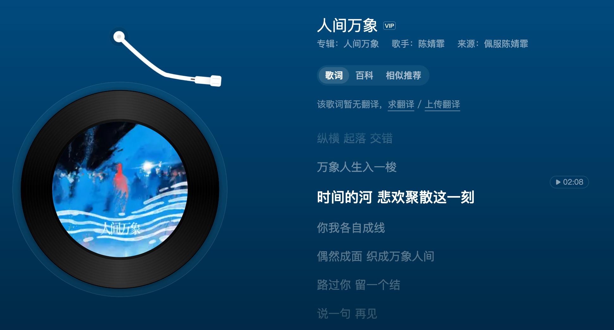
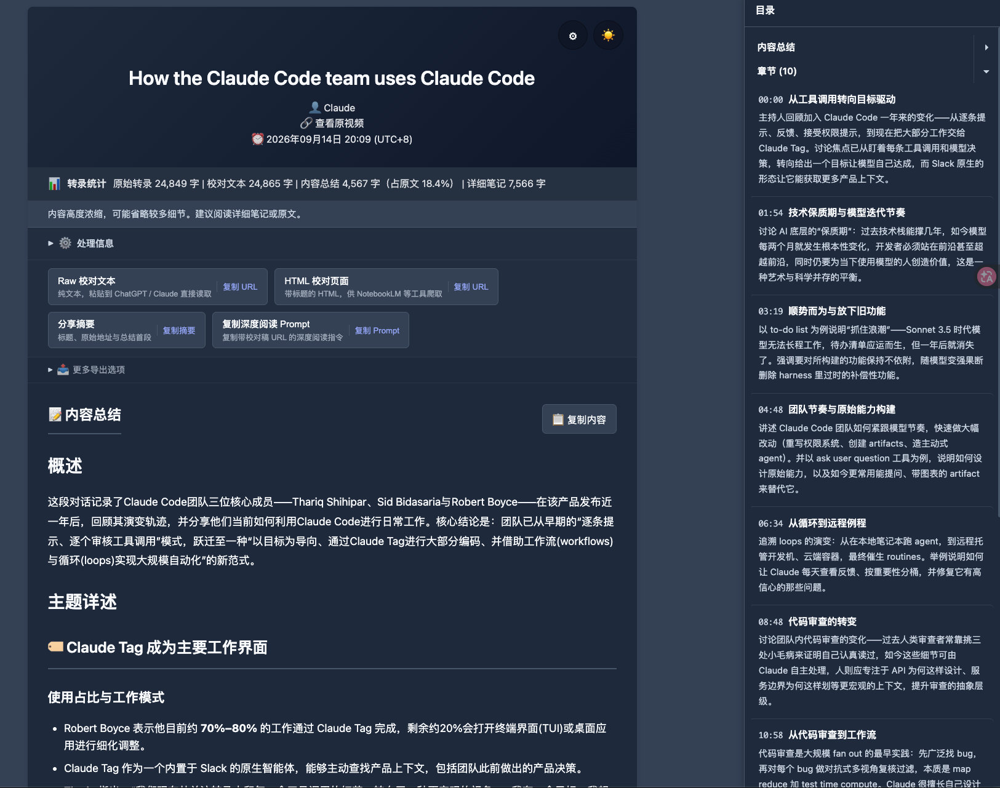
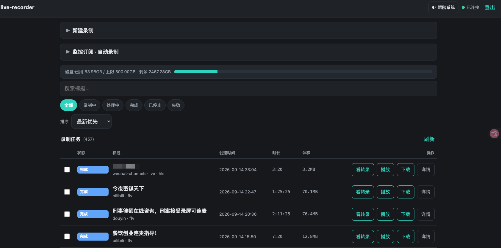

*Translated from the [Chinese original](/posts/260914-observing-the-world/).*

Chen Jingfei (陈婧霏) has released a new song called "The Myriad Faces of the World" (人间万象).

> The world is a net — who is weaving its direction?
> Some have fallen into the dark of night; some are waiting for the spring breeze.

I like her a lot. After listening, I felt the song title could serve as an entry point to talk about something I've wanted to discuss for a long time but never found the right moment for: **I have a habit of continuously observing the world.**

## Curiosity and That Window

In grand terms, it's about seeing heaven and earth, seeing all living beings, seeing myself. In small terms, it's just a fairly pure kind of curiosity.

My following list doesn't only contain things I agree with. It also includes things I don't quite endorse but consider a sample worth keeping. After you've seen enough samples, you truly understand why arguing online mostly has no point — you have no idea what life experiences shaped the person behind that screen or how they think.

There's an interesting divide in this world: one group uses ASR to turn all kinds of content into text to speed up understanding; the other uses TTS to turn text into sound so they can listen anywhere, anytime. I belong to the former — I watch videos at triple speed almost every day, and more often than not I simply convert audio and video into text and read it.

**But the bar for expressing yourself in text is, in the end, far higher than for audio and video.**

A busy person may only have time to record a podcast or shoot a spoken-word video; a frontline practitioner might just film a video to vent a few complaints, and writing an article would feel too formal for them. When you want to look at the real experiences of different people from a broader perspective, audio and video are far richer than text.

There's another layer: text faces a higher review threshold, and that's one side of it. On the other side, as internet access has become faster and cheaper and the online population has grown, the space for public expression has been shrinking too — water that is too clear has no fish. You can only stick to the lowest common denominator and talk about very "correct" content. Put the two together, and the world of text grows ever cleaner and ever safer. By comparison, audio and video still have a chance to convey something more real, something less "correct."

At least for our generation, this isn't too big a problem — after all, we lived through a rougher, wilder era, and we've touched on things both above and below the surface of the water. But for the younger generation, if their main source of information is the internet, it may take exceptional insight to read the information beneath the surface out of all the various forms of self-censorship. Otherwise, they can only make up for it through things like family education.

In short, to gain a broader perception of the world as a whole, audio and video are an extremely high-value channel of consumption. So I built myself a set of audio and video transcription tools that automatically process content from various platforms. The system handles more than ten hours of transcription every day.

## Ten Thousand Kinds of Lives

So what am I watching in those ten-plus hours?

My regular subscriptions cover law, relationships, and starting restaurant businesses, along with plenty of AI and Agent experience sharing, interviews and chats, and the occasional bit of entertainment gossip. But more interesting than the category labels is which cross-sections of the world you see through them. Here are a few examples.

**A girl born in 2007 [held a late-night livestream on the night she finished the gaokao](https://sum.zlxlabs.com/view/view_hHSrkogB3GBL8TJ2yu9Urewrz-P0BMtzSjqIGMGQkMY).**

She studies the humanities, is from Beijing, and comes from an "ordinary family" — she kept stressing those three words. In the stream she was in the classic post-exam frenzy: speaking very fast, jumping between topics, with real anxiety showing through the self-deprecation. She longs for A-levels and an education in Berlin, but her family's finances mean she can only take the in-system route — "I'll go see the world in grad school."

A young woman from Gen Z, in a livestream, laying out her confusion, her dissatisfaction with the education system, and her uncertainty about the future to a few hundred strangers. The gap between "aiming sky-high" and real-world constraints shows up in her in an extremely direct way. You'd rarely find this degree of rawness in any text medium.

**A doctor ran the numbers using probability theory.**

Dr. Han was sentenced for a missed diagnosis, and the news set the medical community abuzz. Another doctor, who has already left the profession, used a mathematical concept — the birthday paradox — to explain why he left clinical practice early: when the sample size is large enough, any low-probability event becomes inevitable. The number of patients a clinician sees in a lifetime far exceeds that threshold. For disputes like missed diagnoses and accidents, there used to be an exit in the form of "settle it with money," but the trend toward criminalization has pushed the risk to an unbearable level.

Having worked out the math, he made an irreversible career choice. In his own words: get out early, before the whole thing comes crashing down on me. This isn't emotional complaining — it's a rational decision derived from probability theory.

**A practitioner with more than ten years in the local government financing vehicle (LGFV, 城投) sector talked to the camera for nearly thirty thousand characters.**

LGFVs across the country live on debt; none of them rely on their own cash flow — those were his exact words. He described a way of operating that you won't find in books or the news: LGFVs are essentially financing platforms for local governments — much of the urban infrastructure you see was funded through these platforms, and the funding flows behind them are far more complex and delicate than outsiders imagine. A young peer wrote him a letter, full of idealistic questioning between the lines. His reply boiled down to eight characters: blend in with the world, but stay clear-headed.

**A relationship-counseling creator on Bilibili [took apart the term "emotional value"](https://sum.zlxlabs.com/view/view_Jf164S3xHG2sa6eeoVkRtItjB9J5QnA0PL6EuUdPJYc).**

With a simple gender-swap experiment, she exposed how this popular concept went, step by step, from "a beautiful emotional exchange" to "a tool for one-sided extraction." You see similar phenomena again and again across the samples in the marriage market — a good word, distorted layer by layer, becomes a weapon people use to hurt each other.

**Singapore's Prime Minister [gave an interview to the *Financial Times* on the "post-American" order](https://sum.zlxlabs.com/view/view_sC_OgJPPzg58S0Arteejrl9oYOWa1wEPURqhxq1FgWU).**

The leader of a small country described, in extremely calm language, a shift already under way: the world is moving from unipolar to multipolar, the process will be long and chaotic, and small countries cannot sit and wait for things to clear up. This height of perspective and this candor are hard to find an equivalent of on the Chinese-language internet.

**And plenty more everyday fragments.**

A frontline delivery rider complaining about the dispatch system. A ride-hailing driver's monologue recorded in the car. A teacher sighing over how their situation has changed. An undergraduate who has just started studying math, confused about where math is headed in the AI era.

Beyond these fragments I stumble across, I also actively dig up some long-form content — interviews, conversations, and documentary-style dialogues with people from all walks of life, each of which is a cross-section of the whole world. Many amateur podcasts on Xiaoyuzhou have very low subscription numbers, but sometimes I'll deliberately throw one into the system just to see what interesting information turns up.

None of this content adds up to a complete "news story" or "opinion" — but in legal disputes you see the shady dealings among business, marriage, and friendship, and many subtle corners of human nature. In relationship counseling you see the different demands, collisions, and mismatches of different people in the marriage market. And Yong Ge's talk about the restaurant business is a fancy-varieties guide to losing money in the human world — you really start to feel there are so many fools that there may not even be enough con artists to go around.

**Observing the diversity of the human species and how the world is put together — this is my long-term project. In the myriad faces of the world, there's always a little more to see.**

## The Tools: How I See All This

In April last year, to consume audio and video content more efficiently, I started building [VideoTranscriptAPI](https://github.com/zlxlabs/VideoTranscriptAPI). At the beginning it was very crude — it could only download and transcribe from a few platforms like Bilibili, with no proofreading, no speaker diarization, no push notifications, and no web reading. Objectively speaking, this project has also witnessed the full growth of my engineering ability through the Agent era.

Besides observing the world, it also carries quite a few **content learning** needs — a lot of the experience sharing on YouTube and the high-quality conversations on Xiaoyuzhou, I read as text converted through this system.

A little over a year later, the gaps have gradually been filled. It now supports mainstream platforms such as YouTube, Bilibili, Xiaoyuzhou, Douyin, Xiaohongshu, WeChat Channels, and Twitter; there is a WebUI to operate it, and a Skill interface for Agents to use. Core capabilities:

- **Local transcription**: CapsWriter and FunASR dual engines, running entirely locally
- **LLM proofreading and summarization**: supports any OpenAI-compatible API, such as DeepSeek
- **Multi-channel push**: automatic notifications to WeCom and Feishu
- **Web reading interface**: a web version lets you read the proofread text and summaries, and also generate detailed notes with matching timestamps. The URL of the proofread text can be copied straight into web clients like ChatGPT and Claude for follow-up questions

The information sources come in two layers. One is **fixed subscriptions**: whenever a specific YouTube or Bilibili channel publishes a new video, it is automatically submitted for transcription. The other is **ad-hoc submission**: when I come across something interesting, I throw it into the system with one click.

I also built a live-recorder — a livestream auto-recording and archiving service that hands recordings over to VideoTranscriptAPI for transcription once they're done.

Livestream content is unedited, and sometimes you can actually see something more raw in it — of course there's also a lot of rambling and muddled logic, but anyway, it's AI doing the reading now, so none of that is a problem.

Put together, the two are the source of those ten-plus hours of daily transcription volume.

I've also previously built a project that [turns the podcasts I've listened to into a recommendation map](../260617-podcast-insights/), which is likewise a derivative combination built on this toolchain — a concrete example of modular tool assembly in the Agent era.

The whole transcription pipeline runs entirely locally, so you need a device that stays online 24 hours a day. Proofreading costs very little — about one or two jiao (a few cents) per article. The system has simple multi-user handling, so sharing it with a few friends to use together is no problem. The only constraint is each platform's anti-abuse controls — at high volume your IP may get blocked; I've had my YouTube downloads blocked before.

## After the Observing

After watching so much, how has it affected me?

The most direct effect is probably a **gradual shift in my overall mindset**.

Because I've seen so much sharing from frontline service workers — delivery riders, ride-hailing drivers, small restaurant owners — you come to know how the felt temperature of the economy is transmitted, layer by layer, to specific people. So these days I'm polite to all these service workers, and sometimes I'm the one who backs down. **I don't want to become the trigger for some incident.**

Legal content makes me consciously avoid certain risky partnerships in advance. Relationship content helps me understand that different people's needs and positioning around marriage can differ enormously — you can't apply your own standards to someone else's life.

But objectively speaking, continuous observation requires a fairly stable set of values. **Diversity in all its unevenness is the source of happiness** — you need an accepting mindset to look at it, or you may suffer quite a psychological shock. Because it's hard to imagine why someone would live a life like that, or start thinking from a starting point like that.

Romain Rolland said there is only one heroism in the world: to see the world as it is and to love it anyway.

Frankly, seeing more of the world doesn't actually let you see the truth of the world — a lot of things you still have to go through yourself. It's just that knowing a bit more is like getting a vaccination in advance, giving you some psychological preparation.

Of course, the other half of that sentence goes unsaid: it's also possible that in the process of seeing life's truth, you refuse to admit it and just run away. If you never have to face certain truths in your whole life, that is actually a kind of luck. It's just that if you do have to face them, sooner is better than later.

---

Let me end with Chen Jingfei's "The Myriad Faces of the World" once more.

> Ten thousand kinds of lives, ten thousand kinds of swaying, sharing the same lamp of moonlight.
> Rising and falling, crossing and interweaving — the myriad faces of life pass through a single shuttle.

<!-- TODO: Embed music player -->

That's all.

> The draft of this article was conceived through Feishu Recording Bean (飞书录音豆) voice-to-text, and its structure and content were worked out in conversation with Claude Code + Opus 4.6.
