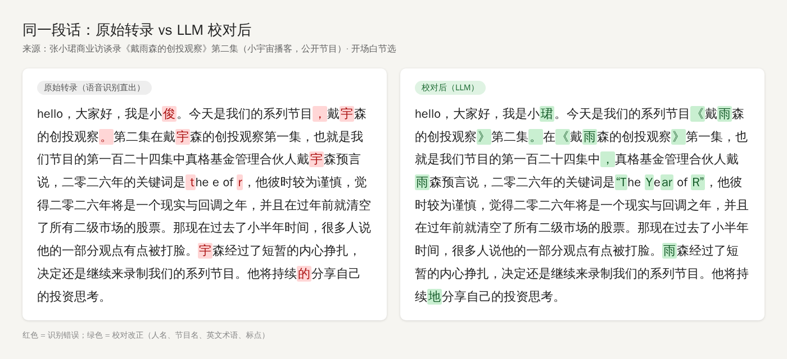
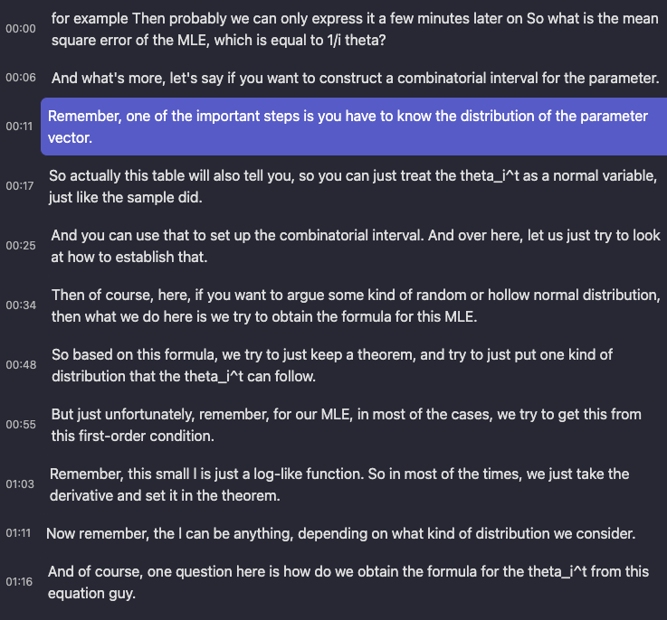
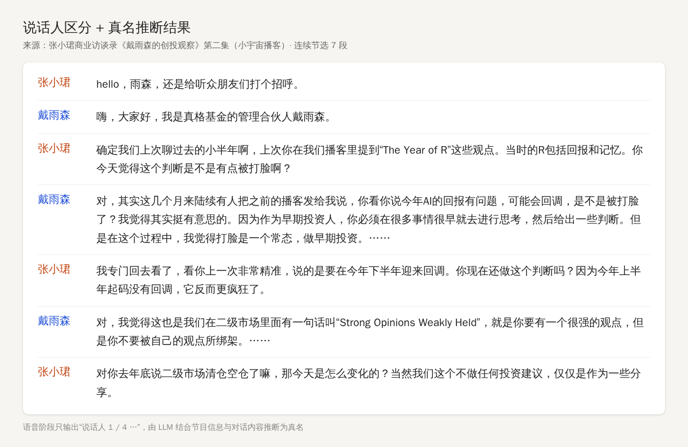
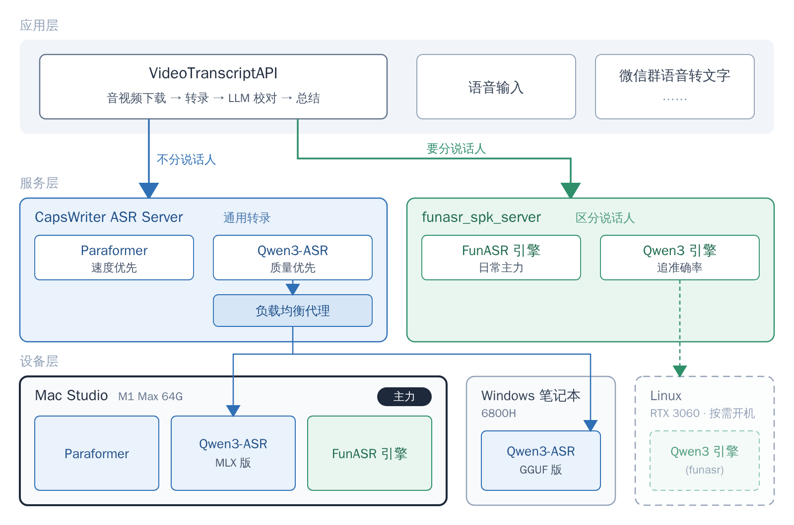

*Translated from the [Chinese original](/posts/261002-local-asr-selection/).*

In [*Observing the World*](../260914-observing-the-world/), I mentioned that I transcribe more than ten hours of audio and video every day. Quite a few friends asked: what's running underneath?

In 2023 I wrote a [usage guide for Whisper](/en/posts/liao-liao-gao-jing-du-yin-shi-pin-zhuan-wen-zi-gong-zuo-liu/) ([the Sspai version](https://sspai.com/post/83644)), which was one of the more complete introductions available online at the time. Not long ago, a high school classmate suddenly got in touch. He had been searching for Whisper material, came across that article, and was pleasantly surprised to discover that the author was me. An article from three years ago reconnecting me with an old classmate in this way felt kind of magical.

Three years on, the ASR (automatic speech recognition, i.e. speech-to-text) field has changed a lot. New models keep arriving one after another, and the capabilities of Coding Agents now let someone like me, a non-professional engineer, build an entire service on my own. **But these days, I basically don't use Whisper anymore.**

Audio and video contain a great deal of information that the text world doesn't, but an Agent can only read it once it's been turned into text. This post is about how to give your Agent this pair of ears at low cost, on consumer-grade hardware. As always, my approach is that you only need to understand the framework; I'll leave a pointer for the specific technical details and let your Agent read up on them. It will explain them in the context of your own situation, and surely better than I can. What's really valuable is the pitfalls I've run into in practice.

## Why Run It Locally at All

I started using online services early. In 2022 I even wrote an article on [using Feishu Minutes to improve your learning experience](https://sspai.com/post/70960), which brought Feishu Minutes quite a few users. Later I was also a long-time user of Tongyi Tingwu, and I've tinkered with both cloud and local models. In the end I settled on local, for three reasons.

**Cost.** Online ASR services cost roughly 0.5 to 1 yuan per hour. That's not expensive on its face, but at more than ten hours a day, it adds up to several hundred yuan a month. The machines at home are on 24 hours a day anyway, so the compute might as well not go to waste.

**Privacy.** The audio never leaves my home.

**Refusals.** Commercial services will flat-out refuse to transcribe certain content, which is a real hassle when it happens. And as I discussed in *Observing the World*, the most valuable parts of audio and video are precisely the content that is less "correct."

One caveat: the proofreading step later on uses a cloud LLM API, so the transcribed text does still leave my local network. If you have higher privacy requirements, that step can just as well be swapped for a local LLM.

## The Conclusion First: Once You Clear the Bar, Stop Chasing Accuracy

When evaluating an ASR model, I mainly look at three things:

- **Resource usage**: VRAM, memory, CPU. In a home setting, you also have to count the electricity cost of running 24 hours a day.
- **Speed**: the industry commonly uses RTF (Real Time Factor), which is transcription time divided by audio duration, and **smaller is faster**. An RTF of 0.1 means 10x real time: an hour of audio is transcribed in six minutes. Below I'll consistently say "x real time."
- **Quality**: transcription accuracy.

Beyond that, you also need to look at which languages it supports.

My core conclusion is this: **based on your own scenario, strike a balance among these, rather than blindly chasing any single metric.**

On consumer-grade hardware, once an open-source ASR model's accuracy clears a baseline, say around 90%, further improvements are much less noticeable in practice. Especially when the downstream step is AI summarization, the more sensible approach is: **ASR lays the foundation, and with precise context, an LLM proofreads it once more**. This is the approach that has given me the best results at the lowest cost.

### The Same Idea, Only Working Three Years Later

Interestingly, this idea was already taking shape in that 2023 article.

What I was transcribing back then was a course recording, taught entirely in English and full of technical terms. Whisper lets you supply a prompt in advance telling it which words might appear in the audio. My approach was to throw the course handouts at Claude to extract keywords, then feed those keywords to Whisper as the prompt, to improve the accuracy of proper nouns. I also tried using GPT-3.5 to add punctuation to the transcripts, but it often took the liberty of merging text, which threw the timestamps off; switching to GPT-4 was too expensive.

Three years later, LLMs are both cheap and reliable (models like DeepSeek v4 flash have very low API prices to begin with), and this finally works. The proofreading flow in [VideoTranscriptAPI](https://github.com/zlxlabs/VideoTranscriptAPI) now goes roughly like this:

1. Get the metadata of the audio or video: title, description, author
2. Have an LLM extract from it the terms that are easy to mis-transcribe: names of people, places, terminology, brands, abbreviations, foreign-language words, and so on
3. Write these terms into the prompt, and proofread the transcript in segments, concurrently
4. Run a quality check to make sure the proofreading hasn't dropped any content

As long as the ASR has a baseline level of accuracy, adding LLM proofreading makes the transcript highly readable. Proofreading one transcript costs only a mao or two (a few cents).

**This conclusion in turn determines how to choose: since quality can be backstopped by an LLM, when picking an ASR you should care more about speed and resource usage.**

## A Map for Choosing

First, the context: home consumer-grade hardware, mainly Chinese and English. In the table, 6800H refers to one of my Windows laptops with an AMD integrated GPU, M1 Max is my Mac Studio, and RTX 3060 is an NVIDIA card with 12 GB of VRAM.

| Model | Strengths | Hardware | Speed | How I use it |
|---|---|---|---|---|
| Whisper | Many languages, arrived early | Best with a discrete GPU | 2023 Large model: about 2x real time on the 6800H, about 12x real time on the M1 Max | Basically no longer used |
| Paraformer-zh | Mainly Chinese, can also handle mixed Chinese-English speech | **CPU alone is enough** | Roughly 20–30x real time on the 6800H and 40–50x on the M1 Max, by feel | **For speed, my workhorse** |
| SenseVoice Small | Chinese, English, Cantonese, Japanese, Korean | CPU or GPU both work | — | Not used day to day |
| Qwen3-ASR 1.7B | **The accuracy ceiling**, 30 languages + 22 Chinese dialects | Best with an NVIDIA GPU | About 8x real time on the M1 Max; about 20x real time on long audio on the RTX 3060 | **For quality** |

The last three all come from Alibaba: Paraformer and SenseVoice come from FunASR, Alibaba's open-source speech toolkit, and Qwen3-ASR comes from the Qwen team. A few words on each:

**Whisper** was open-sourced by OpenAI in September 2022. Its strengths are that it arrived early and supports many languages, so it is often treated as the default first choice for ASR. But if your use case is mainly Chinese and English, its accuracy is no longer on par with the newer models, its resource usage is higher, and on long audio it is prone to hallucination, repeating the same sentence over and over. What impressed me most about it back then was that it could even transcribe notation like `theta_i^t`. These days, apart from less common languages, I have no reason to use it.

**Paraformer-zh** is the oldest model in CapsWriter, yet the one I use the most. Its biggest advantage is speed: an ordinary CPU can run it at dozens of times real time, with no GPU needed at all, which is honestly a little scary. The price is that its accuracy is somewhat below Qwen3-ASR, but with context plus LLM proofreading as a backstop, it's more than enough. If you don't have a GPU and only transcribe Chinese and English, I highly recommend it.

**SenseVoice Small** supports more languages, and in the upstream project's comparisons its accuracy is on par with Paraformer. I'm only introducing it here; I don't use it day to day. My main use case is Chinese and English, so I use Paraformer-zh when I want speed and Qwen3-ASR when I want quality, and those two ends are already covered.

**Qwen3-ASR 1.7B** is currently the ceiling of local transcription quality. In essence, it has a language model "listen" to the audio and then write out the text, and it can guess words from context, so proper nouns and sentence segmentation are both more accurate. A single task uses about 3 GB of VRAM; with word-level timestamps enabled (marking when each word appears, which you only need for precisely aligned subtitles), it goes up to more than 6 GB. It also runs on a Mac, but is much faster with an NVIDIA GPU (CUDA acceleration).

By scenario, it roughly breaks down like this:

- **Voice input method**: you want the raw transcript to be as accurate as possible, to minimize manual corrections, so choose Qwen3-ASR.
- **Long audio + AI summarization**: with precise context, Paraformer-zh is more than enough.
- **Need to distinguish speakers**: podcasts, interviews, meetings; see the next section.
- **Minority languages**: this is where Whisper still has a role.

## Speaker Diarization: Harder Than You'd Think

Whether or not to distinguish speakers looks like just one extra label, but it's actually an entire pipeline:

- **VAD** (voice activity detection): first cut out which segments have someone speaking
- **ASR**: convert to text
- **PUNC**: restore punctuation
- **SPK**: determine who said each segment

The real difficulty is SPK. A back-and-forth interview is manageable, but in real situations conversations overlap, especially in noisy meetings, where B cuts in before A has finished. How do you separate them? The industry has a name for this: the "cocktail party problem." Consumer-grade hardware has limited compute, and this kind of problem basically can't be solved well. In noisy multi-person discussions, my own service's detected speaker count can be off by one to three people.

So my attitude is: **get roughly the right split; if it feels like 80–90% accurate and is good enough for downstream understanding, that's about right.**

One more layer: in summarization scenarios, if the model is capable enough, you don't necessarily need to separate speakers in advance, since it can infer who is speaking from context. It's just that if you can separate the speakers beforehand, the model can save some of its attention and focus on summarizing and distilling the content, which gives better results.

## How I Set It Up

My hardware is rather mixed, and I ended up with three layers: applications on top, two ASR servers in the middle, and a few machines at the bottom. The main workhorse is the Mac Studio:

- **Mac Studio M1 Max 64G**: CapsWriter runs Paraformer (speed first) and the MLX version of Qwen3-ASR (quality first), and funasr_spk_server runs the FunASR engine (speaker diarization). Most of my day-to-day transcription happens on this machine.
- **Windows 6800H laptop**: CapsWriter runs Qwen3-ASR, which, together with the Qwen3-ASR on the Mac Studio, sits behind a load balancer to share the quality-focused workload.
- **Linux + RTX 3060**: the Qwen3 engine of funasr_spk_server, powered on only when needed.

Both ASR servers are open-sourced under the MIT license, and below I'll explain what each one is in a few sentences. As for deployment details, don't rely on me; throw the repository URL at your Agent and have it come up with a plan for your hardware.

### CapsWriter ASR Server: General Transcription

[CapsWriter-Offline](https://github.com/HaujetZhao/CapsWriter-Offline) is an open-source local voice input method. Its author, HaujetZhao, also wrote QuickCut, the video tool I recommended in my article three years ago. Its server has several ASR models built in.

When VideoTranscriptAPI was just getting started in April 2025, given the capabilities of Coding Agents at the time, there was no way I could build an ASR service from scratch myself, so the whole project depended directly on CapsWriter's server.

But it was originally designed for Windows, and my devices include Windows, Mac, and Linux. So this May I split the server out and reworked it into [CapsWriter ASR Server](https://github.com/zlxlabs/CapsWriter-ASR-Server):

- Adapted to Windows, macOS, and Linux
- Added a load-balancing proxy, so multiple devices can sit behind it and tasks are distributed by load
- Upgraded the transfer interface to support compressed formats such as FLAC, for smaller transfers
- Added a whole-file transcription client library (SDK): when writing your own programs, you can hand in an entire audio file and get the result back

Model support is largely inherited from upstream, so Paraformer, SenseVoice, Qwen3-ASR and others all work, and I additionally added the MLX version of Qwen3-ASR for Mac. Since it was originally designed for a voice input method, the interface retains real-time recognition, so in principle you could use it to build things like local live captions.

### funasr_spk_server: Speaker Diarization

CapsWriter is pure transcription and doesn't distinguish speakers. That's certainly enough for voice input, but for scenarios like podcasts and interviews it's nowhere near enough. At the time I couldn't find an out-of-the-box consumer-grade solution that also worked well, so in July 2025 I simply wrote [funasr_spk_server](https://github.com/zlxlabs/funasr_spk_server) from scratch together with Claude Code, and later Codex and others joined in on the iterations too.

It's built on FunASR and wraps speaker recognition into a service you can call right away:

- Automatically merges consecutive speech from the same speaker
- Returns cached results directly for identical files
- Supports two output formats: JSON and SRT subtitles

On an M1 Max 64G, using the Mac's built-in GPU acceleration (MPS), it can run 3 concurrent jobs at roughly 10x real time. Almost all the transcription where I need speaker diarization runs on it.

Later Qwen3-ASR came out, and this May I added a Qwen3 engine to it, for when I want accuracy. This engine is best paired with an NVIDIA GPU; I put it on a machine with an RTX 3060 and power it on when needed.

### VideoTranscriptAPI: The Application Layer

[VideoTranscriptAPI](https://github.com/zlxlabs/VideoTranscriptAPI) ties all of this together: it downloads audio and video from various platforms, routes to funasr_spk_server when speaker diarization is needed and to CapsWriter when it isn't, and then does context-aware proofreading, summarization, and push notifications. I talked about how I use it in [*Observing the World*](../260914-observing-the-world/), so I won't go into it here.

Its code is public too, so if you're interested, you can just have your Agent read it.

## Why I Like Writing Servers

I use these two ASR services at high frequency every day, and for more than just audio and video summarization: transcribing voice messages in WeChat group chats, live captions, and so on can all be built directly on top of them.

**When a tool takes on the nature of a basic building block, you only need to keep maintaining it, and downstream programs calling it through an interface can grow all kinds of application-layer things.** This is also why I increasingly enjoy writing servers.

Open-sourcing these projects is also meant to help everyone skip the ASR pitfalls, so you can go straight to assembling and building more interesting things. If you also have a device that runs 24 hours a day, give it a try.

That's all.

> The draft of this post was conceived from a Feishu voice-recording transcript, and the article structure, fact-checking, and content organization were done through a conversation with Claude Code + Opus 5.5.
