*Translated from the [Chinese original](/posts/261004-context-and-loop/).*

> This post is built on two voice recordings totaling more than 80 minutes. As in the rest of this series: **as a human, you only need to understand the ideas and the logic; for the concrete execution details, just hand the article to your Agent.**

## Intro: Two Keywords

Today I want to talk about a slightly abstract question: if you could only remember two words from the Agent era, which two should they be?

The first is, without a doubt, **Context**.

From the data used to train a model, to the code repositories, company knowledge, and personal habits you give it when you apply it, it is all essentially context. In my experience, whether the output is good is mostly decided before the model says a word: what material you gave it, and what rules you left. That is the logic I was trying to express in my earlier post [Context is All You Need](../context-is-all-you-need/).

The second word, I think, is **Loop**, meaning iteration, or a closed loop.

Only when a task is iterated into a closed loop — with logs, with records you can review, and with a way to verify the result after each change — can an Agent keep improving its own decision quality. This is already a rough form of model training, and taking it further is what people call self-evolution. It sounds lofty, but it can land entirely in our own workflows: **build Context on purpose, and build Loops on purpose.**

The relationship between these two words is the main thread of this post:

- **Static Context**: things written in advance. Rule files, Skill packs, memory, tool configuration.
- **Dynamic Context**: it can only grow out of a Loop. You verify, get results, review mistakes, and that new information flows back as the next round's context.

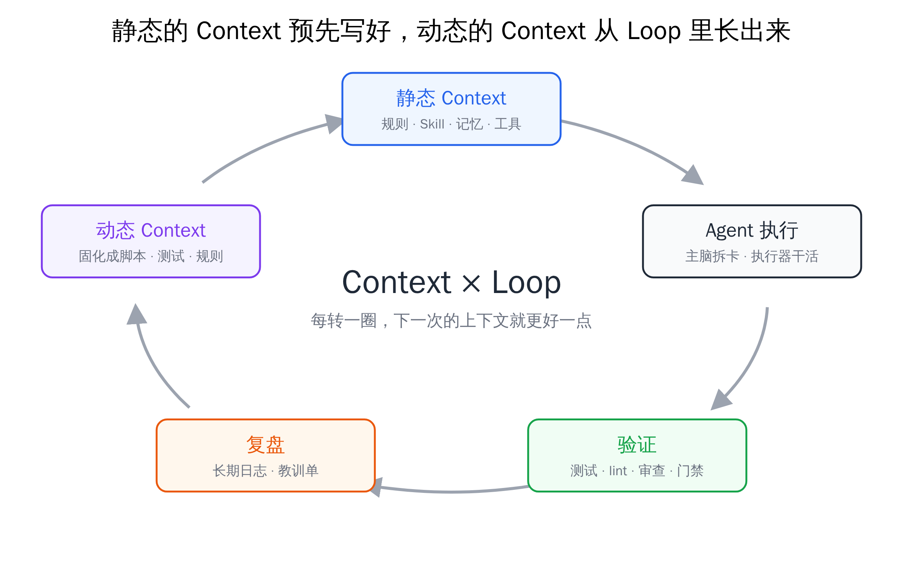

Let me start with some concrete numbers. I have a repository called agent-config, which holds the rules and scheduling scripts for all my AI tools. I created it on July 23. Two months later, it has accumulated about 16,000 commits (every change record), more than 1,800 issues (to-dos and problem tickets), and nearly 2,000 merged PRs (change proposals). All of these were submitted by AI. I have not written a single line of code in this repository myself.

I now consume roughly 2 to 3 billion Tokens a day (including cache reads). A few months ago I had to watch things at high frequency, basically staying people in the loop, to sustain about 4 billion a day; now the consumption is the same order of magnitude, yet I spend only a small part of each day on Agents, and it doesn't get in the way of anything else. By feel, **the effort I put in has dropped by an order of magnitude, and each individual project is noticeably less of a worry.**

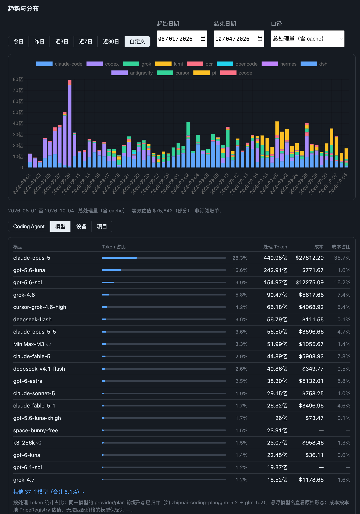

The chart above shows my daily Token throughput from August 1 to October 4. In early August it was almost all Claude Code and Codex; after late September, Pi (yellow) clearly grows. The bottom half is the distribution by model over the same period: besides the 19 listed in the table there are another 37, with Claude, GPT, Grok, DeepSeek, MiniMax, and Kimi all mixed together and no single vendor dominating.

The ones behind all this are Context and Loop.

> Three roles will appear repeatedly below: the **lead** is the AI that splits tasks, makes judgments, and accepts results, like a project manager; the **executor** is the AI that takes a task card and changes the code, like the person doing the work; the **gate** is the set of automated checks that must all turn green before a merge. I covered this architecture in detail in [A General on the March Doesn't Chase Rabbits](../260809-multi-agent-scheduling-architecture/), so I won't repeat it here.

## 1. Why These Two Words

Let's start from Coding. Why was Coding the first scenario where Agents could be deployed at scale? There are essentially three reasons:

1. **High value**: code is expensive to write, so everything saved is money.
2. **High-quality, abundant data**: open-source code, documentation, and Q&A give plenty of training data.
3. **Verification can be closed into a loop**: the code runs, the tests pass, the compiler reports errors.

The second point corresponds to Context, and the third to Loop. Coding happens to satisfy both conditions, so it runs the fastest.

More importantly, **these two things have nothing to do with which specific model you use**. Once they are in place, whether you use a top-tier model or a cheap one, they help you improve decision quality and cut Token waste. Models getting stronger is the vendors' progress; what you can work on from your side is the context and the loop.

A Cloudflare article opens very plainly:

> *"AI has made the step that was previously the slowest and most expensive — implementation — the fastest and cheapest."*
> — [The Agent Development Lifecycle has arrived on Cloudflare, Cloudflare](https://blog.cloudflare.com/agent-development-lifecycle/)

Writing code is no longer the bottleneck. The bottleneck has moved to both ends: at the front, "what context did you give it", and at the back, "how do you verify it did the right thing". That is exactly Context and Loop.

## 2. Static Context: Everything Must Answer "Why Is It Here"

Let's start with the static part, the part we can control ourselves.

### Foundation: Keep the Behavior Trail First

Before talking about how to govern anything, there is one low-cost, extremely valuable decision. I mentioned it in [A General on the March Doesn't Chase Rabbits](../260809-multi-agent-scheduling-architecture/) too, but I'll stress it again: **keep all your Agents' behavior data for the long term.**

By default, Claude Code automatically deletes your local session records after 30 days. Yet these behavior trails are essentially the source of all your review material, and the background for later verification and backtesting. Every pruning, every backtest, and every review described below rests on the premise that "the records are still there". Changing one config option keeps them, so there is no reason not to.

### The Layers of Context

The context of a Coding Agent, open source or closed, roughly consists of these layers:

| Layer | Example | Can you change it? |
|---|---|---|
| Built-in prompt | The system prompts built into Claude Code and Codex | Basically not for closed source; open source you can assemble yourself |
| Global rules | `~/.claude/CLAUDE.md`, `~/.codex/AGENTS.md` | Yes |
| Project rules | `CLAUDE.md` / `AGENTS.md` at the repo root | Yes |
| MCP | Various external tool services | Yes |
| Skill | Global and project skill packs | Yes |
| Memory | Memory across sessions | Yes |

In plain words: **rule files** are the rules stuffed into the conversation at the start of every session; a **Skill** is an operating manual you can call on demand, and normally only a short blurb occupies space; **MCP** is a plug that lets the AI connect to external services, and each plug comes with a fairly long manual.

Over the past month I have done a great deal of auditing and testing on these layers — deleting, trimming, adding, changing — with only two goals: raise task completion quality, and lower Token consumption.

The principle that runs through it all: **treat the Agent's context window as carefully as you treat your own attention.** Everything that appears in the context should, in principle, be governed, and should be asked: does it really need to be here? If not, remove it.

One more concept: **Git, the tool that saves the diff of every change and lets you return to any old version at any time, is in my view the best software of the Agent era, and its foundation.** It stores the diff of every version at very low cost. All your behavior trails can be traced back to which version of the prompt, what kind of context, which harness, and what code logic were in use at the time. (A harness is the layer of software wrapped around a model, like Claude Code or Codex; it decides which tools the AI can call and what it reads first.) So every layer discussed below should go into a Git repository, and even be synced to GitHub, and iterated on for the long term.

### Built-in Prompt: Mostly Leave It Alone

Each Agent's built-in system prompt can't be changed if it is closed source, and you can assemble your own if it is open source. But in most cases, the default, already well-tuned one is fine. I'll come back to this layer in the executor section.

### Global Rules: Not One-Off, and Layered When Assembled

Many people treat the global `CLAUDE.md` or `AGENTS.md` as a one-time job: write it and forget it. I think that's not great. It should go into a repository and be iterated on for the long term, **with additions, and with subtractions too**.

Speaking of subtraction, something quite representative happened recently. Thariq from the Claude Code team published an article on context engineering for the new generation of models:

> *"We removed over 80% of Claude Code's system prompt for models like Claude Opus 5 and Claude Fable 5 with no measurable loss on our coding evaluations."*
> — [The new rules of context engineering for Claude 5 generation models, Claude](https://claude.dev/blog/the-new-rules-of-context-engineering-for-claude-5-generation-models/)

Every vendor gives similar advice when a new model ships: for top-tier models, delete the patches in your historical prompts, and stop repeating "think more, think deeper".

Are they right? Certainly. These are models they trained themselves, and they have the most experience with them.

**But my advice is: follow the direction, and trail the pace by half a year.**

Their current best practice rests on a premise we don't have: nearly unlimited high-quality Tokens. All three vendors have admitted this themselves:

- The Pragmatic Engineer's article on OpenAI's internal software factory opens with: *"It's rare to work with an unlimited token budget, but at OpenAI, that's what all engineers… do."*
- Thariq also said offhand in [the Latent Space interview](https://www.latent.space/p/thariq): *"we have lots of tokens"*.
- In [the interview with Orca's founder](https://www.superlinear.academy/c/recording/orca), it was also mentioned that people inside model companies live in an environment with plenty of Tokens, and rarely run into the friction outside users hit every day: quota used up, switching vendors to carry on.

Those of us on the outside can hardly afford such luxury. What easily happens is: you strip your prompt clean for a top-tier model, the quota runs out two days later, and you're forced onto an ordinary model — the patches you'd made for ordinary models are gone, and you can imagine the quality.

We can only hope that in about six months the cost of high-intelligence Tokens drops to an acceptable range, and then we can really follow suit. **Until then, we have to keep some fairly "ancient" configuration** — the patches made for ordinary models can't be deleted yet.

So what to do? In that interview Thariq raised an interesting point. He said failure modes change with the model; even Fable 5 and Fable 5.1 differ. The host chimed in, "so you'd need a Fable.md and an Opus.md". Thariq's response was: true, but maintaining several copies is very painful, and continuously accumulating records of failure modes will most likely over-constrain the model.

My situation is even more awkward. What I use is extremely mixed: Claude, Codex, Cursor, Kimi, Grok, GLM, MiniMax, Gemini, DeepSeek, plus assorted free models. Maintaining one rule file per model is impossible.

I also seriously evaluated a compromise: two sets by model tier, one for top-tier models and one for ordinary models. I ruled it out in the end, for two reasons. First, the evidence is insufficient: for many defects it's hard to tell whether the cause is the model, the shell, or the task card. Second, most of my executors now run on Pi, where the same shell takes turns hosting several vendors' models, so the "model" axis and the "shell" axis simply can't be separated.

So my current engineering practice is: **one master draft, assembled in layers along two dimensions, "tool × role"**, not by model. The draft is split into three blocks:

1. **Shared base**: your engineering habits. For example, you must write tests before code, plus your own verification methods. Every tool and every role carries it, long-term.
2. **Lead-only**: dispatch routing, review discipline, cross-session memory, delivery authorization. Only the lead side needs these; for executors they are just interference.
3. **Tool-specific**: each tool's own usage and behavior calibration. For example, the Codex side carries the full version of the "anti-over-engineering" constraint, because GPT-family models are usually extremely rigorous and prone to over-design; other tools carry only a slim version. Calibration follows the tool, not the model.

The lead's and the executor's contexts are built separately. On the lead side, the three blocks are combined to generate each tool's global rule file, with Skills loaded on demand. On the executor side, the context is rendered on the spot at dispatch time: only the part of the shared base the executor can use, plus that tool's paragraph, plus the task card and the role declaration. When a Pi executor starts, Skills are switched off entirely, and the whole system prompt is only about 7KB — it just needs to finish this one card, and doesn't need to know the lead's scheduling rules.

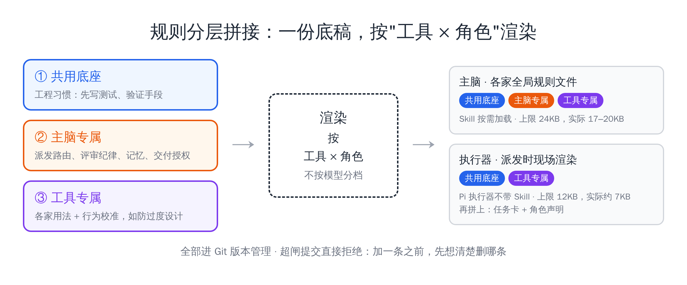

On top of that, I put a hard cap on the injected volume: the rules injected on each lead side cannot exceed 24KB (about 12,000 Chinese characters, which occupy the model's attention at the start of every session), and on each executor side cannot exceed 12KB; exceeding that gets rejected right at commit. For a while the lead's rule source grew to 24.5KB, nearly at the line; I then moved the content needed only by specific workflows into on-demand Skill packs and pressed it back down to about 19.8KB. All of this is under version control and gets backtested as data flows back. **With this cap, before adding a rule you must first figure out which one to delete.**

Incidentally, the relationship between Claude Code and `AGENTS.md` is changing too. It used to be that you could only reference it with a single `@AGENTS.md` line in `CLAUDE.md`, a roundabout compatibility; recently, if the repository directory has no `CLAUDE.md`, it reads `AGENTS.md` directly. If you use several tools together, maintaining one `AGENTS.md` is enough.

### Project Rules, Memory, and Lessons: Each Has Its Place

Project-level rule files already naturally live in the project's version control, so that part is fine. What you need to think through is the **boundary**: what goes into `AGENTS.md`, what goes into Memory, and what goes into neither.

My current split has three paths:

- **Long-term constraints that don't change** go into the project's `AGENTS.md`.
- **Facts and preferences**, such as how a certain server is deployed or which tools I tend to use, go into Memory.
- **Pitfalls I've hit** are not written straight into rules or memory; first I open a lesson ticket (issue), and later find a way to solidify it into a script, a test, or a gate. I'll cover this path in detail in the Loop part below.

All three paths need an entrance and also an exit — they can grow, and they must also be able to shrink.

Let me say a word about Memory specifically.

I now use a great many clients: Claude Code, Codex, Grok, Cursor, Kimi, OpenCode, Pi. In that situation, **you can't depend on any single vendor's built-in memory system**. It's quite likely that Claude finishes a change, hands the implementation to another Agent, and that Agent picks it up without updating Claude's memory. Claude's memory then becomes the place in the whole system that least matches reality.

So on my dev machine I turned off Claude Code's built-in memory and maintain my own. It isn't hard to describe; in essence it follows the same logic as Claude Code's memory: an index directory plus a set of Markdown documents, with additions, updates, and deletions. I constrain it in the global rules so that all Agents maintain it together, and memory flows smoothly between different leads.

I also didn't adopt a dedicated semantic search library. My judgment is that the problem is usually not "it failed to find it", but "it stuffed outdated notes back into the conversation". Rather than making it search more precisely, better to make sure what it stores is correct.

Conversely, if the project is small, **just don't have Memory at all**, and treat the codebase as the only truth. Lower the cost of an Agent understanding the repository through engineering means: optimizing code structure, building a code graph, improving naming, limiting file line counts. Memory becomes necessary only once the project really reaches scale.

### MCP: Use the CLI When You Can

If I were building a SaaS platform, I'd love MCP, because it solves troublesome things like authentication quite neatly. But from the standpoint of someone using Agents, I rather dislike MCP — its footprint in context space is still too big.

So my habit is: **if there's a CLI (a ready-made tool you type into the command line), prefer giving the Agent the CLI**. MCP is controlled at the project level, and turned on only when necessary.

### Skill: Absorb First; If You Must Install, Install Into the Project

As I've said in earlier posts, apart from a few like gstack, I rarely install third-party Skills directly. Mostly I try to **absorb them into my own engineering system**; and even when I do install, I install at the project level and avoid global installs as much as possible.

The reason is again context. A Skill's blurb takes up little space, but it still sits there, and so it can influence results. A Skill unrelated to this project should, in principle, not appear in this project.

For example, Feishu's CLI ships with many Skills. Some projects never use Feishu at all, and some use only a few, such as Bitable and Miaoji; the rest is pure noise. My approach: install globally only what I use at high frequency every day, and switch on the rest individually at the project level.

I stepped on a fairly typical pitfall here. The bulk of Coding Agents is Claude Code and Codex, and most others actively stay compatible, reading their rule files and Skills directly. The most outrageous is Grok: it reads Claude's `CLAUDE.md` and its own `AGENTS.md` at the same time, then swallows all of `~/.claude/skills` as well, with a lot of things not deduplicated. For a while my Grok lead had 197 Skills resident. Its context window is 500K Tokens, which is the total capacity of the whole conversation — before any work began, a chunk was already taken by this duplicated material, most of it irrelevant to the current project. After dealing with it separately, the Skills dropped to 41.

So when you check startup context, don't only count Skills; also check for duplicated injection of rule files.

How do you get project-level Skill switches across multiple Agents? Claude Code does this best: you can switch a Skill on or off right in the project; but not every Agent has that ability. My method is plain: **install globally only the Skills that are common to all Agents and used at high frequency every day; for a Skill a particular project needs, install it into that project's own directory.** That way, whichever Agent opens the project, what it sees is "the common ones + what this project needs", which amounts to a cross-platform, multi-Agent project-level switch. If you only use Claude Code, just use its built-in switch.

Either way, **for a Skill someone shares online, the best option is to absorb and internalize it into your own workflow, second best is to install it into a specific repository, and global is the last resort.** And all Skills should be under version control, deleted or fixed as model capabilities grow.

> From this section, remember just one sentence: everything that enters the context at the start must be able to answer "why is it here", and must be removable.

## 3. The Execution Layer: Flash Models Are Enough, and the Shell Matters More Than the Model

What we've covered so far is the lead's layer. This section goes one layer down, to executors — the content I added in the second recording.

### Flash-Tier Models Have Crossed the Coding Baseline

Some background first. The Tokens I consume daily are quite mixed, and I've bought basically every common subscription on the market: Claude, Codex, Grok, Kimi, MiniMax, GLM.

The overall Token usage follows a trend of **splitting first, then merging**. At the very beginning it was only Claude Code and Codex; later, to save the quota of high-intelligence Tokens, I bought a pile of third-party plans, and both the clients and the models I used became mixed.

But over this past month, comparing several thousand executor task cards, I found that: **at least in the scenario of "lead schedules, executor executes", the success rate and quality with which the various executors complete tasks are actually about the same**. In the acceptance records of the last 90 days, the pass rates of the mainstream executors all fall between 88% and 93%. Of course, each one receives different tasks, so this number only says "in practice they all work", and can't strictly prove equal quality; the clearly unusable ones get eliminated — one was at only 50% and has already been taken offline.

This echoes a judgment I made earlier: **the Flash-tier models of each vendor (the tier each vendor pitches as cheap and fast) have already pushed Coding across that baseline.** Once crossed, provided the subtasks are well split at the execution layer, of the three dimensions to consider when choosing a model — cost, speed, quality — quality is about the same everywhere, so **you only need to consider cost and speed**.

I think a model's "strength" comes in two kinds:

- **Strong across the board**: strong in taste, thinking, and execution. Typical examples are Anthropic's Fable 5 and Opus 5.5.
- **Strong in a direction**: post-training makes it especially cost-effective for Coding or ordinary office tasks. Typical examples are DeepSeek v4.1 Flash and each vendor's Flash models.

If you don't have money to burn, you can save by **tiered task scheduling**: let the across-the-board strong model make high-value judgments, and hand concrete execution to the directionally strong "workhorse models". A model like DeepSeek v4.1 Flash outputs very fast, by feel one or two hundred Tokens per second, and concurrency is easy to push up, which to some extent lets you experience what a "$500 membership" feels like.

### Treat Pi as the Subagent of Every Lead

Next is an adjustment I made recently, and it may be a little counterintuitive.

First, an introduction to **Pi**: it is not a model, but an open-source Coding Agent shell, the same kind of thing as Claude Code and Codex. The difference is that its system prompt is extremely slim, the manuals, tools, and rules stuffed into the conversation can almost all be decided by you, and the model can be any vendor's.

I always used to stress one view: **a good model must be tightly coupled with its own vendor's harness**. Because when top-tier models are trained, the tools available in the harness are taken into account. My view on this hasn't changed.

But I now **prefer to run the execution tasks for the quotas of Codex, Grok, Kimi, MiniMax, and GLM all through Pi**.

The reason is that I added a qualifying condition to "tight coupling": **it applies to hard, open-ended tasks**. In an execution scenario where the lead has already split and arranged the subtasks, I compared the same model with the same context, running on Pi versus its native client, and they are neck and neck.

I just finished a round of comparison today. Same day, same batch of task cards, the same vendor's model run on Pi and on its native client, 12 pairs compared by hand in total:

| Model | Pi wins | Native wins | Conclusion |
|---|---|---|---|
| gpt-6-luna (native: Codex) | 3 (1 of them provisional) | 1 | Pi is no worse than native |
| k3-256k (native: Kimi Code) | 2 | 2 | Tie |
| grok4.6 (native: Grok CLI) | 1 | 3 | Pi slightly weaker |

Six to six overall. Wins and losses mainly depend on whether the executor held to the task card's requirements, and have little to do with Pi versus native. This is not a public leaderboard and the sample is small, so the only conclusion to take away is: **the shell is not the variable that decides who wins.**

An earlier round compared the same DeepSeek model running on Claude Code versus Pi. At first Pi lagged behind; later I found three kinds of problems with the context on the Pi side — the task prompt wasn't injected in the first turn, the entire pool of 83 Skills was stuffed in, and rules were injected twice. After fixing them, **Pi's system prompt dropped from 38,700 characters to 16,700, and first-turn input dropped from 17,500 Tokens to 8,500**; in the third batch of 8 examples Pi won 5, with quality level or slightly better, and cost per task about 40% lower.

The conclusion is very clear: **the gap mainly comes from the context the harness gives the model, not from the model itself.**

And that's Pi's advantage: **it lets you organize the context entirely by yourself**. When other official native harnesses serve as executors, you can't customize the context; they may carry Skills you don't need, and rule files that only the lead side would use. With Pi, I can iterate separately on the context of the executor layer. It completes tasks with quality and quantity, saves Tokens, and the maintenance cost of the executor is also very low.

Putting the two rounds together, what I want to emphasize is: **given thorough context constraints, the Flash-tier models that have crossed the baseline complete tasks with about the same quality.** What really opens the gap is the context you give them; and Pi happens to be the shell that makes it easiest for you to control context.

In short: **treat Pi as the subagent of Claude Code and Codex.** In Claude Code and Codex, I essentially use only the best models, for their thinking intelligence; all the odd jobs go to Pi paired with any third-party model.

## 4. Advisor: Stronger Judgment, Plus a Clean Context

Put nicely, all of these context optimizations are essentially meant to improve task execution quality and reduce the drain on my energy. But objectively, they really are also meant to save Tokens, especially Opus 5.5 quota. Saving to the end, I've started to come up with some "exotic tricks".

The one I use most frequently now is **Advisor mode**: consulting an advisor.

### Two Problems: Mediocre Judgment, Plus Context Rot

When a decision has to be made, the execution layer actually faces two problems.

The first is that **the model's own judgment is rather mediocre**. Workhorse models are fine at executing tasks, but when asked to make decisions, they most likely won't do well.

The second is a **problem every model has: context rot**. As the context window fills, the model's intelligence declines, even for a top-tier model. And it doesn't wait until the window is nearly full to go wrong — I've observed that many models, once the window is forty or fifty percent used, already start getting stuck in a local view without realizing it.

At first I only focused on the first problem, with a simple idea: **use a model that is strong across the board to make high-value judgments.** So I automatically consult top models like GPT-6, Opus, Fable, and Kimi; each model uses about a hundred-odd thousand Tokens per consult, but the advice has very high decision quality and **often directly overturns the underlying model's judgment**.

This idea was learned from Claude Code. It has an experimental native Advisor tool in which the main model consults another, stronger model at key points. But it can only be used inside Claude Code, so I wrote it as a standalone tool, in a Skill-like form, so that all Agents can use it.

### Later I Found: a Clean Context Is Just as Critical

While building this tool, I noticed a detail in Claude Code's native Advisor: **it forwards the whole conversation to the advisor.** I wondered at the time: after seeing so much prior text, would the advisor be led astray as well?

To verify, I ran a retrospective blind test. I found two PRs with known outcomes — both were revised for several rounds and finally withdrawn. I truncated the material after the third round of fixes, just before the lead was about to wrap up, gave no information that could hint at the outcome, and asked the advisor to judge "what to do next". I asked 9 times in total, and **all 9 times rejected the lead's wrap-up plan at the time**, in a direction consistent with the later actual withdrawal.

Then I excluded variables one by one:

- Remove the option menu and switch to an open-ended question — the advisor still proposes stopping.
- Change the advisor's identity to "you are that lead who has already fixed three rounds" — it still jumps out.
- Swap in a weaker model — it can say "you should stop", but can't say "why this approach shouldn't be done at all".

The last one shows that the model's judgment really does matter, which was my initial intuition and corresponds to the first problem; but after eliminating everything, one variable remains that is equally critical: **the advisor isn't carrying that session history**, which corresponds to the second problem. After three rounds of fixes, the lead's context is full of failed attempts, with sunk cost and the inertia of being led by prior text; the advisor starts from a blank page and has none of that baggage.

So Advisor works **because of two things: stronger judgment treats the first problem, and a clean, independent context treats the second.**

### The Simplest Version You Can Use Yourself: Rewind

The clean-context idea is actually something everyone can use in daily conversation. A feature I love using is **rewind**: `/rewind` in Claude Code, `/tree` in Pi.

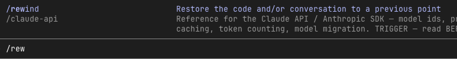

A large language model infers what comes next from what came before, so **all the information in the earlier text affects the quality of the later output**. If you judge that it has already gone in the wrong direction, the best move is not to have it correct itself in the current conversation, but to **go back to the point before it made the mistake and start again from there**. That way those wrong directions simply aren't in its "mind".

At the rewind point you can also tell it in passing: "We've already verified direction XX, no need to explore it again." It will then go straight down another path. If your tool has no rewind feature, open a new conversation and paste only the facts you've already verified, not the few wrong turns.

### What My Advisor Tool Looks Like

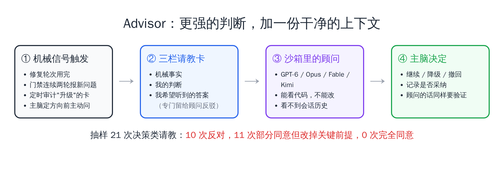

Based on the conclusions above, my Advisor tool has three design points:

- The advisor runs in a **read-only sandbox**: it can look at code but can't change any file, and it can't see what the lead and executors said earlier.
- When the lead consults, it must write a three-column consultation card: mechanical facts, my judgment, and **the answer I hope to hear**. The third column is reserved specifically for the advisor to push back on.
- When to consult doesn't depend on the model's own judgment (a model basically can't estimate how confident it is in itself), but on mechanical signals: the same card has used up its repair rounds, the gate reports new problems two rounds in a row, a task card marked "escalated" in the scheduled audit, and the lead's proactive consultation before setting a direction.

The experience has been very good. I sampled 21 decision-type consultations: **10 directly opposed, 11 partly agreed but changed a key premise, and not a single one agreed completely.** I should note that most of these were sent because the lead already felt something was off or was stuck, so a high rate of opposition doesn't mean the advisor should always play devil's advocate.

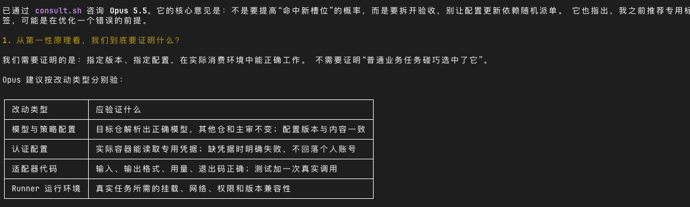

Here are three concrete stories.

**Story one: the advisor recommended giving up, because this card wasn't guarding that bottom line at all.** The decision logic of a merge gate: the executor had fixed it three rounds without converging, and the lead was choosing between two fallback options, ready to enter a fourth round. The advisor's answer was: this card isn't guarding a red line to begin with, and more patching only weakens the red line; take neither fallback option, and drop this version outright. It also pointed out that the problems in all three rounds fell in the same area, because this card had chosen the one path that had to rely on guessing. In the end that PR was closed without merging.

**Story two: the exceptions that were uncertain from a safety standpoint turned out to be exceptions that couldn't be kept at all.** A safety hook that intercepts dangerous commands had a set of "change directory first, then delete" exemption rules, which had been patched for several rounds, and the lead wanted to keep tightening. The advisor first ran a read-only experiment proving that the "change directory" command itself can be quietly rewritten into other behavior, and then gave its conclusion: judging by command text alone, no exemption rule can be proven safe, and the only safe approach is to keep none. The lead adopted it and deleted the whole set of exemptions.

**Story three: what was ranked last should have been ranked first.** When ordering the to-do list for the next few hours for a paid service, the lead put an alert issue of "not yet characterized" last. The advisor said: your ordering is wrong in two places, and this issue should go first — it is the only class of defect that has already actually harmed real paying customers: a user paid and got stuck in some state for 62 days, and nobody knew. That issue was fixed that very night.

Of course, the advisor can be wrong too. Once, its inference that "the existing path already errors out" was overturned by a real reproduction. So the advisor's opinions must also be verified — which is exactly what the next part is about.

**Use the across-the-board strong model for high-value judgments; leave the concrete low-level execution to the workhorse models; and when judging, give it a clean context.**

## 5. A Specimen of Loop: A Configuration Repository That Has Run for Two Months

The static Context is basically covered. Now on to dynamic Context, which is the second keyword: Loop.

### How It Grew Into This

The agent-config repository started only to manage the context described above — syncing rule files and managing Skills. Later it gradually gained the system in which the lead schedules executors, then terminal-badge status monitoring, and later still it evolved into the base repository for all my AI learning.

Looking back, its evolution falls into three steps:

1. **First put the rules into a version repository**: one shared set of rules, with a thin tool-specific layer on top for each tool.
2. **Then have all the pitfalls report back to the same place**: scheduling, dispatching cards, acceptance, scoring — problems flow back uniformly.
3. **Finally use scripts and gates to stop old pitfalls from recurring**: injection budgets, self-built memory, consulting the advisor — all grew out of this step.

None of the steps was designed in advance; each grew out of use.

Its most important aspect is: **it already has the rough form of a Loop**. This repository is effectively the root of my whole Agent scheduling system. I require every session that uses this system to develop other repositories to report, at wrap-up, any scheduling-level or script-level problems into agent-config's issues. Then every day I dispatch Agents specifically to handle those issues.

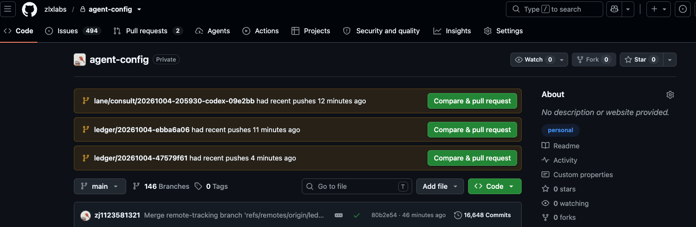

Among the 1,800-plus issues in the numbers at the start, more than 1,100 are tickets dedicated to recording lessons. And this repository is also the one that consumed the most Tokens of all my repositories in the past two months — **building a system that saves effort itself requires a lot of investment**; the second most is the gate system, which I'll come to later.

### Swapping the Engine While the Plane Is Flying

Honestly, this process was very hard.

This repository is both the engine of the whole plane and the thing I have to repair and replace. The early phase was a tangled mess, with especially many conflicts. After a while it slowly converged and settled. Many problems were solved along the way; new problems either could be linked to earlier ones, or appeared less frequently.

In the data, new issues opened per week peaked at 305 in the week of late August to early September, and fell back to 159 in the last week of September.

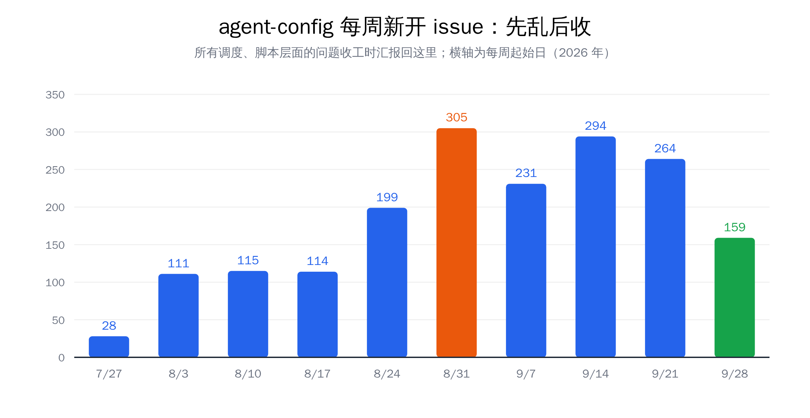

My standard for closing a lesson ticket is just one question: **can this pitfall still be stepped on today?** Only when it can't may it be closed. Not "fixed" and closed, but closed only when "it is mechanically impossible to happen again".

### Don't Make the Same Mistake Twice

Let me walk through a few concrete pitfalls to get a feel for what "a fall into the pit, a gain in wit" looks like in engineering:

- **Tests hit production.** When an executor created an isolated working directory, it copied only the outermost config file, the config in deeper directories was missing, and the program quietly used default values — it connected to the real production environment, with no error at all. Later, creating the working directory was made into a script that automatically links every layer of config, and neither humans nor Agents create them by hand anymore.
- **The push succeeded, and was pushed twice more.** To look at fewer lines of output, Agents habitually trim command results. The trimming lost the "failure" signal; another time it was the reverse, a successful push was displayed as failed and pushed again for two more rounds. A rule was set afterward: to confirm whether code was uploaded, always ask the remote server, and don't trust the local display.
- **The executor dispatched the work back to itself.** A task card forgot to say "you are the one doing the work, don't dispatch to anyone else". The executor read the dispatch manual meant only for the lead, dispatched the task out again, spun for 90 minutes with zero output. Later the task card template was made to force-include a role declaration, and the lead's section was stripped from the rules the executor receives.
- **Checking one switch cost tens of thousands of Tokens.** The lead merely wanted to confirm whether a service was running, used a command that prints out the entire task card, and tens of thousands of Tokens poured into the context just like that. This is an example where Context and Loop meet: context waste, too, can only be discovered through review.

So you should cherish the mistakes you make during development. Dispatch another Agent to read the work log and judge why it made that mistake at the time; accumulate what should be accumulated, and later handle it uniformly from first principles. Objectively, this too is a way of being glad to hear of your faults.

### Better in Code Than in Prompts

Where a lesson settles also matters. Anthropic's [AI-native SDLC playbook](https://claude.com/blog/the-ai-native-sdlc-playbook) has a very practical rule:

> *"When Claude makes a mistake twice, the correction goes into CLAUDE.md."*

But the same article goes on to say that Skills can only make violations rarer, while Hooks make violations nearly impossible. (A Hook is a small script that must run on every commit or execution; a violation makes it fail outright, whereas rules written in descriptive text get treated as unseen by the AI when it's in a bad state.)

xAI's Lauren put this even more thoroughly in a talk. She divides constraints into layers, from strong to weak: **code structure and architecture** (making the error structurally impossible) > static analysis and lint (error scans that run automatically at commit) > rules and Skills > style guides that only human review can enforce. Each time you correct an Agent, follow this order of strength and settle the lesson into the most effective layer you can find.

Of the pitfalls above, the ones that were truly cured at the root were all those turned into scripts, gates, and tests; the ones only written into rule files kept popping up again later in other forms.

### Bringing in New Tools Also Needs Backtesting Against Your Own Logs

Loop isn't only for dealing with mistakes; it is also for dealing with new tools that "look great".

For all the tools that "help Agents save Tokens", when someone recommends one, the first thing to do is not to install it right away, but to **have an Agent analyze, against your local work logs, whether it is actually necessary for your scenario**. After you decide to trial it, backtest again after a while: did it really do what it claimed? Or did it bring side effects?

RTK is an example where I installed first and uninstalled later. It is a tool that compresses command-line output to help AI save Tokens, and it claims to save 90% in some scenarios. I backtested 1,505 calls on my machine, and it actually saved 44% — which sounds decent too, but **87% of that saving came from search and file-reading operations, and those are precisely the two kinds that can least stand compression**: search results quietly lose lines, and when file content is compressed, the Agent can't match the original text when editing code, and has to bypass the tool to find the original. So I stopped using it.

**For any tool that helps an Agent save Tokens, you have to judge whether it is truly helping the Agent understand context better, or introducing new complexity.**

## 6. Low-Cost Verification Channels, and "Verification Also Needs Verifying"

Whether a Loop can turn depends on whether you have a **low-cost, efficient way to verify**. This is one of the areas I care most about now.

### The Spectrum of Verification Channels

The cost of verification has to be looked at comprehensively: time is a cost, extra spending like Tokens is a cost, and human involvement is a cost too. From lowest to highest overall cost, it can roughly be divided into three tiers:

1. **Low cost**: checks that spend no Tokens and give results within seconds. Compile checks of programming languages (expanded on separately below), basic tests, lint (the code-style and error scan that runs automatically at commit). On the backend, tests can lock behavior down.
2. **Medium cost**: checks that spend Tokens. For example Alibaba's OpenCode Review, which can review code at a relatively low Token cost; plus our own custom Agent reviews, and having an Agent record the screen and then review the frontend video. They are more expensive than tests, but much cheaper than humans.
3. **High cost**: checks that need people. Human time and attention are the most expensive, so avoid using them wherever possible, and keep them only for places that truly need judgment.

The role of the gate is to chain the first two tiers together, merge only when all is green, and try not to push checks to the third tier. The principle is also simple: **whatever can be solved at a lower tier shouldn't be escalated to a higher one.**

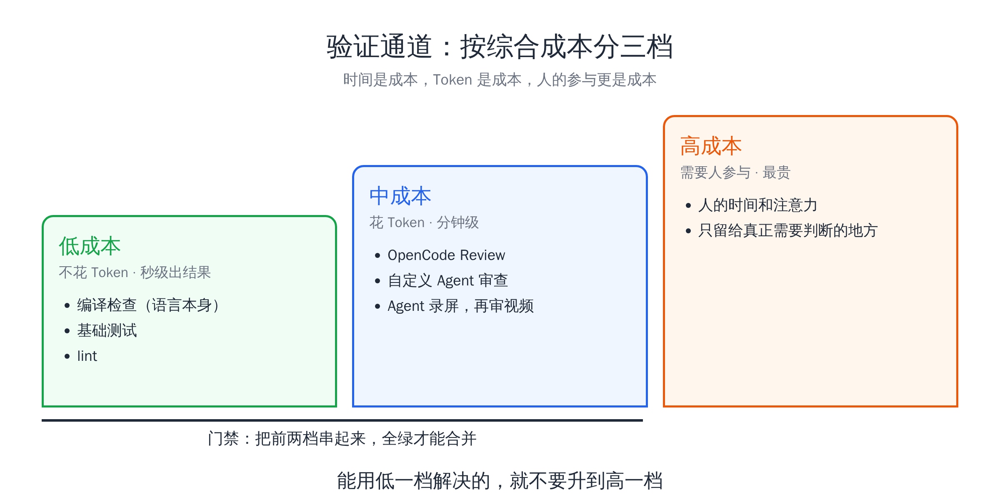

These verification channels send feedback back to the Agent, so it immediately knows whether the code it wrote has problems and where they are. When a bug appears in production, after fixing it you also need to trace back: why did it happen then? How do we avoid it next time? That also forms a Loop.

### Choosing a Language: A Cross-Shaped Coordinate

A clear change for me recently is that I no longer care much what language is underneath. I have Go, Java, and Python projects at the same time. As long as you have some basic programming sense, with AI, in principle any language is fine. At this point in time, writing a feature or a module is no longer hard, but software engineering — managing complexity — is long-lived.

In the past, the most important axis in choosing a language was **the cost of a human writing code**: Python is simple, Rust is complex, so everyone picked what they were good at and found comfortable. That axis matters less now, because it isn't you writing the code.

The way I now choose the underlying language is a cross-shaped coordinate:

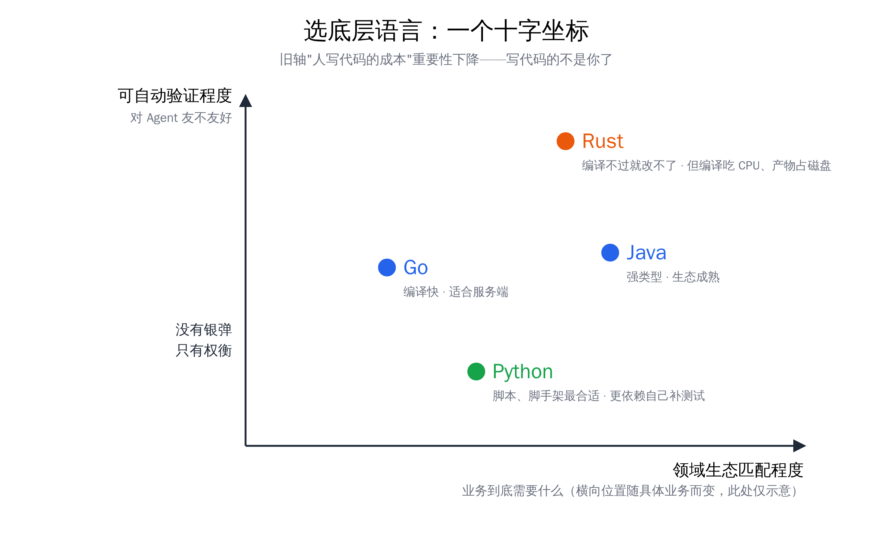

- **Vertical axis: degree of automatic verifiability**, i.e. how friendly the language is to Agents. Rust is the most typical case, where many errors simply won't compile, so the Agent knows immediately when it writes something wrong and can fix it right away; Go and Java come next; Python further back, depending more on tests you add yourself.
- **Horizontal axis: fit with the domain ecosystem**, i.e. what the business actually needs. For simple scripts and scaffolding, Python's ecosystem fits best; for high-performance services, you have to look at Go and Rust.

Look at the two axes together, then weigh them. Higher on the vertical axis isn't always better: Rust compilation eats CPU and build artifacts take disk space, and once concurrency goes up, these become new costs. **Each has its own problems; there's no silver bullet, only trade-offs.** But from the perspective of building a Loop, the low-cost feedback channel that the vertical axis represents is very important for Agents.

### Code Is Cheap, Tests Are High-Value

In the era of Agent Coding, **code is very cheap, and tests are very high-value**.

Having a clear, explicit acceptance standard that can form feedback has become the core goal of modern software engineering. If your goal can be broken down into a series of conditions that can be verified, then for every Coding Agent, everything else is just a matter of time and cost, and you simply iterate.

For things like rewriting a database or migrating a code repository, if there is already a set of tests that can prove the old and new behavior are consistent, and the pitfalls already hit have been internalized as tests, what's left is mainly piling on cost: use the best Tokens, use the best harness. For the part tests don't cover, the difficulty remains.

The most troublesome are goals where **you don't know how to break them down into quantifiable feedback**. Backend performance is relatively simple — latency and throughput are clear numbers, making it easy to form a "change once, measure, change again" loop; but frontend aesthetics are hard to quantify, so it's hard to form a Loop and hard to keep iterating and optimizing.

### Criteria Can Fail Too

Here's an easily overlooked problem: **the thing you use to verify itself also needs verifying.**

My gate system is the repository with my second-largest Token consumption, and I've stepped on quite a few of these pitfalls with it. Two of the most typical:

- **Didn't take the exam, recorded as passing.** When a change proposal was in "draft" state, the model review step was skipped entirely; and the step that aggregates results treated "skipped" as "passed" and still lit the green light. After the proposal was marked ready, it went red three rounds in a row.
- **Assessing an examiner who had never graded a paper.** I designed a set of "synthetic exam papers": periodically testing the review model with code known to have problems, to detect whether it was "alive but dumber". The result: it ran for more than a month, 111 times, and because the login credentials were never configured properly, it never actually graded a single paper.

There were several similar cases: the version was pinned but the behavior wasn't, and one update took down eight repositories at once; tasks were queued while the machines were clearly idle, the longest wait being over 8 hours; a list nobody read silently stopped code review in 32 repositories.

These pitfalls share one thing: **they were all green, and none reported an error.**

So I now have a hard rule: **after writing any criterion, first feed it an input whose known answer is "no", and confirm that it turns red.** A check that can never turn red is as good as not written.

## 7. Bottleneck Shift: From Energy to Hardware, and Back to Energy

After this system was built, I noticed something: **my bottleneck suddenly was no longer energy, but hardware.**

This isn't to say everyone's bottleneck will switch like this; it is just my own phase-specific sense. And it swings back and forth: strengthen the hardware, and the bottleneck goes back to energy. Going further up is a higher-dimensional need — **unlimited high-quality Tokens, paired with sufficient context information and complete infrastructure**; only when all three are in place can the best enterprise-grade application scenarios like Claude Tag and OpenAI Dots arise. That is the battlefield of big companies; for us individuals, first solve this round of bottlenecks in front of us.

### CI Became the New Choke Point

In that OpenAI software factory article, Venkat Venkataramani, who leads infrastructure, said:

> *"We're talking about roughly a 10x increase in load on some systems. At most companies, that kind of growth might happen over two or three years. At OpenAI, we see it in about six months."*
> — [Inside OpenAI's agentic software factory, The Pragmatic Engineer](https://newsletter.pragmaticengineer.com/p/openai-software-factory)

The article also states clearly that version control, CI/CD, and the release process are bottlenecks everywhere. (CI is the pipeline that, each time a merge is prepared, automatically runs tests and reviews on dedicated machines.)

I feel this deeply. I now often schedule 20 leads at the same time, with thirty to fifty executors running beneath them. Once concurrency went up by an order of magnitude, bottlenecks became whack-a-mole: press one down and another pops up:

- The earlier 12-core dev machine often had CPU maxed out for hours at a stretch, and the CI machines were the same at 99%. So I upgraded the dev machine.
- Once memory stopped being the bottleneck, I found **disk** was also a bottleneck.
- If you don't cache to cut traffic, **GitHub download traffic** is also a bottleneck, and one you pay for.
- Without adding machines or layering the CI strategy, **CPU** becomes the bottleneck again. The number of CI slots that can work simultaneously on the gate side went exactly this way, from the original 6 up to the current 84, spread across four machines.

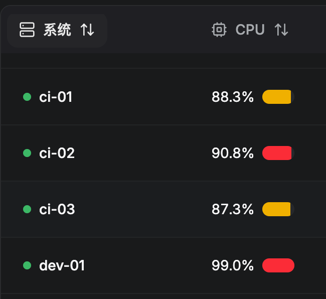

There is no once-and-for-all solution; you can only solve each problem as you meet it. **Cut a road through the mountain, build a bridge over the water.** But these are all low-cost feedback links, and they must be built. If you have a long-term need, upgrade hardware earlier: the price rises in memory and disks are already obvious, and CPU will most likely follow.

### Linux or Mac

From the Loop point of view, there is another topic: which operating system is best suited to Agents.

Tibo, who leads OpenAI Codex, has said that 2026 may be the year of Linux. I think that's right.

What a Loop fears most is being blocked by a human. **From the Computer Use angle (letting AI operate graphical interfaces), Mac is without a doubt the best choice**: it has a large amount of GUI software made for humans, with wide compatibility; the system is also Unix, with fairly complete interfaces, and an Agent can operate it through Computer Use.

**But purely from the angle of the Agent's own use, the best operating system is surely Linux.** Everything can be changed through configuration files, with no second authorization from a human. On Mac, many permissions require a person to click "Allow" on the screen, which the AI can't do, and the loop is broken; on Linux, the same thing is done with one command.

So if you're in a pure Coding scenario and don't depend on a single platform (iOS development, for example, can only be done on Mac), Linux suits Agents better than Mac. This is also my current engineering practice. Of course, capabilities like browser verification and Computer Use need to be filled in separately.

## 8. From Coding to Organizations, and to Learning Itself

### Different Names, the Same Layer of Work

Many new terms have popped up recently: Orca calls it ADE (Agent Development Environment), Cloudflare calls it ADLC (Agent Development Lifecycle), and some call it a harness of harness.

These new terms are really talking about the same thing: **build another layer of working environment outside a single Agent, so that multiple Agents can divide work, verify, and leave records, and collaborate on complex problems.** As for the single-point problems in the lower layer — whether a model can write one feature or one module well — just honestly enjoy the improvement in model capability.

For all I've said in this post, the core is also just this: build a working environment for the Agent. Context is the "material" in this environment, and Loop is the environment's "evolution mechanism".

My current focus is just three directions: **first, scheduling**, letting the lead and executors each do their own job; **second, low-cost, high-quality verification channels**; **third, how to let what has been verified enter the production environment smoothly.**

### Not Only Coding

The reason I say these are the two most important words of the whole Agent era is that they aren't limited to Coding. **Any environment an Agent wants to enter ultimately comes down to these two points: is there sufficient Context, and can a Loop form.**

In [An Old Tree Blooms Anew](../260908-smb-agent-framework/) I discussed three levels of an AI Native organization: whether the organization is **readable** to AI (AI can get the material), **writable** (AI is allowed to change the records in the system), and **closeable-loop** (after a change, it can automatically judge right from wrong and record the errors). Seen in terms of Coding, a code repository is a simple, miniature organization.

### Learning Itself Is Also a Loop

Finally, let's talk about learning new things.

In the past, many very advanced engineering practices couldn't be landed in your own workflow right away, because the front-line practice of big companies depends on very strong infrastructure. But now, with Agents, an individual's engineering capability is almost unlimited.

So the way I judge whether a new thing is worth learning now is: **throw the article to an Agent, and have it combine my local development logs, the mistakes I've made along the way, and historical issues, together with the scenario I alone am responsible for, to judge what is worth absorbing and what can be ignored.** If someone shares a best practice today, a few hours later its core idea may already be in my production line.

The RTK episode of installing then uninstalling, and Advisor being learned from Claude Code and then reworked, both came about this way.

## In Closing

I feel that in this era, **in work where right and wrong can be checked automatically, if you get more and more tired the longer you work on a project, it means there is definitely something wrong with how you schedule Agents.** As for work that still can't be verified automatically, being tired is normal — first fill in "what counts as done right", and then talk about scheduling.

Normally, at least in engineering, you should feel more and more relaxed as you go. Your attention will keep being freed from the project, and you will only need to care about things outside engineering, such as traffic, such as the distribution of power.

If I had to summarize the change of these two months in one sentence, it would be: **from people in the loop, to people out of the loop.**

- **People in the loop**: every step needs a human to look, judge, and decide. The "watching at high frequency to sustain 4 billion Tokens a day" I mentioned at the start was this stage. The human is the slowest link in the whole loop, and how fast the loop turns depends on how long you can stay awake watching each day.
- **People out of the loop**: the human does only two things: define "what counts as done right", and show up when the system truly needs a decision. All the rest — dispatching, executing, verifying, reviewing, settling lessons — turns by itself inside the loop.

Going from inside the loop to outside it doesn't rely on a stronger model, but on the two things this post covers: **Context means the Agent doesn't need a human beside it to explain, and Loop means the Agent doesn't need a human beside it to correct.** Without the former, you have to keep supplying background; without the latter, you have to keep checking results — missing either one, the human can't get out of the loop.

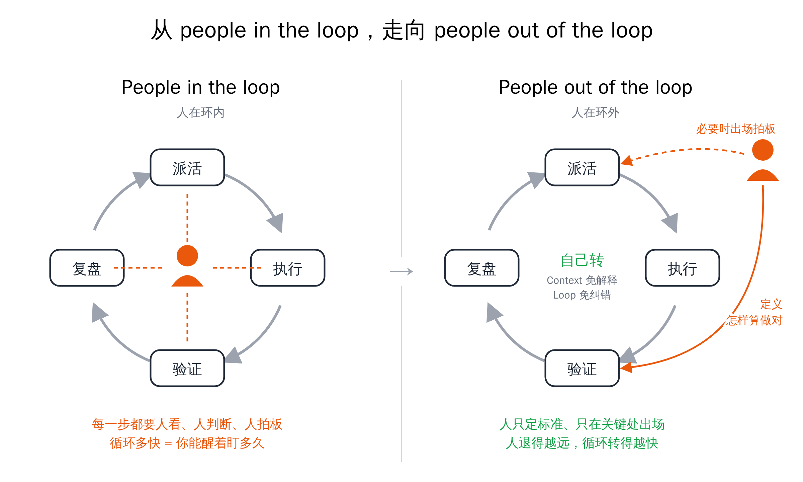

Conversely, the criterion for when a human must stay in the loop is also clear: **wherever right and wrong still can't be verified automatically.** Frontend aesthetics, product direction, trade-offs — it's normal for humans to stay in the loop in these places; what you should do is keep peeling off the parts that can be verified and handing them back to the loop.

What gets you there is these two words:

- **Context**: prepare context on purpose; everything must answer "why is it here", with additions and with subtractions.
- **Loop**: build the closed loop on purpose, so that every mistake is recorded, verified, and written into the next round's context.

The early stage may be bumpy, but as the Loop turns, you basically won't let the same mistake happen a second time, and will only meet new, unexpected problems — that's fine, there are plenty of logs to investigate with, and then you accumulate more. **The further back the human steps, the faster this Loop turns, and the faster your ability to schedule Agents grows.**

A fall into the pit, a gain in your wit. As long as that fall was recorded.

That's all — just one person's view, and not necessarily right. I hope it helps.

---

## Appendix: References

> Human readers can skip this; just throw the links to your Agent.

**Articles and Interviews**

1. **[The new rules of context engineering for Claude 5 generation models](https://claude.dev/blog/the-new-rules-of-context-engineering-for-claude-5-generation-models/)** (Thariq, Claude) — cutting 80% of the system prompt, progressive disclosure, `CLAUDE.md` holding only pitfalls.
2. **[Latent Space interview with Thariq](https://www.latent.space/p/thariq)** — failure modes change with the model; accumulating failure logs over-constrains.
3. **[The AI-native SDLC playbook](https://claude.com/blog/the-ai-native-sdlc-playbook)** (Anthropic) — from linear process to closed loop, write it into rules after two mistakes, the division of labor between Skills and Hooks.
4. **[Inside OpenAI's agentic software factory](https://newsletter.pragmaticengineer.com/p/openai-software-factory)** (The Pragmatic Engineer) — OpenAI's software factory, with the load on some systems growing about 10x in six months.
5. **[The Agent Development Lifecycle has arrived on Cloudflare](https://blog.cloudflare.com/agent-development-lifecycle/)** (Cloudflare) — ADLC, seven requirements for a platform designed for Agents.
6. **[Orca CEO: When AI does twenty things at once, where should a human step in?](https://www.superlinear.academy/c/recording/orca)** (Superlinear Academy) — ADE, the layer above the harness.
7. **Lauren (xAI): here's how i shipped 2,500 PRs last month to production** ([AI summary and proofread version](https://sum.zlxlabs.com/view/view_v8LdbUib-upySmXHKwv8LhiRPZNc1gzl9gqCYXJ8uFY)) — trust layering, verification skills, the codebase is the best memory.

**Earlier Posts in This Series**

- [Context is All You Need](../context-is-all-you-need/) — the workbench metaphor and the basic methods of context management
- [A General on the March Doesn't Chase Rabbits](../260809-multi-agent-scheduling-architecture/) — the multi-Agent scheduling system of lead + execution layer
- [An Old Tree Blooms Anew](../260908-smb-agent-framework/) — readable, writable, closeable-loop

---

> The draft of this post was conceived from voice-to-text transcription with Feishu Luyin Dou; the article structure and content were designed and organized with Claude Code + Opus 5.5, fact-checking was done by Codex, and review was split among Codex, Kimi, and Grok.
