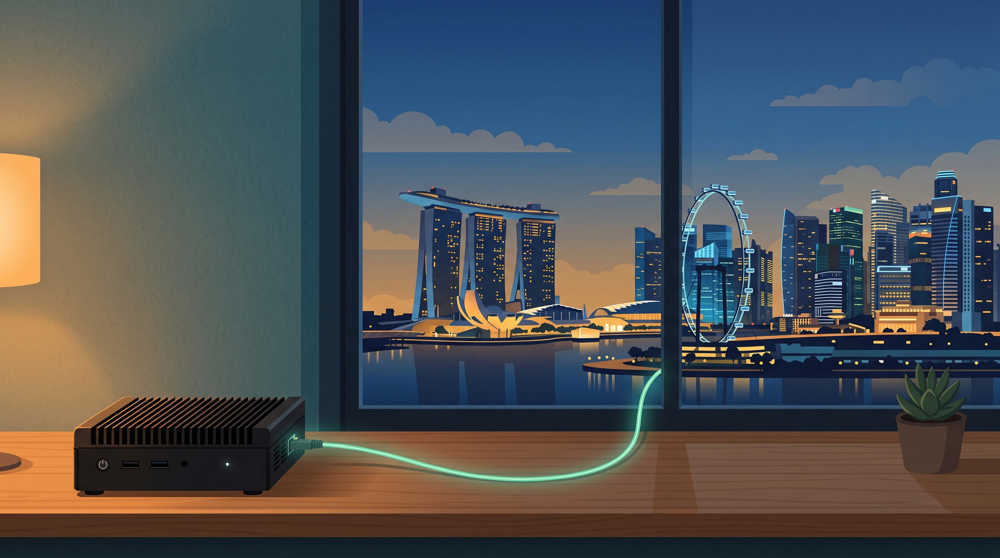
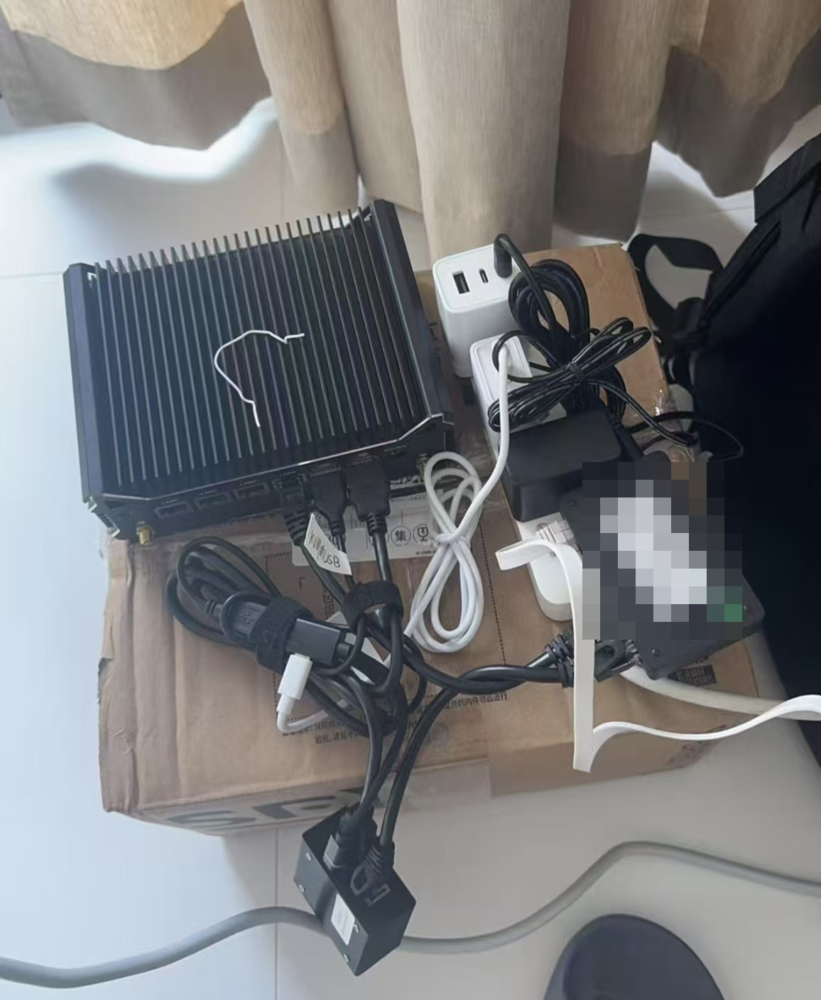
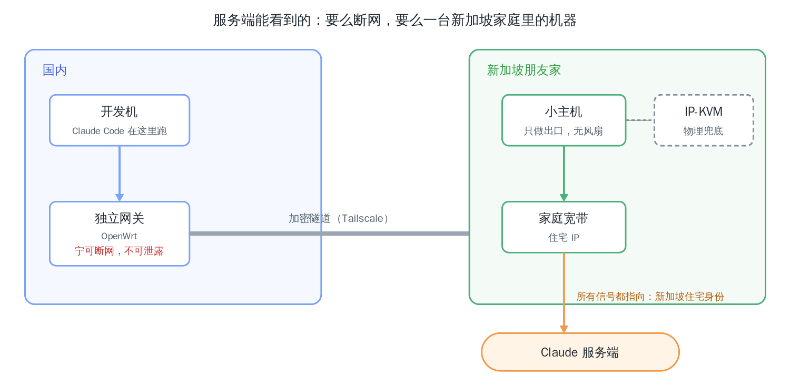
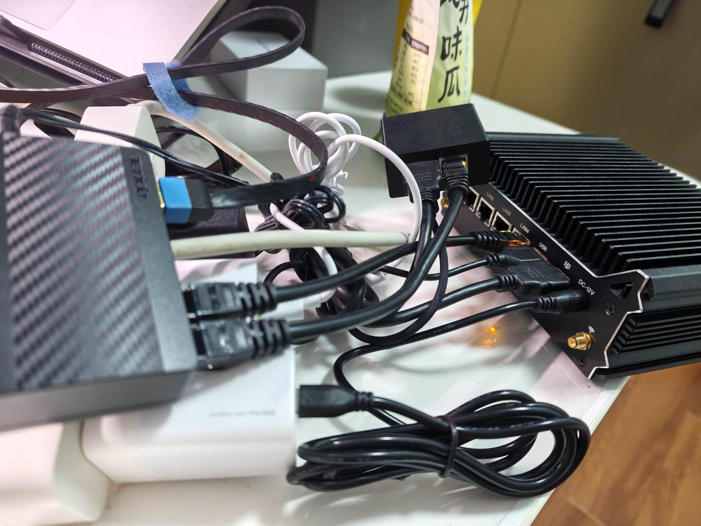
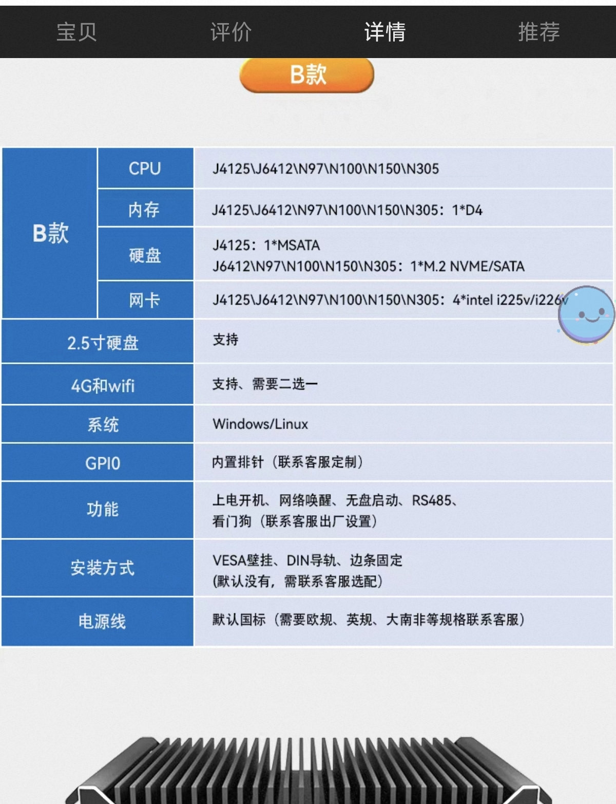
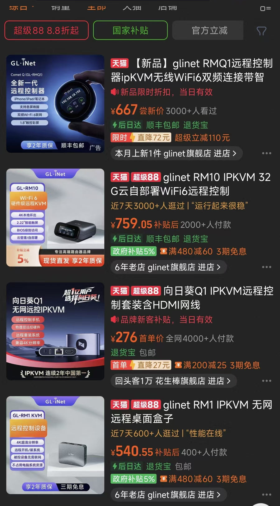

*Translated from the [Chinese original](/posts/261008-claude-code-high-cost-maintenance/).*

> Claude Code has just had another wave of account bans, and the community is full of first-hand accounts from people whose one- or two-year-old accounts got hit. There is plenty written on this topic, but honestly, the underlying logic of some of it is flawed. This post covers it all in one go: what the service provider is trying to stop, what we are simulating, and the framework of the setup I run myself. **I hope this is the last time I talk about this topic.**

---

I've written two related posts before. [*Claude Code: Avoiding Bans, Choosing Models, and Design Philosophy*](/posts/claude-code-risk-model-philosophy/) covered the overall idea of "simulating an overseas Chinese user" and a blind spot that few people mention. [*Don't Disable Telemetry*](/posts/260331-claude-code-telemetry-dont-disable/) explained why "hiding yourself" is the wrong direction entirely.

This one is the finale, so I'll make it **self-contained**: reading only this post, you should still be able to fully understand the service provider's risk-control logic and our response logic. For anything covered in the earlier posts, I'll only give the framework here; see those posts for details.

As usual: **as a human, all you need to understand is the thinking and the logic.** I've put all the technical details of the setup, sanitized, in a technical write-up in the same directory ([GitHub link](https://github.com/zj1123581321/zj1123581321.github.io/blob/main/content/posts/261008-claude-code-high-cost-maintenance/sg-residential-egress-share.md)). If you need it, just hand the link to your Agent.

## 1. First, Understand What the Service Provider Is Guarding Against

Before talking about countermeasures, let's understand the other side. Claude Code's risk control is essentially guarding against three kinds of behavior:

1. **Use from non-compliant regions.** Under its supported-regions policy, Anthropic does not provide service to mainland China, North Korea, and other regions. At its core this is an ideological issue. Their own reports say a lot about it, but the material is sensitive, so I won't go into it here.
2. **Anti-distillation and anti-cyberattack.** These are behaviors the company explicitly prohibits.
3. **Anti-automated abuse.** For example, reverse-engineering the monthly subscription and offering it externally as an API. The Max plan costs $200 a month; reverse-engineered and sold as an API, it can produce call volumes far beyond the subscription price.

People used to joke that American companies are "principled in word, commercial in heart," and that paying some money would always smooth things over. This time is different: Dario himself takes a very clear stance toward China and has publicly argued for tighter chip export controls on China. On restricting Chinese users, Anthropic really does mean what it says. Even when Chinese users go out of their way to hand it money, it bans them all the same, with something of a "better to kill a thousand innocents than let one slip through" attitude.

Our response boils down to one sentence: **simulate being an overseas Chinese person.** You can keep speaking Chinese to Claude, but your "body" is not in mainland China.

## 2. Risk Control Is a Probability Question, Not a Yes-or-No Question

This is the foundation of the whole discussion, and two shared understandings have to be established first.

**First, risk control is a black box.** Apart from Anthropic's internal risk-control team, nobody knows the exact rules and weights. Every risk-control analysis you can see, including this one, is speculation that works backward from observed phenomena.

**Second, risk control is probability, not causation.** It assigns each user a dynamic risk score, judged by cross-referencing multiple signals. Several corollaries follow:

- **Talking about risk control requires a denominator.** Don't trust the statistics of the people around you. "I did X, so I got banned" may well be a valid attribution. But "I didn't do X, so I didn't get banned" is certainly not a valid inference. Ultimately, no matter how well we simulate, we are not real Singaporean Chinese, so in the long run a ban may just be a matter of time. What we can do is push the probability down within a cost we can accept.
- **There is no necessary and sufficient condition.** Even with perfectly complete measures, the probability is never zero. Even genuine local users get caught by mistake, let alone simulated users like us.
- **There is no silver bullet.** Any claim that "just do these few things and you won't get banned" is wrong at the level of its underlying logic.
- **State is dynamic, not static.** The risk score evolves over time. A signal environment that is fine today may be downgraded to high-risk tomorrow. This isn't mysticism; Section 4, on the cost of scaling, shows the concrete mechanism.

Keep these points in mind and the boundaries of everything that follows become clear: we are after **lowering the probability**, not **seeking immunity**.

## 3. The Overall Idea: Blend In Like Water in the Sea

All risk-control countermeasures come down to the same thing: **blend in like water in the sea, and avoid showing any identity trait that differs from the majority.**

Around the identity of an "overseas Chinese person," there are only a few dimensions to handle. For each one I'll only say what the signal is and why it matters; the detailed treatment is in the earlier posts:

- **Phone number**: the country code at registration is a hard signal. Number ranges used by virtual SMS-receiving services are widely blacklisted, and the official side explicitly rejects VoIP-type numbers.
- **Payment**: the card issuer's BIN (the first digits of the card number, which identify the issuing country), the billing address, and the consistency of IP geolocation are all used in risk judgment.
- **KYC and account information**: KYC is the real-name identity verification a platform requires. Every piece of registration information should point to the same country; a mix of countries is more suspicious than not disguising anything.
- **Network**: a residential IP rather than a datacenter IP. A residential IP is an address assigned to home broadband, while a datacenter IP comes from a data center; in the eyes of risk control, real users use the former and bulk-registered accounts mostly use the latter. This item is the focus of this post and gets expanded later.
- **User behavior**: normal interactive use. Don't make calls around the clock without a break, and don't touch reverse-engineering or automated reselling.
- **Don't install the mobile app** ([details in the earlier post](/posts/claude-code-risk-model-philosophy/)): a phone's operating system gives apps access to hardware-level location signals such as GPS, the SIM card's MCC, and cell tower positioning. The official side currently states that it doesn't collect precise location, but the capability and the motive both exist, and a statement is not a promise. Not installing it is the cheapest and most effective protection.
- **Thoroughly clean any device that has been banned**: the client keeps device-level state tracking locally (most likely including hardware identifiers). Switching accounts without cleaning the environment is like registering with a criminal record in tow.

In one sentence: **changing your IP alone is nowhere near enough; your entire environment has to be self-consistent.** If you do it, do the full set. Any single-point solution is meaningless.

## 4. The Cost of Scaling: A Puzzle Piece I Hadn't Detailed Before

The dimensions above are well-worn ground. Today I want to add a point I haven't expanded on before: **the cost of scaling**.

First, a word about ecological niches. Before you ever think of buying an account, relay services (third-party forwarding services: you pay them a little, and they call the official side on your behalf using official accounts they hold in bulk) are your best friend, letting you try top models cheaply. But **the moment you decide to buy an account yourself, you and the relay services stand in the same ecological niche**, and the account behavior of relay services is exactly the kind most likely to trigger the official side's risk control.

The problem is that risk control doesn't punish isolated individuals; it punishes **clusters of signals**. Whoever you share a signal source with, you share risk score with:

- You and a relay service use the same virtual card range (cards in one range often come from the same provider). The range starts out obscure, then the volume grows, and **the accounts in the entire range get banned together**.
- The residential IP service you bought has a good reputation at first. It gets recommended and exploited, until account farmers pour in in bulk, and **your account's risk assessment changes dynamically with how polluted that pool becomes.**

Note this "dynamic" part: risk-control state evolves. A signal pool that was originally good can be downgraded to high-risk because account farmers flood in, and your account's risk score rises with the tide. Not being banned today proves neither that the pool is still clean nor that your setup is right.

This leads to a corollary: **any approach with a low barrier that can be replicated in bulk will, even if it works in the short term, most likely be identified by risk control in the long term.** Account farmers will certainly pour in, and risk control will certainly keep up.

So from the standpoint of maintaining an account over the long term, the approach you want is one that **has a high barrier and cannot be replicated in bulk**. And what we call cost is really just the barrier:

- **The money barrier**: hardware, broadband, and traffic. Replicate it in bulk and the cost gets multiplied by a factor account farmers cannot afford.
- **The trust barrier**: an overseas friend willing to let you keep a device at their home for the long term. This simply cannot be bought.
- **The time barrier**: an account history of monthly payments and clean warm-up raises the capital tied up and the sunk cost of bans for account farmers.

**Cost is the barrier, and in essence it all comes down to "cannot be replicated in bulk."** That is also why I dare to share my setup publicly: its barrier is high enough that most of the people who know how to do it still can't replicate it.

I've condensed this logic into a judgment framework you can take away. When you evaluate any anti-ban approach in future, ask two questions:

1. **How many strangers am I sharing its signal source with?**
2. **If this approach were replicated ten thousand times, what would it cost?**

An approach with ugly answers to both is doomed in the long run. Note that the two questions have to be read together: the harm of replication occurs when the copies share a signal source with you, so the second question actually works through the first.

## 5. My Setup: What This Machine Looks Like in the Server's Eyes

With this framework in hand, let's look at my current setup. Its design goal can be stated in one sentence:

**From every dimension the server can observe, this machine is either offline, or every signal points to a machine used by a Chinese person in a Singapore home. There is no third state.**

### Identity Layer: Singapore All the Way

A Singapore phone number, Singapore payment methods, a Singapore network. Payment goes through a friend's card, one card per account. Singapore has a large Chinese population, so speaking Chinese is not conspicuous at all. Even the account's web operations (upgrading the plan, changing settings) are done in a desktop environment that goes out through the same egress.

The biggest barrier here isn't money; it's that **you need a Singaporean friend you can trust**, and the weight of that trust is heavier than you'd think. With things like carrier records, an IP can be linked to the person registered on the broadband account, so he has to trust that you won't use his home IP to do anything bad. He also has to be willing to tinker with you: receiving the package, plugging it in, and occasionally unplugging and rebooting it for you, even though we put in a great deal of work to minimize his operation and maintenance burden. On qualifications, getting a phone number and home broadband both require valid local identification, and a work visa is the most common kind. But a work visa has an expiry date, so a friend with long-term permanent residency is actually better.

This barrier shuts out a lot of people and makes the setup impossible to replicate. For risk control, that is precisely its greatest advantage.

### Network Layer: A Mini PC That Only Does Egress

The overall architecture in one picture:

The design has three red lines, and each one guards against a class of signal that could be observed:

1. **Geographic consistency**: the connection IP, DNS resolution results, system time zone, and the browser's WebRTC egress all point to Singapore, with consistency verified. Any channel that can't be made consistent is blocked outright; better to lose connectivity.
2. **Can go offline, must not leak**: in the window when any gateway component restarts or crashes, traffic can only fail, never fall back to a mainland egress. I stress-tested this: probing the egress IP every 3 seconds while taking turns restarting the firewall and proxy components, not a single unexpected egress was observed in any sample.
3. **Remotely recoverable**: the machine sits in an overseas friend's home, and the vast majority of faults must be fixable remotely from China, so as not to bother the friend. So I fitted an IP-KVM, a hardware-level remote that emulates a monitor, mouse, and keyboard. When software remote access is completely down, most system-level faults can still be rescued from the BIOS level. Only a power cut or hardware damage really needs the friend on site (the technical document records the pitfalls we hit ourselves).

Operating data: over the first 22 hours of monitoring after launch, every once-a-minute probe was online (1297/1297) and the public IP never changed. It lands as a local home broadband line with local bandwidth of 500+ Mbps. To the server, this is a **stable, single Singapore residential identity**.

Long-term upkeep on the network side is also in place: the egress IP and the geolocation of DNS resolution are continuously monitored. A residential IP can drift by itself, and a change triggers an alert. For business trips or mobile scenarios, portable devices join the same encrypted tunnel network and go out through the same Singapore egress. The details are all in the technical document.

How exactly to build it (hardware selection, system configuration, every layer of leak prevention, the pitfalls we hit, the complete replication checklist) is all in the [technical write-up](https://github.com/zj1123581321/zj1123581321.github.io/blob/main/content/posts/261008-claude-code-high-cost-maintenance/sg-residential-egress-share.md), so I won't expand on it here. If you want to replicate it, the details are all in there.

### Maintenance Layer: Time Is the Most Expensive Barrier

An account isn't done once it's registered. My pace is this: register with a Singapore phone number on Singapore home broadband, start as a free user, use it for a while and upgrade to $20, use it for another while and upgrade to $100, and finally upgrade to $200. **Raise it slowly.** Whether this pace actually helps, nobody can confirm; it's just my personal choice.

This pace is itself a kind of barrier: it raises the capital tied up and the sunk cost of bans for account farmers. The business of farming accounts in bulk can't afford to wait and can't spread out that kind of time. For a normal user, an account that pays monthly, upgrades step by step, and has a clean history is exactly the most ordinary user profile.

I should also be honest about what happens if I do get banned. The appeal channel is usable: my friend's identity is real and proof of residence is available. But so many accounts are being banned now that the time to get unbanned is very uncertain. And objectively, the number of accounts one person can register is limited: the phone number, broadband, and bank card are all tied to my friend's real identity, so I can't start over indefinitely. So the whole bet of this setup still rides on prevention up front. If that day comes, what's lost is several months of account warm-up, plus an appeal that may never get answered.

At this point, of everything the server can see (registration information, payment, IP, DNS, time zone, usage behavior, upgrade trajectory), there is almost no single point from which it could conclude "this is a user I should ban."

### Three Key Trade-offs

**Why not buy an off-the-shelf overseas hosting rental?** Renting out Mac mini hosts has recently become a business on X. Once you understand the framework above, you can see it isn't reliable: you don't know how many people that machine's IP has been sold to at the same time, or whether any of them are doing things the official side prohibits. This is a textbook shared signal source. And identity is all-dimensional: it solves the network for you, but can it solve payment, phone number, and KYC? A single-point solution is worse than none.

**Mac mini or a Linux industrial PC?** First, a fair word: **the Mac mini is still the lowest-barrier option.** It is a complete computer in itself; put it in a friend's home, connect remotely, and it works, with no extra network configuration from us. My only advice on this route is to **max out the configuration in one go**, with enough memory and CPU, or upgrading later will be a hassle.

But keep one thing in mind: cross-border remote access has requirements that depend on the scenario. **Remote desktop streams video, so its bandwidth needs are large and it demands high-quality cross-border lines; SSH is far more forgiving.** So even on the Mac mini route, I'd recommend using SSH remote connections and keeping desktop-streaming tools like UU Remote only for the occasional web operation.

If you're willing to tinker, you can use the setup I describe below. Note one difference: my Linux mini PC is **essentially just a gateway** that only relays traffic, and the code doesn't run on it. The machine writing code is still the dev machine in China; it's just that all of its traffic exits from Singapore. **The two approaches aren't really better or worse than each other; it's more a matter of trade-offs.** The Mac mini is hassle-free but expensive, and running it 24 hours a day is overkill. The Linux industrial PC is cheap, light, and designed for long-term stable operation, but you have to build every network detail yourself. Whichever you choose, I recommend adding an IP-KVM as a physical backstop. With pure software remote access, once a system upgrade hangs or the remote software itself drops offline, you have no way to take over. A few hundred yuan of hardware-level remote pays for itself the first time it saves you.

**Why did I choose a Linux industrial PC?** It only runs network forwarding and the tunnel, so the load is extremely light (measured 644MB of memory and 1.9GB of disk). It is passively cooled with no fan, has a watchdog, disables automatic system updates, and rolls back automatically if an update fails. Every design choice points to "fail less" and "recoverable remotely when it does fail." One thing I should admit honestly: **Linux desktop users are a minority in Singapore too, and I suspect this adds a bit of profile deviation**; a Mac would be more common. But Linux is my daily coding environment, and this deviation is within the cost I can personally accept. Going back to Section 2, we are after lowering the probability, not eliminating every anomaly.

### Why Singapore, Of All Places

Three reasons. **There are many Chinese people there**, so Chinese-language habits are not conspicuous at all. **The time zone is UTC+8, zero time difference from China.** You don't need to pretend to be a nocturnal "American programmer"; the daily-rhythm signal matches naturally, which happens to cover one of the hardest signals to fake in long-term statistics. Finally, **the availability of identity elements**: phone number, home broadband, and payment methods can all be sorted out if you have a friend there.

This setup isn't limited to Singapore, either. In principle, in any country, as long as you can get the phone number, payment, and network all together, the same framework holds.

## 6. Running the Numbers on Cost

- **Hardware**: the host (industrial PC + memory + disk) can be had for under 2,000 (RMB, same below). I spent around 1,500 on a high-spec build, but if it only does network forwarding, 4GB of memory plus a 64GB disk is plenty, and the whole machine runs about 1,000. An IP-KVM costs 400–1,000. In total, two to three thousand, a one-time investment. On the Mac mini route, swap the host budget for a maxed-out Mac mini and the other items stay the same.
- **Traffic**: cross-border lines are billed monthly, at several hundred a month, as lavish or frugal as you like.
- **Trust**: a trustworthy Singaporean friend, who carries the risk of your using his home IP and is willing to tinker alongside you. A barrier that can't be bought.
- **Time**: several months of account warm-up. Anyone who can't wait drops out automatically.

It sounds expensive. But looked at another way, this is actually **low cost over the long run**: build it once, and you don't keep burning resources in the cycle of "get banned → find a new channel → get banned again." Whether it's worth it depends on how you do your own accounting. My own logic is simple: **always keep myself capable of reaching near the world's top models**, and under that goal I find this cost acceptable.

This setup also has clear limits of applicability. Without a trustworthy overseas friend, the setup simply doesn't work. If your usage is low, paying the official API outright, or a layered approach of "top model sets the direction, domestic model does the engineering" (see the [earlier post](/posts/claude-code-risk-model-philosophy/)), is better value. And anyone who is sensitive to the sunk cost of bans and can't stand starting over shouldn't sit at this table either. People stopped by the barrier were supposed to drop out anyway, which is the other side of "cost is the barrier."

## Final Thoughts

Back to the two shared understandings at the foundation: risk control is a black box, and risk control is probability.

I wouldn't dare say the setup above will never get banned, and **no setup dares to say that**. It only pushes the probability as low as I can manage, within a cost I can accept. And whether this is right will ultimately be tested by time.

Let me stress the words "black box" once more: apart from Anthropic's own engineers, nobody knows the true logic of risk control. This post, my previous two posts, and every related piece you can find are, in essence, speculation. So I have no wish to argue with anyone: if you think your idea makes more sense, then you're right.

If you take away only one sentence from this whole post, I hope it's this: **any single-point solution is meaningless; if you do it, do the full set, or better not do it at all.**

If you plan to get hands-on, the technical write-up has the complete replication checklist and a record of the pitfalls.

Just one person's view, for reference only. I hope it helps.

---

## Related Reading

- [Claude Code: Avoiding Bans, Choosing Models, and Design Philosophy](/posts/claude-code-risk-model-philosophy/): the overall idea of simulating an overseas Chinese user, the risk-control blind spot of the mobile app, and cleaning hardware fingerprints
- [Don't Disable Telemetry: After the Claude Code Source Leak, You May Be Doing the Most Dangerous Thing](/posts/260331-claude-code-telemetry-dont-disable/): why "hiding yourself" is actually more dangerous
- [Technical Write-up: A Singapore Residential IP Egress Setup, From Hardware to Software](https://github.com/zj1123581321/zj1123581321.github.io/blob/main/content/posts/261008-claude-code-high-cost-maintenance/sg-residential-egress-share.md): full implementation details, pitfall records, and a replication checklist (sanitized)

---

> This post started as a draft transcribed from Feishu voice recordings (Lu Yin Dou). Kimi Code handled the article structure and content organization, and Codex did the fact-checking.
