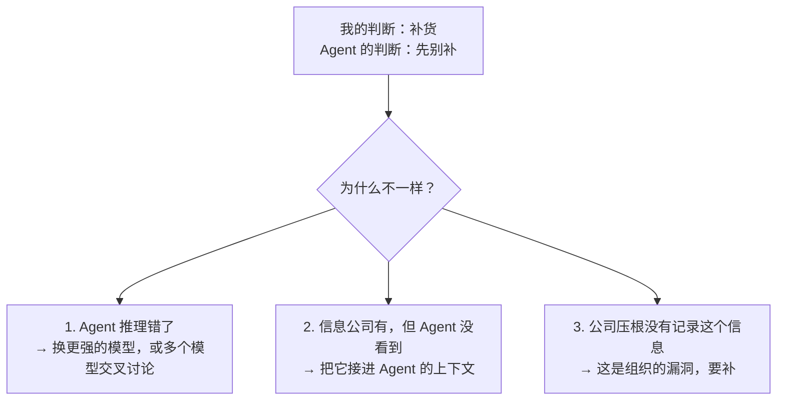
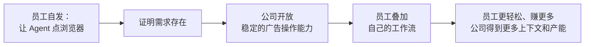
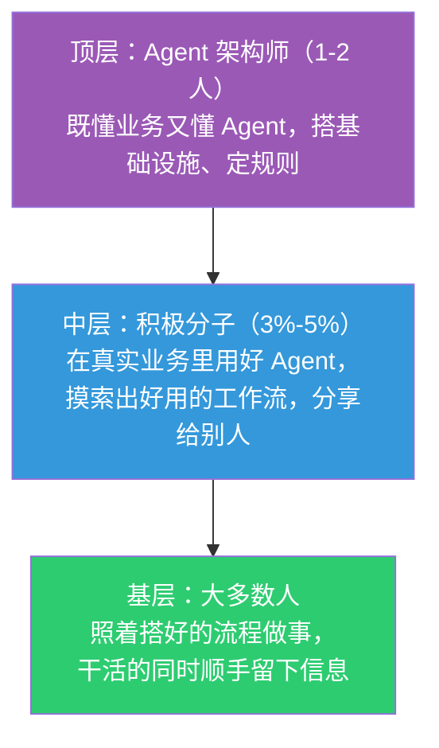
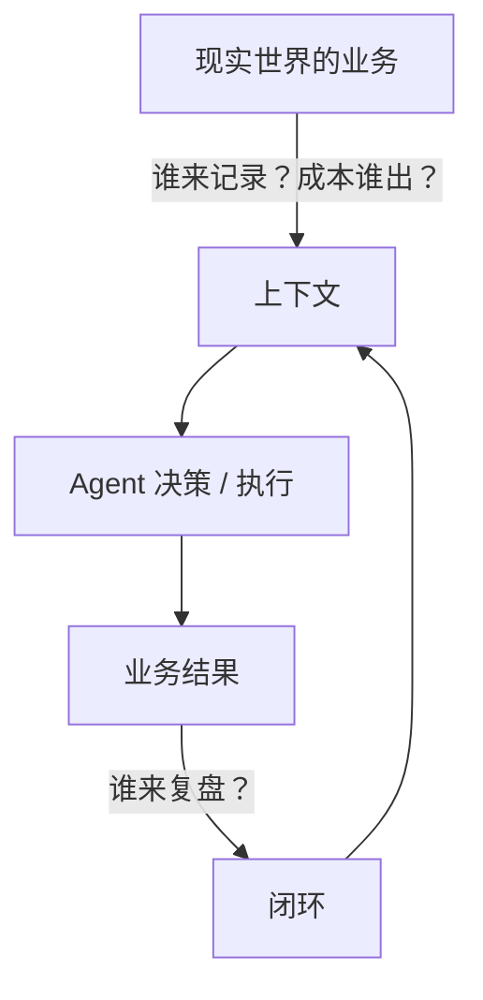

> 这篇写给一类特定的读者：**很懂自己的生意，但没有技术背景的老板**，尤其是中小企业主。延续这个系列的传统——**作为人类，你只需要读懂思路；具体的执行细节，交给你的 Agent。**

## 引子：如果你本来就是老板

最近 FDE（Forward Deployed Engineer，驻场交付工程师）这个词特别火。这套说法在美国的 Palantir 身上最出名——一家给政府和大企业做数据平台的公司。Palantir 用 FDE 来称呼它的一种工作方法：派工程师常驻客户现场，贴着真实业务把系统一点点改出来。它还有一个核心概念叫"本体论"（Ontology），大白话说，就是**把企业现实里的业务——商品、订单、供应商、它们之间的关系、能对它们做的动作、谁有权限做——在数字世界里完整地建一个模型**，然后用数据分析、用 AI 去优化它。

这个词传进国内之后，就变成了一个筐，什么都往里装。随便翻几家公司的招聘就能看出来：同样叫 FDE，[传音](https://transsion.zhiye.com/campus/jobs?shareId=b3b97943-55e6-43e7-8330-154040b813c9&shareSource=2)要的是帮内部业务部门把 Agent 用起来，[中兴新云](https://www.ztccloud.com.cn/careers/campus-forward-deployed-engineer.html)要的更像去客户那里找机会、出方案的咨询顾问，[遇碳科技](https://meet-carbon.com/about/careers/forward-deployed-engineer)要的则是去客户机房里把模型装好、调通的实施工程师。市面上还有更宽的说法：帮客户把一条流程做成全自动、替掉几个人，叫 FDE；给客户定制一套软件，也叫 FDE。

但不管怎么定义，行业里绝大多数的讨论都是**乙方视角**：我怎么进客户现场、怎么取得信任、怎么摸清需求、怎么熟悉一个陌生行业、怎么交付拿结果。

这篇文章换一个视角——**甲方视角**。

如果你本来就是老板，你根本不缺乙方最缺的那些东西：你最懂自己的行业，最懂自己的客户，最懂自己的团队。你真正的问题不是"我怎么做一个 AI 项目"，而是：

**未来三五年，模型每年都在变强，我的公司要怎么持续吃到这个红利？**

我的答案先放在这里：

> **不要追求今天就拥有最先进的 Agent 系统。要努力把公司变成一个"模型越强，自己就越受益"的组织。**

下面展开讲为什么，以及怎么做。

---

## 一、为什么写代码最先被 AI 攻克

先看一个现象。

AI 写代码的能力，去年大概还是个小学生，今年已经能顶替很多顶级工程师了。做 Claude 的 Anthropic 在[官方文章](https://www.anthropic.com/institute/recursive-self-improvement)里写得很清楚：公司领导层公开估计，**内部 90% 以上的代码是 Claude 写的**；按最保守的口径，只统计真正合进生产环境的代码，也有超过 80% 出自 Claude。做 ChatGPT 和 Codex 的 OpenAI 也在[官方文章](https://openai.com/index/how-agents-are-transforming-work/)里给过数字：工程师平均 99% 的产出，是通过 Codex 这个 Agent 完成的（按 Token 计）。

所以我的判断是：至少在软件工程里，"写代码"这件事的成本已经变得非常低，基本可以看作一个被解决了的问题。

为什么偏偏是写代码最先被攻克？不是因为模型天生偏爱代码，而是因为代码世界天然具备两个条件。我在上一篇文章[《吃一堑，长一智》](../261004-context-and-loop/)里，把它们概括为 Agent 时代最重要的两个词：

- **上下文（Context）**：Agent 做事时能看到的所有信息。在代码世界里，代码本身、改动历史、报错日志、说明文档，全都是现成的、数字化的，Agent 随手就能拿到。
- **闭环（Loop）**：做完一件事，能马上知道做得对不对，并且把教训带到下一次。在代码世界里，改完一行代码，跑一下测试，十几秒就知道对错。错了就改，改了再测，一天能转几千圈。

**上下文决定 Agent 这一次做得好不好，闭环决定它下一次能不能做得更好。** 信息现成、对错立判，所以 AI 在代码世界里进化得飞快。

换成生意里的话说：

- **上下文**，就像你招来一个新运营，第一天要交接给他的那些东西：商品资料、历史销量、哪个供应商靠谱、上次为什么砍掉那一款。这些交接不到位，再聪明的新人也只能瞎猜。Agent 也一样。
- **闭环**，说白了就是复盘。只不过要把"当时为什么这么决定"和"后来结果怎么样"记在同一个地方，下次 Agent 做判断前能先看到。

拿补货举个完整的例子：

1. 这次补 500 件，理由是近 30 天日销 20 件、在途为 0。**决策和理由记在表上。**
2. 一个月后，实际卖了多少、有没有断货、压了多少库存，**结果也回填到表上。**
3. 让 Agent 把当时的理由和实际结果对一遍，找出偏差的原因，比如没算到大促。
4. 把"大促前补货要多备一些"写成一条规则，**下次 Agent 补货前先读这条。**

要注意，你平时用的聊天 AI，不会因为你上个月补错了货就自己变聪明。教训不会自动存进模型里，只能靠你把它记下来，放在 Agent 下次一定会读到的地方。这就是闭环。

现在把视角切到一家真实的企业，比如一家跨境电商。

生意可以看成一条光谱：一头是纯数字世界，比如软件开发；另一头是纯物理世界，比如制造业，教育、医疗也偏这一侧。电商横跨两头——流量、广告在数字世界，供应链、仓储、物流在物理世界。

而在物理世界这一侧，上下文和闭环都不是现成的：

- **信息散落各处**：供应商报价在老板微信里，新品测试数据在运营的 Excel 里，用户反馈在客服后台，验厂结果在采购的脑子里，老板自己的判断根本没有记录。
- **对错反馈很慢**：一个补货决策，可能一个月之后才知道对不对；一个供应商选错了，可能半年后才暴雷；一个新品要走完采购、运输、销售、售后，才能下结论。

所以从写代码走到真实企业，最大的变化不是模型变了，而是：

> **上下文和闭环，从"天然就有"，变成了"需要组织主动去生产"。**

这就引出了两个每个老板都可以拿来自检的问题：

1. **公司里正在发生的事，Agent 看得见吗？**
2. **Agent 做了一个判断，它能知道结果好不好吗？**

这两件事做得越好，你的公司就离"代码世界"越近，模型每升级一次，你就自动吃到一次红利。反过来，如果这两件事没做好，给公司买最贵的模型，意义也很有限。

这篇文章剩下的部分，都在回答一个问题：**一家真实的公司，怎么才能持续地生产出上下文和闭环？**

---

## 二、先有品味，再定打法

### 品味来自你看过多少好东西

这个时代很重要的一样东西是品味，而品味来自于你平时到底看过多少好的东西。组织转型也一样。

在我看来，地球上代表最先进工作方式的两家公司，就是 OpenAI 和 Anthropic。它们本身做模型、用的是最强的模型、几乎不用为 Token 精打细算，而且自己也在用 AI 改造自己的行业。我体感下来，它们的工作方式比我们领先半年到一年：它们现在面对的问题，很可能就是我们一年后要面对的问题。

但看的时候要有选择。还记得上一节那条光谱吗？OpenAI 和 Anthropic 站在光谱最靠数字世界的那一头：它们的业务几乎全在数字世界里，上下文现成、闭环便宜，所以能跑得最快。它们告诉你的是**方向**——Agent 的能力边界在哪，未来的工作方式会是什么样子。但它们的具体打法，不能直接搬进跨境电商、制造业或教育这种一脚踩在物理世界里的行业。

所以越往光谱的物理世界那一头走，你越需要看和自己位置相近的样本：

- **模型公司**：只看方向，不抄打法。
- **已经围绕 AI 重组的公司**：看组织怎么变、活怎么分、钱怎么分。比如 XMind，推荐听一下他们联合创始人的分享：[分活，分圈，分钱，搞 AI](https://www.xiaoyuzhoufm.com/episode/6a8c42b42e27ea5b21fabac7)（[AI 总结与校对稿](https://sum.zlxlabs.com/view/view__jJHBegbh00Puv8ZsVDPdYOQxfxJVEk8HRIpT8eIcPc)），讲的是从部门制转向"圈子制"的一手经验。
- **自己行业里、和你在光谱上位置相近的先行者**：他们踩过的坑，才是你真正会踩的坑。

看这些不是为了抄作业，而是为了心里有一个"好组织长什么样"的画面。取法乎上，得乎其中；取法乎中，得乎其下。

### 新公司和老公司，是两道不同的题

心里有了画面，接下来要面对现实。

**最理想的做法，是把 Agent 当成组织里的正式成员——和人一样有岗位、有权限、有分工，围绕它重新设计整个组织。** 你会看到单条业务线越来越小，单个人的能力越来越强，每个人手里的上下文越来越完整。组织架构、分钱的逻辑、激励的逻辑、信息流转的逻辑，全都要重构。这是一流解。

但一流解基本只适合从零开始的新组织。一家已经跑了很多年的老公司，有旧的流程、旧的系统、旧的人员、旧的利益格局，每一层都是阻力。而且说实话，我能找到的、适合传统中小企业照着走的公开案例还很少——很难说谁会第一个吃到螃蟹，谁又会步子迈得太大、翻了车。

所以我目前在推的，是一个**二流解**：**在原有的组织架构下做小步调整，先提效，再从业务发展中找能调整的地方。**

这里有一个关键：**最好找增量业务，而不是在存量业务里内卷。**

历朝历代的改革，只要动了根本利益，就会撞上旧组织的阻力。我常想起北魏孝文帝迁都洛阳推行改革：与其在旧都城里和旧贵族硬碰，不如换一块新地盘，在新的格局里重新分配。放到企业里也是一个道理：在存量业务里用 AI 省人，省下来的每一个环节，都意味着某个人失去了地盘；用 AI 去做新业务、把盘子做大，再拿增量去分配，阻力会小得多。

二流解具体怎么走，我放到文章最后。中间几节先讲清楚，这条路上会遇到什么。

---

## 三、把现实搬进 Agent 看得见的世界

### 信息要记多细

先从一个最朴素的问题开始：**现实世界里发生的事，怎么进入 Agent 的世界？要记到多细？**

我的判断标准只有一条：**看这条信息在业务闭环里是不是真的起作用。** 不起作用的，记了也是白记；真正起作用的，就要往下探到足够细，不能太粗。

举个例子。假设你卖的一款帐篷，最近差评里开始集中出现"漏水"。

- 如果你的记录只有"仓库里还有 1000 件"，那 Agent 能做的只是告诉你"最近差评变多了"。闭环到这里就断了。
- 如果你记到了"这 1000 件分属哪几个批次、每批用的哪家供应商的面料、出厂质检结果如何"，Agent 就能把差评和批次对上，告诉你"问题集中在某个批次、某家供应商"。接下来是换供应商、加质检，还是下架那一批，你都有了依据。这个决策做完，后面的差评率又会告诉你改得对不对——闭环转起来了。

同样是"库存"这条信息，记粗了只能用来看，记细了才能用来改。**建模要细到什么程度，取决于它在你的业务决策和复盘里要承担什么角色。** 不是数据越多越好，而是关键决策需要的信息，够不够细、能不能对上结果。

Palantir 那套本体论听起来很宏大，但落到中小企业，可以从一个非常简单的方案做起：**先把跨环节、需要人和 Agent 一起维护的关键业务信息，统统上表。**

### 一张表串起一个商品的一生

想象一下，公司里所有人都工作在同一套表格里。一个商品从冒出想法到最终淘汰，整个生命周期都在这张表上：

这时候，老板就可以让自己的 Agent 读着这张表，和它聊整个业务的推进：这个月有哪些新品在测？供应链那边成本怎么样？物流会不会因为什么国际局势延期？首批卖得怎么样，第二批要不要补，补多少？

而且这个商品相关的信息，不只来自公司内部。拿我们自己的实践举例，一个商品的综合信息至少有这么几个来源：

- **内部**：交易数据、用户评价、售后退换货、客服沟通记录、供应链的进度和质检、商品基础资料
- **外部**：社交媒体上的讨论、广告素材下面用户的评论和互动

这些信息分散在五六个不同的系统里。我们做的事情，就是把它们定期汇总到一张表上，以商品为中心聚合起来。这样不管是人还是 Agent，想了解一个商品，只需要看一个地方。

用到后来，业务的起点干脆搬到了表上：一个商品先在表里建档、测款，跑通了才进公司正式的商品库。大量测款商品根本走不到上架那一步，但它们的信息同样完整地留在了表里。

### 飞书多维表格：人和 Agent 共用的那张表

那这张表用什么来做？对中小企业，我的答案很明确：**飞书多维表格。**

我的判断是：**飞书多维表格是目前国内最好的、同时面向人和 Agent 的协作型数据库。** 这一点非常关键。

纯粹给机器用的话，正规数据库最舒服；纯粹给人用的话，微信群、Excel 最顺手。但企业真正需要的，是**同一份业务信息，人能方便地改，Agent 能稳定地读**：

- **对人**：改个字段、加一列，随手就能做；手机上就能拍照上传；表单、看板、自动化流程都是现成的。
- **对 Agent**：飞书给机器留好了现成的接入通道，Agent 可以直接读写表里的数据，不用人在中间转手。
- **对公司**：企业内部那些琐碎但躲不开的事——谁能看、谁能改、哪些字段对谁隐藏、外部合作方能看到哪一部分、人员入职离职时权限怎么收放——飞书都已经做好了，配置一下就能用。这些事情自己从零搭，每一件都不难，但加在一起能把一个小团队拖死。

为什么这一点这么重要？因为**业务永远是动态变化的**。

还是那款帐篷。我们给用户做满意度回访，Agent 需要知道这个商品的卖点、参数、使用场景，还有这一轮回访想重点问什么。在没发现漏水问题之前，回访根本不会关注防水；一旦开始有人反馈漏水，"漏水"就必须马上加进回访的重点问题里。而我们这边的回访策略，基本上是一天一变。

如果这些信息写死在一套自己开发的系统里，每改一个字段都要提需求、排期、开发、测试、上线——等系统改完，业务早就已经下结论了。而在飞书里，改一下就生效。

推进过程中，我被业务负责人问得最多的一个问题是：**这些东西为什么不放在公司自己的系统里？把核心业务依赖在一个外部产品上，是不是有风险？** 这很可能也是你心里的疑问。

这个担心完全合理。我的账是这么算的：

1. **分清楚什么数据放哪里。** 我们广告的历史数据有几百万行，这种该进数据库就进数据库，飞书的表本来就不是装海量明细的地方。需要人和 Agent 一起维护、一起协作的那部分信息——比如一个商品当前的状态、卖点、这轮调研的重点——才应该放在飞书上。
2. **算一下自己开发的账。** 飞书是一家大厂投入了巨大资源打磨出来的协作产品。以我的经验，除非你的技术团队非常顶尖，否则自己开发的系统在灵活性和易用性上很难比得过。系统不好用，大家就不愿意用；大家不用，信息就不及时、不准确，Agent 拿到的上下文就是垃圾。
3. **看降低摩擦的能力。** 比如供应链想加一个"拍照上传验货结果"的功能：在飞书里，加一个附件字段，设成只允许手机现场拍摄，发布成一个小应用，同事打开就能用。我当场演示给他看，几分钟就弄好了。在自己的系统里，这是一个需要开发、调试、上线的需求。这中间多耗的每一周，都是白白让给竞争对手的时间。

说白了，飞书多维表格相当于一个**"可视化的、轻量快捷的编程方案"**，最大的优势是把人的使用门槛降得很低。

所以对中小企业，我的建议是：**不追求完美的软件工程，追求跟得上业务的变化。** 如果历史包袱不重，可以单独买飞书多维表格来用。钉钉、企微也在补类似的能力，但我自己实测下来，飞书是断档式的领先：整体的开放程度、对 Agent 的适配、功能更新的速度，都要好得多。

不过要说清楚：工具好用，只解决了"记起来不那么烦"。真正难的是"凭什么要我记"——后面第五节会撞上这堵墙。

至于公司里那些老系统，不管有没有现成的对接方式，都得想办法把数据接到这张表上，方式可以粗糙，先接进来再说。还有一个成本很低的起步动作：**把重要会议的录音转成文字存下来。** 哪怕现在用不上，将来都是很值钱的家底。

---

## 四、老板先下场：把 Agent 当你的联席 CEO

信息上了表，接下来最关键的一步，必须由老板亲自来做。

### 为什么必须是一把手

Agent 落地是一把手工程，这句话大家都听过，通常的理由是"要调资源"。但我觉得还有两个更深的原因。

**第一，只有一把手天然站在公司整体利益上。** 部门负责人会优化部门，员工会优化个人，供应链优化供应链，销售优化销售。而对公司整体长期价值负责的，在中小企业里通常就是老板一个人。

**第二，一把手必须亲手用过，才知道 Agent 的能力边界。** 你自己通过 Agent 搭过一个小工具、优化过一套工作流，你就能真切地感受到它到底能做什么、不能做什么。知道了边界，你就不会被别人忽悠。

### 和 Agent 的判断不一样时，追问一句"为什么"

具体怎么用？我推荐一个非常简单的方法：**把 Agent 当成你的联席 CEO。**

别小看这个习惯。能把生意做起来的老板，身上几乎都有一个共同的本事：拆解、复盘、迭代——看别人的案例，想清楚哪些该做哪些不该做，拿到真实市场里验证，再优化。而这恰好也是 Agent 最擅长的。只要公司信息喂得够全、有闭环能验证，它给出的商业建议，可能比一般的咨询顾问好太多，而且随叫随到。

遇到真实的业务决策，比如"这个新品要不要补货"，先让 Agent 基于它能看到的公司信息给出判断，再和你自己的判断对比。如果不一样，追问为什么。原因只有三种：

前两种是技术活，交给公司里负责搭这套东西的人就行（第七节会讲这个角色），通常不难。第三种情况最有价值。它会不断暴露出：**公司里还有哪些关键信息，只活在某个人的脑子里、某个微信群里、某次口头沟通里。**

这是一个心态上的转变：

- 以前老板会问：**"这个员工怎么不知道这件事？"**
- 现在老板要问：**"我的 Agent 怎么不知道这件事？"**

每发现一次 Agent 不知道的事，你就找到了一个组织的漏洞。老板每用一次 Agent，其实都是在用它给组织找漏洞。

另外有一点值得注意：在我自己的实践里，**大部分时候已经不是 AI 能力不够，而是上下文不足。** 即便当下模型的判断还达不到你的水平，我认为随着模型进步，它的决策能力迟早会追上甚至超过你，至少一定能给你启发。你要做的，就是先把上下文准备好。

### 三个直接的收益

当老板开始基于这张表、和 Agent 一起推进业务，会有三个直接的收益。

**一是决策可以复盘。** 每一个决策都能关联到后来具体的业务结果。虽然关联可能是片面的，但有总比没有强，事后可以回头看当时为什么这么判断、判断对不对。

**二是很多问题能被提前拦住。** 随着规模变大，很多事情人力覆盖不过来。比如卖的商品从 10 个涨到 100 个，总会有某个商品本该这个月 1 号上架、到了 20 号还卡在某个环节没人跟；某个该空运抢时间的货没人推；某个商品的客诉率已经到了警戒线却没人管。这些潜在损失，只要表上记的和仓库里、渠道里实际发生的是一回事，就可以让 Agent 定时巡检，提前发现。

**三是会有意想不到的发现。** 上下文攒到一定程度，可以把几十个数据源一起交给最强的模型，让它分析"这个月销量为什么掉了"。它找出的关联因素，可能完全在你的业务认知之外，甚至能提前提示某个供应链上的风险。这种意外，只有把信息喂够了才会出现。

### 上行下效

还有一个容易被忽略的效果：**当一把手天天对着这张表做决策，其他人自然就必须在这张表上协作。**

你基于这张表看业务，会不由自主地追问："为什么这个信息不在表上？"那就是下一个要打通的点。这股从上往下的拉力，比下任何行政命令都管用。业务往前推的同时，组织的上下文建设也就被推到了一个新的水平。

这股劲还会一层层往下传。当团队负责人知道你已经和 Agent 把表上的信息聊过一遍，他来汇报时就必须带来表上没有的东西，不然他的价值在哪里？你不用催，他自己就会去把 AI 用明白，甚至开会前先让 AI 帮自己做一轮正反方推演，把问题想透再来找你。

---

## 五、转折：信息不是免费的

到这里，一切听起来都很顺。但真正推起来，你会撞上一堵墙。

### 外部两小时，内部两个月

我自己推这件事时有一个很深的体会：**从外部拿数据反而容易，从内部拿数据最难。**

外部平台的数据，有接口就调接口，没接口就让 Agent 模拟人去网页上看，几个小时就能接进来。

但我们做满意度回访这条线时，前后推了两个多月，大部分时间不是花在技术上，而是花在内部协调上：找谁开权限、走什么申请、有没有内部文档、出了问题谁负责。而且说实话，对方不背你的业绩指标，配合的积极性天然就不高。

**技术的墙，经常比部门的墙更容易翻过去。**

说个我们公司的实际情况：公司层面这一整套 Agent 体系——数据怎么汇总、表怎么设计、工具怎么开放、模型怎么配——基本都是我一个人在做。这本身就说明了一件事：**以今天的 AI 能力，技术上已经没有什么真正的难点了。** 一个人借助 Agent，就能把整个公司的技术底座搭起来。真正耗时间、真正难的，全都是权限和利益分配。

### 谁出力，谁受益

更难的是另一类情况：信息需要从物理世界里，由人亲手录进来。

我们供应链那边就是这样。以前同事去拜访供应商，回来在群里说一声、口头对一下就完了。现在为了让整个供应链可追溯，要求拜访全程录音，关键节点必须拍照，所有材料上传到多维表格建档。

站在公司的角度，这件事非常有价值：商品状态同步了，风险能提前发现，损失能提前规避。

但站在供应链同事的角度呢？有位业务负责人问过我一个问题：**这件事对供应链同事自己有什么价值？** 说实话，我答不上来。一线同事的感受，大概就是这样的：

> **你要什么，我不知道；你要的这些东西对我有什么用，我也不知道；但你非要我表演给你看。**

在他们眼里，这是平添的负担，甚至是形式主义：有填表、汇报这个工夫，另一个产品都搞完了。

这就是问题的本质：**付出的是员工，受益的是公司，两边错位了。** 每要求一线员工多拍一张照片、多录一段音、多填一个状态，都相当于给业务流程加了一道"税"。税太重，大家就会不填、乱填、拖着填、应付着填，最后表上的信息反而既不完整也不真实。

所以每次想让一线多记一条信息之前，先问自己两个问题：**这条信息真能改变某个决策吗？一线为此多花的那几分钟，值不值？** 不值，就别记。值，就先想办法把那几分钟压到接近于零。

供应链这件事，我目前也没有找到特别好的解法，只能靠定制度、先在重点产品上强推。但至少我想清楚了一个方向：**如果一定要额外安排工作，就必须把从物理世界录入到数字世界的麻烦降到最低。** 录音能不能自动转文字、自动归档，不用人去剪辑上传？拍照能不能一键完成？摩擦成本降下来，这件事才可能长期推下去。

这也是为什么我那么看重飞书这类工具——它降低摩擦的能力，本身就是最大的价值。

---

## 六、所以，核心是利益

### 人很难背叛自己的利益做事

以当前的 AI 能力来讲，我的粗略判断是：Agent 进企业这件事，八成是组织问题，两成是技术问题。如果公司本身技术底子还不错，甚至可以说九成九是组织问题。

核心就在于：**人很难背叛自己的利益做事。** 公司一旦大了、久了，你就很难说清楚谁的利益和公司是一致的。中小企业相对好一点，老板为企业负责，内部也没有太多权力上的冲突。但即便如此，利益问题依然绕不过去。

### 一个正例：投放团队

先说一个跑通了的例子。

我们做广告投放的同事（优化师），日常工作里有大量机械性的操作。比如每个人都有自己的止损规则：一条广告花了多少钱、曝光到多少人，点击率还不达标，就关掉。这种判断很简单，但每天要重复无数次。

最开始，是几个同事自己摸索，让 Agent 操控浏览器去替他们点广告后台。这个办法很粗糙，又慢又不稳定，但它证明了一件事：**员工真的需要这个。**

于是公司层面做了一件事：把操作广告的能力正式开放出来，做成稳定的工具。同事们在这个基础上叠加自己的工作流，操作更省心，拿到的收益更多。

这是一个双赢：**员工的利益和公司的利益，在这件事上是一致的。** 所以它会自己长起来，不用人推。现在有同事主动来找我要各种权限，这种主动性比强推好太多了。

### 一个悖论

但这里藏着一个悖论：**谁 AI 用得越好，谁就越不需要公司。**

道理很简单。一个人借助 AI 把自己的杠杆放得越大，他在这个时代就越值钱。以前他需要公司的平台、团队和资源才能把一件事做成；现在他自己就能完成整个闭环，大不了再找几个人合作。那他为什么不自己干，拿走最大的那份收益？

所以你最该留住的，恰恰是最有能力离开的人。那些真正手里有货、脑子里有货、能搭出工作流的人，是这个时代最核心的竞争力。普通执行层的同事流动一下影响不大，但对这些核心的人，**要舍得分钱**，要让他们觉得留在公司里干，比出去单干更划算。

还有一个更危险的信号，要绝对避免：**谁贡献了自己的工作流，谁就被裁员。**

假设一个员工花了半年，把自己的工作流全部梳理清楚、自动化、教会 Agent，把经验都沉淀进去。然后公司说：很好，现在不需要你了。那下一批员工会学到什么？**不要贡献，把经验藏好。** 这种氛围一旦在公司内部形成，转型基本就废了。

虽然"人效比"是衡量 AI 价值最容易算的指标，但如果你想养成主动用 AI 的氛围，就必须考虑员工到底怎么想：AI 给他产生的价值，你有没有分给他？你有没有让他相信，那个美好的未来里有他的位置？

所以一切的出发点是：**尽量做双赢的事。** 既帮公司建了上下文，员工也能从中获益——多拿钱也好，干活更轻松也好，都可以。

### 怎么衡量：10 万能不能变成 15 万

利益要分，前提是价值能算清楚。这也是老板和业务负责人最常问的问题，典型的问法是：**假设一个优化师以前一个月的广告消耗是 10 万，用了这套 AI 工具之后，能不能做到 15 万？** 在投放必须满足回报率要求的前提下，消耗做上去了，就说明他能管的盘子变大了。如果还是 10 万，只是他自己干得更轻松了——那对公司来说，"让他开心"当然也有价值，但这个价值远远低于从 10 万变成 15 万。

我的看法分两层。

**第一层：如果分钱方式和目标都不变，你能给他的最大利益，就是让他干活更轻松。** 他省下来的时间，会拿去做对他自己有利的事。站在他的角度，这完全理性：多管一倍的盘子，钱不涨，凭什么要多干？甚至干着干着，把自己的岗位都干没了。所以在旧的分配方式下，"更轻松"就是 AI 能给他的全部，你看到 10 万没变成 15 万，一点都不奇怪。

**第二层：想让 10 万变成 15 万，本质上是一个分配问题，不是一个单纯用考核指标能卡住的问题。** 管理学里有一条常被提起的古德哈特定律，大意是：一个指标一旦被定成考核目标，它就会失真——总有人能想办法把这个数字做出来，结果却偏离了你真正想要的东西。你规定消耗必须到 15 万，他就能把消耗做到 15 万，但回报率、素材质量、账户健康度未必跟着走。

所以这不是一个靠定 KPI 能解决的问题，而是一个组织问题：**不能用旧时代的考核方法，去管新时代的场景。** 公司层面真正想要的，是"业务规模扩大 10 倍，人只需要增加 2 倍"；要实现它，得先想清楚多出来的那部分收益怎么分，而不是先想清楚怎么考核人。

### 生产力变革，就是利益的重新分配

AI 这股浪潮是一场重大的生产力变革。变革就意味着利益的重新洗牌，有人上场，也有人退场。

这时候最该花心思的，是怎样把围绕这场变革的朋友搞得多多的，把敌人搞得少少的。真正构建出一个"未来里有彼此"的环境，才可能长期享受 Agent 的杠杆，而不是做一次外包项目、优化完就结束了。

---

## 七、别指望人人都是 AI 高手

### 人员金字塔

利益想清楚了，下一个问题是：组织里的人该怎么分工？

我的观点是：**不要追求 100% 的 AI 使用率。** 除非你的行业利润率高到能吸引大量顶尖人才，否则任何组织里，愿意长期学习、主动探索的人都只是少数。大部分人只是照着流程干好自己的活。这很正常。

所以我建议先按三层来排（这套分法我在[《老树开新花》](../260908-smb-agent-framework/)里第一次提出，这里结合最近的实践再讲一遍）：

- **顶层：Agent 架构师（1-2 人）**。一个既懂 Agent 又很懂业务的人，负责搭整个团队的基础设施：统一的数据源、权限管理、工具共享平台、反馈迭代的机制。在我们公司，这个角色就是我自己，一个人就够了。
- **中层：积极分子（3%-5%）**。少数愿意拥抱变化的人。他们在真实业务里用 Agent 解决问题、做出成绩，然后把好用的工作流沉淀下来，分享给其他人。大部分人是"因为看见所以相信"——身边有人真的用好了、做出了成果，其他人自然会跟上。
- **基层：大多数人**。不需要懂 Agent，只需要按照中层沉淀下来的流程操作。原来要手动做半天的事，现在变成点几个按钮、做一个审批。他们最重要的职责，反而是**在正常干活的同时，低摩擦地留下下一轮 Agent 需要的信息**。

而且早期一定是不均衡的。我们投放团队里，用得最好的那位同事，上十条新广告，有八条是 Agent 自动建的；其他人十条里可能只有一条，甚至一条都没有。这不是失败，这就是常态——先把一两个人跑通，比追求全员整齐划一重要得多。

至于最后一小撮非常抗拒 AI 的人，本质上就是算账。有些人不用 AI 也是一把好手，那就挑其中最厉害的，能合作就合作，不强求。

如果你在自己的组织里连一个这样的积极分子都找不到，那说明团队里愿意折腾新东西的人实在太少——这时候先别急着上 AI，得先补人。

### 搭戏台，等东西自己长出来

顶层的架构师该怎么工作？我的体会是：**搭戏台，而不是写剧本。**

一线员工大多不懂什么是 Agent，但他们有很强的业务背景。他们会用最朴素的办法解决自己的问题，比如让 Agent 操控浏览器去点某个后台。这些办法往往很粗糙，但存在巨大的优化空间——只是你直接去问，他们自己也看不出来。

架构师要做的就是两件事：

1. **先把基础设施搭好**，让大家有地方折腾。
2. **观察哪些"野生"的做法长出来了。** 当发现某个同事自己做的工具传播很广、大家用得很频繁时，就该出手**收编、正规化**：原来靠操控浏览器、又慢又不稳的环节，能不能换成直接对接系统？公司能不能提供技术支持？

这里有一个很重要的顺序：**先有人走出路来，公司再修路。** 不要一开始就预测"优化师未来肯定需要一个广告 Agent 平台"，然后闷头开发半年。而是等有人已经在拿 Agent 点浏览器了——这就是需求信号——再问：为什么不把这条路铺平？

我们团队里很多工作流，都是不懂代码的同事搭出来的，有些甚至是文科生。这有什么关系呢？他们当中用得最多的人，按我们内部的统计，每天要消耗两三亿 Token。而且没有任何强制，都是自己主动研究出来的，甚至是他们主动来找我请教、申请权限。其他人看到这些人省了时间、拿了更多的钱，也会主动去学。这是一个良性循环。

### 模型也要分层

人分层，用的模型也跟着分层。这件事直接决定了成本。

把模型的能力拆开看，其实是两块：**执行**和**决策**。

- **执行这块**，各家最便宜、最快的那一档模型已经完全够用：成本低、速度快，日常办公的大部分活都能干。我们一线执行层用的全是 DeepSeek 的 Flash 版本，也就是它最便宜的那一档。按我们内部的统计，30 个人的小团队，一个月的模型成本也就五六千块钱，非常划算。
- **决策这块**，便宜模型就不行了。方向不对，努力白费。所以核心的人、关键的事，要舍得用最顶级的模型，甚至把同样的信息交给几家不同的顶级模型，让它们交叉讨论。一般来讲，**给组织的老大配最好的模型**。

对一线员工，我们配的是一种折中的模式：日常杂活全让便宜模型干，遇到真正需要判断的问题，再把整理好的信息交给顶级模型请教一下，只借用它最贵的那几分钟判断力。

最后提醒一句：**不要用 Token 消耗量来衡量 AI 落地的效果。** 给每人发一个 AI 账号、比谁用得多，这个指标毫无意义。要看的是业务结果。

---

## 八、二流解：老板的行动清单

回到第二节说的二流解。把前面的内容串起来，一个传统中小企业目前可行的路径大概是这样：

1. **老板先用起来。** 把 Agent 当联席 CEO，在真实决策里用它，建立自己对 Agent 能力边界的判断。
2. **用 Agent 找出信息缺口。** 它和你判断不一致时，追问是哪一种原因，把"公司压根没记录"的那些漏洞列出来。不要一上来就搞全公司范围的"数据大工程"，把所有系统、所有表格一次性重整一遍。
3. **优先补双方都受益的缺口。** 先补那些员工自己也能得到好处的，比如投放这类。
4. **把录入的麻烦降到最低。** 必须由人从物理世界录入的信息，想尽办法让它更轻松、更自动。
5. **收编员工自己长出来的做法。** 发现传播开的土办法，正规化，变成公司能力。

如果下周一就想动手，可以先做这三件事：

1. 挑 10 个在售的商品，把它们的关键信息——成本、库存、在途、近期销量、差评——建成一张飞书多维表格。
2. 找一个能读这张表的 AI。飞书自带的 AI 功能就能起步；想用更强的模型，让团队里最爱折腾的那个人帮你接上。
3. 问它："这 10 个里，哪个该补货、哪个该停？"然后和你自己的判断对一遍，看看哪里不一样、为什么不一样。

同样重要的，是**一开始不要做什么**：

- 不要一上来就追求"全自动替人"。先让 Agent 盯着表巡检、提醒、给建议；哪件事它反复判断都对、人也愿意认，再把动作交给它。
- 不要一开始就搭什么"企业知识库"。
- 不要一开始就自己开发平台。
- 不要一开始就搞全员培训、要求人人学写提示词。
- 不要追求 AI 使用率，也不要比谁的 Token 用量多。
- 不要把最贵的模型浪费在机械执行上。
- 不要纠结选腾讯、阿里还是字节的 Agent 产品。这些都不是最重要的，**最重要的永远是你组织的上下文**。上下文打磨好了，下面换哪家工具，或者坐等它们升级，都是很自然的事。

---

## 写在最后

如果把整篇文章画成一张图，大概是这样：

中间这台机器——Agent 怎么利用上下文做决策、怎么在闭环里越变越聪明——我在[《吃一堑，长一智》](../261004-context-and-loop/)里讲过，而且模型每年都在替你升级它。**真正的难点在两头**：现实里发生的事，谁来记录、成本谁出？业务结果出来了，谁来复盘？这两头，最终都卡在组织和利益上。

举个我们正在搭的例子：广告素材拍出来、投出去，后台会告诉你观众在第几秒划走、哪几秒最留得住人；把最抓人的画面拆开总结，下一轮就照着这个方向拍。哪怕第一轮拍得不好，只要这个圈在转，就会越来越好；真正危险的是圈缺了一角。在代码世界里，这个圈是自动转的；在你的公司里，得有人有意识地把"结果"接回"下一轮动作"。

所以可以用一句话来概括：

> **模型决定 Agent 能力的上限；上下文和闭环，决定它在你公司里实际能发挥多少；而组织机制，决定上下文和闭环能不能建得起来。**

理想状态下，**好的 Agent 化不应该要求员工额外为 AI 干活**，而是让员工因为这套系统自己也更省事，所以愿意在里面工作——而他们干活的副产品，恰好就成了 Agent 需要的上下文。过去的数字化，常常是"请员工多填一张表，方便老板看"；Agent 时代的数字化，应该是众人拾柴：每个人都在为自己干活，火却越烧越旺。

变是一定要变的。总会有新的创业者尝试完全用 AI 从零改造一个行业，如果他真的能越过监管、关系这些护城河，我认为从零开始的他会比背着历史包袱的你更有优势。市场这只大手，最终会做出公平的裁决。

但也**不用太焦虑。**

大家又不是在和 OpenAI、Anthropic 竞争，而是在自己的行业里和同行竞争。尤其是那些强监管、线上线下交织、靠客户关系吃饭的行业，我的感觉是整个行业的数字化水平都不高，你只需要比别人领先那么一点点，就已经是很大的优势。

以上，一家之言，不一定对。希望对各位有所帮助。

---

## 附录：给 Agent 的参考资料

> 这些链接不用自己读，直接转给你的 Agent，让它读完，当作你们讨论公司方案的底稿。

### 相关文章

- [老树开新花：中小团队的 Agent 落地框架](../260908-smb-agent-framework/)：组织架构师视角，含基础设施选型（一台服务器撑起整个团队的 Agent 基建）
- [吃一堑，长一智：Agent 时代的两个关键词 Context 与 Loop](../261004-context-and-loop/)：上下文与闭环的完整论述，以 Coding 为例

### 推荐播客

- [分活，分圈，分钱，搞 AI](https://www.xiaoyuzhoufm.com/episode/6a8c42b42e27ea5b21fabac7)：XMind 联合创始人谈 AI 时代的组织变革
